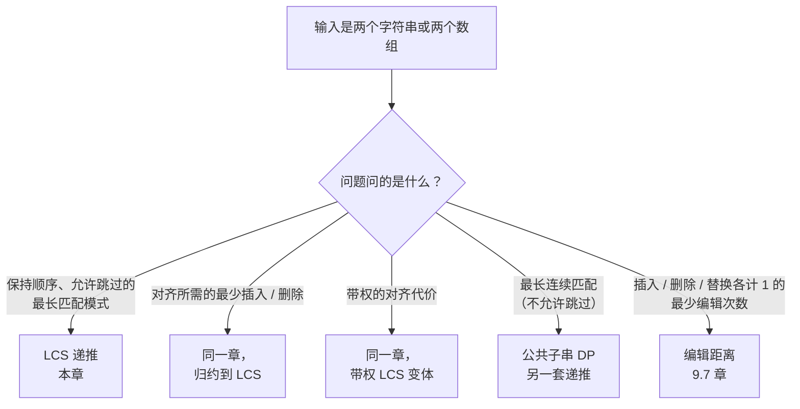
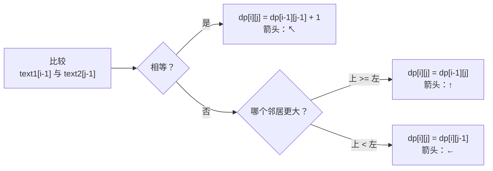
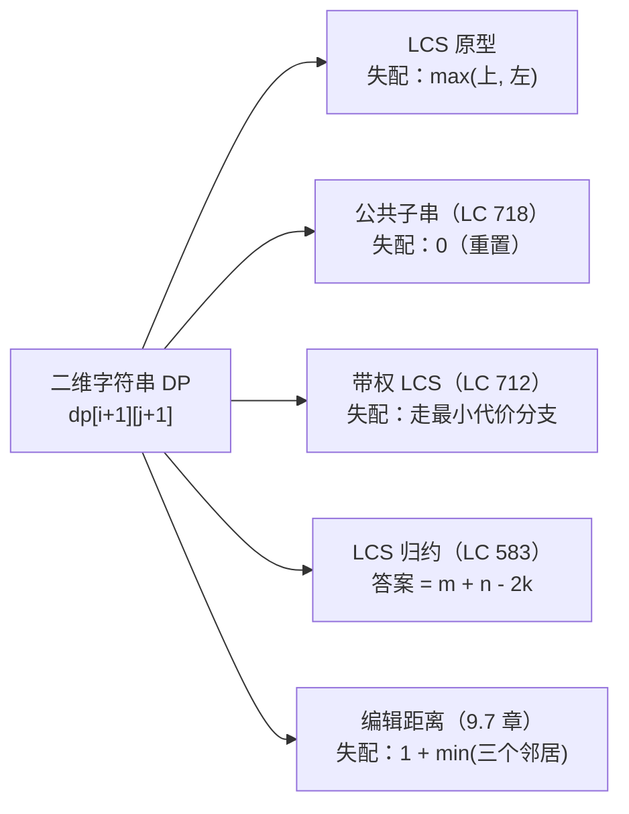

# 最长公共子序列

页面上放着两个字符串。你可以从每个串里随便划掉任意位置的任意多个字符，但剩下的字符不能重新排序。那么，能同时在*两个*串里留下来的最长字符串有多长？对 `"ABCBDAB"` 和 `"BDCAB"`，答案是 4，留下来的串是 `"BCAB"` —— 或者 `"BDAB"`，取决于你走哪条合法的回溯路径。这十二个字符里藏着五条长度为 4 的公共子序列。动手找一遍，递推式就变得一目了然。要是想靠枚举找，你可以一直找到中午：长度 7 的串有 128 条子序列，第二个串有 32 条，你还得两两配对检查是否相同。

本章要建的算法，用 35 次格子写入加 7 步回溯就能给出答案。`git diff` 对齐文件的两个版本，跑的是同一个算法；`wdiff` 对齐一句话的两个版本，跑的也是它；每一道“让这两个字符串相等的最少编辑次数”的面试题，暗地里都归约到它。递推式一旦想通，Part 9 里一半看着最唬人的字符串题，都变成同一张二维表上的小改动。

这一章确实属于 intermediate 难度，但难的不是递推式。递推式三行代码就写完了。难的是当 LeetCode 换一层皮把它包起来时，你还能认出这个模式：整数数组之间的不相交连线、按 ASCII 计权的删除、藏在单个字符串里的回文子序列。本章一半篇幅在讲原型，另一半通过五道题教模式识别，而这五道题最后都归约到同样的十一行。

## 如何识别这个模式

三个信号会把你引到本章，还有一个信号会把你引到别处。



*图注：输入是一对字符串且顺序要保持时，问题的判定条件决定了该用哪套二维字符串 DP。五个分支里 LCS 占了三个，另外两个属于“连续匹配”的近亲和编辑距离。*

最容易咬人的对比就是那条“连续匹配”分支。公共子序列和公共子串共用同一种二维表形状、同一个 `dp[i-1][j-1] + 1` 匹配步骤、同样的 `(m+1) × (n+1)` 分配。它们只差一个分支 —— 失配时的处理 —— 而在 `"ABCBDAB"` 对 `"BDCAB"` 上，两者给出的答案不同（4 对 2）。[常见陷阱](#常见陷阱)会回头讲这个；现在只要记住，在算法空间的这个角落里，“子序列（subsequence）”和“子串（substring）”不能互换。

## 错误答案长什么样

拿 `text1 = "abcde"` 和 `text2 = "ace"`。递归定义自己就写出来了：两个字符串的 LCS，要么是去掉其中一个（或两个都去掉）最后一个字符之后的 LCS 再加上那个字符（如果它相等），要么就是去掉之后的 LCS。写成函数：

```python
# 暴力：O(2^(m+n)) —— 也就是我们要替换掉的写法
def lcs_brute(text1, text2):
    def go(i, j):
        if i == 0 or j == 0:
            return 0
        if text1[i - 1] == text2[j - 1]:
            return go(i - 1, j - 1) + 1
        return max(go(i - 1, j), go(i, j - 1))
    return go(len(text1), len(text2))
```

每个输入上都对。拿一个 30 字符的串去对另一个 30 字符的串，你就得等着了；对上 LC 1143 给出的界 `text1.length, text2.length ≤ 1000`，你就得等一辈子。每次失配分两支，深度能到 `m + n`，而同一个 `(i, j)` 对会被不同递归路径反复走到。

要修的就是这份冗余。按顺序打印 `text1 = "abcde"` 和 `text2 = "ace"` 上的调用，`go(2, 1)` 会单独出现四次：一次经由 `go(3, 1)`，一次经由 `go(2, 2)`，还有两次经由先走 `go(3, 2)` 的路径。每次访问都重算同一个答案。把这个放大到 `m × n` 个可能的 `(i, j)` 格子，你就得到同样 `O(m × n)` 个子问题被重算了 `O(2^{m+n})` 次。

给递归加上记忆化（[递归到记忆化](./00-dp-recursion-to-memo.md) 里的任意一种模式），运行时间就塌到 `O(m × n)`。自底向上的写法拿显式表换掉递归栈，也为本章后面的空间优化打了底。表是这样的。

## 模式

分配 `dp[m+1][n+1]`，第 0 行和第 0 列初始化为 0，按行优先顺序填。每个格子问一个问题，按答案走两个分支之一。

```python
def longest_common_subsequence(text1: str, text2: str) -> int:
    m, n = len(text1), len(text2)
    dp = [[0] * (n + 1) for _ in range(m + 1)]
    for i in range(1, m + 1):
        for j in range(1, n + 1):
            if text1[i - 1] == text2[j - 1]:
                dp[i][j] = dp[i - 1][j - 1] + 1
            else:
                dp[i][j] = max(dp[i - 1][j], dp[i][j - 1])
    return dp[m][n]
```

**Solution** —— Python（[Java](./06-lcs/lc-1143/sol.java) · [C++](./06-lcs/lc-1143/sol.cpp) · [Go](./06-lcs/lc-1143/sol.go)）

```python
# LC 1143. Longest Common Subsequence
#           (("abcde","ace")=3, ("abc","abc")=3, ("abc","def")=0,
#            ("ABCBDAB","BDCAB")=4, ("","abc")=0, ("a","a")=1).
def longest_common_subsequence(text1: str, text2: str) -> int:
    """LC 1143: length of the longest common subsequence.

    Bottom-up tabulation per CLRS 14.4. dp[i][j] holds the LCS length of
    text1[:i] vs text2[:j]. Row 0 and column 0 are zero (empty prefix).
    O(m*n) time, O(m*n) space.
    """
    m, n = len(text1), len(text2)
    dp = [[0] * (n + 1) for _ in range(m + 1)]
    for i in range(1, m + 1):
        for j in range(1, n + 1):
            if text1[i - 1] == text2[j - 1]:
                dp[i][j] = dp[i - 1][j - 1] + 1
            else:
                dp[i][j] = max(dp[i - 1][j], dp[i][j - 1])
    return dp[m][n]


def lcs_with_reconstruction(text1: str, text2: str) -> tuple[int, str]:
    """Recover an actual LCS string by backtracking from (m, n) per CLRS PRINT-LCS.

    Requires the full 2D table (the rolling-row optimization loses the
    parent pointers the backtrack needs). Backtrack runs in O(m + n).
    """
    m, n = len(text1), len(text2)
    dp = [[0] * (n + 1) for _ in range(m + 1)]
    for i in range(1, m + 1):
        for j in range(1, n + 1):
            if text1[i - 1] == text2[j - 1]:
                dp[i][j] = dp[i - 1][j - 1] + 1
            else:
                dp[i][j] = max(dp[i - 1][j], dp[i][j - 1])
    out = []
    i, j = m, n
    while i > 0 and j > 0:
        if text1[i - 1] == text2[j - 1]:
            out.append(text1[i - 1])
            i, j = i - 1, j - 1
        elif dp[i - 1][j] >= dp[i][j - 1]:
            i -= 1
        else:
            j -= 1
    out.reverse()
    return dp[m][n], "".join(out)


def longest_common_subsequence_rolling(text1: str, text2: str) -> int:
    """Length-only variant in O(min(m, n)) space.

    Iterate the shorter string along the inner dimension so the rolling
    row is as small as possible. The diagonal predecessor (dp[i-1][j-1])
    must be saved into a scalar before being overwritten by the next
    write to the previous row.
    """
    if len(text1) < len(text2):
        text1, text2 = text2, text1  # 让较短的串走内层
    n = len(text2)
    prev = [0] * (n + 1)
    curr = [0] * (n + 1)
    for i in range(1, len(text1) + 1):
        for j in range(1, n + 1):
            if text1[i - 1] == text2[j - 1]:
                curr[j] = prev[j - 1] + 1
            else:
                curr[j] = max(prev[j], curr[j - 1])
        prev, curr = curr, prev  # 交换；旧的 prev 复用作下一行的暂存
        for k in range(n + 1):
            curr[k] = 0  # 把接下来要填的那一行清零
    return prev[n]
```

代码里有三处各值得说一句。

网格是 `(m+1) × (n+1)`，不是 `m × n`。第 0 行和第 0 列是空前缀的基准情形；任何字符串与空串的 LCS 都是 0。这个 `+1` 的平移，正是让递推能直接写 `dp[i-1][j-1]` 而不用特判 `i == 0` 或 `j == 0` 的原因。去掉平移，每次填充迭代都要加守卫；留着它，循环体就两行。

字符串用 `text1[i-1]` 读，表却写在 `dp[i][j]`。表是 1 索引，字符串是 0 索引。每份实现选一种约定并守住它。[常见陷阱](#常见陷阱)会展示两种约定串味之后会发生什么。

失配那一步是 `max(up, left)`，不是 `0`。公共子序列 DP 与公共子串 DP 的全部差别就在这一处。`max(up, left)` 说的是*这两个前缀的 LCS，至少和砍掉一个字符后的某个前缀的 LCS 一样好*：保持顺序，允许跳过。而 `0` 说的是*连续性断了，计数归零*。页面上写的是哪一个，决定了这个算法解的是哪道题。



*图注：三个分支，三个箭头。每个格子记下的箭头就是父指针；算法的第二趟倒着读它，把真正的子序列还原出来。*

交互组件把这条递推在标准输入上完整地动了一遍。

## 实例推演：LC 1143 跑教科书输入

`text1 = "ABCBDAB"`，`text2 = "BDCAB"`。网格 8 行 6 列。角落那个格子 `dp[7][5]` 最后会落在 4。看看它是怎么走到那儿的。

第一轮填充（i = 1，拿 `'A'` 逐个比 `text2` 的字符）只命中一次：`'A' == 'A'` 给出 `dp[1][4] = 1`，走对角箭头 `↖`。该行其余格子要么是 0，要么从邻居继承到 1。

第 2 行开始出真信号。`text1[1] = 'B'` 在 `dp[2][1] = 1` 处匹配 `text2[0] = 'B'`，接着又在 `dp[2][5] = 2` 处匹配 `text2[4] = 'B'`。第二次匹配消费了对角前驱 `dp[1][4] = 1` 并加一：算法已经找到了子序列 `"AB"`，长度 2，藏在两个前缀 `"AB"` 和 `"BDCAB"` 之间。

第 3 行（`text1[2] = 'C'`）只匹配一次 `text2[2] = 'C'`，在 `dp[3][3] = 2`。那里的对角前驱是 `dp[2][2] = 1`，记录着前缀 `"AB"` 对 `"BD"` 的 LCS 长度为 1（即 `"B"`）；加上新的 `'C'` 匹配，就得到 `"BC"` 对 `"BDC"`，长度 2。算法就是记账，一次一对前缀。

到第 4 行（`text1[3] = 'B'`，输入里的第二个 `'B'`），表已经在找长度 3 的子序列了。`dp[4][5] = 3` 记录着 `"ABCBDAB"` 的前缀 `"ABCB"` 与 `"BDCAB"` 有一条长度 3 的 LCS：具体是 `"BCB"` 或 `"BAB"`，看走哪条路。那个格子的匹配步骤消费 `dp[3][4] = 2`（`"ABC"` 对 `"BDCA"`）再加一。沿任意一行看，这个进程是单调的：更长前缀的 LCS 只会持平或变大。

第 5 行（`text1[4] = 'D'`）匹配 `text2[1] = 'D'` 一次，在 `dp[5][2] = 2`。这一行的失配格子从上／左邻居中较大者继承；`dp[5][5] = 3` 来自 `dp[4][5] = 3`（平局时上邻居取胜，因为实现偏向“上”）。第 6 行（`text1[5] = 'A'`）在 `dp[6][4] = 3` 处匹配 `text2[3] = 'A'`，从 `dp[5][3]` 的长度 2 前缀上建出 `"BCA"`。

角落那个格子 `dp[7][5]` 是要盯的。填充走到它时，35 个内部格子已经全部填满。`text1[6] = 'B'` 匹配 `text2[4] = 'B'`，于是递推走对角：`dp[7][5] = dp[6][4] + 1 = 3 + 1 = 4`。答案就在这个格子里。LCS 长度为 4，把它还原出来是另一趟。

整趟填充是 35 次格子写入，每次只碰三个已算好的邻居。没有格子被重复访问。填充过程中没有回溯。一趟，从左到右、从上到下，答案在角落落地。

> **Interactive widget:** [DP 表格填充](../../../dsa/widgets/w-31-dp-table-fill.yml)（panel `panel-c`）—— 在网站上渲染；YAML 规格描述了关键帧。

*静态回退：一个 8×6 的网格从左到右、从上到下填充。对角线上出现十次匹配 —— `(1,4)`、`(2,1)`、`(2,5)`、`(3,3)`、`(4,1)`、`(4,5)`、`(5,2)`、`(6,4)`、`(7,1)`、`(7,5)` —— 每处写下 `↖` 箭头。失配格子从上／左邻居中较大者继承。角落格子 `dp[7][5] = 4`。回溯那趟从角落走到 `(0, 0)`，沿途收集四个字符 `"BCAB"`。*

### 还原出真正的子序列

填充返回 4，而面试官要的是 `"BCAB"`。还原是另一趟，把同一张表倒着读。

从 `(m, n) = (7, 5)` 出发，走到 `(0, 0)`。每个格子上，看正在比较的两个字符。相等，就是对角格子，这个字符属于 LCS，下一步走 `(i-1, j-1)`。不相等，就看两个邻居 `dp[i-1][j]` 和 `dp[i][j-1]`，值等于 `dp[i][j]` 的那个就是父节点。平局要一致地处理，选哪边都行。

```python
def lcs_with_reconstruction(text1, text2):
    m, n = len(text1), len(text2)
    dp = [[0] * (n + 1) for _ in range(m + 1)]
    for i in range(1, m + 1):
        for j in range(1, n + 1):
            if text1[i - 1] == text2[j - 1]:
                dp[i][j] = dp[i - 1][j - 1] + 1
            else:
                dp[i][j] = max(dp[i - 1][j], dp[i][j - 1])
    out = []
    i, j = m, n
    while i > 0 and j > 0:
        if text1[i - 1] == text2[j - 1]:
            out.append(text1[i - 1])
            i, j = i - 1, j - 1
        elif dp[i - 1][j] >= dp[i][j - 1]:
            i -= 1
        else:
            j -= 1
    out.reverse()
    return dp[m][n], "".join(out)
```

在标准输入上，路径是 `(7,5) ↖ → (6,4) ↖ → (5,3) ↑ → (4,3) ↖ → (3,2) ↑ → (2,2) ↖ → (1,1) ↑ → (0,1)`。四个 `↖` 步，收集四个字符 —— `B`、`A`、`C`、`B` —— 最后反转成 `"BCAB"`。CLRS 图 14.8 展示的就是这张 8×6 表，还原出的串也一样。[^1]

严格 `>` 的平局规则（`dp[i - 1][j] > dp[i][j - 1]`）会还原出 `"BDAB"`。两者都是长度 4 的合法 LCS。这种不唯一性是真实存在的，值得说一次：面试官说“给我一条 LCS”，哪条都行；说“给我*所有* LCS”，那是另一道题（输出一般是指数级的）。

> [!IMPORTANT]
> 填充和回溯必须用同一套平局规则。如果填充在平局时记 `up`，回溯在平局时走 `left`，还原出的串就可能跟表的打分路径对不上。要么挑一个比较器在两趟里都用，要么在填充时额外存一张 `b[i][j]` 父箭头表，回溯时读它。CLRS 用的是后者；本章用前者，因为这样和组件渲染的样子一致。[^1]

## 实际开销

| 变体 | 时间 | 空间 | 你能得到什么 |
|---|---|---|---|
| 自底向上填表（标准写法） | O(m·n) | O(m·n) | 只有长度，整表可用于还原 |
| 从 `(m, n)` 回溯 | 额外 O(m + n) | O(LCS 长度) | 填充之后的真实 LCS 字符串 |
| 滚动行（只要长度） | O(m·n) | O(min(m, n)) | 只有长度；无法还原 |
| Hirschberg 算法 | O(m·n) | O(m + n) | 线性空间下的 LCS 字符串；按中点分治 |

填充的界是个计数论证，不是什么深奥定理。网格有 `(m+1)(n+1)` 个格子，每个格子做 `O(1)` 工作（三次读、一次写、一次比较），总计 `O(m · n)`。CLRS 用一段话就论证完了。[^1]

计数论证没说明的是：*为什么每个格子只需要读三个邻居*，而不用重新探索终结于该前缀对的指数多条子序列。这就是最优子结构，CLRS 定理 14.1。证明是交换论证：如果 `(z_1, ..., z_k)` 是 `(X[1..m], Y[1..n])` 的一条 LCS 且 `x_m == y_n`，那么 `z_k` 必须等于 `x_m`，且 `(z_1, ..., z_{k-1})` 必须是严格更小的前缀对 `(X[1..m-1], Y[1..n-1])` 的一条 LCS。若不是，我们就能给那对更小的前缀换上一条更长的 LCS，再追加 `x_m`，得到比原来更长的一条 LCS，与最优性矛盾。[^1] 递推直接继承了这个结构：每个格子只需要三个更小前缀对的答案，因为此处前缀对上的最优 LCS 必然是这三者之一的延伸。

回溯最多走 `m + n` 步，因为每一步要么减 `i`，要么减 `j`，要么两个都减。它不可能重访格子，所以任一索引到零时就结束。

最坏情况下这个渐进界是紧的。有 `Θ(m · n)` 个不同子问题，它们之间的依赖就是递推的三邻居触达范围，任何尊重这个依赖的算法都必须至少碰每个格子一次。特殊情形下有更快的算法。Hunt-Szymanski 是 `O((n + r) log n)`，其中 `r` 是匹配对的数量，适合 LCS 相对于 `m · n` 很短的场景，但超出本章范围，在面试规模的输入上也很少更快。[^2]

### 用行复用做到 O(min(m, n)) 空间

整张表是 `O(m · n)` 个格子。这些存储大部分是死重：第 `i` 行只读第 `i-1` 行和当前行左边的邻居。两条长度为 `min(m, n) + 1` 的滚动行就够了，空间从 `O(m · n)` 降到 `O(min(m, n))`。

机制是这样的。挑较短的字符串作内层循环的维度（这样滚动行尽量小）。维护两个数组 `prev` 和 `curr`，长度都是 `n + 1`。把第 `i` 行填进 `curr` 之后交换它们：新的 `prev` 就是刚才的 `curr`，新的 `curr` 是旧的 `prev` 清零后给下一轮用。

```python
def lcs_rolling(text1, text2):
    if len(text1) < len(text2):
        text1, text2 = text2, text1            # 让较短的串作为内层维度
    n = len(text2)
    prev = [0] * (n + 1)
    curr = [0] * (n + 1)
    for i in range(1, len(text1) + 1):
        for j in range(1, n + 1):
            if text1[i - 1] == text2[j - 1]:
                curr[j] = prev[j - 1] + 1       # 对角前驱
            else:
                curr[j] = max(prev[j], curr[j - 1])
        prev, curr = curr, prev                  # 交换；旧的 prev 成为暂存
        for k in range(n + 1):
            curr[k] = 0
    return prev[n]
```

有两点要注意。对角前驱 `dp[i-1][j-1]` 是在 `curr[j-1]` 于上一轮内层循环被覆盖*之前*从 `prev[j-1]` 读的。这没问题：`prev` 是旧行，`curr[j-1]` 是新行，内层循环在写 `curr[j-1]` 之后才读 `prev[j-1]`。那个对角值恰好在正确时刻待在 `prev[j-1]` 里。

更紧的版本只用一条长度 `n + 1` 的行，外加一个标量，在内层循环覆盖之前把对角前驱存住。这个标量就是 `curr[j-1]` 把 `prev[j-1]` 冲掉之前的值。这种形式拿“交换并清零”这一趟，换成一次显式的对角保存：

```python
def lcs_one_row(text1, text2):
    if len(text1) < len(text2):
        text1, text2 = text2, text1
    n = len(text2)
    dp = [0] * (n + 1)
    for i in range(1, len(text1) + 1):
        diag = 0                                 # dp[i-1][0] 恒为 0
        for j in range(1, n + 1):
            saved = dp[j]                        # 覆盖前先存下 dp[i-1][j]
            if text1[i - 1] == text2[j - 1]:
                dp[j] = diag + 1
            else:
                dp[j] = max(dp[j], dp[j - 1])
            diag = saved                         # 下一轮的 dp[i-1][j-1]
    return dp[n]
```

一行、一个标量、一趟。交面试答案用哪种都行；双行版更好读也更好调，单行加标量版更接近生产代码的样子。

坑在这儿。滚动版返回长度，不返回字符串。还原需要表的每一行，因为回溯是跨行倒着走的。旧行一丢，父指针就跟着丢了。如果题目要求线性空间下给出 LCS 本身，正确的工具是 Hirschberg 1975 年的算法：从头正向算一遍 LCS 长度，从尾反向再算一遍，找出两半得分之和等于 LCS 长度的那一列（分割点），然后对两半递归。[^3] 递推式没变；这个调度用常数倍的时间换渐进空间。名字值得记住，45 分钟里基本不值得实现。

空间优化几乎是必然出现的追问。“能少用点空间吗？”答案是能，两行就够；下一句是“但前提是你不需要真正的子序列”。面试交流就这么多。

为什么挑较短的字符串走内层？当 `m = 1000`、`n = 5` 时，滚动行长度是 6 而不是 1001。这个选择不影响时间复杂度（两个维度都仍然要 `O(m · n)` 次格子写入），但它把滚动行的大小从 `O(max(m, n))` 变成 `O(min(m, n))`。如果内存吃紧的场合真在乎这个交换，就在开头加一行守卫。

## 变体与归约

LCS 是原型，至少有三种 LeetCode 题在不改递推式的前提下归约到它。难的是认出这层伪装；后面的代码还是同样的十一行。



*图注：LCS 这一章站在一小族二维字符串 DP 的根部。变体维度就是失配分支；其余部分都共用。*

### 披着伪装的 LCS：LC 1035 Uncrossed Lines

给你两个整数数组。在每个相等数字对之间连线，一端来自第一个数组，一端来自第二个。线不能交叉。最多能画多少条不相交的线？

两条线 `(i_1, j_1)` 和 `(i_2, j_2)` 交叉，当且仅当 `i_1 < i_2` 且 `j_1 > j_2`。不相交意味着 `i_1 < i_2` 蕴含 `j_1 < j_2`。也就是说：配对的元素保持顺序。而这正是公共子序列的定义。不相交连线的最大数量就是 `LCS(nums1, nums2)`。

实现就是 `longest_common_subsequence`，只是 `==` 比的是整数而不是字符。别的什么都不用改。[^4] 遇到这道题，认出它就行，别重新推一遍 DP。

这个归约是本章第一堂“透过抽象做模式识别”的课。题面没提子序列，没提字符串，没提前缀。它讲的是几何：线、交叉、平行数组。在这道题上从零搭一套 DP 的候选人也能做出来；而认出“不相交配对就是保序配对”的候选人，30 秒就写出同一份代码。本章真正要教的技能是认出伪装，不是递推式。

### 归约到 LCS：LC 583 Delete Operation for Two Strings

给定 `word1` 和 `word2`，最少要做多少次单字符删除（从任一单词删）才能让它们相等？

归约只有一步。令 `k = LCS(word1, word2)`。LCS 里的字符留下，其余全删。从 `word1` 删 `m - k` 个，从 `word2` 删 `n - k` 个。答案是 `(m - k) + (n - k)`。

```python
def min_distance(word1, word2):
    k = longest_common_subsequence(word1, word2)
    return (len(word1) - k) + (len(word2) - k)
```

LC 583 到这儿就讲完了。DP 没变；归约活在取答案那一行里。[^5] 一旦内化，整族“最少删几次才能相等”“最少插几次才成回文”“最少几步才能变换”的题目，都塌成 LCS 加算术。

归约正确的证明：任何让两个字符串相等的删除序列，留下的字符串按定义就是两个原串的公共子序列。留下的那条公共子序列越长，删除次数越少。最少删除次数对应最长公共子序列，而这正是 LCS 算的东西。两个长度 5 的串，若 LCS 长度为 3，就需要 `(5 - 3) + (5 - 3) = 4` 次删除。算术是不变的；算法唯一要算的就是 LCS 长度。

### 带权 LCS：LC 712 Minimum ASCII Delete Sum

形状和 LC 583 一样，但每次删除的代价是被删字符的 ASCII 值。求最小总代价。

递推翻了。`dp[i][j]` 现在是让 `word1[:i]` 与 `word2[:j]` 相等的最小删除代价，不再是“最长匹配”。合并算子变成 `min`。基准行和基准列不再是全零，而是累积的 ASCII 和，因为把 `word1[:i]` 变成空串的代价是删掉字符的 `sum(word1[:i])`。匹配步骤沿用对角前驱（字符相等就不产生代价）。失配步骤在两种删除选项里挑更便宜的。

```python
def minimum_delete_sum(s1, s2):
    m, n = len(s1), len(s2)
    dp = [[0] * (n + 1) for _ in range(m + 1)]
    for i in range(1, m + 1):
        dp[i][0] = dp[i - 1][0] + ord(s1[i - 1])
    for j in range(1, n + 1):
        dp[0][j] = dp[0][j - 1] + ord(s2[j - 1])
    for i in range(1, m + 1):
        for j in range(1, n + 1):
            if s1[i - 1] == s2[j - 1]:
                dp[i][j] = dp[i - 1][j - 1]
            else:
                dp[i][j] = min(dp[i - 1][j] + ord(s1[i - 1]),
                               dp[i][j - 1] + ord(s2[j - 1]))
    return dp[m][n]
```

递推的形状（对角 vs 上 vs 左）保住了，只有算术不同。[^6] 这是“带权 LCS”在面试里的标准呈现；见过一次之后，“求最小 / 最大代价对齐”这一族题就都能上手了。

### 打破模式的近亲：LC 718 Maximum Length of Repeated Subarray

这道题*看着*像 LCS，其实不是。它问的是两个数组里最长的*连续*匹配块：公共子串，不是公共子序列。

同样的二维表形状。同样的 `dp[i-1][j-1] + 1` 匹配分支。失配分支不同：

```python
def find_length(nums1, nums2):
    m, n = len(nums1), len(nums2)
    dp = [[0] * (n + 1) for _ in range(m + 1)]
    best = 0
    for i in range(1, m + 1):
        for j in range(1, n + 1):
            if nums1[i - 1] == nums2[j - 1]:
                dp[i][j] = dp[i - 1][j - 1] + 1
                if dp[i][j] > best:
                    best = dp[i][j]
            # 失配：dp[i][j] 保持 0 —— 连续性归零
    return best
```

相对 LCS 有两处改动。失配时写 `0` 而不是 `max(up, left)`，因为连续性断了。答案是表里任意位置的最大值，不是角落格子，因为最长的一段可以在任何地方结束。[^7]

拿 LCS 代码跑 `("ABCBDAB", "BDCAB")` 得 4。拿公共子串代码跑同一个输入得 2（末尾那段 `"AB"`）。页面上写的是哪条递推，决定了答案是 4 还是 2。这正是下面点名的那个陷阱；LeetCode 的讨论帖之所以把它放在“学生最常见错误”榜首，就是因为两种算法共用太多表面，乍看之下错的那个很像对的。[^8]

## 常见陷阱

> [!WARNING]
> **把公共子序列和公共子串搞混。** 匹配分支完全一样；失配分支就是全部差别。子序列从邻居通过 `max(up, left)` 继承 —— 答案是角落格子。子串重置为 `0` —— 答案是所有格子里的最大值。在 `("ABCBDAB", "BDCAB")` 上，写错的代码返回 2 而不是 4。记住失配分支才是判别依据，不是表的形状。[^8]

两条递推坐在同一张依赖图上，写同样形状的表，分配方式也一样。它们只在三行上分岔：失配情形（`max(up, left)` 对 `0`）、答案位置（角落格子对所有格子的最大值）、以及隐含的重置（子序列从不重置，子串每次失配都重置）。当代码看着对、小输入上答案却错，第一个该查的就是这里。

> [!WARNING]
> **在循环里混用字符串索引和表格索引。** dp 表是 1 索引（`i = 1..m`，`j = 1..n`），字符串是 0 索引。读字符要写 `text1[i-1]`，不是 `text1[i]`。一个函数里混用两种约定，比较就整体错开一位，对角值被悄悄污染。选一种约定守住；`dp[i][j]` 配 `text1[i-1]` 和 `dp[i+1][j+1]` 配 `text1[i]` 都对，但一次只能用一种。

错位一位的 bug 是静默的，因为表的维度照样成立：`dp[m][n]` 仍在界内，循环照样结束，答案还是个整数。只是不是对的那个整数。诊断办法是拿 `("a", "a")` 这种单字符匹配跑一遍，看是否返回 1；错位写法返回 0，因为 `text1[1]`（越界、或空、或下一个字符）不等于 `text2[1]`。

> [!WARNING]
> **要真正的 LCS 字符串时只返回表格角落。** 面试官会从“长度是多少”转到“把字符串给我”。如果候选人只背了 `dp[m][n]` 却没背回溯那趟，问题就卡住了。回溯是另一个算法：从 `(m, n)` 出发，顺着每个格子编码的箭头走 —— 对角收集一个字符，向上或向左不收集 —— 直到任一索引归零。面试前在标准输入上练一次，别等到面试中。

第四个更隐蔽的陷阱：写自顶向下递归时，把记忆化缓存分配在递归函数*内部*。缓存每次调用都重置，记忆化等于没做，解法在 `m = n = 1000` 时超时。把缓存提到递归外面（Python 里用闭包变量，Java 里用实例字段，C++ 里用静态成员），或者给递归函数挂上 Python 的 `@functools.cache` 装饰器，或者干脆写自底向上版本（构造上就绕开了这个问题）。

第五个看场景的陷阱：填充和回溯之间的平局规则漂移。填充在平局时记 `up`（`dp[i-1][j] >= dp[i][j-1]`），回溯在平局时走 `left`。在会碰上平局的输入上，回溯走的路径和填充的打分路径不一致。还原出的串可能是合法 LCS，也可能是错的，取决于输入，而且不稳定。修法是两趟用同一个比较器；本章参考代码处处用 `>=`。

## 题目梯度

> [!NOTE]
> 下面五道题全在 LC-Medium。LCS 模式在结构上就窄在这一档：没有一道公认的 Easy 题能教这条递推（LC 1143 本身就是最简单的 LCS 形状，已经是 Medium），而公认的 Hard 题要么漏到隔壁章（LC 72 Edit Distance 在 [9.7](./07-edit-distance.md)），要么考的是另一种 DP 形状（数子序列、回文 DP）。注册表里本章的 `single-difficulty-band` 标注，记的就是这是模式的属性，不是梯度上的缺口。

### 核心（三题全做才算掌握本章）

- [LC 1143 — Longest Common Subsequence](https://leetcode.com/problems/longest-common-subsequence/) [中等] • dp-2d-lcs ★
- [LC 1035 — Uncrossed Lines](https://leetcode.com/problems/uncrossed-lines/) [中等] • dp-2d-lcs-disguised
- [LC 583 — Delete Operation for Two Strings](https://leetcode.com/problems/delete-operation-for-two-strings/) [中等] • dp-2d-lcs-reduction

### 进阶（可选）

- [LC 712 — Minimum ASCII Delete Sum for Two Strings](https://leetcode.com/problems/minimum-ascii-delete-sum-for-two-strings/) [中等] • dp-2d-weighted-lcs
- [LC 718 — Maximum Length of Repeated Subarray](https://leetcode.com/problems/maximum-length-of-repeated-subarray/) [中等] • dp-2d-common-substring

LC 1143 是本章的招牌题（★），也是实例推演用的题。核心三题各练一项承重技能：原型递推（LC 1143）、透过非字符串的伪装认出 LCS（LC 1035）、用总数减去 LCS 的归约（LC 583）。进阶两题各推一个变体维度：带权对齐（LC 712 把 `max` 换成 `min`，并给基准加上累积 ASCII 代价）和连续匹配的近亲（LC 718，它待在变体树里，作为对 LCS 递推的刻意反例）。

## 后续衔接

[编辑距离](./07-edit-distance.md)是下一站，也是直系近亲。同样是在一对字符串上开二维表，同样的 `(m+1) × (n+1)` 分配，同样是前缀对上的递推形状。失配分支翻了。字符不相等时，LCS 取两个邻居中*较大*的，因为它在数匹配、想尽可能多匹配。编辑距离取三个邻居中*较小*的再加一，因为它在数编辑、想尽可能少编辑。第三个邻居（对角）是让替换成为可能的那一个；LCS 没有它，因为没有对应物。把两条递推并排摆着看，族谱就清楚了：LCS 数留下什么，编辑距离数改了什么，两者跑在同一张表上。

当第二个字符串是第一个字符串的反转时，LCS 算法其实在解一道*单字符串*题：最长回文子序列。那是[回文子序列 DP](../../../dsa/part-9-dynamic-programming/10-palindrome-dp.md)，那一章的转折在于 dp 表的对角线沿着原串的主反对角线走。同一条递推，换一种几何读法。

本章的空间优化 —— 两条滚动行 —— 可以推广。几乎所有不需要回溯的二维字符串 DP 都吃这一招。要认的形状是“第 `i` 行只读第 `i-1` 行和第 `i` 行更早的列”，这个形状覆盖了 Part 9 里大多数看着最唬人的字符串题。当依赖往回伸得比上一行更远（沿反对角线填的回文子串 DP、格子 `dp[i][j]` 从两个索引都更远的格子读取的区间 DP），滚动行的招就不灵了，整表是唯一选项。哪些题吃这招、哪些不吃，就是 Part 9 剩下的内容。

同一套“前缀对 DP”框架，只把递推上的操作集换个花样，就跑起了生物信息学里整族 Levenshtein / Smith-Waterman / Needleman-Wunsch 算法。`git diff` 是 LCS 的一个特例，字母表是“源代码的行”；算法并不在乎符号是不是任意长度的字符串。同一份代码换个 `==`，就能跑氨基酸序列、跑一篇维基百科条目的两个修订、跑同一段录音的两次转写。面试题很小；算法无处不在。

## 参考文献

[^1]: Cormen, T. H.; Leiserson, C. E.; Rivest, R. L.; Stein, C. *Introduction to Algorithms*, 4th ed., MIT Press, 2022, Chapter 14 §14.

[^2]: ["Longest common subsequence,"](https://en.wikipedia.org/wiki/Longest_common_subsequence)

[^3]: Hirschberg, D. S. ["A linear space algorithm for computing maximal common subsequences,"](https://dl.acm.org/doi/10.1145/360825.360861)

[^4]: walkccc, *LeetCode Solutions*, [Problem 1035 Uncrossed Lines](https://walkccc.me/LeetCode/problems/1035/)

[^5]: walkccc, *LeetCode Solutions*, [Problem 583 Delete Operation for Two Strings](https://walkccc.me/LeetCode/problems/583/)

[^6]: walkccc, *LeetCode Solutions*, [Problem 712 Minimum ASCII Delete Sum for Two Strings](https://walkccc.me/LeetCode/problems/712/)

[^7]: walkccc, *LeetCode Solutions*, [Problem 718 Maximum Length of Repeated Subarray](https://walkccc.me/LeetCode/problems/718/)

[^8]: LeetCode Discuss, ["Recursion → Memoization → Tabulation → Space Optimization,"](https://leetcode.com/discuss/post/8000256/longest-common-substring-recursion-memoi-qwqn/)
