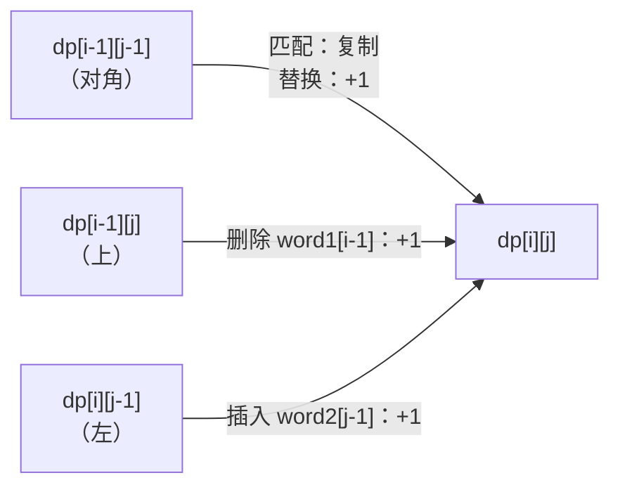
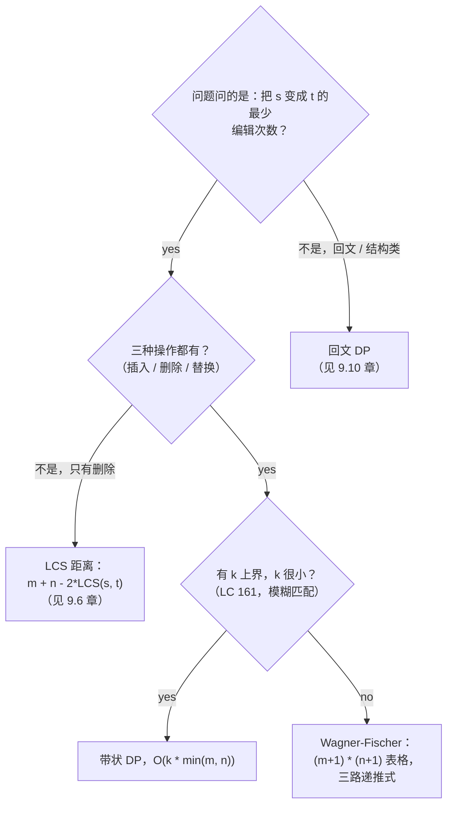

# 编辑距离

贪心在 LeetCode 72 的例子 `intention` 与 `execution` 上就翻车。从左往右走，遇到第一个不匹配就改，边走边计数：你得到的答案是错的。正确答案是 5，而一个人手动找到它时，做了一件贪心走法做不到的事：往前看，同时考虑三种不同的最后一步，然后挑最便宜的那一个。

这种前瞻就是本章的全部内容。Wagner 和 Fischer 在 1974 年把它发表出来，作为「二维表格如何消化一个抵制局部思考的问题」的典范例子；而这个算法处在你用过的每一个 diff 工具、拼写检查器、模糊匹配器和 DNA 比对器的核心。[^1] 在 LC 72 的题面上，它只问一个问题：给定两个字符串 `word1` 和 `word2`，把其中一个变成另一个所需的最少单字符编辑次数（插入、删除或替换）是多少？[^2] `horse` 和 `ros` 的答案是 3。`intention` 和 `execution` 的答案是 5。任意一对字符串的答案都装得进一张 `(m+1) × (n+1)` 的表，按行填、耗时 `O(mn)`，而且每个内部格子都走同一个三路递推式。[^3]

## 贪心为何失效

最诚实的第一次尝试，是让两个字符串都从左往右走，遇到第一个不匹配就编辑并计数。这是人在面试压力下会抓起来的算法。在 `horse` 和 `ros` 上，它是对的：

```text
horse vs ros
 h vs r   mismatch.  replace h -> r.  count = 1.  rest: orse vs os
 o vs o   match.                       count = 1.  rest: rse vs s
 r vs s   mismatch.  replace r -> s.  count = 2.  rest:  se vs (empty)
 s, e     extra characters.  delete each.  count = 4.

reported = 4.
```

两次替换加两次删除。最优答案是 3：替换 `h`，保留 `o`，保留 `s`，删掉 `r` 和 `e`。贪心走法把 `r` 替换掉了，而不是留着它，因为它没法往前看两个字符，看出 `s` 会自己走到位。

`intention` 和 `execution` 更糟，因为贪心的第一步就错了，而且这个错会累积：

```text
intention vs execution
 i vs e   mismatch.  replace.  count = 1.
 n vs x   mismatch.  replace.  count = 2.
 t vs e   mismatch.  replace.  count = 3.
 e vs c   mismatch.  replace.  count = 4.
 n vs u   mismatch.  replace.  count = 5.
 t vs t   match.
 i vs i   match.
 o vs o   match.
 n vs n   match.

reported = 5.
```

这一次贪心凑出了正确的数字。但*路径*是错的。最优对齐会推迟第一次编辑，先在位置 0 插入一个 `e`，再替换 `intention` 中间三个字符。贪心是碰巧把数对上的；在最便宜的对齐更难找到的输入上，数字也会错。

失败的样子就是本章的信号。在每个位置上，贪心锁死三种局部动作之一（匹配、替换、前进），却不考虑另外两种动作在剩下的输入上要花多少。最优答案要求同时看每个位置的全部三个前驱，然后取最便宜的。表格干的正是这件事。

## 归约

定义状态 `dp[i][j]` 为把 `word1[:i]` 变成 `word2[:j]` 的最少编辑次数。原问题的答案是 `dp[m][n]`。两个字符串、两个前缀长度、一个数。状态就这么多。

递推式立在一个观察上：**答案是「处理最后一个位置的三种方式」里的最小值。** 要么尾字符本来就相等，你直接抄更短那一对的答案；要么你花一次编辑，从三个更小的对之一走到当前这一对。没有别的可能。两个字符串的任何一种对齐，都以这四种动作中的恰好一种收尾，而最便宜的对齐落在最便宜的那个动作上。

这一句话就是本章。下面都是记账。

## 模式

```python
# 暴力：不做记忆化是 O(3^max(m,n))
def min_distance_brute(word1, word2):
    def edit(i, j):
        if i == 0: return j        # j 次插入构造出 word2[:j]
        if j == 0: return i        # i 次删除把 word1[:i] 清空
        if word1[i-1] == word2[j-1]:
            return edit(i-1, j-1)  # 匹配：对角线免费
        return 1 + min(
            edit(i-1, j-1),        # 替换
            edit(i-1, j),          # 从 word1 删除
            edit(i, j-1),          # 向 word1 插入
        )
    return edit(len(word1), len(word2))
```

对任何输入都正确。但它是指数级的，因为递归从三个父节点反复摸到同一个 `(i, j)` 对，每次都把答案重新推一遍。在 `intention` 和 `execution` 上，调用树大约有 `3^9 = 20,000` 次调用，而真实的 `(i, j)` 空间只有 `100` 个不同格子。给函数加上记忆化，你就得到一个 `O(mn)` 算法；自底向上打成表，你得到同一个算法，代码还更少。

```python
def min_distance(word1, word2):
    m, n = len(word1), len(word2)
    dp = [[0] * (n + 1) for _ in range(m + 1)]
    for i in range(m + 1):
        dp[i][0] = i  # i 次删除把 word1[:i] 变成 ""
    for j in range(n + 1):
        dp[0][j] = j  # j 次插入把 "" 变成 word2[:j]
    for i in range(1, m + 1):
        for j in range(1, n + 1):
            if word1[i-1] == word2[j-1]:
                dp[i][j] = dp[i-1][j-1]              # 匹配：对角线免费
            else:
                dp[i][j] = 1 + min(
                    dp[i-1][j-1],                    # 替换
                    dp[i-1][j],                      # 从 word1 删除
                    dp[i][j-1],                      # 向 word1 插入
                )
    return dp[m][n]
```

**解法** —— Python（[Java](./07-edit-distance/lc-72/sol.java) · [C++](./07-edit-distance/lc-72/sol.cpp) · [Go](./07-edit-distance/lc-72/sol.go)）

```python
# LC 72. Edit Distance

def min_distance(word1: str, word2: str) -> int:
    """LC 72: minimum number of operations to convert word1 to word2."""
    m, n = len(word1), len(word2)
    # dp[i][j] = word1[:i] 与 word2[:j] 之间的编辑距离
    dp = [[0] * (n + 1) for _ in range(m + 1)]
    for i in range(m + 1):
        dp[i][0] = i  # i 次删除把 word1[:i] 变成 ""
    for j in range(n + 1):
        dp[0][j] = j  # j 次插入把 "" 变成 word2[:j]
    for i in range(1, m + 1):
        for j in range(1, n + 1):
            if word1[i - 1] == word2[j - 1]:
                dp[i][j] = dp[i - 1][j - 1]               # 匹配：对角线免费
            else:
                dp[i][j] = 1 + min(
                    dp[i - 1][j - 1],                     # 替换
                    dp[i - 1][j],                         # 从 word1 删除
                    dp[i][j - 1],                         # 向 word1 插入
                )
    return dp[m][n]


def min_distance_rolling(word1: str, word2: str) -> int:
    """O(min(m, n)) space variant using two rolling rows."""
    if len(word1) < len(word2):
        word1, word2 = word2, word1
    m, n = len(word1), len(word2)
    prev = list(range(n + 1))
    curr = [0] * (n + 1)
    for i in range(1, m + 1):
        curr[0] = i
        for j in range(1, n + 1):
            if word1[i - 1] == word2[j - 1]:
                curr[j] = prev[j - 1]
            else:
                curr[j] = 1 + min(prev[j - 1], prev[j], curr[j - 1])
        prev, curr = curr, prev
    return prev[n]
```

三个操作各自对应三个前驱之一。这个约定在本章和四份参考实现里都是固定的：

- **`dp[i-1][j-1] + 1` 是替换。** 两个前缀各缩一个。当前字符不一致，你花一次编辑把其中一个换成另一个。
- **`dp[i-1][j] + 1` 是删除。** `word1` 的前缀缩一个，`word2` 的不缩。你花一次编辑丢掉 `word1` 的尾字符。
- **`dp[i][j-1] + 1` 是插入。** `word2` 的前缀缩一个，`word1` 的不缩。你花一次编辑补上 `word2` 的尾字符。

尾字符本来就相等时不需要编辑：`dp[i][j] = dp[i-1][j-1]`。对角线免费。

> [!IMPORTANT]
> `+ 1` 在匹配判断之外。匹配时返回 `dp[i-1][j-1]`，不加任何东西；不匹配时返回 `1 + min(...)`。把两者搞混——在匹配情形加了 1，或在不匹配情形忘了加 1——得到的算法在两个字符串完全相同时正确，其他情况全错。[^4]

基准情形把表格封口。`dp[0][0] = 0`，因为空串用零次编辑变成自己。`dp[i][0] = i`，因为 `i` 次删除把 `word1[:i]` 清空。`dp[0][j] = j`，因为 `j` 次插入从空串构造出 `word2[:j]`。少了这几条，内层循环就会读到从没写过的格子；结果是无声的垃圾。

## 递推式在一个格子上长什么样



*每个内部格子都由三个前驱喂进来。匹配时对角线免费，替换时它花一次；上面的永远是删除，左边的永远是插入。*

## 实例推演：`horse` 到 `ros`

网格是 `(m+1) × (n+1) = 6 × 4`。行索引 `i = 0..5`（`horse` 的前缀长度）；列索引 `j = 0..3`（`ros` 的前缀长度）。第 0 行填 `0, 1, 2, 3`（插入）。第 0 列填 `0, 1, 2, 3, 4, 5`（删除）。内部按行填。

决定性的一刻在 `dp[2][2]`。尾字符是 `o` 和 `o`。它们相等，对角线免费，`dp[2][2] = dp[1][1] = 1`。贪心看不见的就是这一个格子：留住 `o` 而不是替换它，算法只花周围格子一半的代价就走到 `(2, 2)`。之后每一个回溯经过 `(2, 2)` 的格子都继承这份便宜。

这个组件把每一次写格子的过程做成动画，每个新格子里画出被选中的前驱箭头。第 13 步是 `o` 等于 `o` 的那次匹配。第 23 步是 `(5, 3)` 的最后一次填充，最便宜的前驱是正上方的格子，操作是删掉尾字符 `e`。

> **Interactive widget:** [DP 表格填充](../../../dsa/widgets/w-31-dp-table-fill.yml)（面板 `panel-d`）—— 在网站上渲染；YAML 规格描述了各个关键帧。

*静态兜底：答案格子 `dp[5][3] = 3` 位于 6 × 4 表格的右下角。15 个内部格子里有 3 个是匹配（`o`、`r`、`s` 在两个字符串里都出现的位置）；其余由 `1 + min(diag, top, left)` 填出。从 `(0, 0)` 到 `(5, 3)` 最便宜的路径包含一次替换和两次删除，顺序可以不同。代价唯一；对齐不唯一。*

## 这个模式用在哪



*字符串变换类问题落到手上时要跑的决策树。LCS 距离与有界编辑距离，是读者最常伸手去拿的两种 Wagner-Fischer 特化；9.6 章收着 LCS 这一族。*

[最长公共子序列](./06-lcs.md)是这一部分里最近的兄弟。两个算法都按行填同一张 `(m+1) × (n+1)` 表，区别在格子的更新方式：

| 模式 | 匹配 | 不匹配 | 合并方式 |
|---|---|---|---|
| LCS | `dp[i-1][j-1] + 1` | `max(dp[i-1][j], dp[i][j-1])` | `max` |
| 编辑距离 | `dp[i-1][j-1]`（免费） | `1 + min(diag, top, left)` | `min` |

LCS 数匹配；编辑距离数不匹配和空档。两者都是同一副底盘上的二维字符串 DP。编辑距离的三个操作，用 LCS 的话说，对应「前缀末尾字符没能进入公共子序列」的三种方式。它们是同一个算法配不同的代价函数，这也是为什么那个四路面板组件在两章之间共用同一套渲染界面。

归约还能再深一层。把编辑距离里的替换分支删掉，只留删除和插入，答案就变成 `m + n - 2 * LCS(s, t)`，因为 LCS 之外的每个字符都必须从某一侧删掉。[^5] LC 583 是这件事的典范实例，它作为核心题放在[最长公共子序列](./06-lcs.md)那边，不在这里。

## 实际开销

| 变体 | 时间 | 空间 | 说明 |
|---|---|---|---|
| Wagner-Fischer（完整表） | `O(mn)` | `O(mn)` | 典范算法；只能还原代价 |
| 两行滚动 DP | `O(mn)` | `O(min(m, n))` | 第 `i` 行只依赖第 `i - 1` 行；滚动不破坏正确性 |
| Hirschberg 算法 | `O(mn)` | `O(m + n)` | 还能还原对齐，而不只是代价[^6] |
| 有界距离，代价 ≤ k | `O(k · min(m, n))` | `O(k)` | Ukkonen 宽度 `2k + 1` 的对角条带 |

`(m+1) × (n+1)` 的表有 `Θ(mn)` 个格子，给定三个前驱后每个格子只花 `O(1)` 的工作，所以总工作量是 `Θ(mn)`。两行变体利用的是：填第 `i` 行只查第 `i - 1` 行；两条长度为 `n + 1` 的行就够，而滚动这套纪律不破坏正确性，因为递推是行内局部的。

配套的下界比听起来更锋利。Backurs 和 Indyk 在 2015 年证明：除非强指数时间假设为假，编辑距离不可能在强次二次时间里算出来。[^7] 说人话就是：除非复杂度理论出现重大突破，这个一般问题上你没法显著快过 `O(mn)`。滚动变体和 Hirschberg 变体买到的是空间，不是时间。对 LC 72 的 `m, n ≤ 500` 上限，`mn = 250,000` 个格子，算法在微秒级跑完。

## 还原操作序列

代价表告诉你 `dp[m][n] = 3`。它不告诉你这三个操作是 `replace, delete, delete`，还是 `delete, replace, delete`，还是别的排列。如果面试官要的是对齐而不只是个数，你就从 `(m, n)` 回溯到 `(0, 0)`，在每个格子上读它选中的是哪个前驱。

```python
def recover_ops(word1, word2, dp):
    i, j = len(word1), len(word2)
    ops = []
    while i > 0 or j > 0:
        if i > 0 and j > 0 and word1[i-1] == word2[j-1]:
            ops.append(('match', word1[i-1]))
            i, j = i-1, j-1
        elif i > 0 and j > 0 and dp[i][j] == dp[i-1][j-1] + 1:
            ops.append(('replace', word1[i-1], word2[j-1]))
            i, j = i-1, j-1
        elif i > 0 and dp[i][j] == dp[i-1][j] + 1:
            ops.append(('delete', word1[i-1]))
            i -= 1
        else:
            ops.append(('insert', word2[j-1]))
            j -= 1
    return list(reversed(ops))
```

回溯跑 `O(m + n)`，因为每步把 `i + j` 减一或减二。代价是唯一的。任何回溯都落到同一个 `dp[m][n]`。但对齐不唯一。两个前驱打平时，还原出的序列取决于你先查哪一个。本章的参考实现按 `diag > top > left` 的顺序破平，与 `min({diag, top, left})` 的求值顺序一致。不同的破平顺序给出不同的对齐、相同的代价。

长输入上要完整对齐，Hirschberg 1975 年的算法用 `O(m + n)` 空间还原操作序列：它靠一个分治技巧找到最优路径的中点，再对两半递归。[^6] 生产级 diff 工具（`git diff`、`diff`、每个 IDE 合并视图的文本层）正是为此用 Hirschberg 或它的后代。

## 两个最容易踩的坑

> [!WARNING]
> **空串的基准情形不是可选项。** `dp[0][j] = j` 和 `dp[i][0] = i` 承载的是「从空前缀构造」和「清空到空前缀」的代价。把表开成 `m × n` 而不是 `(m+1) × (n+1)`，循环就在一个没有基准行、没有基准列的数组上跑；算法读到未初始化的零，在其中一个字符串为空时返回 `0`。这个 bug 是无声的：表填满了，算法终止了，答案在测试用例 `("", "abc")` 上是错的。

> [!WARNING]
> **字符比较写的是 `word1[i-1] == word2[j-1]`，不是 `word1[i] == word2[j]`。** 表的大小是 `(m+1) × (n+1)`，为的是让前缀长度取 `0, 1, ..., m`。当 `i = m` 时，`word1[i]` 就越界了。标准约定（`dp[i][j]` 是 `word1` 前 `i` 个字符与 `word2` 前 `j` 个字符之间的代价）逼着查找时必须错一位。一次定死，之后每个比较都照这个写。[^8]

## 题目梯度

### 核心（全部做完才算掌握本章）

- [LC 72 — Edit Distance](https://leetcode.com/problems/edit-distance/) [中等] • dp-2d-edit-distance ★

### 进阶（可选）

- [LC 161 — One Edit Distance](https://leetcode.com/problems/one-edit-distance/) [中等] • dp-2d-edit-distance-bounded *（参考：仅 Python；LC Premium。用 LC 72 加上 `dp[m][n] <= 1` 提前退出即可解。）*
- [LC 1771 — Maximize Palindrome Length From Subsequences](https://leetcode.com/problems/maximize-palindrome-length-from-subsequences/) [困难] • dp-2d-edit-distance-cousin *（参考：仅 Python）*

LC 72 是本章的招牌题，也是 Wagner-Fischer 的典范实例。这个模式没有对应的 Easy 级 LC 变体；最简单的 LC 变体是 LC 161，本身就是中等，本章用 `no-easy-canonical` 这个选题标记把这件事记下来。LC 1771 用 `LCS on s + reverse(t)` 的归约收尾这一族：它是编辑距离形状的 DP，代价函数不同，还多了一条约束——回文里的字符分别来自哪个子串。

LC 1035（Uncrossed Lines）和 LC 583（Delete Operation for Two Strings）属于[最长公共子序列](./06-lcs.md)。两道都是伪装的 LCS：LC 1035 直接就是，LC 583 走 `m + n - 2 * LCS` 的归约。这两道题的自然归宿都是 LCS 那一章。

## 后续衔接

这一部分的下一步是[最长递增子序列（O(n²) DP）](./08-lis-quadratic.md)，它用一个一维 `dp[]`，下标是保留的最后一个元素的位置。形状从「两个前缀上的二维表」变成「一个位置上的一维数组，加对更早位置的内层扫描」；递推式仍然是把少量前驱格子组合成当前格子，但结构是单个字符串，不是两个。

不做任何改动就直接复用这张二维字符串 DP 表的后续是[回文 DP](../../../dsa/part-9-dynamic-programming/10-palindrome-dp.md)：`dp[i][j]` 从「前缀上的代价」变成「子串上的布尔值」，迭代顺序从按行主序改成按区间长度，好让依赖方向对得上。

当操作带权重时（把 `A` 换成 `T` 的代价与把 `A` 换成 `C` 的代价不同，DNA 序列比对就是这样），递推式里的 `+ 1` 变成 `+ cost(op)`，算法其余部分不变。Smith-Waterman（局部比对）和 Needleman-Wunsch（全局比对）是两个有名的实例；两者都是换了代价函数的 Wagner-Fischer，就像编辑距离是换了代价函数的 LCS。这副底盘很耐用。

## 参考文献

[^1]: Wagner, Robert A. and Fischer, Michael J., "The String-to-String Correction Problem," *Journal of the ACM*, 21(1):168-173, January 1974, doi:10.1145/321796.321811.
[^2]: LeetCode 72 Edit Distance，题面与示例镜像于 leetcode.ca，<https://leetcode.ca/all/72.html>。示例 1（`horse -> ros = 3`）与示例 2（`intention -> execution = 5`）逐字引用。
[^3]: Cormen, Leiserson, Rivest, Stein (CLRS), *Introduction to Algorithms*, 4th ed., MIT Press, 2022, Chapter 14 (Dynamic Programming), §14.4 problem 14-5 (Edit Distance).
[^4]: Levenshtein, Vladimir I., "Binary codes capable of correcting deletions, insertions, and reversals," *Soviet Physics Doklady*, 10(8):707-710, February 1966（原文为俄文，*Doklady Akademii Nauk SSSR*，163(4):845-848，1965）。
[^5]: Wikipedia, "Levenshtein distance," <https://en.wikipedia.org/wiki/Levenshtein_distance>
[^6]: Hirschberg, D. S., "A linear space algorithm for computing maximal common subsequences," *Communications of the ACM*, 18(6):341-343, 1975, doi:10.1145/360825.360861.
[^7]: Backurs, Arturs and Indyk, Piotr, "Edit Distance Cannot Be Computed in Strongly Subquadratic Time (unless SETH is false)," STOC 2015, arXiv:1412.0348.
[^8]: LeetCode Discuss, "Good strategies to avoid off by one errors?", <https://leetcode.com/discuss/post/1479718/good-strategies-to-avoid-off-by-one-erro-se2e/>.
