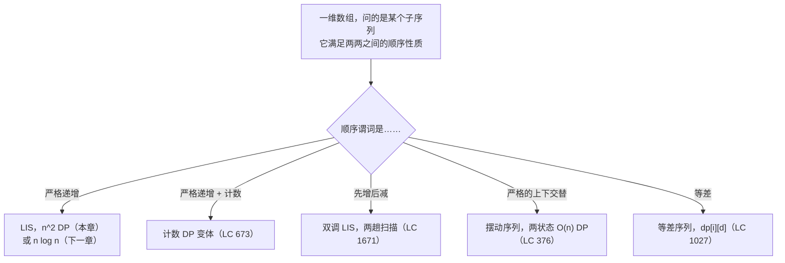
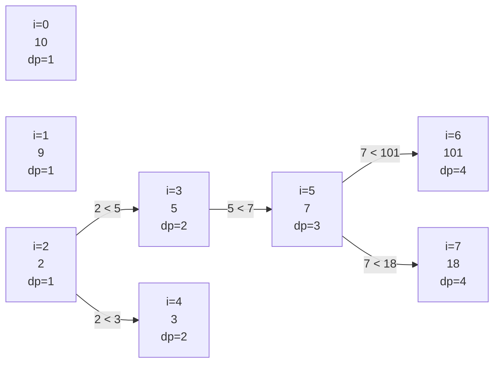

# 最长递增子序列：平方级 DP

2,500 个互不相同的整数随机排列后，最长严格递增子序列平均大约有 100 个元素。不是 50，也不是 1,250，而是大约 `2 * sqrt(n)`。这个数字出自 Erdős 和 Szekeres 1935 年的一篇组合数学论文，下次有人问一个打乱顺序的列表 LIS“应该”有多长时，它是个很好用的量级参照。这个数字也解释了这道题为什么比看上去难：长度 2,500 的输入，答案是长度 100，而最直观的算法要找它得试 `2^2500` 条候选子序列。

标准题面是 *Longest Increasing Subsequence*（LeetCode 300）。给定 `nums = [10, 9, 2, 5, 3, 7, 101, 18]`，返回最长严格递增子序列的长度。答案是 4：子序列 `[2, 3, 7, 101]`，或 `[2, 3, 7, 18]`，或 `[2, 5, 7, 101]`，都是四个元素，都合法。题目只要长度。本章讲教科书上的 `O(n^2)` 动态规划解法，推导出让还原成为可能的前驱指针技巧，并指出一个更紧的界——下一章给出。

## 这个模式用在哪



*LIS 家族的五个问题，一棵决策树。严格递增这一支是本章的主场；另外四个是同一递推式稍作改动就能吸收的变体。*

信号是结构性的，不在表面。当输入是一维数组，问的是某个*子序列*的最长长度、个数或某个最优值，而且这个子序列的元素要满足两两之间的顺序性质时，该用的就是下面这个递推。*子序列*（subsequence）这个词很关键：选中的元素保持原有顺序，但不必相邻。连续子数组问题属于完全另一族（滑动窗口或前缀和）。

## 为什么暴力解法行不通

最诚实的第一次尝试是枚举所有子序列。对下标的 `2^n` 个子集，逐个检查选出的值是否构成严格递增链，记录见过的最大长度。

```python
# 暴力解法：O(2^n * n)——这就是我们要替换掉的东西
def length_of_lis_brute(nums):
    n = len(nums)
    best = 0
    for mask in range(1 << n):
        picked = [nums[i] for i in range(n) if mask & (1 << i)]
        if all(picked[k] < picked[k + 1] for k in range(len(picked) - 1)):
            best = max(best, len(picked))
    return best
```

在任何输入上都正确。在 LeetCode 300 给定的界 `n <= 2500` 下，最坏情况要跑大约 `2^2500` 次掩码迭代——一个 753 位的数字。这个算法还没耗尽时间就先耗尽了宇宙。即便 `n = 30`，循环也已经超过十亿次。整个思路根本走不通。

修法是动态规划的标准动作：别再枚举，开始把每个子问题的答案记下来。

## 让递推成立的状态

定义 `dp[i]` 为**恰好以下标 `i` 结尾、且以 `nums[i]` 作为最后一个元素的最长严格递增子序列的长度。**“恰好结尾在 `i`”这个说法是承重的定义。换成另一种看似显然的写法——“只使用 `nums[0..i]`、不管结尾在哪的最长 LIS”——递推就崩了：每次转移都得同时考虑延展和忽略新元素，依赖关系缠成一团，内层循环也失去了形状。

状态选对了，递推一句话就能说完。任何结尾于 `i` 的 LIS，都是某条结尾于更早下标 `j`（且 `nums[j] < nums[i]`）的 LIS 后面接上 `nums[i]`。取最好的那个 `j` 就行。如果没有合格的 `j`，这条链的长度就是 1（只有 `nums[i]` 自己）。

```text
dp[i] = 1 + max(dp[j] for j < i if nums[j] < nums[i])    # max 中默认为 0
```

最终答案是 `max(dp[0..n-1])`，因为 LIS 可以结束在数组的任何位置，不一定在最后一个下标。

这就是 CLRS 第 4 版 §14.4 习题 14-1 和 Erickson《Algorithms》§3.6 里的写法。[^1][^2] 两处都把它当作“回头看”式 DP 的典范。前面两章的编辑距离和最长公共子序列递推，用的也是这种“恰好结尾在”的形状。

## 模式

```python
def length_of_lis(nums):
    n = len(nums)
    if n == 0:
        return 0
    dp = [1] * n                       # 每个单元素自身就是长度 1 的 LIS
    for i in range(1, n):
        for j in range(i):
            if nums[j] < nums[i] and dp[j] + 1 > dp[i]:
                dp[i] = dp[j] + 1
    return max(dp)
```

**解法** — Python（[Java](./08-lis-quadratic/lc-300/sol.java) · [C++](./08-lis-quadratic/lc-300/sol.cpp) · [Go](./08-lis-quadratic/lc-300/sol.go)）

```python
# LC 300. Longest Increasing Subsequence
from typing import List


def length_of_lis(nums: List[int]) -> int:
    """LC 300 Longest Increasing Subsequence: O(n^2) DP.

    dp[i] = length of the longest STRICTLY increasing subsequence
    ending exactly at index i (and including nums[i]).
    """
    n = len(nums)
    if n == 0:
        return 0
    dp = [1] * n
    for i in range(1, n):
        for j in range(i):
            if nums[j] < nums[i] and dp[j] + 1 > dp[i]:
                dp[i] = dp[j] + 1
    return max(dp)
```

有三行值得细看。

初始化 `dp = [1] * n` 是伪装起来的 base case。每个位置无论上下文如何，都是自身长度为 1 的 LIS，内层循环只会把 `dp[i]` 往上改。初始化成 0 是新手最常见的 bug：输入 `[5]` 这种单元素时它返回 0，而正确答案是 1。

谓词 `nums[j] < nums[i]` 是**严格**的，不是 `<=`。题目说的是“严格递增”。写成 `<=` 会悄悄通过大部分测试，却在 `[7, 7, 7, 7, 7]` 上失败——正确答案是 1，而 `<=` 返回 5。全相等这个用例一行就能构造，能立刻抓到这个 bug，提交前跑一遍。

比较式写成 `dp[j] + 1 > dp[i]` 是有意的。`>` 保证只在严格变优时才赋值，这一点在开始记录前驱指针后（下一节）很关键：`>=` 会让另一个 `j` 覆盖掉已经产出同样长度的前驱，让还原变复杂，却换不来任何速度。

## 实例推演：nums = [10, 9, 2, 5, 3, 7, 101, 18]

逐个下标走一遍算法。对每个 `i`，内层循环扫过所有更早的 `j`，在满足 `nums[j] < nums[i]` 的 `j` 中取最大的 `dp[j] + 1`，写进 `dp[i]`。轨迹如下：

| i | nums[i] | 满足 nums[j] < nums[i] 的候选 j | dp[i] |
|---|---|---|---|
| 0 | 10 | 无 | 1 |
| 1 | 9 | 无 | 1 |
| 2 | 2 | 无 | 1 |
| 3 | 5 | j=2（nums=2，dp=1） | 2 |
| 4 | 3 | j=2（nums=2，dp=1） | 2 |
| 5 | 7 | j=2,3,4；最优是 j=3，dp=2 | 3 |
| 6 | 101 | j=0..5；最优是 j=5，dp=3 | 4 |
| 7 | 18 | j=2,3,4,5；最优是 j=5，dp=3 | 4 |

最终答案是 `max(dp) = 4`。有两条 LIS 链并列长度 4：一条结束于 i=6（`[2, 3, 7, 101]`），一条结束于 i=7（`[2, 3, 7, 18]`）。题目只要长度，并列无所谓。



*每条箭头是 `dp[i]` 的胜出前驱链接。下标 0 和 1 没有入边（`dp` 停在 1）。两条长度 4 的链共享前缀 `2 -> 3 -> 7`，之后分别走向 `101` 和 `18`。*

## 还原出其中一条子序列

LeetCode 300 只要长度。面试官常会追问：“现在把其中一条这样的子序列打印出来。”这个增强很小。在 `dp[]` 之外维护 `prev[i]`，记录产出 `dp[i]` 当前值的那个下标 `j`；若 `dp[i]` 停在 base case 的 1，则记为 `-1`。

```python
def lis_with_reconstruction(nums):
    n = len(nums)
    if n == 0:
        return 0, []
    dp = [1] * n
    prev = [-1] * n
    end = 0                                 # 全局最大值所在的下标
    for i in range(1, n):
        for j in range(i):
            if nums[j] < nums[i] and dp[j] + 1 > dp[i]:
                dp[i] = dp[j] + 1
                prev[i] = j
        if dp[i] > dp[end]:
            end = i
    chain = []
    cur = end
    while cur != -1:
        chain.append(nums[cur])
        cur = prev[cur]
    chain.reverse()
    return dp[end], chain
```

在标准输入上运行，得到 `(4, [2, 3, 7, 101])`。前驱回溯的代价是 `O(L)`，`L` 为链长，被 `O(n^2)` 的填表盖过。同样的渐进复杂度，每个格子多一个整数。

这和编辑距离、最长公共子序列里驱动还原的前驱回溯是同一个模式。一旦把“恰好结尾在 `i`”的状态定下来，加父指针就是机械劳动。

## 实际开销

| 变体 | 时间 | 空间 | 说明 |
|---|---|---|---|
| 只要长度 | O(n^2) | O(n) | 两层嵌套循环；一张长度 `n` 的表 |
| 带还原 | O(n^2) | O(n) | 时间不变；多一个 `prev[]` 数组 |
| 暴力 | O(2^n × n) | O(n) | 错误答案；被我们替换掉的那个 |

两层循环贡献了 `n * (n - 1) / 2` 次常量工作量的比较。每一对做一次 `<` 判断和一次取最大更新，在机器整数上都是 `O(1)`。在 LeetCode 300 的界 `n <= 2500` 下，大约 `3.1 * 10^6` 次操作：在本书发布的每种语言里都能轻松跑进一秒。

`O(n^2)` **不是**最优的。Schensted（1961）用有序的“tails”数组加二分查找，把 LIS 长度算到了 `O(n log n)`；Fredman（1975）证明对基于比较的算法，这个界在低阶项以内是紧的。[^3][^4] [O(n log n) 的耐心排序算法](../../../dsa/part-9-dynamic-programming/09-lis-patience-sort.md) 就是下一章。本章先讲慢算法的原因是：`O(n^2)` 的递推能直接推广到下面那些变体，而耐心排序那套框架不行。

## 模式失效的场景

这种“回头看”的状态形状能撑起四种面试级别的变体。它们都保留外层 `i`、内层 `j` 的结构，变的只是每一对的更新规则。其中两个值得点名：计数变体和双向扫描。

### 计算 LIS 链条数：从“多长”到“多少”（LC 673）

LeetCode 673 问的是不同的最长递增子序列有多少条。骨架不变，表多出一列。维护 `length[i]`（同上面的 `dp[i]`）和 `count[i]`（结束于 `i` 的不同 LIS 链条数）。对每一对满足 `nums[j] < nums[i]` 的 `(j, i)`，按 `j` 是延长当前最优还是与之并列来分支：

```python
def find_number_of_lis(nums):
    n = len(nums)
    if n == 0:
        return 0
    length = [1] * n
    count = [1] * n
    for i in range(1, n):
        for j in range(i):
            if nums[j] < nums[i]:
                if length[j] + 1 > length[i]:
                    length[i] = length[j] + 1
                    count[i] = count[j]               # 严格更长，替换
                elif length[j] + 1 == length[i]:
                    count[i] += count[j]              # 并列，累加
    longest = max(length)
    return sum(c for l, c in zip(length, count) if l == longest)
```

“并列则累加”这个分支是计数 DP 里教学价值最高的一处。直接复制 LC 300 内层循环、忘了 `elif` 的读者能通过单元素测试，但遇到任何有多条等长不同链条的输入就挂。[^5]

### 两次扫描造山峰：双调 LIS（LC 1671）

LeetCode 1671 问的是最少删除多少个数能让数组变成山峰（严格上升到峰顶，再严格下降）。这里的教学点是归约到双调 LIS：把 LIS DP 跑两遍。`left[i]` 是标准的前向扫描；`right[i]` 是在反谓词（`nums[j] > nums[i] for j > i`）上做同样的 LIS DP，等价于把数组反转、跑完再翻回来。以 `i` 为峰顶的最长双调子序列长度为 `left[i] + right[i] - 1`（那个 `-1` 是把峰顶被重复计的一次扣掉），且只有在两半都非平凡时才成立。

```python
def minimum_mountain_removals(nums):
    n = len(nums)
    left = [1] * n
    for i in range(1, n):
        for j in range(i):
            if nums[j] < nums[i] and left[j] + 1 > left[i]:
                left[i] = left[j] + 1
    right = [1] * n
    for i in range(n - 2, -1, -1):
        for j in range(i + 1, n):
            if nums[j] < nums[i] and right[j] + 1 > right[i]:
                right[i] = right[j] + 1
    best_mountain = max(
        left[i] + right[i] - 1
        for i in range(n)
        if left[i] > 1 and right[i] > 1                 # 两半都非平凡
    )
    return n - best_mountain
```

`left[i] > 1 and right[i] > 1` 这个门槛是最容易漏的一行。“山峰”要求严格上升**且**严格下降；左边没有比它小的元素、或右边没有比它小的元素的下标 `i`，都不可能是峰顶。去掉这个门槛，算法会报出不可能的山峰，并少算删除次数。

另外两个变体形状相同，改动更小。*Wiggle Subsequence*（LC 376）把内层循环整个消掉，因为顺序谓词是局部的：状态只依赖 `i - 1`，两趟并行的单格扫描就够，界降到 `O(n)`。*Longest Arithmetic Subsequence*（LC 1027）把状态扩成两维，用公差索引 `dp[i][d]`；`d` 取值范围很大时，给每个 `i` 配一张哈希表能让空间保持可控。

## 两个最容易踩的坑

> [!WARNING]
> **状态定义：“恰好结尾在 i”胜过“前缀 nums[0..i] 里的最优”。** 把 `dp[i]` 定义成恰好以下标 `i` 结尾、以 `nums[i]` 为最后一个元素的最长 LIS。另一种看似显然的选择——“前缀 `nums[0..i]` 里不管结尾在哪的最优 LIS”——看着等价，其实不等价。按那个定义，每次转移都得同时考虑延展*和*跳过 `nums[i]`，递推多出一个分支，取答案那一步也换了形状。状态定义对了，内层循环那句“对合法的 `j` 取最大”就塌缩成一行。

> [!WARNING]
> **严格与非严格比较。** LC 300 说的是*严格*递增。内层循环里的谓词是 `nums[j] < nums[i]`，不是 `nums[j] <= nums[i]`。用 `<=` 会悄悄通过大部分测试，却在全相等的输入 `[7, 7, 7, 7, 7]` 上失败——正确答案是 1，而 `<=` 返回 5。谓词读两遍。提交前测一遍全相等用例。

还有一个顺带值得提的 bug：题目要求还原时没留 `prev[]`。这个增强不过多一个数组、多一次向上回溯；如果面试官的追问是“现在打印一条这样的 LIS”，你会庆幸在填表时就记下了前驱，而不是事后想从 `dp[]` 里反推。

## 题目梯度

### 核心（三题全做才算掌握本章）

- [LC 300 — Longest Increasing Subsequence](https://leetcode.com/problems/longest-increasing-subsequence/) [中等] • lis-quadratic-dp ★
- [LC 673 — Number of Longest Increasing Subsequence](https://leetcode.com/problems/number-of-longest-increasing-subsequence/) [中等] • lis-with-count
- [LC 1671 — Minimum Number of Removals to Make Mountain Array](https://leetcode.com/problems/minimum-number-of-removals-to-make-mountain-array/) [困难] • bitonic-lis

### 进阶（可选）

- [LC 376 — Wiggle Subsequence](https://leetcode.com/problems/wiggle-subsequence/) [中等] • wiggle-two-state-dp
- [LC 1027 — Longest Arithmetic Subsequence](https://leetcode.com/problems/longest-arithmetic-subsequence/) [中等] • lis-keyed-by-difference

LeetCode 上 LIS 家族在子序列 DP 这一层没有公认的简单变体；LC 674（*Longest Continuous Increasing Subsequence*）是连续而非子序列，用的是线性扫描而不是回头看递推。核心三题在模式自然覆盖的难度带上各练一遍这个递推：本体（LC 300）、加一个并列累加的计数（LC 673）、带“两半都非平凡”门槛的双向扫描（LC 1671）。进阶两题展示框架简化时会发生什么（LC 376 塌缩到 `O(n)`），以及状态扩展时会发生什么（LC 1027 用差值给表建索引）。

## 后续衔接

这个算法的内层循环做的事比它需要做的多。在下标 `i` 处，算法要扫过每一个更早的 `j`，找出它能延展的最长链，但其中大部分 `j` 都是被支配的：如果某个 `j` 的值更大、链又更短，那它永远不可能是对的前驱。[用耐心排序把 LIS 做到 O(n log n)](../../../dsa/part-9-dynamic-programming/09-lis-patience-sort.md) 把内层线性扫描换成在维护好的 tails 数组上二分查找，界从 `O(n^2)` 降到 `O(n log n)`。Schensted 1961 年的耐心排序构造是最早的做法。[^3] Fredman 1975 年的结果给出了基于比较的 LIS 的匹配下界，所以不利用数值本身的结构，`O(n log n)` 就是极限。[^4]

你要付出的是：`O(n log n)` 算法放弃了本章 `prev[]` 数组一行代码就能给出的干净的前驱指针还原。从耐心排序的 tails 数组里还原一条见证 LIS，需要多不少记账工作。面试里追问“再把子序列打印出来”时，平方级 DP 往往是更干净的答案；而在大输入上只要长度时，下一章胜出。

## 参考文献

[^1]: Cormen、Leiserson、Rivest、Stein，《Introduction to Algorithms》第 4 版，MIT Press，2022，第 14 章 §14.4 习题 14-2 “Longest monotonically increasing subsequence”。(a)(b) 两小问明确要求给出 `O(n^2)` 算法。<https://mitpress.mit.edu/9780262046305/introduction-to-algorithms/>。

[^2]: Jeff Erickson，《Algorithms》，jeffe.cs.illinois.edu，第 3 章（动态规划），§3.6 “Longest Increasing Subsequence”。<https://jeffe.cs.illinois.edu/teaching/algorithms/>。

[^3]: Schensted, C. (1961), "Longest increasing and decreasing subsequences," *Canadian Journal of Mathematics*, vol.

[^4]: Fredman, Michael L. (1975), "On computing the length of longest increasing subsequences," *Discrete Mathematics*, vol.

[^5]: walkccc，《LeetCode Solutions》，第 673 题（Number of Longest Increasing Subsequence）。带显式 `elif length[j] + 1 == length[i]` 累加器的双分支更新，被记录为 LC 673 最常见的 bug。<https://walkccc.me/LeetCode/problems/0673/>。
