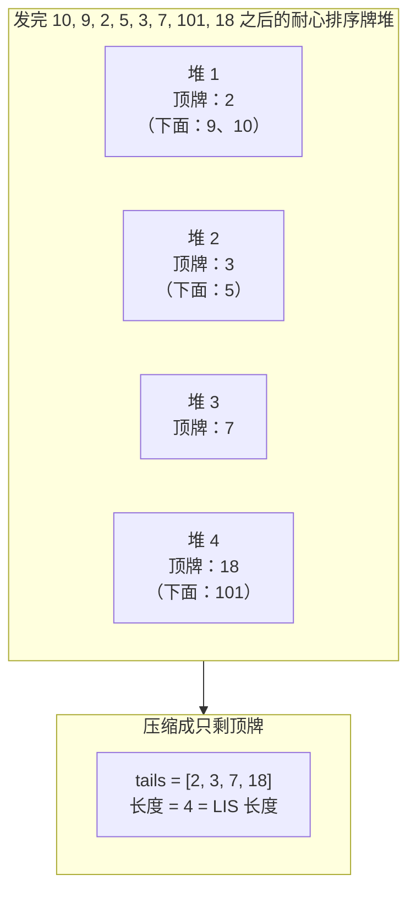

# 最长递增子序列：耐心排序

1972 年，Hammersley 注意到一件本不该成立的事。拿一副牌洗乱，从左到右一张张发出去，只按一条规则摆堆：每张牌放到最左边那堆顶牌大于等于它的牌堆上；如果现有牌堆都不满足，就在右边另起一堆。牌发完后数一数有几堆。这个堆数就是发牌顺序里最长递增子序列的长度。不是近似值，是精确答案。

上一章 [最长递增子序列：平方级 DP](./08-lis-quadratic.md) 用一张 `O(n^2)` 的表解同一个问题。递推干净、容易讲清楚，多数工程师能凭记忆写出 LIS，靠的就是它。纸牌游戏这个观察把复杂度压到 `O(n log n)`，答案一点没变。这个“压下来”的过程就是本章的内容。

## 耐心，一种纸牌游戏

Patience 是英国人对美国人称作 solitaire 的那类单人纸牌游戏的说法。[^2] Mallows 在 1973 年写下的那个变体，是从洗好的牌里一次发一张到一排牌堆上，用的正是上面那条“放到最左边顶牌更高的堆”的规则。[^3] 它与最长递增子序列的联系由 Hammersley 在 1972 年正式建立[^4]，随后被 Aldous 和 Diaconis 在 1999 年提升为定理，两人把这个算法描述成“一个简单的单人纸牌游戏”，并直接证明了对应关系。[^5] Schensted 1961 年关于 Young 表（Young tableaux）的论文是算法上的源头：同一套 `O(n log n)` 机制，只是用组合数学的语言写成，而不是纸牌的语言。[^6]

历史插曲到此为止。纸牌游戏只值一段，因为它让算法变得具体；本章剩下的部分是算法本身。

## 从纸牌堆到 tails 数组

在 `[10, 9, 2, 5, 3, 7, 101, 18]` 上跑一遍这条规则。八张牌，四堆。

```text
pile 1: 10 -> 9 -> 2     (每张新牌都埋住了上一张顶牌)
pile 2: 5 -> 3
pile 3: 7
pile 4: 101 -> 18
```

四堆。最长递增子序列长度是 4。（一个见证是 `2, 3, 7, 101`，还有别的。）拿 [最长递增子序列：平方级 DP](./08-lis-quadratic.md) 里的平方级 DP 对一遍，答案一致。

算法全程只需要*每堆的顶牌*。新牌到来时，问题只在于落到哪一堆，而这个决定完全取决于从左到右可见的那些顶牌。被埋住的牌再也不会回来。于是把每堆压缩成它的顶牌，放进一个数组，叫 `tails`。

```text
在 [10, 9, 2, 5, 3, 7, 101, 18] 上每一步之后的 tails：

第 1 步  x = 10:   tails = [10]
第 2 步  x = 9:    tails = [9]                # 9 埋住 pile 1 的 10
第 3 步  x = 2:    tails = [2]                # 2 埋住 pile 1 的 9
第 4 步  x = 5:    tails = [2, 5]             # 5 新起 pile 2
第 5 步  x = 3:    tails = [2, 3]             # 3 埋住 pile 2 的 5
第 6 步  x = 7:    tails = [2, 3, 7]          # 7 新起 pile 3
第 7 步  x = 101:  tails = [2, 3, 7, 101]     # 101 新起 pile 4
第 8 步  x = 18:   tails = [2, 3, 7, 18]      # 18 埋住 pile 4 的 101
```

`tails` 每一步都有序。这正是二分查找能用的性质。有序不是假设，而是发牌规则的推论，并且每一步都成立。

算法维护的不变式，值得背下来的一句话：

> `tails[i]` 是到目前为止发现的所有长度为 `i + 1` 的递增子序列里，可能的最小尾值。[^1]

有三个词值得强调。*最小可能值*：在扫描见过的所有长度 `(i+1)` 的子序列中，取结尾最小的那个。*到目前为止*：数组随扫描推进不断更新，下标 `i` 处的值可以变小。*尾值*：子序列的最后一个元素，不是整条子序列。第 8 步之后可见的 `tails = [2, 3, 7, 18]` 并不是 LIS 本身。这个输入里一条真实的长度 4 的 LIS 是 `[2, 3, 7, 101]`，另一条是 `[2, 5, 7, 101]`。tails 数组存的东西比答案子序列更微妙：它存的是每个长度上的最优尾值，而仅凭这一点就足以数出长度，即使输入里没有任何一条子序列真的按那个顺序包含这些值。[^1]

### 按尾值二分查找

把放置规则改写到 tails 数组的说法里：牌 `x` 到来时，找最左边的下标 `pos` 满足 `tails[pos] >= x`。如果不存在这样的下标（每个尾值都严格小于 `x`），就追加 `x`；否则用 `x` 覆盖 `tails[pos]`。

`tails` 有序，所以找 `pos` 就是二分查找。Python 标准库叫它 `bisect_left`，C++ 叫 `std::lower_bound`，Go 叫 `sort.SearchInts`；Java 没有形状合适的原生数组版本，所以参考实现是手写的。四者返回同一个值：在保持数组有序的前提下 `x` 可以插入的最左下标，也就是现有元素大于等于 `x` 的最左位置。

为什么取最左而不是最右？因为严格递增的子序列不能包含两个相等的值。当 `x` 等于某个下标 `pos` 处的值时，把 `pos` 当作落点（替换而不是延长）才能守住严格 LIS 的约定。换成最右匹配（`bisect_right`），相等的值就能延长链条，那统计的是非严格子序列：另一个问题，下面会讲。

每一步的代价是二分查找的 `O(log |tails|) <= O(log n)`，加上替换的 `O(1)` 或追加的摊还 `O(1)`。对 `n` 张牌求和：`O(n log n)`。空间是 tails 数组的 `O(n)`；在严格递增的输入上数组会长到 `n`，这个界是紧的。[^1]

替换那一步藏着全部工作量。再看第 8 步。第 7 步之后 `tails = [2, 3, 7, 101]`，长度 4。牌 18 到来。`bisect_left(tails, 18) = 3`，因为 `tails[3] = 101 >= 18` 而 `tails[2] = 7 < 18`。用 18 覆盖 `tails[3]`，长度仍是 4。此刻可见的 tails 数组是 `[2, 3, 7, 18]`，但输入里没有任何一条真实的 LIS 在下标 3 处以 18 结尾。算法是把长度 4 上的一个*更好*的尾值先冻在那里，等着以后某张牌来延长它。好处在一张介于 18 和 101 之间的牌到来时立刻显现：它能以新的尾值 18 把数组延长到长度 5，而以 101 结尾就延长不了。

这个不对称正是算法成立的原因。替换降低了未来延长的门槛，同时从不忘记已经达到的长度。

## 模式

```python
from bisect import bisect_left

def length_of_lis(nums):
    tails = []
    for x in nums:
        i = bisect_left(tails, x)         # 满足 tails[i] >= x 的最左下标
        if i == len(tails):
            tails.append(x)               # x 大于所有尾值，延长
        else:
            tails[i] = x                  # x 替换一个 >= 的尾值，冻下更低的门槛
    return len(tails)
```

严格 LIS 的全部算法就这些。三行函数体，一个返回。LC 354 的外壳原样复用这个辅助函数，放在下面的实例推演里。

## 实例推演：LC 354, Russian Doll Envelopes

题面大意：给一组信封，每个信封是 `[width, height]`。信封 `(w1, h1)` 能装进 `(w2, h2)`，当且仅当两个维度都严格满足 `w1 < w2` 且 `h1 < h2`。求最长的嵌套信封链。样例输入 `[[5, 4], [6, 4], [6, 7], [2, 3]]`，期望输出 3（一条链：`[2, 3]` 装进 `[5, 4]`，再装进 `[6, 7]`）。

多数读者第一反应是按宽度排序，再对高度求 LIS。这个直觉对了一半，而错的那一半恰好是面试里 LC 354 最常被漏掉的地方。

在样例上试一下。按 `(宽度升序, 高度升序)` 排序，数组变成 `[[2, 3], [5, 4], [6, 4], [6, 7]]`。只看高度：`[3, 4, 4, 7]`。对 `[3, 4, 4, 7]` 求严格 LIS，得到 3（一个见证：`3, 4, 7`），答案碰巧是对的。

再试 `[[1, 1], [1, 1], [1, 1]]`。同样排序：`[[1, 1], [1, 1], [1, 1]]`。高度 `[1, 1, 1]`，严格 LIS 是 1，正确，靠运气。再试 `[[5, 1], [5, 2], [5, 3]]`。排序后 `[[5, 1], [5, 2], [5, 3]]`，高度 `[1, 2, 3]`，严格 LIS 是 3。*错了*。这三个信封宽度相同，谁也装不进谁，正确答案是 1。

修法在平局的处理上：按 `(宽度升序, 同宽时高度降序)` 排序。坏例子里的高度随之变成 `[3, 2, 1]`，其上的严格 LIS 是 1，正确。原样例的高度变成 `[3, 4, 7, 4]`（同宽的那对 `[6, 4], [6, 7]` 因为 `7 > 4` 翻成 `[6, 7], [6, 4]`），严格 LIS 仍是 3，也对。

降序平局的理由很直接。宽度相同的信封里，任何嵌套链最多只能取一个，因为它们彼此都不严格更宽。把同宽信封的高度按*降序*排出来，序列里严格 LIS 至多能挑一个。是 LIS 的严格性完成了本该由维度检查完成的过滤。[^7]

```python
from bisect import bisect_left

def max_envelopes(envelopes):
    if not envelopes:
        return 0
    envelopes.sort(key=lambda e: (e[0], -e[1]))   # 宽度升序，同宽时高度降序
    return length_of_lis([e[1] for e in envelopes])
```

**解法** — Python（[Java](./09-lis-patience-sort/lc-354/sol.java) · [C++](./09-lis-patience-sort/lc-354/sol.cpp) · [Go](./09-lis-patience-sort/lc-354/sol.go)）

```python
# LC 354. Russian Doll Envelopes
from bisect import bisect_left
from typing import List


def length_of_lis(nums: List[int]) -> int:
    """LC 300 helper. Length of the longest strictly increasing subsequence."""
    tails: List[int] = []
    for x in nums:
        i = bisect_left(tails, x)
        if i == len(tails):
            tails.append(x)
        else:
            tails[i] = x
    return len(tails)


def max_envelopes(envelopes: List[List[int]]) -> int:
    """LC 354. Sort by (width ASC, height DESC on tie), then LIS on heights."""
    if not envelopes:
        return 0
    envelopes.sort(key=lambda e: (e[0], -e[1]))
    return length_of_lis([e[1] for e in envelopes])
```

LIS 那一段的动画跟输入来源无关，所以本章的组件跑的是 LC 300 的标准输入 `[10, 9, 2, 5, 3, 7, 101, 18]`，而不是排好序的信封高度。两条轨迹最后都停在 `tails = [2, 3, 7, 18]`、长度 4。要看的是数组怎么长出来，不是具体的数值。

> **Interactive widget:** [用耐心排序求 LIS](../../../dsa/widgets/w-33-lis-patience.yml) — 在网站上渲染；YAML 规范描述关键帧。

*静态备用图：输入 `[10, 9, 2, 5, 3, 7, 101, 18]` 走完八步。tails 依次长成 `[10] -> [9] -> [2] -> [2, 5] -> [2, 3] -> [2, 3, 7] -> [2, 3, 7, 101] -> [2, 3, 7, 18]`，长度落在 4。值得停一下的是第 8 步那次替换：长度没变，尾值更小——这正是算法的核心招数。*



*同一套算法的两个视角：左边的耐心排序牌堆与右边的 tails 数组一张牌对一张牌地对应。被埋住的牌再也不会进入落位判断，所以把每堆压缩到顶牌是无损的。*

## 实际开销

| 变体 | 时间复杂度 | 空间复杂度 | 备注 |
|---|---|---|---|
| LC 300 耐心排序（本章） | `O(n log n)` | `O(n)` | 严格递增输入上取到紧界 |
| LC 300 平方级 DP（9.8 章） | `O(n^2)` | `O(n)` | 隐藏测试在 `n = 2,500` 时超时 |
| LC 354 排序 + 耐心排序 LIS | `O(n log n)` | `O(n)` | 排序和 LIS 都是 `O(n log n)`；两者可组合 |
| LC 1964 非严格流式 | `O(n log n)` | `O(n)` | 换 `bisect_right`，按下标逐个输出长度 |
| 平均牌堆数（随机排列） | n/a | tails 为 `O(sqrt(n))` | Vershik-Kerov-Logan-Shepp 给出约 2 sqrt(n) 堆[^5] |

空间上界最坏是 `O(n)`，但随机排列平均只有 `O(sqrt(n))`，这个结果 Aldous 和 Diaconis 归功于 Vershik-Kerov-Logan-Shepp 极限定理。[^5] 面试规模的输入（`n <= 10^5`）远在任何实际顾虑之下；同样约束下 9.8 的平方级 DP 超时，这个算法却能轻松过掉 LC 的时限。

## 模式失效的场景：严格与非严格

LC 1964 要求给出每个位置上的最长有效障碍赛长度，其中“有效”指每个障碍都高于*或等于*前一个。“或等于”把严格 LIS 变成了非严格 LIS：相等的值现在可以延长链条。

算法的改动只有一行。Python 里把 `bisect_left` 换成 `bisect_right`；C++ 里把 `lower_bound` 换成 `upper_bound`；Go 里把 `sort.SearchInts` 换成返回第一个严格大于 `x` 的下标的 `sort.Search`；Java 手写二分里把 `<` 翻成 `<=`。`bisect_right` 返回第一个严格大于 `x` 的下标，所以匹配位置上的相等值会被保留（从它前面延长过去），而不是被覆盖。

```python
from bisect import bisect_right

def length_of_non_decreasing_lis(nums):
    tails = []
    for x in nums:
        i = bisect_right(tails, x)
        if i == len(tails):
            tails.append(x)
        else:
            tails[i] = x
    return len(tails)
```

LC 1964 还要*每个*位置上的答案，不只是末尾的。耐心排序的骨架不用改结构就能支持：每次迭代在执行更新之前输出 `i + 1`（即 `bisect_right` 返回的下标加一）。流式输出就是每一步的当前长度。

严格还是非严格，是对题面一个词的读取：“strictly increasing” 选 `bisect_left`，“non-decreasing” 或 “taller than or equal to” 选 `bisect_right`。选错在没有重复值的输入上毫无声响，一旦出现一个重复值就立刻炸出来。[^8]

## 还原真正的子序列

按现在写出来的算法返回的是 LIS 长度，不是一条 LIS。可见的 tails 数组不是答案；实例推演的第 8 步把 tails 冻成了 `[2, 3, 7, 18]`，而同一输入里一条真实的长度 4 的 LIS 是 `[2, 3, 7, 101]`。要还原真正的子序列，得额外记账。

标准做法在主循环旁记录两件事：(1) 落在每个尾值位置上的那张牌在 `nums` 里的下标；(2) 对每个 `nums[i]`，一个父指针指向 `nums[i]` 落位那一刻占据前一个尾值位置的那张牌。从最后一次延长处沿父链往回走，就得到一条合法 LIS 的逆序。这个技巧出自 Bespamyatnikh 和 Segal 2000 年的论文，不增加渐近代价：`O(n log n)` 时间、`O(n)` 空间，与只求长度的版本同界。[^9]

这也正是 [最长递增子序列：平方级 DP](./08-lis-quadratic.md) 里的平方级 DP 仍然值得掌握的关键原因。那里父指针是自然掉出来的：标准的 `dp[i]` 递推本来就在遍历候选前驱，记下哪个 `j` 让 `dp[i]` 取到最小，就能用多一行代码还原 LIS。耐心排序的还原能用，但要多几份状态，而本章的主算法一处都没展示；如果面试官要真正的子序列，而回指针那套构造你手上没有，平方级 DP 是更稳的退路。

## 两个最容易踩的坑

> [!WARNING]
> **LC 354 上平局方向搞反。** 按 `(宽度升序, 高度升序)` 而不是 `(宽度升序, 高度降序)` 排序，只要有两个信封宽度相同，答案就错。`[[1, 1], [1, 1], [1, 1]]` 上提交会得 3 而不是 1。修法是降序平局：同宽信封以递减的高度浮出来，其上的严格 LIS 天然跳过这些重复。理由一句话：宽度相同的信封里，任何嵌套链最多取一个。排序把这个编码进去了。

> [!WARNING]
> **把 `tails` 当成真正的 LIS。** 最终的 tails 数组存的是每个长度上的最优尾值，不是答案子序列。把 `[2, 3, 7, 18]` 当作输入 `[10, 9, 2, 5, 3, 7, 101, 18]` 的*那条* LIS 是错的；一条真实的 LIS 是 `[2, 3, 7, 101]`。两者不是一回事，把它们混为一谈，是还原做砸之后最常见的 bug。如果题目要子序列（不是长度），就按上一节用回指针，或者退回 [最长递增子序列：平方级 DP](./08-lis-quadratic.md) 的平方级 DP，那里还原只多一行。

## 9.8 与 9.9：什么时候选哪一个

两章解同一个问题。它们之间的选择不总是速度问题。

| 关注点 | 9.8（`O(n^2)` DP） | 9.9（`O(n log n)` 耐心排序） |
|---|---|---|
| 渐近时间 | `O(n^2)` | `O(n log n)` |
| `n = 10^5` 时能否过 LC 时限 | 不能（超时） | 能 |
| 心智模型的成本 | 中等（一条递推） | 高（不变式要想一下才通） |
| 路径还原 | 在现有循环里多一行 | 需要 Bespamyatnikh-Segal 那套回指针记账[^9] |
| 推广到“统计不同 LIS 的条数” | 直接（并行的 `count[i]` 表） | 不平凡 |
| 推广到“带权 LIS”或“带约束的 LIS” | 直接（改递推） | 有时得换成 Fenwick 树 |
| 推广到每个前缀的 LIS 长度 | 每个下标多一次 `max` | 自然；每一步的 tails 长度就是 |
| 二维嵌套（LC 354 一族） | 排序 + 9.8 = 排序后 `O(n^2)` | 排序 + 9.9 = 排序后 `O(n log n)` |
| 凭记忆上白板 | 多数读者可以 | 少数读者可以 |

要记住的不对称：9.8 是负责*推广*的那一章，9.9 是负责*扩展*的那一章。题目是“在长输入上快速求一条 LIS”时，9.9 完胜。题目是“求 LIS *并*报出哪些元素参与”，或者“统计有多少条不同的 LIS”，或者“每个元素带权时的 LIS 权重”，9.8 的递推加一两行就能吸收改动，而 9.9 的 tails 数组得外挂辅助结构。成熟的工程师两套都随身带。LC 面试题单两种都要：LC 300 两者皆可；LC 354 必须 9.9（`n^2` 的填表在给定界下超时）；LC 1964 必须 9.9（每前缀输出在 9.9 里是每步 `O(1)`，在 9.8 里是每步 `O(n)`）。

对比的诚实结论：自己学这道题时先选 9.8；面试倒计时在走、约束又把 9.8 排除掉时先选 9.9。两个算法不是对手，它们是同一个问题透过不同镜头看到的样子，哪个镜头对得上问题，就用哪个。

## 题目梯度

### 核心（三题全做才算掌握本章）

- [LC 354 — Russian Doll Envelopes](https://leetcode.com/problems/russian-doll-envelopes/) [困难] • sort-then-lis-patience ★
- [LC 1964 — Find the Longest Valid Obstacle Course at Each Position](https://leetcode.com/problems/find-the-longest-valid-obstacle-course-at-each-position/) [困难] • non-strict-lis-patience *（参考实现：仅 Python）*
- [LC 646 — Maximum Length of Pair Chain](https://leetcode.com/problems/maximum-length-of-pair-chain/) [中等] • sort-then-lis-patience *（参考实现：仅 Python）*

### 进阶（可选）

- [LC 406 — Queue Reconstruction by Height](https://leetcode.com/problems/queue-reconstruction-by-height/) [中等] • sort-by-compound-key-then-greedy *（参考实现：仅 Python）*

LC 300，*Longest Increasing Subsequence*，是 [最长递增子序列：平方级 DP](./08-lis-quadratic.md) 拥有的同题兄弟，故意不放进这个梯度。两章互相引用，同一个问题、不同镜头；注册表把 LC 300 的主场定在 9.8，好让交叉引用保持干净。

LC 406 放在进阶位是故意设的陷阱。它和 LC 354 共用那个（主键降序、次键升序）的排序技巧，但算法主体是贪心的按位置插入，根本不是 LIS。先做 LC 354；再带着这个教训去做 LC 406：光看排序形状，作为模式信号太粗。

## 后续衔接

耐心排序这套框架把一个具体问题（LIS）从 `O(n^2)` 的填表变成 `O(n log n)` 的数组构建。同一个通用动作——用对数级数据结构替掉平方级 DP 表——可以推广到 LIS 之外。自然的下一步是在压缩后的值上建一棵 Fenwick 树（树状数组），它同样在 `O(n log n)` 内解出 LIS，并且能推广到 tails 数组吸收不干净的带权变体。那个结构会在第 11 部分单独成章。

另一条分支在 DP 家族内部。[最长递增子序列：平方级 DP](./08-lis-quadratic.md) 是负责路径还原、LIS 计数变体、以及一切要问 LIS 的状态而不只是长度的题目的兄弟章。两个算法，一个题族，不同的教学切面；上面的对比表就是地图。

## 参考文献

[^1]: Wikipedia，“Patience sorting”。小节“Pseudocode”“Analysis”“Algorithm for finding a longest increasing subsequence”。检索于 2026-05-20。<https://en.wikipedia.org/wiki/Patience_sorting>。

[^2]: “Patience” 是英式及英联邦英语里对美式英语称 “solitaire” 的那类单人纸牌游戏的说法。

[^3]: Mallows, C. L., “Patience sorting”。*Bulletin of the Institute of Mathematics and Its Applications*，第 9 卷（1973）。

[^4]: Hammersley, John, “A few seedlings of research”。*Proceedings of the Sixth Berkeley Symposium on Mathematical Statistics and Probability*，第 1 卷，University of California Press，1972，pp.

[^5]: Aldous, David and Diaconis, Persi, “Longest increasing subsequences: from patience sorting to the Baik-Deift-Johansson theorem”。*Bulletin of the American Mathematical Society*，第 36 卷，第 4 期（1999），pp. 413-432。<https://doi.org/10.1090/S0273-0979-99-00796-X>。

[^6]: Schensted, C., “Longest increasing and decreasing subsequences”。*Canadian Journal of Mathematics*，第 13 卷（1961），pp.

[^7]: doocs/leetcode 镜像，“354. Russian Doll Envelopes”。英文 README。检索于 2026-05-20。<https://raw.githubusercontent.com/doocs/leetcode/main/solution/0300-0399/0354.Russian%20Doll%20Envelopes/README_EN.md>。

[^8]: doocs/leetcode 镜像，“1964. Find the Longest Valid Obstacle Course at Each Position”。英文 README。检索于 2026-05-20。<https://raw.githubusercontent.com/doocs/leetcode/main/solution/1900-1999/1964.Find%20the%20Longest%20Valid%20Obstacle%20Course%20at%20Each%20Position/README_EN.md>。

[^9]: Bespamyatnikh, Sergei and Segal, Michael, “Enumerating longest increasing subsequences and patience sorting”。*Information Processing Letters*，第 76 卷，第 1-2 期（2000），pp. 7-11。<https://doi.org/10.1016/S0020-0190(00)00124-1>。
