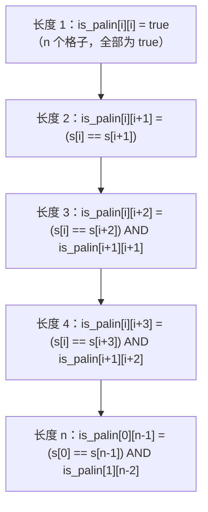
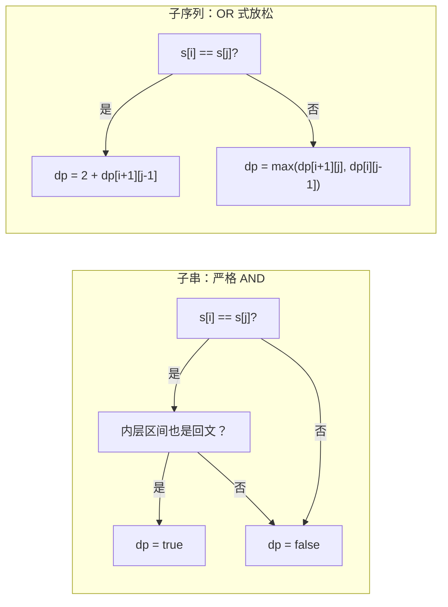

# 回文 DP

LeetCode 5 的示例输入是 `s = "babad"`，期望输出 `"bab"` 或 `"aba"`，两个都算对。五个字符，两个合法答案，一个二十行就写完的 O(n²) 算法。这题看着不大。它从 2011 年起霸占每一份 DP 题单，真正的原因是：最自然的填表顺序是错的 —— 而认出这一点，就是本章的全部内容。

你在本部分见过的其他二维 DP 题，都是逐行填表。[最长公共子序列](./06-lcs.md)读 `dp[i-1][j-1]`、`dp[i-1][j]`、`dp[i][j-1]`：三个格子，全在上方一行或左边一列。从上到下、从左到右，填完。回文 DP 读 `dp[i+1][j-1]` —— 那是当前格子*下面*的一行。从上往下迭代，算法读到的是还没填过的格子，于是几乎所有情况都静默返回 `false`，最后把输入的第一个字符当成答案打印出来。修法是不按*行*填，而按*长度*填。[^1]

## 暴力解法为何不够

最诚实的第一次尝试，是枚举 `s` 的每个子串，再逐个检查是否回文。三层嵌套操作：挑一个左下标，挑一个右下标，跑一次双指针检查。

```python
# 暴力：O(n^3) —— 我们要替换掉的东西
def longest_palindrome_brute(s):
    n = len(s)
    if n == 0:
        return ""
    best = s[0]
    for i in range(n):
        for j in range(i, n):
            # s[i..j] 是回文吗？
            l, r = i, j
            ok = True
            while l < r:
                if s[l] != s[r]:
                    ok = False
                    break
                l += 1
                r -= 1
            if ok and j - i + 1 > len(best):
                best = s[i:j + 1]
    return best
```

子串大约有 `n²/2` 个，每次回文检查花 O(n)，合计 O(n³)。在 LC 5 给定的 `n <= 1000` 上限下，最坏情况要做大约 `5 × 10⁸` 次操作，Python 或 Java 的一秒时限早就超了。[^2]

浪费掉的工作有个名字。暴力解法里，判断「`s[2..7]` 是回文吗」，是拿 `s[2]` 比 `s[7]`，再拿 `s[3]` 比 `s[6]`，再拿 `s[4]` 比 `s[5]`。要回答「`s[1..8]` 是回文吗」，它拿 `s[1]` 比 `s[8]`，再拿 `s[2]` 比 `s[7]`，再拿 `s[3]` 比 `s[6]`，再拿 `s[4]` 比 `s[5]`。后面三次比较，正是上一轮为那个更小子串做过的同一份工作。每个长度 `L` 的区间，都要重做长度 `L-2` 的区间早就定下来的那些内层比较。

诀窍是把每个区间的答案记下来，而不是重算。表就是干这个的。

## 归约

区间 `s[i..j]` 是回文，当且仅当两件事同时成立：两端相等，即 `s[i] == s[j]`；并且严格内层的区间 `s[i+1..j-1]` 自身也是回文。递推式直接掉出来：

```text
is_palin[i][j] = (s[i] == s[j]) AND (j - i < 2 OR is_palin[i+1][j-1])
```

`j - i < 2` 这个短路照顾了两个基准情况。长度为 1 的区间（`i == j`）平凡地是回文。长度为 2 的区间（`j == i + 1`）只要两个字符相同就是回文；它没有内层区间可查，所以这一次内表查找被绕过。

仔细读这条递推。长度为 `L = j - i + 1` 的格子 `is_palin[i][j]`，依赖长度为 `L - 2` 的格子 `is_palin[i+1][j-1]`。依赖落在严格*更短*、且严格*更里*的区间上。里层先算，外层后算；短的先算，长的后算。这是唯一能跑通的填表顺序。

按行填的话，会先算 `is_palin[0][j]`（从 0 开始的一个长区间），再算 `is_palin[1][j-1]`（从 1 开始的短区间，往里缩了一条对角线）。依赖方向是反的：算法要的是内层格子，可内层格子还没填。照样读，拿回来的是数组默认的 `false`，AND 失败，格子被标成 `false`，全程不报错。

正确的迭代顺序是按长度递增。先长度 1，再长度 2，再长度 3，一直到长度 `n`。在每个长度趟里，起点 `i` 从 0 走到 `n - L`，`j` 由 `j = i + L - 1` 得出。等算法算到某个长度 `L` 的格子时，所有长度 `L-2` 的格子都已经有值了。



*每个长度 L 的趟只依赖长度 (L-2) 趟的格子；按行填会在依赖还不存在的时候就把格子算掉。*

## 模式

```python
def longest_palindrome(s):
    n = len(s)
    if n == 0:
        return ""
    # is_palin[i][j] 为 True 当且仅当 s[i..j] 是回文。
    is_palin = [[False] * n for _ in range(n)]
    start, max_len = 0, 1

    # 长度 1。
    for i in range(n):
        is_palin[i][i] = True

    # 长度 2。
    for i in range(n - 1):
        if s[i] == s[i + 1]:
            is_palin[i][i + 1] = True
            start, max_len = i, 2

    # 长度 L 从 3 到 n。
    for L in range(3, n + 1):
        for i in range(n - L + 1):
            j = i + L - 1
            if s[i] == s[j] and is_palin[i + 1][j - 1]:
                is_palin[i][j] = True
                if L > max_len:
                    start, max_len = i, L

    return s[start:start + max_len]
```

**Solution** —— Python（[Java](./10-palindrome-dp/lc-5/sol.java) · [C++](./10-palindrome-dp/lc-5/sol.cpp) · [Go](./10-palindrome-dp/lc-5/sol.go)）

```python
# LC 5. Longest Palindromic Substring
def longest_palindrome(s: str) -> str:
    """LC 5: 2D by-length DP. O(n^2) time, O(n^2) space."""
    n = len(s)
    if n == 0:
        return ""
    # is_palin[i][j] 为 True 当且仅当 s[i..j] 是回文。
    is_palin = [[False] * n for _ in range(n)]
    start, max_len = 0, 1

    # 基准：每个长度 1 的子串都是回文。
    for i in range(n):
        is_palin[i][i] = True

    # 长度 2。
    for i in range(n - 1):
        if s[i] == s[i + 1]:
            is_palin[i][i + 1] = True
            start, max_len = i, 2

    # 长度 L 从 3 到 n，按长度填。
    for L in range(3, n + 1):
        for i in range(n - L + 1):
            j = i + L - 1
            if s[i] == s[j] and is_palin[i + 1][j - 1]:
                is_palin[i][j] = True
                if L > max_len:
                    start, max_len = i, L

    return s[start:start + max_len]


def longest_palindrome_centers(s: str) -> str:
    """Same problem, expand-around-centers. O(n^2) time, O(1) space."""
    if not s:
        return ""

    def expand(left: int, right: int) -> tuple[int, int]:
        while left >= 0 and right < len(s) and s[left] == s[right]:
            left -= 1
            right += 1
        # 循环结束后，[left+1, right-1] 就是最大回文。
        return left + 1, right - 1

    best_l, best_r = 0, 0
    for i in range(len(s)):
        # 以 i 为中心的奇数长度回文。
        l1, r1 = expand(i, i)
        # 以 i 与 i+1 之间为中心的偶数长度回文。
        l2, r2 = expand(i, i + 1)
        if r1 - l1 > best_r - best_l:
            best_l, best_r = l1, r1
        if r2 - l2 > best_r - best_l:
            best_l, best_r = l2, r2
    return s[best_l:best_r + 1]
```

在走推演之前，有三点值得指出来。

基准情况在主循环外面填。长度 1 无条件是回文：单个字符按定义就是回文。长度 2 只在相邻两个字符相同时成立。把它们显式填掉，按长度迭代的结构就无处可藏，同时也把内层循环里那个别扭的 `j - i < 2` 短路消掉了。`L >= 3` 的块里，递推式现在是干净的形式：`s[i] == s[j] AND is_palin[i+1][j-1]`，没有特例。

外层循环迭代 `L`，内层循环迭代 `i`。这个顺序就是本章的全部。反过来写，写成 `for i in range(n): for L in range(...)`，依赖就断了：在 `i = 0` 时，你会为每个 `L` 算 `is_palin[0][L-1]`，而 `is_palin[1][L-2]` 还没被碰过。长度在外，索引在内；算法只读更早那些长度趟里的格子。

证物 —— 也就是真正的那个子串，而不只是它的长度 —— 用 `(start, max_len)` 跟踪。教科书上的 DP 递推在每个格子里存一个布尔值，而 LC 5 要的是一个字符串。每当发现一个长度 `L > max_len` 的回文，`start` 和 `max_len` 一起更新，最后 `s[start:start + max_len]` 就切出答案。只跟踪 `max_len`，回答的是另一个问题。

> [!IMPORTANT]
> 填表顺序是算法的脊梁。外层迭代长度，内层迭代起点，绝不要按行。每个长度 `L` 的格子都依赖严格位于它内部的一个长度 `L-2` 的格子，所以走到长度 `L` 的格子时，内层那个早就算好了。把循环嵌套反过来，凡是长度 3 及以上本该是 `true` 的格子，全都会被填成 `false`，算法在大多数输入上只会返回一个字符。[^3]

## 实例推演：LC 5，`s = "babad"`

分配完的空表：`is_palin` 是 5 × 5，全 `false`。状态：`start = 0`，`max_len = 1`。

**长度 1。** 对角线上的每个格子置 `true`。`is_palin[0][0] = is_palin[1][1] = is_palin[2][2] = is_palin[3][3] = is_palin[4][4] = true`。算法发现了五个长度 1 的回文；最大长度仍是 1。

**长度 2。** 走四对相邻字符。

- `i = 0, j = 1`：`s[0] = 'b'`，`s[1] = 'a'`。不匹配。格子保持 `false`。
- `i = 1, j = 2`：`s[1] = 'a'`，`s[2] = 'b'`。不匹配。格子保持 `false`。
- `i = 2, j = 3`：`s[2] = 'b'`，`s[3] = 'a'`。不匹配。格子保持 `false`。
- `i = 3, j = 4`：`s[3] = 'a'`，`s[4] = 'd'`。不匹配。格子保持 `false`。

`"babad"` 里没有长度 2 的回文。状态不变。

**长度 3。** 三个候选：起点 `i = 0, 1, 2`。

- `i = 0, j = 2`：`s[0] = 'b'`，`s[2] = 'b'`。两端相等。内层是 `is_palin[1][1] = true`。*命中。* 置 `is_palin[0][2] = true`。`L = 3 > max_len = 1`，于是更新 `start = 0, max_len = 3`。子串 `s[0..2] = "bab"` 成为当前最优。
- `i = 1, j = 3`：`s[1] = 'a'`，`s[3] = 'a'`。两端相等。内层是 `is_palin[2][2] = true`。*命中。* 置 `is_palin[1][3] = true`。`L = 3` 不大于 `max_len = 3`，不更新。`"aba"` 也在表里；但 `"bab"` 先被发现，继续当证物。
- `i = 2, j = 4`：`s[2] = 'b'`，`s[4] = 'd'`。不匹配。格子保持 `false`。

**长度 4。** 两个候选。

- `i = 0, j = 3`：`s[0] = 'b'`，`s[3] = 'a'`。不匹配。
- `i = 1, j = 4`：`s[1] = 'a'`，`s[4] = 'd'`。不匹配。

**长度 5。** 一个候选。

- `i = 0, j = 4`：`s[0] = 'b'`，`s[4] = 'd'`。不匹配。

循环结束。返回 `s[0:0 + 3] = "bab"`。

这段推演展示了题目允许的那种不对称。`"bab"` 和 `"aba"` 都是 `"babad"` 里长度 3 的回文，算法两个都记进了表，但每个长度上只有*最先*发现的那个能拿到证物。LC 5 接受任一答案。把证物更新里的严格 `>` 改成 `>=`，算法就返回 `"aba"`，同样正确。

*静态兜底：按长度填表在长度 1 时把主对角线铺满，长度 2 一无所获，长度 3 命中两次（格子 `(0,2)` 和 `(1,3)` 都翻成 true），长度 4、5 全部落空。长度 3 的第一次命中锚定了证物；答案是 `"bab"`。*

## 中心扩展：从 O(n²) 空间到 O(1)

这张二维表为每一对 `(i, j)` 记录 `s[i..j]` 是不是回文。填完之后，被查阅的只有其中一条信息：运行中更新出来的 `(start, max_len)`。剩下 `n²/2 - 1` 个格子只写不读。

有一种办法可以完全不建表，算出同一个答案。

把回文所有可能的*中心*走一遍，只要两侧字符相同就往外扩。奇数长度的回文中间是一个字符：`"racecar"` 以 `'e'` 为中心。偶数长度的回文中心落在两个字符之间：`"bb"` 以索引 0 和索引 1 之间为中心。奇数中心有 `n` 个（每个字符一个），偶数中心有 `n - 1` 个（每对相邻字符一个），合计 `2n - 1` 个候选。对每个中心往外扩，直到两端不等或某一端越出字符串，然后记下全局遇到的最长回文。

```python
def longest_palindrome_centers(s):
    if not s:
        return ""

    def expand(left, right):
        while left >= 0 and right < len(s) and s[left] == s[right]:
            left -= 1
            right += 1
        return left + 1, right - 1

    best_l, best_r = 0, 0
    for i in range(len(s)):
        l1, r1 = expand(i, i)        # 奇数长度，以 i 为中心
        l2, r2 = expand(i, i + 1)    # 偶数长度，在 i 与 i+1 之间
        if r1 - l1 > best_r - best_l:
            best_l, best_r = l1, r1
        if r2 - l2 > best_r - best_l:
            best_l, best_r = l2, r2
    return s[best_l:best_r + 1]
```

两个算法是同构的。二维表为每一对写下「`s[i..j]` 是回文吗」的答案；中心法当场算出同一个答案，然后丢掉。两者都是 O(n²) 时间。`2n - 1` 个中心，每个最多扩 `n/2` 步，按数上三角格子那套等差级数算，总和是 `n²/2`。[^4] 差别在空间：表是 O(n²)，中心法是 O(1)。

中心法的代码量只有表法的三分之二，也是大多数面试官想看到的答案。但表是更好的教学框架，因为按长度迭代的结构直接摆在循环嵌套里；中心法把它藏进了两个指针从每个候选中心往外走的展开过程中。[^4]

> [!WARNING]
> **忘了同时检查奇数长度和偶数长度的中心。** 对每个 `i` 只跑 `expand(i, i)`，会找到所有奇数长度回文，漏掉所有偶数长度回文。这个 bug 在 `s = "cbbd"` 上立刻现形：算法返回一个单字符（`"c"`、`"b"` 或 `"d"`），而不是正确的 `"bb"`。偶数长度回文的锚点在两个字符*之间*，不在单个字符上；标准修法是对每个索引同时调用 `expand(i, i)` 和 `expand(i, i+1)`，维基百科「Slower algorithm」那一节讲的就是这个案例。[^4]

## 子串不是子序列

本章的递推式有一个近亲，乍看很像，其实是另一套算法。

LC 516 要的是最长回文*子序列*，字符可以跳过。输入 `"bbbab"`，LC 5（子串）返回 `"bbb"`（长度 3，连续的那一段）。LC 516（子序列）返回 4：跳过索引 3 上的 `'a'`，剩下的 `"bbbb"` 正着读反着读一样。同样的输入，不同的问题，不同的递推。

子串递推是严格的 AND：两端必须相等，*并且*内层区间必须是回文。任一不成立，格子就是 `false`。子序列递推放松了这一点：两端不等时，取「跳过左端点」和「跳过右端点」中更好的那个，这正是[最长公共子序列](./06-lcs.md)的形状。



*子串要求两端相等 AND 内层回文，是严格合取，「不成立」会沿链一路往上传。子序列把不等端点那一条分支放松成两个严格更小子问题上的 max，与 LCS 递推同形。[^5]*

诊断测试：问这道题允不允许跳过字符。如果 `"aabb"` 的合法回文答案可以是 `"abba"` 或 `"ab"`，那是子序列题，递推要放松。如果 `"aabb"` 只允许 `"aa"` 或 `"bb"`，那是子串题，递推必须严格。在子串题上套 LCS 式逻辑，算法就会给出错误答案，比如对 `"abcbcba"` 返回 `"bbb"`，而正确答案是 `"abcbcba"`（整个串本身就是回文子串）。

## 实际开销

| 变体 | 时间 | 空间 | 说明 |
|---|---|---|---|
| 二维 DP 填表（LC 5、LC 647） | O(n²) | O(n²) | 每个子串一个 bool；`n*(n+1)/2` 个格子按长度顺序填 |
| 中心扩展（LC 5、LC 647） | O(n²) | O(1) | 工作量与填表相同，只是从不落表 |
| 最长回文子序列 DP（LC 516、LC 1312） | O(n²) | O(n²) | CLRS 第 14-2 / 15-2 题的教科书递推[^5] |
| 最少切割回文划分（LC 132） | O(n²) | O(n²) | 一维 `dp[i] = 最少切割数`，叠在布尔回文表上 |
| Manacher 算法 | O(n) | O(n) | 线性时间，在字符串部分讲（见下） |

对本章的算法来说 O(n²) 是紧的，因为算法要对 `s` 的每个连续子串给出答案，而这样的子串恰好有 `n*(n+1)/2` 个。每个格子只花 O(1) 的工作量；中心法做同样的工作量，只是不写下来。任何被迫考虑每个区间的算法，都躲不开 `n²/2` 的下界。

O(n) 的突破是 Manacher 算法，Glenn Manacher 1975 年发表在 *Journal of the ACM* 上。[^6] 它利用回文的镜像性：当算法已经发现一个以位置 `c` 为中心、右边界为 `r` 的长回文时，任何 `i < r` 的位置都能白拿至少 `min(r - i, p[mirror])` 的回文半径 —— 靠的是外围那个回文的对称性。用「中心只增不减、右边界只增」的势能论证，总工作量摊还到 O(n)。[^4] 这个算法三十行左右就能写完，但确实微妙；不看着它跑一遍，光读代码很难懂。课程里字符串那一部分会把 Manacher 讲透。就面试而言，O(n²) 是现实的天花板。LC 5 的 `n <= 1000` 意味着表法大约 `10⁶` 次操作，任何语言不调优都能过。[^2]

## 模式失效的场景

布尔谓词 `is_palin[i][j]` 是脊梁。另外三道面试题，以不同方式从同一张表、或从同形的递推里读出答案。

### 数命中次数而不是找最长（LC 647）

LC 647 问 `s` 里有多少个不同的连续子串是回文。同样的填表顺序、同样的递推、同样的长度在外迭代；只把 `(start, max_len)` 这个证物换成一个计数器，每当 `is_palin[i][j]` 翻成 `true` 就加一。中心扩展的写法更干净：每个中心上，每成功扩一步就记一个新回文，答案就是 `2n - 1` 个中心的扩展长度之和。同样的时间复杂度，同样的代码骨架，只是读出的东西不同。[^4]

### 归约：让字符串变成回文的最少插入数等于 `n - LPS`（LC 1312）

LC 1312 问把 `s` 变成回文最少要插入多少个单字符。归约是本章的低调揭晓：

```text
min_insertions(s) = len(s) - LPS(s)
```

`LPS` 是 `s` 的最长回文*子序列*的长度。直觉是：LPS 是已经处在回文形状里的最长骨架；骨架之外的每个字符，都得靠插入一个孪生字符去配平这种不对称，每有一个局外人就多一次插入。对 `s = "leetcode"`，最长回文子序列是 `"eee"`（长度 3），答案是 `8 - 3 = 5`。[^7]

算法就是 §「子串不是子序列」里的最长回文子序列 DP：同样的 `dp[i][j]` 定义在闭区间 `s[i..j]` 上，同样的按长度填，同样的把 AND 放松成 max 的递推。插入次数读作 `n - dp[0][n-1]`。

### 分层 DP：最少切割次数（LC 132）

LC 132 问把 `s` 切成若干个回文子串，最少要切几刀。两个 DP 叠在一起。先按本章的办法把 `is_palin[i][j]` 表填好，当预言机用。再填一维表 `cuts[i] = 把 s[0..i] 切完的最少刀数`：

```text
cuts[i] = 0                                        if is_palin[0][i]
cuts[i] = min over j < i of cuts[j] + 1            otherwise, where is_palin[j+1][i]
```

外层循环 `i` 从 0 走到 `n - 1`，内层循环枚举切点 `j`。两个循环都是 O(n)，所以总代价是在 O(n²) 的回文表填充之上再叠 O(n²)，整体仍是 O(n²)。LC 132 与[区间 DP](./11-interval-dp.md)交叉互列 —— 切分计数那一套递推形状归区间 DP 管，本章管它依赖的回文谓词。[^7]

## 常见陷阱

> [!WARNING]
> **长度 2 时内表查找的差一错误。** 把递推写成 `is_palin[i][j] = (s[i] == s[j]) AND is_palin[i+1][j-1]` 而不加 `j - i < 2` 短路，长度 2 的格子会去读 `is_palin[i+1][i]`。那个格子在对角线下方，属于表里没用上的那半边，零初始化后默认是 `false`。结果：所有长度 2 的回文（`"aa"`、`"bb"`、`"oo"`）都被静默漏掉。修法二选一：要么在单条递推里保留 `j - i < 2 OR is_palin[i+1][j-1]` 短路，要么在长度 3 的循环之前把长度 1 和长度 2 显式填成基准情况 —— 参考实现用的是后者。

> [!WARNING]
> **混淆子串与子序列。**「最长回文子串」（LC 5）和「最长回文子序列」（LC 516）听起来几乎一样，二维递推也相似，但它们是两道不同的题。对 `"abcbcba"`，LC 5 返回整个串（长度 7，连续回文）。LC 516 在这里也返回 7，但对 `"bbbab"` 两者分道扬镳：LC 5 返回 `"bbb"`（长度 3），LC 516 返回 4（子序列 `"bbbb"`）。写递推之前，先用自己的话把题目复述一遍。字符能跳，递推就是 LCS 形状、在两个更小子问题上取 max；不能跳，递推就是本章的严格 AND。[^5]

## 题目梯度

### 核心（三题全做才算掌握本章）

- [LC 5 — Longest Palindromic Substring](https://leetcode.com/problems/longest-palindromic-substring/) [中等] • palindrome-dp-by-length ★
- [LC 647 — Palindromic Substrings](https://leetcode.com/problems/palindromic-substrings/) [中等] • palindrome-dp-by-length
- [LC 1312 — Minimum Insertion Steps to Make a String Palindrome](https://leetcode.com/problems/minimum-insertion-steps-to-make-a-string-palindrome/) [困难] • palindrome-dp-subseq-reduction

### 进阶（可选）

- [LC 516 — Longest Palindromic Subsequence](https://leetcode.com/problems/longest-palindromic-subsequence/) [中等] • palindrome-dp-subseq
- [LC 132 — Palindrome Partitioning II](https://leetcode.com/problems/palindrome-partitioning-ii/) [困难] • interval-dp-with-palindrome-table

LC 5 是本章的招牌题（★），也是按长度填表最干净的演示。核心三题各练回文谓词的一项承重读法：最长子串（LC 5）、回文子串计数（LC 647）、最少插入的 `n - LPS` 归约（LC 1312）。面试常考的题库里没有公认的 Easy 回文 DP 题。LC 9（Palindrome Number）是整数运算，LC 125（Valid Palindrome）是双指针检查；两者都不用这张表，所以梯度只跨中等和困难两档。

## 后续衔接

下一章[区间 DP](./11-interval-dp.md)把 LC 132 用到的那层切分计数推广成一族题，包括矩阵链乘（LC 1039）、戳气球（LC 312）和取石子游戏的各种变体。形状是同一个：一张以闭区间 `[i, j]` 为下标的二维表，按长度递增填，内层格子在区间内某个分割点上做聚合。

Manacher 的 O(n) 算法 —— 中心法的线性时间替代 —— 在课程里字符串那一部分，和 KMP、Aho-Corasick 一起讲。LC 5 的面试天花板宽松地就是 O(n²)，所以一套能跑的回文 DP 足够应付你实际会遇到的几乎所有面试轮次。真要处理百万字符的输入、要线性时间，下一站就是字符串部分。

## 参考文献

[^1]: LeetCode, "5. Longest Palindromic Substring." <https://leetcode.com/problems/longest-palindromic-substring/>.

[^2]: walkccc/LeetCode, "5. Longest Palindromic Substring." <https://walkccc.me/LeetCode/problems/5/>.

[^3]: GeeksforGeeks, "Longest Palindromic Substring using Dynamic Programming." <https://www.geeksforgeeks.org/dsa/longest-palindromic-substring-using-dynamic-programming-2/>.

[^4]: Wikipedia, "Longest palindromic substring." <https://en.wikipedia.org/wiki/Longest_palindromic_substring>.

[^5]: walkccc/CLRS, "15-2 Longest palindrome subsequence" (CLRS 3rd ed. Problem 15-2; 4th ed. Problem 14-2). <https://walkccc.me/CLRS/Chap15/Problems/15-2/>.

[^6]: Glenn Manacher, "A new linear-time 'on-line' algorithm for finding the smallest initial palindrome of a string," *Journal of the ACM*, 22(3):346–351, 1975.

[^7]: walkccc/LeetCode, "132. Palindrome Partitioning II." <https://walkccc.me/LeetCode/problems/132/>.
