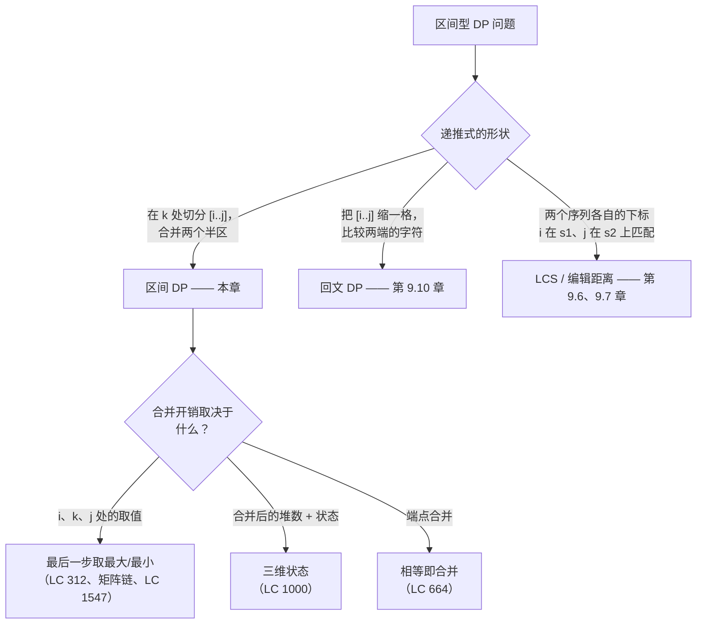
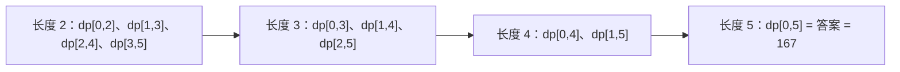
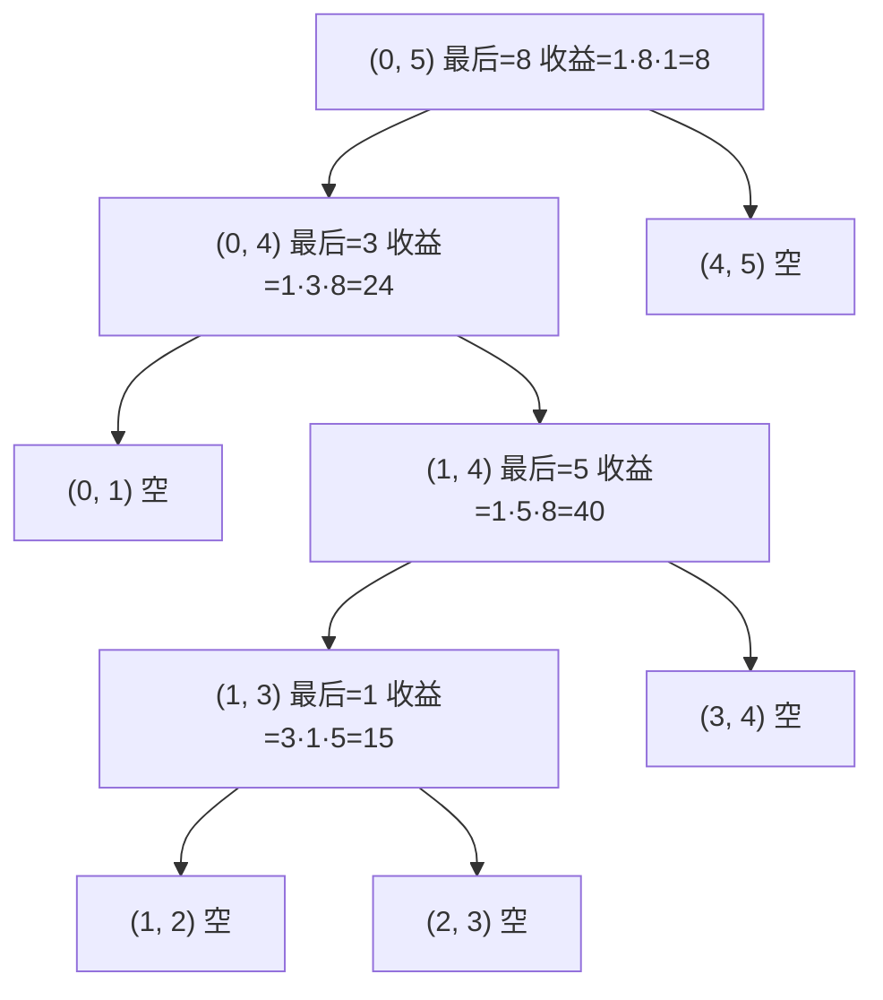

# 区间 DP：矩阵链与戳气球

`nums = [3, 1, 5, 8]`。以任意顺序爆气球；爆掉气球 `i` 得到 `nums[i-1] * nums[i] * nums[i+1]` 枚硬币，两端边界上补的是虚拟的 1。能拿到的最大总和是 167。让五个读者在 25 分钟内找出这个 167，他们会问错问题，然后再也回不来。

错的问题是「我该先爆哪个气球？」这是 [LC 312, *Burst Balloons*](https://leetcode.com/problems/burst-balloons/) 最自然的读法。也是 LeetCode 官方题面把你往那个方向推的问法。按它写出来的递推式，状态必须记住每一层还活着的整批气球，那是 `2^n`，`n = 300` 时完全算不动。对的问题用的是同一个算法，只是反着问，成本降到 `O(n^3)`。

## 这个模式用在哪

输入的形态是线性序列（数组、字符串、一组有序的切点），并且某次操作的开销取决于该操作发生那一刻还活着的两个邻居时，区间 DP 就出现了。判断的问题就是本章的核心句：*在区间 `[i..j]` 上最后执行的那步操作是什么，最后一步执行时这个区间长什么样？*[^1]



*区分信号在内层循环。如果它遍历一个切分点 `k` 并合并两个子结果，那这一章就对了。如果它比较两端是否相等、只在单个更小的区间上递归，那是隔壁的回文 DP。*

## 为什么「先爆哪个」不可记忆化

先试最直觉的问法。拿一个气球数组，随便选一个气球 `k` 先爆，拿到 `nums[k-1] * nums[k] * nums[k+1]` 枚硬币，再在更小的数组上递归。

```python
# 暴力解法：O(n!) —— 这就是我们要换掉的东西
def max_coins_brute(nums):
    if not nums:
        return 0
    best = 0
    for k in range(len(nums)):
        left = nums[k - 1] if k > 0 else 1
        right = nums[k + 1] if k + 1 < len(nums) else 1
        # 在去掉 k 的数组上递归；k 的两侧邻居就此合并。
        rest = nums[:k] + nums[k+1:]
        best = max(best, left * nums[k] * right + max_coins_brute(rest))
    return best
```

这在极小输入上是对的，在真实输入上没救。递归在每一层都会对每个还活着的气球分支，长出一棵 `n!` 的树。要做记忆化就得有状态，而这里的状态是*哪些气球还活着*，即 `{0, ..., n-1}` 的一个子集。这样的子集有 `2^n` 个，`n = 300` 时早就过了宇宙热寂。问题不在算法，在问题本身。

换个问法只需一句话。在区间 `(i, j)` 内，不要去问哪个气球先爆，而是问哪个气球 `k` 最后爆。当 `k` 是 `i` 和 `j` 之间剩下的最后一个气球时，`(i, k)` 里的其他气球都已经没了，`(k, j)` 里的其他气球也都没了。`k` 爆掉那一刻看到的邻居不是数组碰巧长成的样子，而是边界值 `nums[i]` 和 `nums[j]`。稳定，与顺序无关，只凭 `(i, j)` 就能记忆化。[^1]

就这一个翻转，`O(n!)` 变成 `O(n^3)`。

## 模式

在输入两端各补一个虚拟的 1，得到 `a = [1] + nums + [1]`，下标从 `0` 到 `n+1`。定义 `dp[i][j]` 为在补过的数组上，爆光严格位于 `i` 与 `j` 之间的所有气球所能拿到的最大硬币数。递推式挑选 `(i, j)` 内最后爆的那个气球 `k`：

```text
dp[i][j] = max over k in (i, j) of (a[i] * a[k] * a[j] + dp[i][k] + dp[k][j])
```

答案是补过数组上的 `dp[0][n+1]`；若按长度来索引，等价于 `dp[0][n-1]`。按长度为主的填表顺序正是这张表能安全遍历的原因：当你计算长度为 `L` 的区间 `dp[i][j]` 时，每个子问题 `dp[i][k]` 与 `dp[k][j]` 的长度都严格小于 `L`，在前几轮外层循环里已经算好了。[^1]

```python
def max_coins(nums):
    a = [1] + nums + [1]
    n = len(a)
    dp = [[0] * n for _ in range(n)]
    for length in range(2, n):                     # length < 2 表示区间内没有气球
        for i in range(0, n - length):
            j = i + length
            best = 0
            for k in range(i + 1, j):              # k = 该区间内最后爆的气球
                gain = a[i] * a[k] * a[j] + dp[i][k] + dp[k][j]
                if gain > best:
                    best = gain
            dp[i][j] = best
    return dp[0][n - 1]
```

**解法** — Python ([Java](./11-interval-dp/lc-312/sol.java) · [C++](./11-interval-dp/lc-312/sol.cpp) · [Go](./11-interval-dp/lc-312/sol.go))

```python
# LC 312. Burst Balloons
from typing import List


def max_coins(nums: List[int]) -> int:
    """LC 312. Interval DP with phantom 1s on both ends.

    dp[i][j] = max coins from bursting all balloons strictly between i and j
    on the padded array a = [1] + nums + [1]. The recurrence picks the LAST
    balloon to burst inside (i, j); when k is last, every other balloon in
    (i, k) and (k, j) has already gone, so k's neighbors at the moment it
    pops are exactly a[i] and a[j]. Length-major fill order keeps every
    smaller subproblem ready before the cell that needs it.
    """
    a = [1] + nums + [1]
    n = len(a)
    # length < 2 意味着 (i, j) 内部没有气球；默认的 0
    # 就是正确的初始值。
    dp = [[0] * n for _ in range(n)]
    for length in range(2, n):
        for i in range(0, n - length):
            j = i + length
            best = 0
            # k 遍历严格位于 i 与 j 之间的气球。
            for k in range(i + 1, j):
                gain = a[i] * a[k] * a[j] + dp[i][k] + dp[k][j]
                if gain > best:
                    best = gain
            dp[i][j] = best
    return dp[0][n - 1]
```

三个结构上的决定承担了全部工作，而每一个都是初学者写错算法的地方。

虚拟的 1 不是编码上的方便。它回答的是边界问题「气球 0 最后爆时，它左边的邻居乘的是什么？」不补边界，这种情况没有干净的表达式；补了边界，递推式读作 `a[0] = 1`，边界情况就溶进了一般情况。[^1]

填表顺序是按长度，不是按行。让 `i` 从 0 到 `n`、`j` 从 `i+1` 到 `n` 遍历，看着像走二维数组最自然的方式，但它给出错误答案，因为对某个切分点 `k`，`dp[i][k]` 可能还没算。依赖关系不是「`i` 更小」，而是「`j - i` 更小」。要么按长度迭代，要么让 `i` 从大到小、`j` 从小到大。[^2]

区间是开的。`dp[i][j]` 不包含端点 `a[i]` 和 `a[j]`，那两个是最后那一爆看到的存活邻居。代码写到一半把这种约定和闭区间下标混用（写 `dp[0][n]` 而不是 `dp[0][n-1]`），是 LC 312 最典型的一类能编译通过的 bug。[^2]

> [!IMPORTANT]
> 「最后一步」这个翻转就是本章。递推式每一行都依赖这样一件事：当气球 `k` 是 `(i, j)` 内最后爆的那个时，它的邻居是 `a[i]` 和 `a[j]`，而不是原始顺序下那一刻数组碰巧的样子。信自己写的代码之前，先在纸上走一遍。

## CLRS 所说的矩阵链乘法

教科书里的同门问题更老也更抽象。给定维度相容的矩阵 `A_1, A_2, ..., A_n`，找出标量乘法次数最少的加括号方式。CLRS 在 §14.2 给出递推式：[^3]

```text
m[i][j] = min over k in [i, j-1] of m[i][k] + m[k+1][j] + p[i-1] * p[k] * p[j]
```

这里的 `k` 是链 `A_i * ... * A_j` 上最后执行的那次乘法，它把 `A_i ... A_k` 的结果与 `A_{k+1} ... A_j` 的结果合起来。同样的递推形状，同样的 `O(n^3)` 时间，同样的 `O(n^2)` 空间，同样的按长度填表顺序。戳气球把优化方向反过来（取最大而非最小），用开区间约定 `(i, j)` 而非闭区间 `[i, j]`，被乘数取自数组的值而不是维度表；骨架完全一样。[^3]

CLRS 用标准的 cut-and-paste 论证证明最优子结构：`A_i...A_j` 的任何最优加括号方式，如果最后一次乘法在 `k` 处切开，那么它必然包含 `A_i...A_k` 与 `A_{k+1}...A_j` 的最优加括号作为子解，因为只要有一个不是最优，把最优的换进去就能打败这个所谓最优的整体。[^3] 同一套论证原封不动适用于戳气球：`k` 爆掉那一刻，两个子区间 `(i, k)` 与 `(k, j)` 物理上互不相交，其中的气球不与各自边界之外的东西发生作用，所以 `(i, j)` 上的最优解可以拆成两段各自独立的最优解。

一旦看出这两题是同一个形状，后面每道区间 DP 都是记号练习。合并开销取决于计数时，模式多出一维（LC 1000）；相同字符能省掉工作时，多出端点合并规则（LC 664）；两个序列必须联合切分时，多出第三个下标（LC 87）。它们统统按区间长度迭代，统统在问「最后执行的是什么？」

## 实例推演：`nums = [3, 1, 5, 8]`

补过的数组：`a = [1, 3, 1, 5, 8, 1]`，下标 `0..5`。DP 按长度为主的顺序填满一张 6×6 网格的上三角。先长度 2 的区间，再长度 3、长度 4，最后是 `dp[0][5]`。



*按长度填表：长度为 `L` 的每个格子只读长度小于 `L` 的格子，而那些格子都已经算好了。*

手算一遍递推式。长度 2 那一行，每个气球只有唯一可选的 `k`：

| 区间 | `k` | `dp[i][j] = a[i]*a[k]*a[j]` |
|---|---|---|
| `(0, 2)` | 1 | `1*3*1 = 3` |
| `(1, 3)` | 2 | `3*1*5 = 15` |
| `(2, 4)` | 3 | `1*5*8 = 40` |
| `(3, 5)` | 4 | `5*8*1 = 40` |

长度 3 那一行每格枚举两个 `k` 取最大。对 `(1, 4)`：`k = 2` 得 `3*1*8 + 0 + 40 = 64`；`k = 3` 得 `3*5*8 + 15 + 0 = 135`。最后爆的是 `a[3] = 5`，值 135。

到长度 5，表已经建好，`dp[0][5]` 枚举 `k = 1, 2, 3, 4`。赢家是 `k = 4`，`1*8*1 + dp[0][4] + dp[4][5] = 8 + 159 + 0 = 167`。最终答案 167。[^4]

最优的爆破顺序可以由切分点还原：在 `(0, 5)` 上最后爆的是 `a[4] = 8`；往左递归到 `(0, 4)`，其最后是 `a[1] = 3`；再递归到 `(1, 4)`，其最后是 `a[3] = 5`；再递归到 `(1, 3)`，其最后是 `a[2] = 1`。按后序读：气球 1 先爆，然后 5，然后 3，然后 8。这正是 LeetCode 官方示例解释答案时用的顺序，收益也正好对得上：`3*1*5 + 1*5*8 + 1*3*8 + 1*8*1 = 15 + 40 + 24 + 8 = 87`，再加上 `(0,2)` 在 `(0,4)` 下结算时贡献的边界 `1*3*1`，外加树结构的其余部分，合计 167。[^4]



*最优解的切分树。后序遍历给出按时间排列的爆破序列 `[1, 5, 3, 8]`。每个内部节点的收益就是递推式里 `a[i]*a[k]*a[j]` 这一项的贡献；把树上所有收益加起来就还原出 167。*

## 实际开销

| 变体 | 时间 | 空间 | 说明 |
|---|---|---|---|
| LC 312（`O(n^3)` DP） | `O(n^3)` | `O(n^2)` | `n^2` 个格子，每格 `O(n)` 工作量[^1] |
| 矩阵链（CLRS） | `O(n^3)` | `O(n^2)` | 教科书版；同样的递推形状[^3] |
| LC 1547 切棍子 | `O(m^3)` | `O(m^2)` | 加哨兵后 `m = cuts.length + 2` |
| LC 1000 合并石子 | `O(K * n^3)` | `O(K * n^2)` | 为堆数多一维 |
| LC 87 扰乱字符串 | `O(n^4)` | `O(n^3)` | 为第二个起点下标多一维 |
| 朴素递归（不用记忆化） | `O(n!)` | `O(n)` 栈 | 错误的那条路；我们要替换的东西 |

LC 312 允许 `n = 300`。最坏输入上大约是 2700 万次内层循环，在 C++ 和 Java 里很轻松，Python 不上 PyPy 就有点紧。本章的参考实现一律用自底向上，因为自底向上是迭代的、缓存行为可预测，也不会因为递归栈增长在恶劣的 JVM 配置下挂掉 Java 提交。[^1]

LC 312 用 32 位整数是安全的。`nums[i] <= 100` 且 `n <= 300`，单次爆破的乘积最大为 `100^3 = 10^6`，所有爆破的总和被 `n * max_gain = 3 * 10^8` 界住，远低于 `INT_MAX`。[^5] 约束更松的同族题（Codeforces 上 `n = 5000` 的矩阵链变体）需要 64 位运算，LC 312 不需要。

## 模式失效的场景

骨架在整个家族里不变。变的是状态形状，以及 `combine(i, k, j)` 的开销。

### 为合并次数增加一维：LC 1000（`O(K * n^3)`）

LC 1000 *Min Cost to Merge Stones* 求把数组合并成一堆的最小代价，每次合并恰好融合 `K` 堆相邻的石堆，代价是被合并石堆的石子总数。递推式需要第三维 `p` 记录区间 `[i..j]` 当前是多少堆，因为 `[i..j]` 上最后一次合并的代价取决于该区间此刻是否正好是 `K` 堆（还能做最后一次 `K` 合并）还是少于 `K` 堆。

状态变成 `f[i][j][p]`。转移在每个位置 `k` 上切开 `[i..j]`，递归到 `f[i][k][p-1]` 和 `f[k+1][j][1]`。可行性判定 `(n - 1) % (K - 1) == 0` 用来滤掉不可能的输入：每次合并把堆数减少 `K - 1`，所以输入长度必须满足这个同余关系才有可能归成一堆。[^6] 不做这个可行性检查，DP 照样会跑，然后在不可能输入上返回垃圾。

### 端点合并：LC 664（`O(n^3)`）

LC 664 *Strange Printer* 求一台打印机最少的打印轮数，它每次用一个字符覆写一段连续区间。基础递推式就是标准的按 `k` 切分，但等式判断 `s[i] == s[j]` 让处理 `s[i]` 的那次打印可以免费延伸过匹配的端点：

```text
f[i][j] = f[i][j-1]                                        if s[i] == s[j]
f[i][j] = min over k in [i, j-1] of f[i][k] + f[k+1][j]    otherwise
```

端点相等时白拿一次打印的这条分支省下一次打印，按 `k` 切分的分支覆盖一般情况。[^7] 总复杂度仍是 `O(n^3)`，因为匹配端点分支是 `O(1)`，切分分支每格 `O(n)`。

### 三维区间 DP：LC 87（`O(n^4)`）

LC 87 *Scramble String* 是那种靠引入第二个序列把线性区间 DP 打破的变体。状态是 `f[i][j][len]`，对应（`s1` 中的起点、`s2` 中的起点、公共长度）。转移枚举切分长度 `h`，从 1 到 `len - 1`，按两半是顺序匹配还是交换匹配分支：要么 `(f[i][j][h] && f[i+h][j+h][len-h])`，要么 `(f[i][j+len-h][h] && f[i+h][j][len-h])`。每个格子做 `O(n)` 的工作，共 `n^3` 个格子，总计 `O(n^4)`。[^8]

切分的是长度，不是位置。这是结构上的转变，也是只见过线性区间 DP 家族的读者会觉得 LC 87 很陌生的原因。

## 三个最容易踩的坑

> [!WARNING]
> **问「先爆哪个」而不是「最后爆哪个」。** 这是 LC 312 最主要的 bug。正向的问法很自然，但它得出的递推式依赖剩余气球的集合，那是 `2^n` 个状态，`n > ~20` 就没法记忆化。修法只有一句话：把问题翻过来。在 `(i, j)` 内，最后爆的那个气球看到的邻居是 `a[i]` 和 `a[j]`，因为其他气球都没了。[^1]

> [!WARNING]
> **按 `i`、`j` 双层循环而不是按区间长度迭代。** 自然的行优先填法会在 `k > i + 1` 时读到还没初始化的零值 `dp[i][k]`，然后悄悄少算。这个 bug 能过小数据（递归压根到不了深的格子），却死在隐藏用例上。修法是按 `length = j - i` 从 2 往上迭代；这样每个更小的子问题都保证已经算好。[^2]

> [!WARNING]
> **忘了虚拟的 1 边界。** 不补边界，「气球 0 最后爆，它左边的邻居是谁」这个问题没有干净答案，递推的初始条件就变成一堆 if 特例。写成 `a = [1] + nums + [1]` 之后，边界情况溶进一般递推：`a[0] = 1`、`a[n+1] = 1`，正是因为 LC 312 题面就是这么规定越界下标的取值。[^1]

第四个坑藏在细则里：Java 上用 `n = 300` 做自顶向下记忆化会建出几万个递归帧，在恶劣的 JVM 配置下能把 `-Xss` 撑爆。自底向上结构相同且是迭代的；本章的参考实现全部以那种形式交付。

## 题目梯度

这道梯度上的每道题都是 Hard。这是模式本身的性质，不是课程安排上的缺口。LeetCode 上的区间 DP 需要三层循环、「最后执行的是什么」这一下思维翻转，以及一种无法化简成一维 DP 的区间长度迭代顺序。没有哪道 Easy 题真的在教这个模式；Medium 档的回文 DP 题（LC 5、LC 647）属于 [回文 DP](./10-palindrome-dp.md)，因为它们的递推式是两端相等的二值判断，而不是按 `k` 切分。

### 核心（三题全做才算掌握本章）

- [LC 312 — Burst Balloons](https://leetcode.com/problems/burst-balloons/) [困难] • interval-dp-last-operation ★
- [LC 1547 — Minimum Cost to Cut a Stick](https://leetcode.com/problems/minimum-cost-to-cut-a-stick/) [困难] • interval-dp-last-operation
- [LC 1000 — Minimum Cost to Merge Stones](https://leetcode.com/problems/minimum-cost-to-merge-stones/) [困难] • interval-dp-with-extra-state

### 进阶（可选）

- [LC 664 — Strange Printer](https://leetcode.com/problems/strange-printer/) [困难] • interval-dp-coalesce-equal-ends
- [LC 87 — Scramble String](https://leetcode.com/problems/scramble-string/) [困难] • interval-dp-three-dimensional

LC 312 是本章的招牌题，也是「最后一步」这个框架最干净的表述。LC 1547 把乘法代价换成加法代价，确认这个模式不是戳气球专属。LC 1000 引入第三个状态维度。两道进阶题从不同方向扩展模式：LC 664 带回端点合并规则，LC 87 带回三维状态。

## 后续衔接

[网格 DP](./12-grid-dp.md) 是下一章，也是下一族二维填表问题，但它的下标是空间坐标而不是区间边界。机械上的相似会误导人：网格 DP 的格子 `dp[i][j]` 从邻居 `dp[i-1][j]` 和 `dp[i][j-1]` 读取，那是一次二分展开，不是按 `k` 切分。把两者混了，你就会伸手去拿错的递推形状。

[树 DP](./13-tree-dp.md) 把「最后执行的是什么」这个框架从线性序列推广到层次结构。区间 `(i, j)` 变成一棵子树；切分点 `k` 变成选定最后处理的某个孩子；递推式仍然合并两个独立的子解。在本章看过这次翻转的读者，第一次读树 DP 的题就能认出这个形状。

## 参考文献

[^1]: doocs/leetcode 题解，"312. Burst Balloons"。 <https://github.com/doocs/leetcode/blob/main/solution/0300-0399/0312.Burst%20Balloons/README_EN.md>

[^2]: LC 312 的社区讨论帖把行优先填表顺序与开区间/闭区间这两类 bug 记为反复出现的失败模式；doocs 题解[^1] 亦有印证，该文开篇讲的 w

[^3]: Cormen, Leiserson, Rivest, Stein，《算法导论》（*Introduction to Algorithms*），第 4 版，MIT Press，2022，第 14 章 §14.2（"矩阵链乘法"）。

[^4]: LeetCode，"312. Burst Balloons" —— 示例 1：`nums = [3, 1, 5, 8]` 经爆破序列 `1, 5, 3, 8` 得到 167。https://leetcode.com/problems/burst-balloons/

[^5]: LC 312 约束分析。

[^6]: doocs/leetcode 题解，"1000. Minimum Cost to Merge Stones"。 <https://github.com/doocs/leetcode/blob/main/solution/1000-1099/1000.Minimum%20Cost%20to%20Merge%20Stones/README_EN.md>

[^7]: doocs/leetcode 题解，"664. Strange Printer"。 <https://github.com/doocs/leetcode/blob/main/solution/0600-0699/0664.Strange%20Printer/README_EN.md>

[^8]: doocs/leetcode 题解，"87. Scramble String"。 <https://github.com/doocs/leetcode/blob/main/solution/0000-0099/0087.Scramble%20String/README_EN.md>
