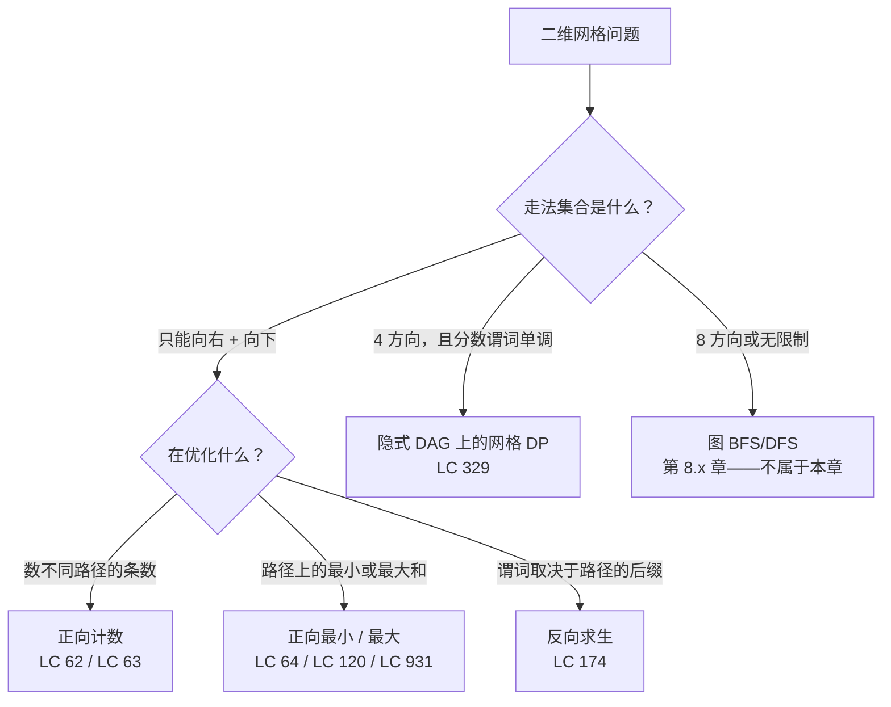
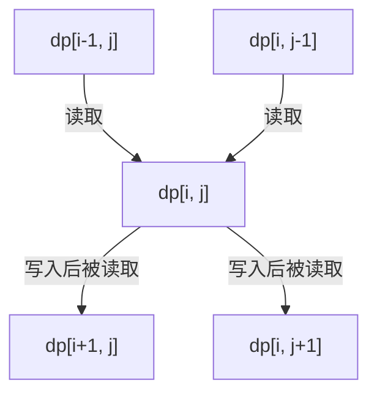
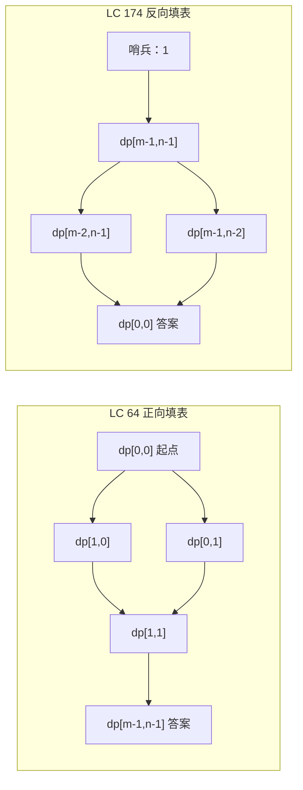
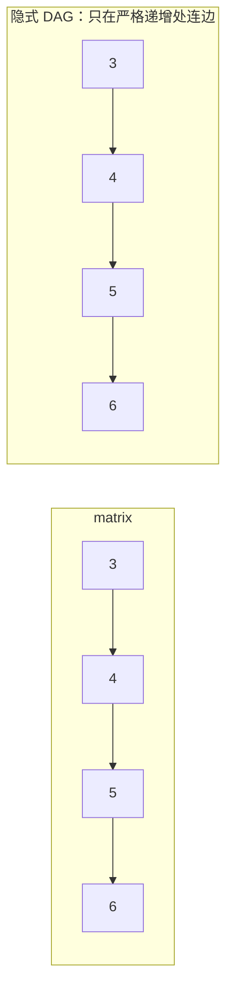

# 网格 DP：正向填表，反向求生

`m = 3`，`n = 7`。一个机器人站在 `(0, 0)`，每次向下或向右走一格，走到 `(2, 6)`。有多少条不同的路线？答案是 28，而一个刚毕业的计算机专业学生能给出三种做法：枚举所有路径然后超时；写一个递归，在 `m = n = 100` 时要跑到宇宙热寂之后；或者自上而下填一张 `3 x 7` 的表，每个格子做一次加法。第三种做法就是本章。而那个能把它弄坏的问题，也是。

弄坏它的问题叫《地牢游戏》（Dungeon Game），[LC 174](https://leetcode.com/problems/dungeon-game/)。同样是 `m x n` 的网格。机器人换成了骑士；格子装的是 HP 增减量，不再是无权的；骑士从 `(0, 0)` 出发，初始 HP 是某个未知值 `H`，必须走到 `(m-1, n-1)`，且在每个格子上 HP 都至少为 1。求最小的 `H`。[^1] 在《不同路径》上管用的那套递推式，到这里就不管用了，原因正是本章的核心观点：在网格 DP 里，迭代顺序不是风格选择。它跟着依赖方向走，而依赖方向跟着问题问的东西走。

## 如何识别这个模式

任何二维网格问题的诊断问题都是：给定目标格 `(i, j)`，哪些格子可能是到达这里之前的最后一步？如果答案是一个小的有限前驱集合，而且这些前驱自身的 DP 值在某种自然的填表顺序下已经算好了，那你手上就是网格 DP。递推式有固定形状：`dp[i][j] = combine(dp[predecessor_1], dp[predecessor_2], ..., cell_cost[i][j])`。变的是 `combine` 运算符，形状不变。



*`combine` 运算符就是判别器。计数用 `+`。优化用 `min(...) + cost` 或它的取 max 版本。当终点处的谓词取决于每个格子之后发生的事，迭代方向就反过来，运算符变成 `max(min(...) - cost, 1)`。*

## 暴力解法为何不够

招牌题是 [LC 62, *Unique Paths*](https://leetcode.com/problems/unique-paths/)。[^2] 一个 `m x n` 网格；机器人从左上角出发，只能向右或向下，走到右下角；返回不同路径的条数。诚实的第一次尝试是用递归把它们一条条枚举出来。

```python
# 暴力解：O(2^(m+n)) —— 我们要替换掉的东西
def unique_paths_brute(m, n):
    def paths_from(i, j):
        if i == m - 1 and j == n - 1:
            return 1
        total = 0
        if i + 1 < m:
            total += paths_from(i + 1, j)
        if j + 1 < n:
            total += paths_from(i, j + 1)
        return total
    return paths_from(0, 0)
```

在 `m = n = 3` 上它是对的。一过 `m = n = 14` 就是灾难。每条不同的路径都是递归树里自己的一片叶子，所以调用次数跟着路径条数涨，而路径条数正是这个算法要算的答案。在 LC 62 的题面上界 `m, n <= 100` 处，调用树大约有 `C(198, 99)` 片叶子，这是个 58 位数，地球上没有那么多硅能把它算出来。[^2]

浪费也是一眼就能看出来的。`paths_from(2, 3)` 会被每一条经过 `(2, 3)` 的不同路径各算一遍，而这样的路径很多。函数调用没有记忆，它一遍又一遍重新推导同一个答案。给它加上记忆化，不同子问题的数量就塌缩成 `m * n`，每格一个。这就是网格 DP。

## 模式

定义 `dp[i][j]` 为从 `(0, 0)` 到 `(i, j)` 的不同「向右或向下」路径条数。进入 `(i, j)` 的最后一步来自 `(i-1, j)`（上方）或 `(i, j-1)`（左侧）。到 `(i, j)` 的总路径数，就是到这两个前驱的路径数之和。基础情况 `dp[0][j] = dp[i][0] = 1`，因为顶行和左列各自只有一条单调路径。[^2]



*每个格子读它的上方邻居和左侧邻居，随后自身又被下方和右方的后继读取。按行主序从上到下、从左到右填表，每次读取就都落在已经写好的值上。*

```python
def unique_paths(m, n):
    # 填表顺序：行主序，从上到下，从左到右。
    # 依赖：dp[i][j] 读 dp[i-1][j]（上方）和 dp[i][j-1]（左侧）。
    dp = [[0] * n for _ in range(m)]
    for j in range(n):
        dp[0][j] = 1
    for i in range(m):
        dp[i][0] = 1
    for i in range(1, m):
        for j in range(1, n):
            dp[i][j] = dp[i - 1][j] + dp[i][j - 1]
    return dp[m - 1][n - 1]
```

**解法** —— Python（[Java](./12-grid-dp/lc-62/sol.java) · [C++](./12-grid-dp/lc-62/sol.cpp) · [Go](./12-grid-dp/lc-62/sol.go)）

```python
# LC 62. Unique Paths
"""Forward grid DP: count monotone right/down paths from (0, 0) to (m-1, n-1).

The recurrence is the unweighted count `dp[i][j] = dp[i-1][j] + dp[i][j-1]`,
filled row-major top-to-bottom, left-to-right. Two implementations: the
full 2D table for clarity, and the rolling 1D row for `O(min(m, n))` space.
"""

from typing import List


def unique_paths_2d(m: int, n: int) -> int:
    """Full 2D table DP. dp[i][j] = dp[i-1][j] + dp[i][j-1]."""
    dp = [[0] * n for _ in range(m)]
    for j in range(n):
        dp[0][j] = 1
    for i in range(m):
        dp[i][0] = 1
    for i in range(1, m):
        for j in range(1, n):
            dp[i][j] = dp[i - 1][j] + dp[i][j - 1]
    return dp[m - 1][n - 1]


def unique_paths_1d(m: int, n: int) -> int:
    """Rolling 1D row. O(m*n) time, O(min(m, n)) space."""
    if m < n:
        m, n = n, m
    dp = [1] * n
    for _ in range(1, m):
        for j in range(1, n):
            dp[j] = dp[j] + dp[j - 1]
    return dp[n - 1]


def unique_paths(m: int, n: int) -> int:
    """LeetCode-shaped entry point. Defaults to the full 2D table."""
    return unique_paths_2d(m, n)
```

填表顺序这一行值得停下来看。`dp[i][j]` 读两个格子：上方那个和左边那个。`i` 从 0 往上走、`j` 从 0 往上走，就保证这两次读取都落在已经写好的值上。把任一重循环反过来，递推式读到的就是 0。这不是怪癖；网格 DP 全家都守这条规矩，而把它弄错就是这一族里一半 bug 的来源。用大白话把依赖写在循环上面。如果你说不出递推式读的是哪两个格子，那你的循环边界就是在猜。[^2]

空间还能再省。`dp[i][*]` 只依赖 `dp[i-1][*]` 加上当前行刚写好的项，所以一个单行缓冲加原地更新就够：`dp[j] = dp[j] + dp[j-1]` 恰好就是 `dp_new[j] = dp_old[j] + dp_new[j-1]`，因为在算右边的时刻，`dp[j]` 还是旧行的值（我们还没覆盖它），而 `dp[j-1]` 已经是新行的值（上一轮刚写）。总空间从 `O(m*n)` 降到 `O(min(m, n))`。同一个递推式，少一个维度。[^2]

## 同一个家族里的递推式

每个单调方向的网格递推式都长一个样。变的只有 `combine` 运算符和基础情况。

| 题目 | `combine(top, left, cell)` | 基础行 / 基础列 | 算的是什么 |
|---|---|---|---|
| LC 62 Unique Paths | `top + left` | `dp[0][*] = dp[*][0] = 1` | 路径条数 |
| LC 64 Min Path Sum | `min(top, left) + cell` | 前缀和滚动累加 | 一条路径上的最小和 |
| LC 63 Unique Paths II | `0 if obstacle else top + left` | 基础循环在第一个被堵格子处停住 | 避开障碍的路径条数 |
| LC 931 Falling Path Sum | `min(top_left, top, top_right) + cell` | `dp[0][j] = matrix[0][j]`（所有 `j`） | 从第 0 行任意起点到最后一行任意终点的最小和 |
| LC 174 Dungeon Game | `max(min(below, right) - cell, 1)` | 哨兵 `dp[m][n-1] = dp[m-1][n] = 1` | 最小起始 HP，迭代方向反转 |

LC 62 到 LC 64 只换一个运算符：`+` 变成 `min(...) + cell`。LC 63 加了一个障碍短路，以及基础行上的同款规则（第 0 行第 `c` 列有个被堵的格子，会让第 0 行它右边所有格子都不可达，所以基础循环必须 `break`，不能 `continue`）。[^3] LC 931 把「起点在角上」推广成「起点在第 0 行任意位置」，于是第 0 行每个格子都有基础值，答案要在整个底行上取。递推式读三个前驱而不是两个，因为路径可以斜着走。

第五行就是把这个家族弄破的那一行。看看它。

## 转折：正向 DP 失效的时候

[LC 174 Dungeon Game](https://leetcode.com/problems/dungeon-game/) 读起来和 LC 64 几乎一样。一个 `m x n` 网格。格子里是整数，可能为负。求从一角到另一角、只向右或向下的一条路径上的最优和。差别只有一句话：LC 64 的答案就是这个最优和；LC 174 的答案是**最小的起始 HP**，使得累计 HP 在每个格子上都不低于 1，终点格也算。[^1] 题面只多一句话，DP 却差一个数量级。

先试正向 DP。定义 `dp[i][j]` 为从 `(0, 0)` 走到 `(i, j)` 所需的最小 HP。最后一步来自上方或左侧。递推式：

```python
# 错误：LC 174 用正向 DP —— 行不通
dp[i][j] = min(dp[i - 1][j], dp[i][j - 1]) + ???
```

这个 `???` 没法干净地填出来，因为 `(i, j)` 处对 HP 的要求并不是「到前驱为止需要多少 HP」的函数。它取决于骑士到达时手里有多少 HP，而那取决于此前走过的整条路径，这超出了 `dp[i-1][j]` 所知道的信息。要用正向方式捕获它，状态得加两个维度——到目前为止所需的最小 HP，以及当前 HP——格子数会从 `m * n` 爆炸成随格子取值范围指数增长的东西。正向写法不是慢，而是没法记忆化。[^4]

换个方向只要一句话。从终点往起点迭代。定义 `dp[i][j]` 为*进入 `(i, j)` 时所需的最小 HP，使得从 `(i, j)` 往后能活下来*。两个后继是 `(i+1, j)`（下方）和 `(i, j+1)`（右侧）。哪个后继对进入 HP 的要求更低，骑士就该走进哪个；在此前提下，骑士在 `(i, j)` 要有足够的 HP 去付掉本格的增减量，同时还能满足后继的门槛：

```text
dp[i][j] = max(min(dp[i+1][j], dp[i][j+1]) - dungeon[i][j], 1)
```

外层 `max(..., 1)` 的钳位，就是逐格执行的生存谓词：骑士不能以低于 1 的 HP 进入任何格子，哪怕这个格子上有个巨大的补给，会让算式算出 0 甚至负数。哨兵基础格 `dp[m][n-1] = dp[m-1][n] = 1` 表示：终点格结算完之后，骑士至少要有 1 HP 才算活着。[^4]



*LC 64 从左上填到右下，因为每个格子依赖它的上方和左侧前驱。LC 174 从右下填到左上，因为生存谓词依赖后继。箭头是依赖方向；迭代顺序是这些箭头反过来。*

```python
def calculate_minimum_hp(dungeon):
    # 填表顺序：行主序反着来，从下到上，从右到左。
    # 依赖：dp[i][j] 读 dp[i+1][j]（下方）和 dp[i][j+1]（右侧）。
    m, n = len(dungeon), len(dungeon[0])
    INF = float("inf")
    dp = [[INF] * (n + 1) for _ in range(m + 1)]
    dp[m][n - 1] = 1
    dp[m - 1][n] = 1
    for i in range(m - 1, -1, -1):
        for j in range(n - 1, -1, -1):
            need = min(dp[i + 1][j], dp[i][j + 1]) - dungeon[i][j]
            dp[i][j] = max(need, 1)
    return dp[0][0]
```

**解法** —— Python（[Java](./12-grid-dp/lc-174/sol.java) · [C++](./12-grid-dp/lc-174/sol.cpp) · [Go](./12-grid-dp/lc-174/sol.go)）

```python
# LC 174. Dungeon Game
# 递推式：
#   dp[i][j] = max(min(dp[i+1][j], dp[i][j+1]) - dungeon[i][j], 1)
# 哨兵基础格 dp[m][n-1] = dp[m-1][n] = 1 强制「骑士必须带着至少
# 1 HP 抵达」。迭代方向是从右下到左上。
"""Backward grid DP: minimum starting HP for a knight to reach the princess.

Forward DP fails because the survival predicate "HP >= 1 at every cell"
depends on the suffix of the path, not the prefix. Iterating from
(m-1, n-1) back to (0, 0) lets each cell read its already-computed
successors and take the cheaper one.
"""

from typing import List


def calculate_minimum_hp(dungeon: List[List[int]]) -> int:
    m = len(dungeon)
    n = len(dungeon[0])
    # dp[i][j] = 进入 (i, j) 时所需的最小 HP，足以撑完整条路径。
    # 用哨兵 inf 填充，让 (m-1, n-1) 格读到 min(inf, inf)，
    # 落回自己的钳位。
    INF = float("inf")
    dp = [[INF] * (n + 1) for _ in range(m + 1)]
    dp[m][n - 1] = 1
    dp[m - 1][n] = 1
    for i in range(m - 1, -1, -1):
        for j in range(n - 1, -1, -1):
            need = min(dp[i + 1][j], dp[i][j + 1]) - dungeon[i][j]
            dp[i][j] = max(need, 1)
    return dp[0][0]
```

> [!IMPORTANT]
> 迭代方向不是风格选择。它跟着依赖方向走，而依赖方向跟着问题走。LC 64 问的是路径的前缀，所以正向填；LC 174 问的是路径的后缀，所以反向填。把依赖写成注释放在循环上面。如果你把 LC 64 的正向循环抄进 LC 174 却没反过来，递推式读到的就是 0（或者哨兵里的无穷），然后一声不响地返回垃圾值。[^4]

## 实例推演：`m = 3`、`n = 7` 上的 LC 62

3 × 7 的表一行一行填。顶行和左列播种为 1。每个内部格子等于上方格子与左侧格子之和。

| j → | 0 | 1 | 2 | 3 | 4 | 5 | 6 |
|---|---|---|---|---|---|---|---|
| **i = 0** | 1 | 1 | 1 | 1 | 1 | 1 | 1 |
| **i = 1** | 1 | 2 | 3 | 4 | 5 | 6 | 7 |
| **i = 2** | 1 | 3 | 6 | 10 | 15 | 21 | **28** |

行 1 是行 0 的前缀和，行 2 是行 1 的前缀和。右下角是 28，它也等于中心二项式系数 `C(m + n - 2, m - 1) = C(8, 2) = 28`，也就是两角之间单调格点路径条数的闭式解。两条路线互相印证了答案。[^5]

闭式解耗时 `O(min(m, n))`、空间 `O(1)`，数学上很讨喜，但它不能推广。加个障碍（LC 63）、给格子加权（LC 64）、把依赖反过来（LC 174），二项式恒等式就没了。DP 才是每个变体都活得下来的技术。

## 实际开销

| 变体 | 时间 | 空间 | 来源 |
|---|---|---|---|
| LC 62 正向二维表 | `O(m*n)` | `O(m*n)` | doocs LC 62[^2]；CLRS 第 14 章[^6] |
| LC 62 正向滚动一维数组 | `O(m*n)` | `O(min(m, n))` | doocs LC 62[^2] |
| LC 62 闭式解 `C(m+n-2, m-1)` | `O(min(m, n))` | `O(1)` | 二项式系数恒等式[^5] |
| LC 64 最小路径和 | `O(m*n)` | `O(m*n)` 或 `O(n)` 滚动 | doocs LC 64[^3] |
| LC 174 地牢反向 | `O(m*n)` | `O(m*n)` 或 `O(n)` 滚动 | doocs LC 174[^4] |
| LC 329 最长递增路径 | `O(m*n)` | `O(m*n)` 缓存 + 递归栈 | doocs LC 329[^7] |
| 朴素递归（无记忆化） | `O(2^(m+n))` | `O(m+n)` 栈 | 错误答案；我们要替换的东西 |

`O(m*n)` 是任何必须读每个格子的算法的时间下界，因为读输入的复杂度下界就是 `Omega(m*n)`。`O(m*n)` 能做到，是因为每个格子恰好写一次、最多被常数个后继读取；每格的总工作量是 `O(1)`。只要递推式是一步依赖——这个家族每个成员都是——空间就能降到 `O(min(m, n))`。[^6]

LC 62 给定的约束 `1 <= m, n <= 100`，加上「答案不超过 `2 * 10^9`」的保证，意味着 32 位有符号整数装得下这个计数（`INT_MAX` 是 `2_147_483_647`）。本章的参考实现相应地用 `int`。把同一个递推式推广到 `n = 1000` 的网格，计数在 `n = 16` 附近就溢出了；改用 `long` / `int64`，或者用任意精度算术去算闭式解。[^8]

## 模式失效的场景

下面四个变体覆盖了面试轮换里几乎全部情况。每个都只是对标准递推式改一行。

### 障碍物：递推式和基础循环都要短路

[LC 63 Unique Paths II](https://leetcode.com/problems/unique-paths-ii/) 加了被堵的格子。内部递推式变成 `dp[i][j] = 0 if obstacle[i][j] else dp[i-1][j] + dp[i][j-1]`。微妙的 bug 藏在基础行和基础列里。顶行 `(0, c)` 处有一个障碍，就让它右边所有格子沿顶行不可达；基础循环必须在第一个障碍处 `break`，不能 `continue`。照抄 LC 62 的基础循环，你会给后面每个格子都设上 `dp[0][c+k] = 1`，等于凭空允许路径穿墙而过。[^3]

### 混合走法：下坠路径的递推式要读三个前驱

[LC 931 Min Falling Path Sum](https://leetcode.com/problems/minimum-falling-path-sum/) 把「从角上出发」推广成「从第 0 行任意格子出发」，并允许每步向左下、正下或右下走。递推式读三个前驱：`dp[i][j] = min(dp[i-1][j-1], dp[i-1][j], dp[i-1][j+1]) + matrix[i][j]`，并对 `j-1` 和 `j+1` 做边界检查。基础行是 `dp[0][j] = matrix[0][j]`（所有 `j`），答案在整个底行上取最小。三角网格上的三角形问题 [LC 120](https://leetcode.com/problems/triangle/) 形状相同，而读者常把它补成方阵，再从那些幻影格子里读出虚构的 0，然后踩坑。[^9]

### 严格递增谓词：隐式 DAG 与带记忆的 DFS

[LC 329 Longest Increasing Path in a Matrix](https://leetcode.com/problems/longest-increasing-path-in-a-matrix/) 是走法集合变成 4 方向、但严格递增谓词 `matrix[next] > matrix[cur]` 让格子图依然无环的那个变体。定义 `dp[i][j]` 为*从* `(i, j)` 出发的最长严格递增路径。用带记忆化的 DFS 来算：每个格子在它那些值更大的邻居算完之后算一次，拓扑序隐含在递归里。总工作量 `O(m*n)`。不带记忆化的朴素 DFS 是 `O(2^(m*n))`，在 LC 的 200 乘 200 隐藏用例上超时。[^7]



*LC 329 在网格格子上建一张隐式 DAG，边从小值格子指向严格更大的 4 邻居。在这张 DAG 上做 DFS 加记忆化，总共 `O(m*n)` 就能算出 `dp[i][j]`，因为每个格子只算一次，每条边最多被走两遍。*

### 闭式解：伪装成 DP 的杨辉三角

LC 62 的路径条数，正好是长度为 `m + n - 2`、含 `m - 1` 个「下」和 `n - 1` 个「右」的不同二进制串的个数，即 `C(m + n - 2, m - 1)`。按 `min(m - 1, n - 1)` 项连乘来算，闭式解耗时 `O(min(m, n))`、空间 `O(1)`。它比 DP 快，而且只要闭式解适用，渐近上就一直赢。它对 LC 63（障碍）、LC 64（带权格子）、LC 174（反向求生）都不适用。[^5]

## 三个最容易踩的坑

> [!WARNING]
> **在 LC 174 上用正向 DP。** 最常见的模式匹配错误：读到「网格上的最小代价」，手就伸向 LC 64 的正向模板。它不管用。目标是「最小起始 HP」，而任何格子上的 HP 都是路径后缀的函数，不是前缀的函数。正向 DP 得跟踪两个状态维度（当前 HP 和到目前为止的最小 HP），状态空间直接爆炸。从终点往起点迭代，用 `dp[i][j] = max(min(dp[i+1][j], dp[i][j+1]) - dungeon[i][j], 1)`，问题就变回同一个 `O(m*n)` 的形状。[^4]

> [!WARNING]
> **迭代顺序搞反。** 用行主序从上到下填 LC 174 是第二常见的 bug；读者抄了 LC 64 的正向循环，忘了把边界反过来。于是递推式给 `dp[i+1][j]` 和 `dp[i][j+1]` 读到哨兵无穷，`min(...)` 求值成无穷，每个格子都被钳成 1。算法对任何输入都返回 1。修法是把依赖写成循环上方的注释：「依赖下方格子和右侧格子，行主序反着填」。本章的 Python 参考实现用显式的 `range(m - 1, -1, -1)` 让这个反转看得见。

> [!WARNING]
> **LC 63 的基础初始化写错。** 不检查障碍行就把 `dp[0][j] = 1` 给所有 `j` 初始化，是那个能编译、能过小用例、过不了隐藏用例的 LC 63 bug。基础行必须在第一个被堵格子处 `break`（不是 `continue`），因为顶行一旦有个格子被堵，它右边所有格子沿顶行路线的路径数都是 0。基础列同理，改法对称。[^3]

## 题目梯度

网格 DP 这个模式在结构上就被绑在中等和困难上。二维网格上每个单调方向的递推式都落在 LC 中等，因为二维状态和基础情况的记账把它推过了简单题的门槛；困难变体（LC 174、LC 329）则在上面又叠了一层，要么是反向迭代，要么是与图 DP 的交叉。LC 判为简单的一维 DP 前驱题，也就是 LC 70 Climbing Stairs 和 LC 198 House Robber，放在 [DP 1D](./02-dp-1d.md) 里，它们的机制在那里从零讲起。把它们拽进本章会把两篇都写歪。

### 核心（三题全做才算掌握本章）

- [LC 62 — Unique Paths](https://leetcode.com/problems/unique-paths/) [中等] • grid-dp-path-count ★
- [LC 64 — Minimum Path Sum](https://leetcode.com/problems/minimum-path-sum/) [中等] • grid-dp-min-path
- [LC 174 — Dungeon Game](https://leetcode.com/problems/dungeon-game/) [困难] • grid-dp-backward

### 进阶（可选）

- [LC 329 — Longest Increasing Path in a Matrix](https://leetcode.com/problems/longest-increasing-path-in-a-matrix/) [困难] • grid-dp-on-dag-memo
- [LC 931 — Minimum Falling Path Sum](https://leetcode.com/problems/minimum-falling-path-sum/) [中等] • grid-dp-multi-source

LC 62 是本章的招牌题，也是最干净的入门。核心三题把递推式的三种承重变化都练到了：计数（LC 62）、正向优化（LC 64）、反向求生（LC 174）。两道进阶题往不同方向扩展这个家族：LC 329 用隐式 DAG 的框架，LC 931 用多源推广。LC 63（Unique Paths II）和 LC 120（Triangle）在正文里作为 LC 62 和 LC 64 的一行变体讲过；两题都值得做，但在五个名额的上限下都进不了梯度。

## 后续衔接

[Tree DP](./13-tree-dp.md) 是下一章，递推形状会翻过来：不再是「由前驱算格子」，而是「由子节点算父节点」。结构上的共同点是「在图上做 DP」，树是最容易递归的 DAG，网格排第二。在本章见过「依赖方向」这个框架的读者，第一次读树 DP 的题目时就能认出同一套机械。

前面有两章悄悄成了这里一切的基础。[DP bottom-up tabulation](./01-dp-bottom-up-tabulation.md) 介绍了按填表顺序迭代的技术；本章是它在二维上的标准应用。[DP 1D](./02-dp-1d.md) 讲了一维状态上的 `dp[i] = combine(dp[i-1], ...)`，其中 LC 70 和 LC 198 是读者在做 LC 62 之前该先解决的前驱题。从一维到二维，代码上只差一点，概念面却大得多：依赖方向不再显然，基础情况从一个变两个，迭代顺序也成了必须动脑子想的东西。

当走法集合从「只能向右和向下」放宽到 4 方向或 8 方向、又没有单调的分数谓词时，格子图就不再是 DAG，网格 DP 也就不再适用。那些题在 Part 8：[Grid traversal with BFS](../part-8-graphs/01-bfs.md) 管最短步数类问题，深度优先搜索管连通分量。要在本章和那两章之间做选择，看走法集合：单调方向**或**严格递增谓词让图无环，DP 才成立；任意的 4 方向移动不行。

## 参考文献

[^1]: doocs/leetcode 题解，"174. Dungeon Game"。 <https://github.com/doocs/leetcode/blob/main/solution/0100-0199/0174.Dungeon%20Game/README_EN.md>

[^2]: doocs/leetcode 题解，"62. Unique Paths"。 <https://github.com/doocs/leetcode/blob/main/solution/0000-0099/0062.Unique%20Paths/README_EN.md>

[^3]: doocs/leetcode 题解，"63. Unique Paths II"。 <https://github.com/doocs/leetcode/blob/main/solution/0000-0099/0063.Unique%20Paths%20II/README_EN.md>

[^4]: Pavlescu，*A Guide to Coding Interview Problems: Dungeon Game*，kindatechnical.com，检索于 2026-05-20。从终点反向的框架是标准修法。 <https://www.kindatechnical.com/coding-interview-problems-python/dungeon-game.html>。

[^5]: NIST Digital Library of Mathematical Functions，*Combinatorial Analysis: Binomial Coefficients*，第 26.3 章，访问于 2026-05-20。该处确立：从 `(0, 0)` 到 `(m, n)` 的单调格点路径数为 `C(m + n, m)`；按 LC 62 的「格子数」表述，计数是 `C(m + n - 2, m - 1)`。 <https://dlmf.nist.gov/draft1/26.3.E2>。

[^6]: Cormen、Leiserson、Rivest、Stein，*Introduction to Algorithms*，第 4 版，MIT Press，2022，第 14 章（动态规划）。

[^7]: doocs/leetcode 题解，"329. Longest Increasing Path in a Matrix"。 <https://github.com/doocs/leetcode/blob/main/solution/0300-0399/0329.Longest%20Increasing%20Path%20in%20a%20Matrix/README_EN.md>

[^8]: walkccc.me，*LeetCode Solutions: 62*。同一个模式把 `m, n` 推到超出 LC 上界（例如 USACO Grid Paths 到 `n = 1000`），会在 `n = 16` 附近溢出 32 位，因为 `C(2n, n)` 的增长约为 `4^n / sqrt(pi * n)`。 <https://walkccc.me/LeetCode/problems/62/>。

[^9]: doocs/leetcode 题解，"931. Minimum Falling Path Sum"。 <https://github.com/doocs/leetcode/blob/main/solution/0900-0999/0931.Minimum%20Falling%20Path%20Sum/README_EN.md>
