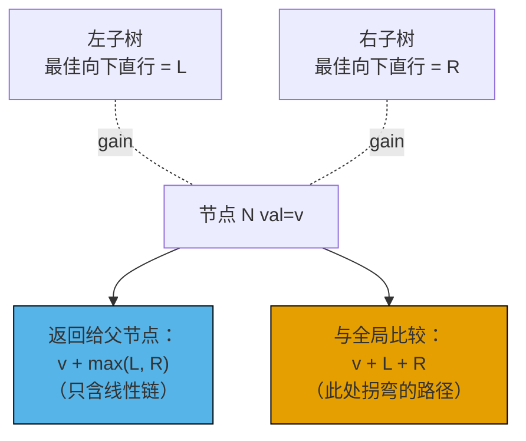
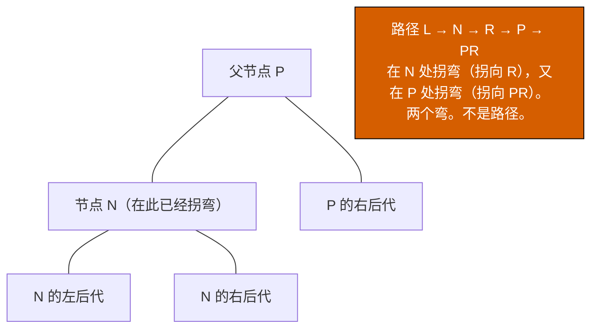

# 树形 DP：沿调用栈向上传递的状态

[树形 DP 入门：带副状态的后序遍历](../part-6-trees-heaps/09-tree-dp.md) 展示过三种形态：用参数把累加器一路往下传（LC 257）；每个子树只出一个聚合值，另外用一个闭包捕获的副计数器（LC 508）；还有直径那个技巧——子树深度往上冒，同时全局量跟踪“穿过本节点”的最优值（LC 1372）。这三种都只往父节点返回一个数字。本章要打破的正是这条约束。

LC 337 *House Robber III* 问的是小偷能在一棵由房子组成的树上最多偷到多少钱，规则只有一条：直接相连的两栋房子不能都偷。第一反应当然是递归返回“这个子树能偷到的最好结果”，而第一反应是错的。上面那个父节点能不能偷自己，取决于我们偷不偷自己。子树返回的那一个数字，必须同时携带两种可能，父节点才推得下去自己的选择。所以辅助函数返回一个二元组：一个位置放“如果偷这个子树的根”，另一个放“如果不偷”。父节点按自己的状态挑更合适的组合。

本章要讲的就是这件事。下面每一节对应一个机制：每个节点的状态长什么样，父节点拿它做什么。LC 337 是两状态。LC 124 *Binary Tree Maximum Path Sum* 是双量拆分——返回的值和拿去跟全局比较的值不是同一个。LC 968 *Binary Tree Cameras* 是三状态。LC 834 *Sum of Distances* 要在树上多走一趟，因为它要的是每个节点当根时的答案，而不只是一个。骨架与入门篇相同，返回类型更丰富，外加一个额外技巧。

## 后序遍历模板，再说一遍

本章的每个算法都是一次后序 DFS。先访问子节点，把结果和当前节点合并，再向父节点返回点什么。多数时候还会（可选地）写一个闭包捕获的全局量。CLRS 第 14 章把树上的 DP 归为依赖图就是输入本身的那一类情形。每个子树的答案只依赖它的严格后代，从不依赖兄弟节点，所以既不存在重叠子问题，也不需要记忆化表。[^1] 每个节点恰好访问一次，线性时间顺手就得到了。

```text
function helper(node):
    if node is null:
        return identity_for_this_problem
    left  = helper(node.left)
    right = helper(node.right)
    state = combine(node.val, left, right)
    side_state.record(state)            # 可选，用于全局答案
    return what_parent_needs(state)
```

三个可调的旋钮：空节点的单位元、辅助函数返回什么、以及它（如果有的话）在旁路记录什么。入门篇在返回位上用的是标量。本章的第一步就是把这个位加宽。

## 两状态 DP：(rob, skip) 二元组

LC 337 给出一棵由房子组成的树，每个节点的 `node.val` 都是正数。偷了一栋房子，它的直接父节点和直接子节点就出局：你拿了这一栋，那些节点只能贡献 0。问的是在任意一个独立集上能取到的最大总和，邻接关系由树给出。

站在任意节点上，两种情形就覆盖了全部选择。**偷这个节点：** 计入 `node.val`，两个子节点都被禁掉。**跳过这个节点：** 从 `node.val` 拿 0，每个子节点既可以偷也可以跳过，取更大的那个。两种情形，两个数字。辅助函数两个都返回，父节点按自己的情形去组合。

```python
def rob(root):
    def helper(node):
        if node is None:
            return (0, 0)            # 空子树的 (rob_this, skip_this)
        rob_l, skip_l = helper(node.left)
        rob_r, skip_r = helper(node.right)
        # 偷这个节点：子节点必须被跳过。
        rob_this  = node.val + skip_l + skip_r
        # 跳过这个节点：每个子节点自由选择。
        skip_this = max(rob_l, skip_l) + max(rob_r, skip_r)
        return (rob_this, skip_this)

    return max(helper(root))
```

**解法** —— Python（[Java](./13-tree-dp/lc-337/sol.java) · [C++](./13-tree-dp/lc-337/sol.cpp) · [Go](./13-tree-dp/lc-337/sol.go)）

```python
# LC 337. House Robber III
# 与两状态二元组返回同构
# 模式（树上的成对返回状态机）。
"""LC 337. Maximum money you can rob without alerting the police.

Two adjacent nodes cannot both be robbed. The recurrence at each node is
a small state machine: returning a 2-tuple (rob_this, skip_this), where
rob_this = node.val + skip_left + skip_right (children must be skipped)
skip_this = max(rob_left, skip_left) + max(rob_right, skip_right) (free choice).
The wrapper takes max(rob_root, skip_root). One post-order pass; O(n) time.
"""
import sys
from dataclasses import dataclass
from typing import Optional, Tuple


sys.setrecursionlimit(10**6)


@dataclass
class TreeNode:
    val: int = 0
    left: Optional["TreeNode"] = None
    right: Optional["TreeNode"] = None


def rob(root: Optional[TreeNode]) -> int:
    def helper(node: Optional[TreeNode]) -> Tuple[int, int]:
        if node is None:
            return (0, 0)  # 空子树的 (rob_this, skip_this)
        rob_l, skip_l = helper(node.left)
        rob_r, skip_r = helper(node.right)
        # 偷本节点会强制两个子节点都被跳过。
        rob_this = node.val + skip_l + skip_r
        # 跳过本节点则把每个子节点的选择权放开。
        skip_this = max(rob_l, skip_l) + max(rob_r, skip_r)
        return (rob_this, skip_this)

    return max(helper(root))
```

递推式就是两个方程，一个位置一个。`rob_this = node.val + skip_l + skip_r` 是被迫的：拿了本节点，两个子节点就都不能拿，所以每个子节点贡献它的 `skip_*` 位。`skip_this = max(rob_l, skip_l) + max(rob_r, skip_r)` 是机会主义的：跳过本节点就把选择权还给每个子节点，让它们各自独立挑更好的那一档。根上的包装取 `max(rob_root, skip_root)`，因为用户不关心哪个情形赢了，只要更大的那个数。

空子树的单位元是 `(0, 0)`。两个位置对任何求和都只贡献 0，这正是对的行为，因为空子树既不带来收入，也不带来义务。

> [!IMPORTANT]
> 两状态模式的适用范围远远超出 LC 337。只要父节点的选择依赖子节点的选择（也就是树上的状态机），辅助函数的返回值就会加宽成每个状态一个位置。LC 1372 用二元组携带两个锯齿方向；本章用二元组携带两个贪心状态；下面的 LC 968 用三位状态码。骨架始终相同，元组的大小随状态空间伸缩。

不用元组的朴素递归会把每个子树重复访问四次，`(parent_state, this_state)` 的每种组合各一次，跑成指数时间。元组把每个状态的答案记忆化在一个返回值里。每个节点访问一次。O(n)。

## 双量拆分：负值登场

LC 337 的两个位置都向上流动：父节点用掉子节点的整个元组。LC 124 *Binary Tree Maximum Path Sum* 引入的是另一种双量拆分。这里，辅助函数返回给父节点的值，和拿去跟答案比较的值，不是同一个。

题目：在二叉树里求任意一条非空路径的最大和。路径是由父子边连起来的一串节点，每个节点最多出现一次，整条路径最多拐一次弯。节点值可以是负数。对 `[-10, 9, 20, null, null, 15, 7]`，答案是 42。路径 `15 → 20 → 7` 完全落在右子树内，绕开了那个负的根。

每个节点上关心两个量，而它们不是同一个数。

- **辅助函数返回什么：** 以本节点结尾、最多只往一个子树延伸的那条最好的*向下直行*路径。父节点会把它粘到自己的值上，而父节点只能往自己的节点上接一条线性链。已经拐过弯的链它接不了，否则形状会有两个弯，就不再是路径了。
- **什么拿去和全局比较：** 经过本节点、两个子树都延伸的那条最好的*拐弯*路径。拐弯路径是本节点上的最优候选，但上面的父节点没法继续延伸它，所以它该待在全局量里，而不是返回位里。



*每个节点上两个不同的量。向下直行的链往上走；拐弯的路径留在原地。*

负值带来的另一个变化是截断（clamp）。如果某个子树最好的向下直行链是负的，正确的做法是丢掉它：延伸到空路径，贡献 0。截断 `max(child_gain, 0)` 就是优化的全部。它不是对坏输入的防御性检查，它本身就是那个优化。

```python
def max_path_sum(root):
    best = -float("inf")

    def gain(node):
        nonlocal best
        if node is None:
            return 0
        left_gain  = max(gain(node.left),  0)
        right_gain = max(gain(node.right), 0)
        # 经过本节点的拐弯路径——与全局比较，不返回。
        if node.val + left_gain + right_gain > best:
            best = node.val + left_gain + right_gain
        # 向上返回的向下直行路径。
        return node.val + max(left_gain, right_gain)

    gain(root)
    return int(best)
```

**解法** —— Python（[Java](./13-tree-dp/lc-124/sol.java) · [C++](./13-tree-dp/lc-124/sol.cpp) · [Go](./13-tree-dp/lc-124/sol.go)）

```python
# LC 124. Binary Tree Maximum Path Sum
"""LC 124. Maximum sum of any non-empty path in a binary tree.

The dual-quantity split is the chapter's central move:
  - RETURN to caller: best straight-down path ending at this node, extending
    into AT MOST one subtree (the parent will glue this into its own path).
  - COMPARE to global: best bent path THROUGH this node, using BOTH subtrees
    (a bent path cannot be extended further upward).
The clamp `max(child_gain, 0)` is the optimization, not a bug fix: if
including a subtree lowers the path sum, exclude it (the empty extension
contributes 0).
"""
import sys
from dataclasses import dataclass
from typing import Optional


sys.setrecursionlimit(10**6)


@dataclass
class TreeNode:
    val: int = 0
    left: Optional["TreeNode"] = None
    right: Optional["TreeNode"] = None


def max_path_sum(root: Optional[TreeNode]) -> int:
    best = -float("inf")

    def gain(node: Optional[TreeNode]) -> int:
        nonlocal best
        if node is None:
            return 0
        left_gain  = max(gain(node.left),  0)
        right_gain = max(gain(node.right), 0)
        # 经过本节点的拐弯路径——与全局比较，不返回。
        if node.val + left_gain + right_gain > best:
            best = node.val + left_gain + right_gain
        # 向上返回的向下直行路径。
        return node.val + max(left_gain, right_gain)

    gain(root)
    return int(best)
```

有两行值得多看两眼。

第一处是截断。对 `[2, -5, -3]`，两个子节点的链都贡献负值。没有截断的话，拐弯路径的候选会是 `2 + (-5) + (-3) = -6`，向下直行返回的是 `2 + max(-5, -3) = -1`。有了截断，两个子节点的贡献都变成 0；拐弯路径的候选是 `2 + 0 + 0 = 2`，正是答案；向下直行返回 `2 + 0 = 2`。截断编码的就是这件事：往一个负和的子树里延伸，比不延伸更差。

第二处是初始化。`best` 从负无穷开始，不是从 0。对 `[-3]` 这样的树，每条路径都是单个节点，而每个节点都是负的。根上的拐弯比较是 `-3 + 0 + 0 = -3`，它得赢过 `best` 的初始值。如果 `best` 从 0 开始，算法会返回 0，也就是一条零节点的路径，而 LC 124 明确要求路径非空。负无穷保证这个比较至少在根上触发一次。[^2]

> [!WARNING]
> LC 124 最常见的 bug 是把拐弯的那个量返回给父节点，而不是返回向下直行的量。第一个用例过，第二个就挂。原因：调用这个辅助函数的父节点默认拿到的是线性链。如果你返回 `node.val + left_gain + right_gain`，父节点就会尝试把它延伸进自己的值，拼出一个带两个弯的 Y 形。面试官就在等这个错误。两个不同的表达式写在两行不同的代码里：一行更新 `best`，另一行 `return`。



*拐弯路径不能往上返回的理由。父节点把自己接到一条已经在子节点处拐过弯的链上，得到的是一个双弯形状，按 LC 124 的定义这已经不是路径。*

## 三状态 DP：摄像头问题的归约

LC 968 *Binary Tree Cameras* 要求在二叉树上装最少数量的摄像头，使每个节点都被监控到。装在节点 `u` 上的摄像头能监控 `u`、`u` 的父节点和 `u` 的子节点：也就是它自己和它的直接邻居。

站在任意节点上，三个状态覆盖了它的子树里刚刚发生了什么。

- **NEEDS_COVER（状态 0）：** 下面的子树没问题，但本节点既没有摄像头，也没有带摄像头的子节点。必须有人来覆盖它，而唯一还剩的候选人就是父节点。
- **HAS_CAMERA（状态 1）：** 本节点上装了摄像头。它覆盖自己、两个子节点，以及（如果父节点递归到它）父节点。
- **COVERED（状态 2）：** 本节点已经被下面的某个子节点监控住了。父节点对本节点没有任何义务。

转移表不用费心，自己就写出来了。

| 左子状态 | 右子状态 | 本节点的动作 | 新状态 |
|---|---|---|---|
| 任意 | NEEDS_COVER | 装一个摄像头（count++） | HAS_CAMERA |
| NEEDS_COVER | 任意 | 装一个摄像头（count++） | HAS_CAMERA |
| HAS_CAMERA | *（不是 needs_cover） | 被左边覆盖 | COVERED |
| *（不是 needs_cover） | HAS_CAMERA | 被右边覆盖 | COVERED |
| COVERED | COVERED | 这里暂时没什么可做的 | NEEDS_COVER |

前两条规则必须先于后两条生效；只要有子节点喊 NEEDS_COVER，本节点就是最后一个有机会覆盖它的地方。第五条规则是陷阱：当两个子节点都已经被覆盖（被*它们的*后代覆盖，而不是被本节点覆盖），本节点既没摄像头，附近也没有能覆盖它的摄像头，只能请父节点来处理。空子树返回 COVERED，因为节点不存在就不产生义务。

```python
NEEDS_COVER, HAS_CAMERA, COVERED = 0, 1, 2

def min_camera_cover(root):
    cameras = 0

    def dfs(node):
        nonlocal cameras
        if node is None:
            return COVERED
        l = dfs(node.left)
        r = dfs(node.right)
        if l == NEEDS_COVER or r == NEEDS_COVER:
            cameras += 1
            return HAS_CAMERA
        if l == HAS_CAMERA or r == HAS_CAMERA:
            return COVERED
        return NEEDS_COVER

    if dfs(root) == NEEDS_COVER:
        cameras += 1
    return cameras
```

**解法** —— Python（[Java](./13-tree-dp/lc-968/sol.java) · [C++](./13-tree-dp/lc-968/sol.cpp) · [Go](./13-tree-dp/lc-968/sol.go)）

```python
# LC 968. Binary Tree Cameras
# 与三状态 DP 同构
# 模式（树上的状态机归约）。
"""LC 968. Minimum cameras to monitor every node.

Each node returns one of three states to its parent:
  0 = NEEDS_COVER   (this node is not yet monitored; parent must cover it)
  1 = HAS_CAMERA    (this node holds a camera; covers itself and parent)
  2 = COVERED       (this node is monitored by a child; parent has no duty)
The rule:
  - If any child needs cover: place a camera here (state 1, count++).
  - If any child has a camera: this node is COVERED (state 2).
  - Otherwise (both children covered): this node NEEDS_COVER (state 0).
A null leaf returns COVERED (state 2): the empty subtree imposes no obligation.
The wrapper checks the root: if it returns NEEDS_COVER, place one final camera.
"""
import sys
from dataclasses import dataclass
from typing import Optional


sys.setrecursionlimit(10**6)

NEEDS_COVER = 0
HAS_CAMERA = 1
COVERED = 2


@dataclass
class TreeNode:
    val: int = 0
    left: Optional["TreeNode"] = None
    right: Optional["TreeNode"] = None


def min_camera_cover(root: Optional[TreeNode]) -> int:
    cameras = 0

    def dfs(node: Optional[TreeNode]) -> int:
        nonlocal cameras
        if node is None:
            return COVERED
        l = dfs(node.left)
        r = dfs(node.right)
        # 有子节点未被监控——在这里装一个摄像头。
        if l == NEEDS_COVER or r == NEEDS_COVER:
            cameras += 1
            return HAS_CAMERA
        # 有子节点带摄像头——本节点被它覆盖。
        if l == HAS_CAMERA or r == HAS_CAMERA:
            return COVERED
        # 两个子节点都被覆盖、都没摄像头——本节点需要被覆盖。
        return NEEDS_COVER

    if dfs(root) == NEEDS_COVER:
        cameras += 1
    return cameras
```

包装层还多一件事。递归结束后，如果根自己返回了 NEEDS_COVER，它上面再没有父节点能覆盖它；必须在根上补装最后一个摄像头。单节点树上漏掉这一行，返回的就是 0 而不是 1。

这个贪心归约正是它时间 O(n)、空间 O(h) 的原因。更完整的 DP 会给每个节点维护三个真正的 DP 值（三种终态各自能达到的最少摄像头数），父节点要组合全部九个 `(left_state, right_state)` 组合。贪心版本对每个节点只认定一个状态，只记摄像头数量，因为“只在被迫时才装摄像头”可以被证明是最优的：装在父节点上的一个摄像头，覆盖的节点严格多于把它装到某个叶子上，所以最优布局永远把摄像头推到约束允许的最高处。

## 换根：每个节点上的答案

后序这套形状解决的是“以根为根时最优值是多少”。LC 834 *Sum of Distances in Tree* 问的是另一件事：对每个节点 `i`，返回 `i` 到其他所有节点的距离之和。朴素做法是从每个节点各跑一次 BFS，`O(n²)`。在 LC 834 给定的 `n` 最大到 30,000 时完全不行。

换根技巧是再加一趟遍历。第一趟解决那个标准问题：随便以节点 0 为根，算出 `count[u]`（`u` 的子树大小，包含 `u`）和 `answer[0]`（节点 0 到其他每个节点的距离之和）。第二趟*移动根*，从 `u` 挪到它的某个子节点 `v`，并用 `answer[u]` 在常数时间内更新出 `answer[v]`。

挪动时的算术：根从 `u` 移到子节点 `v` 后，`v` 子树里的每个节点（共 `count[v]` 个）都近了一步；`v` 子树外的每个节点（共 `n - count[v]` 个）都远了一步。于是 `answer[v] = answer[u] - count[v] + (n - count[v])`。往 `v` 的子节点继续递归，同理。整个第二趟是 O(n)，每条边一次 O(1) 更新。[^3]

```python
def sum_of_distances_in_tree(n, edges):
    if n == 1:
        return [0]
    adj = [[] for _ in range(n)]
    for u, v in edges:
        adj[u].append(v)
        adj[v].append(u)

    count  = [1] * n
    answer = [0] * n

    def post(u, parent):
        for v in adj[u]:
            if v == parent:
                continue
            post(v, u)
            count[u]  += count[v]
            answer[u] += answer[v] + count[v]

    def pre(u, parent):
        for v in adj[u]:
            if v == parent:
                continue
            answer[v] = answer[u] - count[v] + (n - count[v])
            pre(v, u)

    post(0, -1)
    pre(0, -1)
    return answer
```

**解法** —— Python（[Java](./13-tree-dp/lc-834/sol.java) · [C++](./13-tree-dp/lc-834/sol.cpp) · [Go](./13-tree-dp/lc-834/sol.go)）

```python
# LC 834. Sum of Distances in Tree
# 实现换根
# 技巧（模式扩展）。
"""LC 834. For every node i, the sum of distances to all other nodes.

Naive approach: run BFS from every node, O(n^2). Re-rooting collapses
that to O(n) with two passes:

  Pass 1 (post-order):  for each node, compute count[u] = subtree size
                         (including u) and answer[root] = sum of distances
                         from root to every node in the tree.
  Pass 2 (pre-order):   for each child v of a node u, derive answer[v] from
                         answer[u] in O(1):
                            answer[v] = answer[u] - count[v] + (n - count[v])
                         Intuition: re-root from u to v. The count[v] nodes
                         in v's subtree each get 1 step closer; the
                         (n - count[v]) nodes outside each get 1 step farther.

The graph is given as `edges`; we build an undirected adjacency list once.
"""
import sys
from typing import List


sys.setrecursionlimit(10**6)


def sum_of_distances_in_tree(n: int, edges: List[List[int]]) -> List[int]:
    if n == 1:
        return [0]

    adj: List[List[int]] = [[] for _ in range(n)]
    for u, v in edges:
        adj[u].append(v)
        adj[v].append(u)

    count = [1] * n     # 子树大小（后序那一趟）
    answer = [0] * n    # answer[u] = u 到所有节点的距离之和

    # 第一趟：以 0 为根做后序 DFS。计算 count[u] 和一部分
    # answer[0]，即从节点 0 出发的深度之和。
    def post(u: int, parent: int) -> None:
        for v in adj[u]:
            if v == parent:
                continue
            post(v, u)
            count[u] += count[v]
            answer[u] += answer[v] + count[v]

    # 第二趟：前序 DFS。以 O(1) 把根从 u 换到每个子节点 v。
    def pre(u: int, parent: int) -> None:
        for v in adj[u]:
            if v == parent:
                continue
            answer[v] = answer[u] - count[v] + (n - count[v])
            pre(v, u)

    post(0, -1)
    pre(0, -1)
    return answer
```

有两个细节要检查。两个 DFS 函数里的 `parent` 参数挡住了递归沿边往回走；没有它，无向树的 DFS 会绕圈。后序那一趟的 `count[v]` 递推（递归进 `v` 之后 `count[u] += count[v]`）用的是每个子节点刚算出来的值，这正是后序顺序重要的地方。前序那一趟方向相反：`answer[v]` 是在递归进 `v` 的子节点*之前*，由*已经正确*的 `answer[u]` 算出来的，因为 `v` 的子节点需要 `v` 的正确答案才能推出自己的。

这个技巧在竞赛编程里叫*换根 DP*（re-rooting DP）。USACO Guide 的 “DP on trees - solving for all roots” 模块是标准写法；它教的就是同样的双数组形状（子树内的值、子树外的值），并把它应用到 LC 834 这类“每个节点都当一次根”的问题上。[^3] 大多数 LC 题用不到它；一旦用得上，替代方案就是 `O(n²)`，在隐藏用例上超时。

## 实际开销

| 模式 | 时间 | 空间（不含输出） | 备注 |
|---|---|---|---|
| 两状态 DP（LC 337） | O(n) | O(h) 递归栈 | 一趟后序；每个节点常数工作量 |
| 双量拆分（LC 124） | O(n) | O(h) | 一趟后序；全局量只是一个标量 |
| 三状态 DP（LC 968） | O(n) | O(h) | 一趟后序；贪心对每个节点只认定一个状态 |
| 换根（LC 834） | O(n) | 邻接表 O(n) + 递归 O(h) | 两趟；第二趟多做 n 次 O(1) 更新 |

`n` 是节点数，`h` 是树高。平衡树给出 `h = O(log n)`；退化成链的树给出 `h = n - 1`。递归栈空间是唯一随平衡与退化而变的项。

树形 DP 上的 O(n) 界是白送的。CLRS 第 14 章把 DP 描述成“递归图里存在重叠子问题、再用记忆化表把它们合并”时才划算的技术。树形 DP 是退化情形：递归图就是输入的那棵树，而树按定义没有共享子结构。每个节点只解一次，花 `O(work_per_node)` 的时间，一张表都不用分配。[^1] Erickson 的 *Algorithms* 用归纳法给出同样的论证：辅助函数在某个节点上的正确性由它在严格子节点上的正确性蕴含，归纳的代价是一次节点访问。[^4]

退化成链的那种树会让 Python 提交出错。CPython 默认递归深度上限是 1,000 帧。LC 124 的 `n` 上限是 30,000；LC 968 是 1,000；LC 834 是 30,000。本章的 Python 参考实现全都以 `sys.setrecursionlimit(10**6)` 开头。[^5] 其他语言的默认栈更大（1 MB 以上），但同样会在对抗性测试数据上撞见栈溢出。这些语言里的修法也一样：Java 用 `-Xss8m`，Linux 上的 C++ 用 `ulimit -s unlimited`，或者把递归改写成显式栈。

## 三个最容易踩的坑

> [!WARNING]
> **LC 337：只返回一个数，而不是两个。** 有读者把 `helper(node)` 写成返回“这个子树能偷到的最好结果，一个整数”，于是父节点手上什么都没有。修法是把返回类型加宽成 `(rob_this, skip_this)` 二元组，让父节点按情形去挑。LC 1372（两个锯齿方向）和 LC 968 的转移表（三个状态）是同一种形状；返回类型的大小要等于父节点需要推理的状态空间大小。

> [!WARNING]
> **LC 124：把拐弯路径返回给父节点。** 有读者看到 `best = max(best, node.val + left_gain + right_gain)`，反射性地把同一个表达式 `return` 出去。在任何深度超过两层的树上，父节点接着就会去延伸一条已经拐过弯的路径，得到的形状有两个弯，不再是路径。两个不同的表达式：拐弯的那个量更新 `best`，向下直行的那个量才被返回。Hello Interview 的题解把这一条列为它常见错误清单里的第一个 bug。[^2]

> [!WARNING]
> **LC 968：忘了在根上补装摄像头。** 递归结束时根处于某个状态。如果根返回的是 NEEDS_COVER，它上面没有任何父节点能覆盖它，包装层就必须在根上装一个摄像头。漏掉这段递归后的检查，在任何“根恰好落进 NEEDS_COVER”的树上答案都会差 1，包括最小的输入——单节点树。

还有一个值得点名的 bug：LC 124 上忘了负值截断。没有 `max(child_gain, 0)`，算法会把每个子树的贡献强行塞进拐弯路径的比较，连那些拉低答案的子树也照塞。LC 124 的隐藏用例立刻就能抓住它。

## 题目梯度

### 核心（三题全做才算掌握本章）

- [LC 337 — House Robber III](https://leetcode.com/problems/house-robber-iii/) [中等] • tree-dp-state-machine ★
- [LC 124 — Binary Tree Maximum Path Sum](https://leetcode.com/problems/binary-tree-maximum-path-sum/) [困难] • tree-dp-dual-quantity
- [LC 968 — Binary Tree Cameras](https://leetcode.com/problems/binary-tree-cameras/) [困难] • tree-dp-greedy-state

### 进阶（可选）

- [LC 834 — Sum of Distances in Tree](https://leetcode.com/problems/sum-of-distances-in-tree/) [困难] • tree-dp-rerooting
- [LC 979 — Distribute Coins in Binary Tree](https://leetcode.com/problems/distribute-coins-in-binary-tree/) [中等] • tree-dp-flow-on-edges

LC 337 是本章的招牌（★），因为在四题里，两状态二元组的返回是最干净的机制教学载体；双量拆分（LC 124）和三状态归约（LC 968）把这个模式往两个不同方向延展。核心三题跨了中等和困难，但没有跨到简单：树形 DP 的经典简单题（LC 543 *Diameter of Binary Tree*）归 [二叉树基础](../part-6-trees-heaps/00-binary-tree-fundamentals.md) 所有，入门篇里的三个简单/中等形状（[树形 DP 入门](../part-6-trees-heaps/09-tree-dp.md)）也在那里。本章的 `ladder_curation_flag` 是 `no-easy-canonical`，把这个空缺记为进阶子集本身的性质，而不是缺了一道题。

LC 834 是换根的老家，而换根是本章唯一需要遍历两趟的技法；LC 979 复用后序形状，只是换了个观察角度：每条边上的硬币移动次数，由这条边两侧子树的数量差固定下来。

## 后续衔接

下一站是状压 DP。后面那章 [状压 DP](./14-bitmask-dp.md) 把每个节点的状态从小的固定枚举（LC 968 三状态、LC 337 两状态）换成物品全集的一个比特编码子集；每个节点的“状态”变成一个 32 位整数，第 `i` 位表示“物品 `i` 被选中”。后序的形状原样保留；状态空间从常数跳到指数，而状压 DP 的 `2^n` 复杂度正是从这儿来的。

另一条岔路通向带环的图。树形 DP 的正确性建立在“每个子树与其他子树互相独立”之上，这在树上是成立的，而在一般图里，只要出现一条回边就破功。[图的表示](../part-8-graphs/00-graph-representation.md) 和 [拓扑排序](../part-8-graphs/04-topological-sort-kahn.md) 是图上 DP 接手的地方；那些技法把后序形状推广成拓扑序，在 DAG 上把线性时间收回来，遇到有环的情形则退回到更贵的迭代。

## 参考文献

[^1]: Cormen, Leiserson, Rivest, Stein, *Introduction to Algorithms*, 4th ed., MIT Press, 2022, 第 14 章 “Dynamic Programming”。第 10 章 §10.4 “Representing rooted trees” 给出本章通篇使用的 O(n) 后序遍历树的界。<https://mitpress.mit.edu/9780262046305/introduction-to-algorithms/>

[^2]: Hello Interview, “Leetcode 124. Binary Tree Maximum Path Sum.” <https://www.hellointerview.com/community/questions/binary-tree-max-sum/cm5eh7nrh04qg838ohcis83zd>

[^3]: USACO Guide, “DP on Trees — Solving For All Roots”（Gold 模块）。命名了双数组技法（子树内的 `f[x]` 与子树外的 `g[x]`），并给出上面 LC 834 实现所用的逐边 O(1) 更新推导。<https://usaco.guide/gold/all-roots>

[^4]: Jeff Erickson, *Algorithms*, 1st ed., June 2019, 第 3 章 “Dynamic Programming”。本章复杂度一节所用的归纳正确性论证出自 §3.6。<https://jeffe.cs.illinois.edu/teaching/algorithms/book/03-dynprog.pdf>

[^5]: Python 3 文档，`sys.setrecursionlimit`，https://docs.python.org/3/library/sys.html#sys.setrecursionlimit。
