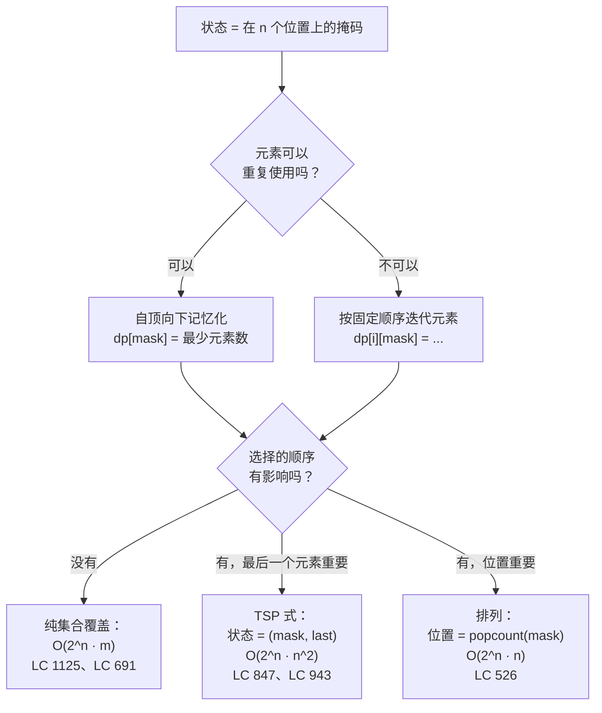

# 位掩码 DP

前面大多数章节讲的是一个模式，这一章讲的是一个状态。位掩码（bitmask）就是一个整数，代表“这 `n` 个元素里我碰过哪些子集”，而整章要说的其实只有一句话：只要一道题的自然状态是*一个小规模全集的子集*，这个子集就装得进一个 CPU 寄存器。麻烦在“小”这个字上。`n = 20` 时状态空间约一百万，还行。推到 `n = 25` 就是三千三百万。到 `n = 30` 变成十亿，算法根本跑不动。

这是全书最难的 DP 形态，而且难的原因很具体。Part 9 里其他每个 DP 家族的状态几乎都能用一句人话念出来：*“以索引 i 结尾的最长递增子序列”*、*“凑出金额 a 的最小代价”*、*“长度为 i 和 j 的两个前缀之间的编辑距离”*。位掩码 DP 的状态是*“在已覆盖的子集恰好是这个 17 位模式、且我最后碰的是第 5 个元素的前提下，最小代价是多少”*。读这句话比读代码还难，而代码又比前面任何一章都难读。这一章的价值就在于把一个标准范例——LC 847 *Shortest Path Visiting All Nodes*——干净地落到一个最小输入上，这个小输入却把算法里每一个有意思的瞬间都跑了一遍。这一步打通之后，各种变体都只是同一套算法换几个基本操作。

## 如何识别这个模式



*位掩码 DP 的三种子形态。右边那条分叉轴告诉你是否需要额外的 `last` 维度，以及位置指针是否隐含在 `popcount(mask)` 里。*

这个模式的信号有两部分。第一，`n` 很小，是具体的小：LC 847 的约束是 12，LC 526 是 15，LC 1125 是 16，LC 1986 是 14。超过 20 就别想了。第二，元素之间有交互。如果这 `n` 个元素能各自独立求解再求和，答案对 `n` 就是线性的，掩码纯属浪费状态。如果元素让贪心和一维 DP 都失效（排列、划分、集合覆盖、哈密顿式遍历），掩码才是对工具。

空间表就是那个上限的来源。一个元素一位，`n` 个元素，一共 `2^n` 种可能的子集：

| `n` | `2^n` 个掩码 | `2^n · n` 次操作 | 每状态 4 字节时的内存 |
|---|---|---|---|
| 10 | 1,024 | 10K | 4 KB |
| 15 | 32,768 | 491K | 131 KB |
| 20 | 1,048,576 | 20.9M | 4.2 MB |
| 22 | 4,194,304 | 92M | 16.8 MB |
| 25 | 33,554,432 | 838M | 134 MB |
| 30 | 1,073,741,824 | 32B | 4.3 GB |

一张 32 位 int 的记忆化表在 `n = 20` 时约四兆字节，大多数笔记本能装进 L2。到 `n = 22`，表就放不进 L2 了，缓存未命中的常数因子会让实际耗时翻倍。到 `n = 25`，你已经超出任何内存受限比赛的限制；到 `n = 30`，超出工作站的限制。**本章的适用区间是 `n ≤ 20`。**[^1] Held-Karp 1962 年的原始论文——表里每一行 TSP 式算法都是它这个形状的扩展——跑在最低只能到 `n = 13` 的机器上。[^2] 空间天花板动了，算法没动。

## 暴力解法为何不够

经典题是 LC 847 *Shortest Path Visiting All Nodes*。给定一张无向连通图，`n ≤ 12` 个节点，邻接表形式。求一条至少访问每个节点一次的最短游走长度。游走可以从任意点开始、任意点结束，节点和边都能重复经过。样例：`graph = [[1, 2, 3], [0], [0], [0]]`（以节点 0 为中心的星形，叶子是 1、2、3），期望输出 4。一条合法游走是 `1 → 0 → 2 → 0 → 3`，四条边。

老实的第一次尝试会问：算法该按什么*顺序*访问节点？一条访问每个节点至少一次的游走必然有第一个、第二个……；如果知道顺序，把相邻节点之间的最短路径加起来就是游走长度。朴素算法枚举所有可能的顺序，也就是 `n` 个节点的每一个排列，取最便宜的那个。

```python
# 暴力：枚举每一种访问顺序。O(n! * n^2)，这就是我们要替换掉的那堵墙。
from itertools import permutations
from collections import deque

def shortest_path_brute(graph):
    n = len(graph)
    if n == 1:
        return 0

    # 先对每个源点做 BFS，预计算两两最短距离。
    dist = [[float('inf')] * n for _ in range(n)]
    for src in range(n):
        dist[src][src] = 0
        q = deque([src])
        while q:
            u = q.popleft()
            for v in graph[u]:
                if dist[src][v] == float('inf'):
                    dist[src][v] = dist[src][u] + 1
                    q.append(v)

    best = float('inf')
    for order in permutations(range(n)):
        total = sum(dist[order[i]][order[i + 1]] for i in range(n - 1))
        if total < best:
            best = total
    return best
```

算法是对的，`n = 4` 时几微秒就跑完。到 `n = 12` 这个 LC 的上限，`12! = 479,001,600` 种顺序，每种累加 `n - 1 = 11` 次最短路径查表。Python 要跑几十分钟。Java 快十倍，仍然 TLE 一个数量级。阶乘墙就是墙。

修法是别再把排列顺序当成工作单位来枚举。两个不同的顺序，只要它们访问了同一批前缀节点、最后停在同一个节点上，面对的未来就是同一个：都得从同一个当前位置出发去覆盖剩下的节点，而这条最省的延伸对两者完全相同。把这两个顺序合并成一个。抓住*未来取决于什么*的状态是 `(node, mask)`：你当前所在的节点，以及已访问节点的子集。已访问集合内部的顺序无关，只有集合本身有关。这样的状态有 `n · 2^n` 个，在上面做 BFS 就是这一章的内容。

## 模式

六个位运算恒等式构成后面全章假定你能流畅读懂的词汇表。每一个都会出现在后面的代码里。

```python
mask | (1 << i)         # 置位第 i 位（把元素 i 标记为已覆盖）
mask & ~(1 << i)        # 清除第 i 位
mask & (1 << i)         # 测试第 i 位（已置位则为真）
(1 << n) - 1            # 完整掩码：n 位全部置 1
mask & (mask - 1)       # 清除最低的置位位（Kernighan 技巧）
~mask & full            # 在 n 位内取补（“仍未覆盖”的集合）
```

这些在 Python 的任意精度 int 上能用，在 Java/C++/Go 的有符号 `int` 上对 `n ≤ 30` 也能用。`n = 31` 时，32 位有符号类型上的 `1 << 31` 会溢出。本章 `n ≤ 20` 的区间是安全的；心里记下这条边界，继续往下走。

LC 847 的位掩码 BFS 让所有节点同时出发，每步走一条边，把目标节点的位 OR 进已访问掩码。靠 BFS 逐层推进的保证，第一个出队且 `mask == full` 的状态就是最短游走。关键在于 visited 表以 `(node, mask)` 为键，不能只用 `mask`，因为两个不同的当前节点即使到目前为止访问的集合相同，未来也不同。

```python
from collections import deque


def shortest_path_length(graph):
    n = len(graph)
    if n == 1:
        return 0
    full_mask = (1 << n) - 1

    visited = [[False] * (1 << n) for _ in range(n)]
    queue = deque()
    for i in range(n):
        start_mask = 1 << i
        visited[i][start_mask] = True
        queue.append((i, start_mask, 0))

    while queue:
        node, mask, dist = queue.popleft()
        if mask == full_mask:
            return dist
        for nb in graph[node]:
            new_mask = mask | (1 << nb)
            if not visited[nb][new_mask]:
                visited[nb][new_mask] = True
                queue.append((nb, new_mask, dist + 1))

    return -1
```

**解法** —— Python（[Java](./14-bitmask-dp/lc-847/sol.java) · [C++](./14-bitmask-dp/lc-847/sol.cpp) · [Go](./14-bitmask-dp/lc-847/sol.go)）

```python
# LC 847. Shortest Path Visiting All Nodes
# 在 (node, mask) 状态上做位掩码 BFS。状态数 n * 2^n；
# 转移枚举节点邻居。O(n^2 * 2^n) 时间，O(n * 2^n) 空间。
# 按 LC 约束 n <= 12。
from collections import deque
from typing import List


def shortest_path_length(graph: List[List[int]]) -> int:
    """LC 847. Shortest path that visits every node (revisits allowed)."""
    n = len(graph)
    if n == 1:
        return 0
    full_mask = (1 << n) - 1

    # visited 表以 (node, mask) 为索引。BFS 第一次到达该状态时置 True，
    # 那个距离就是到该状态的最短距离。
    visited = [[False] * (1 << n) for _ in range(n)]
    queue = deque()
    for i in range(n):
        start_mask = 1 << i
        visited[i][start_mask] = True
        queue.append((i, start_mask, 0))

    while queue:
        node, mask, dist = queue.popleft()
        if mask == full_mask:
            return dist
        for nb in graph[node]:
            new_mask = mask | (1 << nb)
            if not visited[nb][new_mask]:
                visited[nb][new_mask] = True
                queue.append((nb, new_mask, dist + 1))

    return -1  # LC 约束保证图连通；这里只是防御性写法。
```

进实例推演之前，有三行值得细看，因为正是这三行把位掩码 BFS 和普通图 BFS 区分开。

给每个起点都播种。游走可以从任何地方开始，所以 BFS 前沿初始就装着全部 `n` 个距离为零的状态 `(i, 1 << i)`。普通图 BFS 从一个源点出发；这个 BFS 从 `n` 个源点出发，让逐层不变量按构造挑出其中最便宜的那个。

掩码 OR。每次转移都是 `new_mask = mask | (1 << nb)`。如果 `nb` 已经在掩码里（重复访问），OR 是空操作，`new_mask == mask`。这时 `(nb, mask)` 状态几乎肯定已经访问过（我们之前从别的路径到这里来过），BFS 直接跳过。LC 847 的规范*允许*重复访问；用 `(node, mask)` 作键只是让搜索不至于绕圈。

判重看的是状态，不是掩码。`visited[nb][new_mask]` 是那道闸门。一个天真的“这个掩码我见过没”闸门会误杀合法状态：两个不同节点都能到达同一个掩码，两者都是可搜索的未来。只有联合键才能正确剪枝。

## 实例推演：LC 847 在 3 节点链上

取 `graph = [[1], [0, 2], [1]]`，三个节点排成一条链：0 连 1，1 连 0 和 2，2 连回 1。期望答案是 2，走 `0 → 1 → 2` 或反过来都行。为了把图景压小，这里只跟踪从单个起点（节点 0）出发的 BFS；完整算法并行跑三个这样的前沿，由 BFS 的层次保证按构造挑出最便宜的那个。

种子是 `(0, 0b001, 0)`。第一步扩展节点 0 唯一的邻居，得到 `(1, 0b011, 1)`。弹出这个状态后，节点 1 向两个邻居扩展：`(0, 0b011, 2)` 会入队，因为联合键没见过，尽管节点 0 本身访问过；`(2, 0b111, 2)` 带着完整掩码入队。下一个出队的就是完整掩码那个。答案：2。

> **Interactive widget:** [位掩码 BFS：(node, mask) 状态扩展](../../../dsa/widgets/w-34-bitmask-dp.yml) —— 在网站上渲染；YAML 规格描述了各个关键帧。

*静态回退：3 节点链图上从节点 0 出发的 8 步 BFS 轨迹。状态 (node, mask) 二元组每步推进一条边；visited 表剪掉重复的 (node, mask) 对，但允许对某个节点重复访问——只要掩码因此改变。完整掩码 `0b111` 在距离 2 处经由游走 0 → 1 → 2 到达。*

## 实际开销

| 方案 | 时间 | 空间 | 适用场景 |
|---|---|---|---|
| 暴力枚举排列 | O(n! · n²) | O(n²) | 实践中只到 n ≤ 8；到 12 就爆 |
| 位掩码 BFS（本章） | O(n² · 2^n) | O(n · 2^n) | n ≤ 20；LC 847 封顶 12 |
| Held-Karp TSP（带权） | Θ(n² · 2^n) | Θ(n · 2^n) | 同样的形状，换成边权[^2] |
| 纯集合覆盖位掩码 | O(m · 2^m) | O(2^m) | LC 1125、LC 691 |
| 子掩码枚举 | Θ(3^n) | 每状态 | 划分成两半这类问题[^3] |

状态数本质上是 `n · 2^n`。每个状态的转移遍历节点邻居，图里每个节点最多 `n - 1` 个邻居，于是每状态 `n` 次操作，总共 `n² · 2^n`。*天花板在状态数上，不在递推的算术上。* 六十年来没人改进过 Held-Karp 的 `n² · 2^n` 时间界[^2]，最近的条件性下界结果还说大概率改不动。

空间开销是 visited 表的 `O(n · 2^n)`。在 LC 847 的 `n = 12` 上限下是 `12 · 4096 = 49,152` 个布尔值。`n = 20` 时约 2100 万个布尔值，仍不到 25 MB。`n = 25` 时表是 800 MB，比赛机器上跑不起来。前面那张空间表就是把本章区间钉在 `n ≤ 20` 的约束。值得读两遍。

## 模式失效的场景

决策流程图里的三种子形态各带一个不同的状态和一套不同的复杂度。它们共用掩码这个整数，其他方面就没多少共同点了。

### 集合覆盖：给需求做掩码，迭代候选项（LC 1125）

LC 1125 *Smallest Sufficient Team* 是教科书式变体。有 `m ≤ 16` 项所需技能和 `n ≤ 60` 个人，每个人持有一部分技能。找出覆盖全部技能的最小团队。

把这道题从“感觉是 NP”翻成“平凡的位掩码 DP”的那个转折是：掩码做在**需求**上，不做在**候选项**上。想成“选出的人的集合”的读者会得到 `2^60` 个状态，然后断定这题得上随机化。正确的状态是 `dp[skill_mask] = 覆盖这组技能所需的最少人数`，转移迭代人，把每个人的技能掩码 OR 进当前的覆盖。状态数 `2^16 = 65,536`，每状态 60 次转移，总工作量不到一百万。[^4]

思维上要切换的是：当题目说“`n ≤ 15-20` 个东西必须全部被覆盖或全部被访问”时，掩码做在*覆盖目标*上，不做在*选项*上。候选项那一维作为转移来迭代，不编进状态。

### TSP 式：状态多一个 `last` 维度（LC 943，Held-Karp 1962）

一旦“从元素 A 到元素 B 的代价”取决于 A、B 究竟是哪两个元素，光有掩码就不够了。未来不只取决于还剩哪些元素，还取决于你现在坐在哪个元素上。状态变成 `(mask, last)`：已访问子集，加上最近访问的元素。

LC 943 *Find the Shortest Superstring* 是竞赛版实例。给定 `n ≤ 12` 个字符串，找出包含全部输入串作为子串的最短字符串。位掩码 DP 写作 `dp[mask][last] = 恰好覆盖 mask 里的字符串、且以第 last 个输入字符串结尾的最短超串`。[^5] 转移是再追加一个字符串，先算它与 `last` 的最大重叠；复杂度 `O(n² · 2^n)`，与 Held-Karp 1962 年对 TSP 的原始动态规划处理是同一个 Θ 界。[^2]

LC 847 是这个形状在边权全为 1 时的特例，这也正是 BFS 够用的原因：每条边代价都是 1 时，层序遍历*就是*最短路 DP。带权边的话，把 BFS 队列换成 Dijkstra 式优先队列，或者换成 `2^n · n` 个状态上的显式 DP 表，算法就是 Held-Karp。

### 排列 / 赋值：位置就是 `popcount(mask)`（LC 526）

LC 526 *Beautiful Arrangement* 问：`1..n`（`n ≤ 15`）的排列中，有多少个在每个位置上都满足整除谓词——位置 `i`（1 起）要求 `perm[i] % i == 0` 或 `i % perm[i] == 0`。

这里取胜的状态形状把 `last` 维度整个砍掉了。因为算法每步恰好放一个新值，下一个待填的位置就是 `popcount(mask) + 1`，隐含在掩码自己身上。递推式是 `dp[mask] = sum over j in mask of [predicate(popcount(mask), j) is true] * dp[mask \ {j}]`，复杂度 `O(n · 2^n)`。一维都没浪费。

这是三种子形态里最便宜的一种，因为隐含的位置指针从空间和时间里各消掉一个因子 `n`。

## 两个最容易踩的坑

> [!WARNING]
> **掩错了维度。** 如果题目说“`n ≤ 15` 个东西必须被覆盖，`m` 个候选可以提供”，掩码做在 `n` 个东西上，不做在 `m` 个候选上。上手就写 `2^m` 是面试轮次里最常见的一个位掩码 DP 错误。LC 1125 有 `m = 60` 个候选人、`n = 16` 项必需技能，掩码是 `2^16 = 65,536`，不是 `2^60`。题面里的信号是“必须全部被 COVERED 或 VISITED”：拿到位的是那个集合，选项靠迭代处理。

> [!WARNING]
> **给每状态暂存缓冲区别名。** 很多位掩码 DP 解法会带一个每状态的暂存数组（LC 691 里某张 sticker 的字符计数，LC 1125 里某个人的技能掩码）。Python 里 `avail = sticker_counts[s]` 是给列表起了别名，内层循环的修改会在递归的兄弟分支之间留存下来。Go 里 `avail := cnt[s]` 只有在 `cnt[s]` 是定长 `[26]int` 时才是真拷贝；如果是 `[]int` 切片，那就是别名。Java 要写 `int[] avail = sc.clone()`。C++ 要写 `std::array<int, 26> avail = cnt[s]`。各语言 `sol.*` 里已验证的参考代码用的都是拷贝写法；review 时看到长得像别名写法的，合并之前就该打回。

## 题目梯度

### 核心（三题全做才算掌握本章）

- [LC 847 — Shortest Path Visiting All Nodes](https://leetcode.com/problems/shortest-path-visiting-all-nodes/) [困难] • bitmask-bfs ★
- [LC 526 — Beautiful Arrangement](https://leetcode.com/problems/beautiful-arrangement/) [中等] • bitmask-dp-permutation *（参考解：仅 Python）*
- [LC 698 — Partition to K Equal Sum Subsets](https://leetcode.com/problems/partition-to-k-equal-sum-subsets/) [中等] • bitmask-dp-partition *（参考解：仅 Python）*

### 进阶（可选）

- [LC 1986 — Minimum Number of Work Sessions to Finish the Tasks](https://leetcode.com/problems/minimum-number-of-work-sessions-to-finish-the-tasks/) [中等] • bitmask-dp-bin-packing *（参考解：仅 Python）*
- [LC 1125 — Smallest Sufficient Team](https://leetcode.com/problems/smallest-sufficient-team/) [困难] • bitmask-dp-set-cover *（参考解：仅 Python）*

这道题目梯度在结构上就只有中等和困难。没有公认的简单位掩码 DP 题：一道题一旦是简单，掩码状态压缩就是多余的，要么 `n` 太小、这个技巧没意义，要么结构塌成了一维 DP。硬去凑齐简单/中等/困难，只会在本章塞进非典型的题，或者手伸到别的模式家族去。

## 后续衔接

[树形 DP](./13-tree-dp.md) 和本章共享同一个定义性动作（把一个不平凡的集合结构压成小状态再递归），但它利用的是树的层级结构，位掩码 DP 则直接枚举子集。两章合起来覆盖了进阶 DP 需要的状态设计词汇：结构是层级式的，就在结构上递归；是一个规模不大的无结构集合，就给它做掩码。

Held-Karp 向带权边的推广会在图论那一章讲哈密顿路径或带权 TSP 的那一刻出现。状态形状仍是 `(mask, last)`；BFS 队列换成优先队列，或者在 `2^n · n` 个状态上建一张显式 DP 表。[^2] LC 847 是无权情形。到 Held-Karp 只差调一个约束。

## 参考文献

[^1]: MathWorks File Exchange, "Dynamic Programming solution to the TSP" (2011)。记录了 Held-Karp 的 `O(2^n · n²)` 时间界与实用上限：在标准硬件上"把该算法的使用限制在 15 个城市以内"，而在紧凑的 C++ 实现和专用机器上可达到 `n ≤ 20`。<https://www.mathworks.com/matlabcentral/fileexchange/31454-dynamic-programming-solution-to-the-tsp>。

[^2]: "Held-Karp algorithm"，Wikipedia。`Θ(2^n · n²)` 时间、`Θ(n · 2^n)` 空间的复杂度界已经站了六十多年。<https://en.wikipedia.org/wiki/Held%E2%80%93Karp_algorithm>。

[^3]: CP-Algorithms, "Submask Enumeration"。用二项式定理证明遍历每个 `(mask, submask)` 对总共花 `Θ(3^n)`：`Σ_k C(n, k) · 2^k = (1 + 2)^n`。<https://cp-algorithms.com/algebra/all-submasks.html>。

[^4]: doocs/leetcode 题解，"1125. Smallest Sufficient Team"。<https://github.com/doocs/leetcode/blob/main/solution/1100-1199/1125.Smallest%20Sufficient%20Team/README_EN.md>

[^5]: doocs/leetcode 社区题解，"0943. Find the Shortest Superstring"。完整的字符串上 TSP DP，带父指针重构；约束 `1 ≤ words.length ≤ 12`。<https://github.com/doocs/leetcode/blob/main/solution/0900-0999/0943.Find%20the%20Shortest%20Superstring/README_EN.md>。
