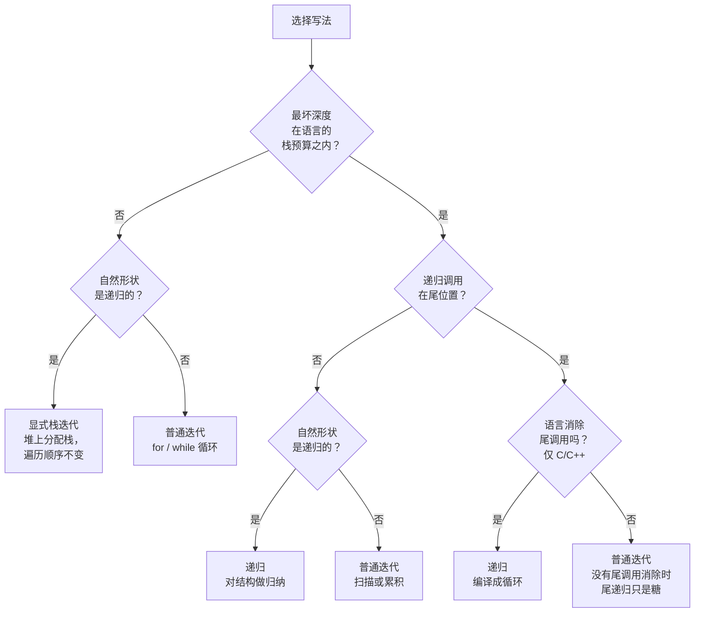

# 递归与迭代：迭代什么时候才重要

这个选择跟哪种写法跑得更快、哪种看起来更干净无关，两者都得看场景。真正要判断的是：递归写法在你的代码实际会遇到的输入上是否还正确，以及递归的自然形状是否与数据吻合。三个依次回答的问题就能定下来：递归最深能到多少层、这门语言是否消除尾调用、输入本身的形状是不是递归的。三个里漏掉任何一个，你要么上线一段在压力下就爆栈的代码，要么在归纳法一行就能证明的地方硬写一个循环。

## 如何决策

**问题：** 这道题、这门语言、这些输入，我该写递归形式还是迭代形式？

**一句话答案。** 输入本身是递归结构（树、AST、分治切分）且最坏深度在该语言的栈预算之内时，用递归；输入是顺序结构、深度可能溢出，或者语言不消除尾调用而递归又恰好是尾递归形状时，用迭代；形状是递归的但深度不安全时，用显式栈的混合形式。

## 流程图

*两个问题定安全性，一个问题定自然性。实践里尾调用这一支真正起作用的语言只有 C 和 C++。Python、Java、Go 从 Q2 直接落到 Iter2，因为这三门语言都不消除尾调用。*

## 算法对比

全书的题目都能被三种形式覆盖：纯递归、纯迭代、显式栈混合形式。第四种形式——尾调用消除下的尾递归——在 C 和 C++ 里存在，但在我们讲的其他任何语言里都会塌回纯递归或纯迭代。它在流程图里拿一个叶子节点，不配单开一节。

### 递归

函数在一个严格更小的子问题上调用自己，再把结果与常量时间的收尾工作合并。基准情形终止递归；递归情形把工作交给运行时调用栈。以下情况选它：

- 输入是**结构上递归的**：一棵树、一份 JSON 文档、一棵 AST、一棵语法分析树、一个定义成 `node -> next` 的链表。函数的伪代码与数据定义一一对应：每种叶子形状一个基准情形，每种分支形状一个递归情形。
- 最坏深度**可证明**落在该语言栈预算之下。平衡树的递归深度是 `O(log n)`；每次折半的分治也是 `O(log n)`；在 `k` 元子集上做回溯搜索，递归深度是 `k`，不是 `2^k`。
- 正确性证明是**对结构做归纳**。每种情形一句话，评审的人几秒钟就能看出 bug。

Cormen、Leiserson、Rivest 和 Stein 讲每一个分治算法（归并排序、快速排序、Strassen、FFT）都用递归形式，因为递推关系本身就是算法的规格说明。[^1] 把它展开成循环，主定理的分析就模糊了。Sedgewick 和 Wayne 讲排序与树算法默认也用递归表述，理由相同。[^2]

| | 时间 | 空间 |
|---|---|---|
| 每次递归调用 | 合并工作 | 一个栈帧 |
| 输入规模为 n 时总计 | 整棵树上的栈帧工作量之和 | 最大深度 × 栈帧大小 |

实际栈帧大小：Python 约 500 到 1000 字节（PEP 651 给出的数字是每兆字节大约 1000 个栈帧），Java HotSpot 约 100 到 200 字节，优化编译的 C++ 约 50 到 100 字节，Go 的 goroutine 在扩容前最小约 2 KiB。[^3]

参考：[递归心智模型](../part-0-foundations/02-recursion-mental-model.md)、[递归模式](../part-7-recursion-backtracking/00-recursion-patterns.md)、[树遍历](../part-6-trees-heaps/01-tree-traversals.md)、[DFS](../part-8-graphs/02-dfs.md)。

### 迭代

一个 `for` 或 `while` 循环，配上显式的辅助状态：计数器、累加器，有时还有一个手动维护的栈。不管输入多大，循环体都只占 `O(1)` 额外栈空间。以下情况选它：

- 输入是**顺序的**：一维数组、只扫一遍的字符串、定步长的模拟。循环就是“逐步走过、累积、返回”的直接表达。把递归硬套到一次平行扫描上，只会多出栈帧和噪音，换不来任何洞察。
- 深度在合法输入上就**会溢出**。Mattermost 工程团队对 Go 标准库的分析发现，2014 到 2024 年间的 12 个 CVE 都源自深度递归的解析器把栈耗尽而崩溃，涉及 `encoding/xml`、`encoding/gob`、`compress/gzip`、`go/parser` 和 `path/filepath`。这占了“Go 有史以来发布的所有 CVE 的 9%”。[^4] 每一例的修法要么是加一个显式深度计数器，要么是改成迭代循环。`encoding/xml.Decoder.Skip` 里的 CVE-2022-28131 把一个递归方法换成了用 `int64 depth` 计数器跟踪的 `for` 循环；修补后的代码在结构上比原版更简单，而且可证明不会栈溢出。[^4]
- 这段递归在不消除尾调用的语言上恰好是**尾形状的**。Python、Java、Go 都不消除尾调用。Project Loom 的设计说明写得很明确：“给 JVM 加自动尾调用优化不是这个项目的目标。”[^5] Go 运行时团队为了保持栈回溯完整，做了同样的取舍。这三门语言里任何一个“尾递归”函数，每次调用照样吃掉一个栈帧。任意大的输入上还能跑在 `O(1)` 栈里的，只有迭代。

迭代的正确性证明是循环不变式加终止性论证。两到四句话，而不是一句。写的人稍微费点劲，严谨程度相当。

| | 时间 | 空间 |
|---|---|---|
| 每次循环迭代 | 循环体工作 | 以堆为上限 |
| 输入规模为 n 时总计 | 循环体工作之和 | 与 n 无关的 `O(1)` 栈 |

参考：[反转模式](../part-5-linked-lists/01-reversal-patterns.md)、[递归模式](../part-7-recursion-backtracking/00-recursion-patterns.md)、[从递归到记忆化](../part-9-dynamic-programming/00-dp-recursion-to-memo.md)。

### 显式栈混合形式

混合形式把一段递归改成迭代循环，同时在堆上维护一个栈数据结构（Python 里是 `list`，Java 里是 `ArrayDeque`，C++ 里是 `std::vector` 或 `std::stack`，Go 里是切片），保存调用栈本来会保存的那些状态。以下情况选它：

- 自然形状是**递归的**（一棵树、一次图遍历、一棵语法分析树），而最坏深度会**溢出**该语言的栈预算。比如要在 Python 或 Go 里遍历一张 `10^6` 个节点首尾串成一条链的对抗性图，又不重构算法本身，这是唯一安全的做法。你不能指望尾调用消除，也不能安全地递归，但你可以在一个长度无上限的堆分配栈上压入、弹出节点。
- 你需要**显式限制深度**，用来防恶意输入。Skiena 的 *Algorithm Design Manual* 把这套转换当成图算法的安全变换来讲，因为图算法可能撞上退化的输入。[^6]

代价是记账。显式栈版本读起来像状态机，不像问题的规格说明。压栈顺序、出栈纪律、后序与前序行为上的 bug，都更难看出来。本书的 [Morris 遍历](../part-6-trees-heaps/02-morris-traversal.md) 是极端版本，靠穿线改树本身拿到 `O(1)` 额外空间，那一章也点明了由此得到的代码出了名地难读。

| | 时间 | 空间 |
|---|---|---|
| 每次迭代 | 压栈或出栈，加循环体工作 | 一个堆节点 |
| 树规模为 n 时总计 | `O(n)` 次操作 | `O(d)` 堆空间，d 为最大深度 |

参考：[树遍历](../part-6-trees-heaps/01-tree-traversals.md)、[DFS](../part-8-graphs/02-dfs.md)、[Morris 遍历](../part-6-trees-heaps/02-morris-traversal.md)。

## 逐项对比

| 维度 | 递归 | 迭代 | 显式栈混合形式 |
|---|---|---|---|
| 最坏时间 | 与递归树的规模成正比 | 与循环体工作量 × n 成正比 | 与压栈出栈次数成正比 |
| 栈空间 | `O(d)` 调用栈，d 为最大深度 | `O(1)` 调用栈 | `O(1)` 调用栈，`O(d)` 堆空间 |
| 栈溢出风险 | Python、Java、Go 上深输入时很高 | 没有 | 没有，只受堆限制 |
| 缓存行为 | 每个栈帧重新分配局部变量；深调用会伤 L1 | 每次迭代复用同一批局部变量；局部性更好 | 逐节点堆分配；三者中最差 |
| 代码清晰度 | 每种情形一句话；与数据定义对应 | 形状顺序时很清楚；形状递归时别扭 | 读起来像状态机；最难评审 |
| 中止时的清理 | 异常按顺序展开栈帧，`finally` 块会执行 | `break` 或 `return` 时手动清理 | 手动清理 |
| 溢出的可捕获性 | Python 的 `RecursionError` 可捕获；Java 的 `StackOverflowError` 可捕获；C++ 溢出是未定义行为；Go 的 `runtime.throw` 是致命错误，**不能**恢复 | 不适用 | 不适用 |
| 何时选用 | 形状递归且深度安全 | 形状顺序，或深度不安全，或是非 TCE 语言上的尾形状 | 形状递归且深度不安全 |

一种读法：如果语言是 Python、Java 或 Go，尾调用消除那一栏是空的，那么问题 1 的深度上限就是硬约束。如果语言是 C 或 C++，GCC 的 `sibcall` 优化和 Clang 的 `[[clang::musttail]]` 属性可以让尾递归安全，但只对真正处在尾位置的调用有效。[^7][^8] 中序树遍历在递归调用之后还有工作（访问节点），拿不到任何好处。

## 三道招牌题

每种主要形式配一道题。每道都在一个标准面试题里展示这种形式的模式信号。

### 递归胜出：二叉树的最大深度

[LC 104 — Maximum Depth of Binary Tree](https://leetcode.com/problems/maximum-depth-of-binary-tree/) [简单]

树高被题目约束卡住了（LeetCode 把节点数上限设在 `10^4`，所以绝对最坏情况是一条深度 `10^4` 的退化链，在 Python 抬高后的上限之内，也远在 JVM 的 `-Xss` 默认值之内）。递归解法三行，靠归纳自证：空树的深度是 0；一个节点的深度是 1 加上两棵子树深度的较大者。迭代版本需要队列、层计数器和二十行记账，反而把递推关系遮住了。

### 迭代胜出：无重复字符的最长子串

[LC 3 — Longest Substring Without Repeating Characters](https://leetcode.com/problems/longest-substring-without-repeating-characters/) [中等]

字符串是序列。`10^5` 个字符的输入，在多数平台上即便抬高了递归上限，Python 也会溢出；而它的自然形状是“扫、扩、缩”：两个指针左右走，配一张哈希表。没有可提取的递归形状。Erickson 的说法直接回答了结构性问题：当你问“这个输入的递归形状是什么”，而答案是“没有”，那就写循环。[^9]

### 混合形式胜出：10^6 格网格上的岛屿数量

[LC 200 — Number of Islands](https://leetcode.com/problems/number-of-islands/) [中等]

递归洪水填充是显而易见的解法。LeetCode 判题机上网格上限 `300×300`，递归写法能过。可换成 `1000×1000`、所有格子连成一片的网格（模糊测试最喜欢造这种输入），递归深度就到 `10^6`，Python、Java、Go 全崩。修法是显式栈：Python 里用一个装 `(r, c)` 对的 `list`，压入邻居，弹到空为止。遍历顺序一样，没有调用栈风险。Mattermost 的 CVE-2022-28131 修 `encoding/xml.Decoder.Skip` 用的就是同一个转换：把递归换成自带栈的迭代循环。[^4]

## 常见误解

**“把 `sys.setrecursionlimit` 抬到 10⁶ 就能解决深递归。”** 不能。Python 文档写得很清楚：“能设的上限取决于平台。当程序需要深递归、而平台支持更高的上限时，用户可能需要把上限调高。这么做要小心，因为上限设得过高会导致崩溃。”[^10] CPython 底下那层 C 栈是操作系统给的固定资源，通常 1 MiB 到 8 MiB。把递归上限设成 `10^6` 并不会让那段栈变大，只是让你能一直递归到撞上它，而中途没有 Python 层的安全网。程序会在到达上限之前的某处以段错误崩掉。正解是改成迭代或显式栈形式，不是把上限调高。

**“Go 的 `recover()` 能像接 panic 一样接住栈溢出。”** 不能。Go 里的栈耗尽不是 panic，是 `runtime.throw` 抛出的致命错误。Mattermost 的分析说它是“一个 nosplit 函数，意味着它永远不会扩栈”，并且“用的是 crash()……而不是 fatalpanic()”。[^4] 栈溢出时 defer 的代码不会执行，所以任何靠 `defer` 释放数据库锁、关闭文件或解锁互斥量的函数，在递归把栈打爆的那一刻就会泄漏这些资源。正解是根本别让递归走到那么深：限住它、数着它，或者消掉它。

**“加几个累加器参数把递归‘改成尾递归’，在 Python 或 Java 里就更安全了。”** 纯粹是表面功夫。函数签名变了，每次调用的栈帧分配没变。本来是深度 `n` 的非尾递归，重构完还是深度 `n`。这种反模式最常出现在从 Scheme、Scala 或 OCaml 转过来的作者身上，那些语言里 TCE 是语言契约的一部分。Python、Java、Go 不提供这种保证。要安全就写循环。

**“Java 迟早会有尾调用消除，Loom 路线图上有。”** 没有。Project Loom 明确写出的非目标就是这句话：“实现自动尾调用优化不是这个项目的意图。”[^5] 原因不是技术上的懈怠。HotSpot 里对安全敏感的 API 要靠遍历调用栈来识别调用者，TCO 会把那些检查依赖的栈帧抹掉。对待 JVM 就跟对待 CPython 一样：尾递归代码是表达力上的糖，不是可移植的空间优化。

**“在任意递归调用上挂 `[[clang::musttail]]` 就能强制变成尾调用。”** 不能。这个属性是一份契约：调用点必须本来就处在这样的位置——调用方“会直接返回它从被调函数拿到的值”，不再做别的工作，而且调用方与被调方的签名必须兼容。[^8] 把属性硬貼到循环里的递归调用上，或者贴到调用后还有工作的调用上，编译器直接报错。这个属性是在**已经**处于尾位置的调用上**强制**做尾调用消除，它不会把非尾调用变成尾调用。

## 参考文献

[^1]: Cormen, Leiserson, Rivest, Stein, *Introduction to Algorithms*, 4th ed., MIT Press, 2022, Ch. 4.

[^2]: Sedgewick and Wayne, *Algorithms*, 4th ed., Addison-Wesley, 2011. https://algs4.cs.princeton.edu/

[^3]: Shannon, "PEP 651 — Robust Stack Overflow Handling," 2021 (rejected). https://peps.python.org/pep-0651/

[^4]: Forsen, "A deep dive into deeply recursive Go," Mattermost Engineering Blog, 2025-07-11. https://mattermost.com/blog/a-deep-dive-into-deeply-recursive-go/

[^5]: OpenJDK Project Loom, project description. Quoted at https://stackoverflow.com/a/69273526

[^6]: Skiena, *The Algorithm Design Manual*, 3rd ed., Springer, 2020.

[^7]: GCC Internals, "Permitting tail calls." https://gcc.gnu.org/onlinedocs/gccint/Tail-Calls.html

[^8]: Clang, "Attributes in Clang — `musttail`." https://clang.llvm.org/docs/AttributeReference.html#musttail

[^9]: Erickson, *Algorithms*, 1st ed., 2019, Ch. 1. https://jeffe.cs.illinois.edu/teaching/algorithms/

[^10]: Python 3 docs, `sys.setrecursionlimit`. https://docs.python.org/3/library/sys.html#sys.setrecursionlimit
