# 记忆化与制表，自顶向下与自底向上

你已经判断过这道题有重叠子问题、值得缓存了，那是上一页 [递归 vs DP](../../../dsa/patterns/P-19-recursion-vs-dp.md) 的活。这一页从那里接着走。同一个递推式，两种实现策略，渐进复杂度完全一样。教科书的说法是，它们是同一个底层算法的两种对偶形式。面试里的说法是，其中一种会在 `10^5` 规模的输入上把栈耗光，另一种能把空间降到 `O(1)`，而你必须在动手敲第一行之前就知道哪个是哪个。

## 如何决策

**问题：** 给定一个具备最优子结构和重叠子问题的递推式，你是自顶向下实现（递归加备忘录），还是自底向上实现（在一张填好的表上迭代）？

**一句话答案。** 递归会撑爆栈时，用制表；常量窗口依赖能换来滚动数组压缩时，用制表；生产环境的常数因子要紧时，用制表。状态空间稀疏时，用记忆化；依赖顺序不规则、循环根本写不出来时，用记忆化；面试里图顺手、想让归纳法替你保证正确性时，用记忆化。混合形态——在稀疏填充的表上做自底向上迭代——适合这样一类题：按索引看状态空间是稠密的，但其中绝大多数格子不可达。

## 流程图

```mermaid
flowchart TD
    Start["手里有一个递推式，<br/>存在重叠子问题"] --> Q1{"最坏递归深度<br/>会撑爆<br/>语言栈吗？"}
    Q1 -->|"是"| Tab1["自底向上制表"]
    Q1 -->|"否"| Q2{"常量窗口依赖<br/>能否用滚动数组<br/>压到 O&#40;1&#41; 空间？"}
    Q2 -->|"是 且预算紧"| Tab2["自底向上制表<br/>压缩成滚动两个变量"]
    Q2 -->|"否"| Q3{"状态空间是稠密<br/>还是稀疏？"}
    Q3 -->|"稀疏：<br/>多数格子到不了"| Memo1["自顶向下记忆化<br/>只算真正碰到的状态"]
    Q3 -->|"按索引稠密<br/>但多数格子<br/>运行时不可达"| Hybrid["自底向上迭代<br/>走哈希表式的表<br/>或提前退出守卫"]
    Q3 -->|"稠密，每个<br/>格子都参与"| Q4{"填表顺序<br/>能从递推式直接看出？"}
    Q4 -->|"不能，顺序不规则<br/>矩阵链、区间"| Memo2["自顶向下记忆化<br/>由递归自己决定顺序"]
    Q4 -->|"能"| Tab3["自底向上制表<br/>常数因子更好"]
```

*三个维度决定选哪条路：栈安全、内存预算，以及真正被访问的是哪一部分状态。状态空间稀疏把人往记忆化拽；深递归或滚动数组压缩把人往制表拽；混合形态处理的是索引稠密但可达性稀疏的情形。*

## 算法对比

手册里所有 DP 题都落在三种形态上：带备忘录的自顶向下、在稠密表上自底向上（通常做了压缩）、在稀疏或带守卫的表上自底向上。前两种是对偶；第三种是两种干净选项都不合适时的落点。

### 自顶向下记忆化

函数就是递推式本身，逐字写成递归调用。一个缓存（`dict`、`@functools.cache` 装饰器，或初始化成哨兵值的数组）拦下重复调用并返回缓存答案。[^1][^2] 以下情况选它：

- 依赖顺序**不规则**。CLRS 4e §14.2 的矩阵链乘法是标准例子：`m[i,j]` 依赖索引区间两半里更短的链 `m[i,k]` 和 `m[k+1,j]`，所以自底向上的填表顺序是*按链长*，不是先 `i` 再 `j`。[^1] 区间 DP、任意结构上的树形 DP、带缓存的博弈 minimax 都有这个性质。递归天然往更短的链里走；备忘录在每条链第一次算出答案时把它记下来。
- 状态空间**稀疏**。当问题固定了起始状态、只有一部分候选子问题落在答案路径上时，记忆化只算真正走到的那些子问题，而制表会把整个状态空间填满。[^3] CLRS 4e §14.3 明确点了这种情况：当天然递归算法只求解自底向上 DP 所需子问题的一小部分时，自顶向下更高效。[^1]
- 你在**先把正确性立住**。Erickson 第 3 章的讲法是“先记忆化，再制表”：写出递归，挂一个备忘录在小输入上确认正确性，只有确实需要常数因子或空间收益时才转成表。[^2] 递归的正确性由调用图强制保证：子调用没返回之前，任何父节点都不会执行。

代价是实打实的。每次访问格子都要付一次函数调用开销；缓存若是 `dict`，还要再加一次哈希查找。CLRS 4e §14.3 记载，自底向上方法通常常数因子更好，因为它省掉了递归调用开销。[^1] 栈的风险也是真的：Python 默认的 `sys.setrecursionlimit` 是 1000；[^4] Java 的深度取决于 `-Xss`（典型是 `10^4` 到 `10^5` 帧）；C++ 主线程的栈在 Linux/macOS 上是 8 MiB；Go 的 goroutine 栈会自动增长，但在刁钻输入下照样会撞上硬上限。

| | 时间 | 空间 |
|---|---|---|
| 每个状态 | `O(work-per-state)` | 一条缓存记录加一个栈帧 |
| 总计 | `O(states * work-per-state)`[^1] | `O(states visited)` 缓存 + `O(max depth)` 栈 |

参考：[DP 心智模型：从递归树到记忆化 DAG](../part-9-dynamic-programming/00-dp-recursion-to-memo.md)。

### 自底向上制表

先分配一张表，循环按与递推依赖图一致的顺序把它填满。递归没了，运行时栈停在 `O(1)`。以下情况选它：

- 递归会**撑爆栈**。各语言都有硬性递归上限。[^4] 在 `n` 能到 `10^4` 或 `10^5` 的一维递推 LeetCode 题上，Python 和 Java 里自底向上是更稳的默认。第 9.1 章正是把这一点当作“讲完记忆化立刻讲制表”的主要动机。[^5]
- 递推只碰**最近几个格子组成的常量窗口**，而你需要滚动数组省空间。Fibonacci 用 `dp[i-1]` 和 `dp[i-2]`；0/1 背包的内层循环只用上一行；打家劫舍只用前两个值。自底向上允许滚动两个变量的压缩，把空间从 `O(n)` 或 `O(n*W)` 降到 `O(1)` 或 `O(W)`。[^5] 用两个标量替掉整个数组，同步更新，返回最后那个标量。记忆化匹配不了这个技巧：递归顺序由调用图决定，递归跑到一半你一般没法把早先的备忘录条目丢掉，而且就算能丢，递归栈帧也还在那儿。
- 你在**生产热路径**上，常数因子要紧。连续内存访问、步长可预测、没有哈希、没有函数调用。LC 上一维和二维 DP 题的标准面试期待就是迭代写法，原因相同。[^5]

代价在簿记上。填表顺序错了，答案会静默出错；写循环之前你必须分析清楚“谁依赖谁”。Erickson 和 Skiena 都把这当成一种顺序性失效模式：候选人在递推式还没理顺时就先写循环，用一个看起来合理的顺序填表，然后交付一个静默 bug。[^2][^6]

| | 时间 | 空间 |
|---|---|---|
| 每个格子 | `O(work-per-cell)` | 一个数组槽位 |
| 总计 | `O(states * work-per-state)`[^1] | `O(state space)`，通常可压缩到 `O(window)` |

参考：[自底向上制表：从备忘录到迭代 DP](../part-9-dynamic-programming/01-dp-bottom-up-tabulation.md)。

### 迭代 + 惰性表（混合形态）

前两种干净选项都假设状态空间是规则的。有些题打破这个假设：索引看起来稠密（容量 `W = 10^9` 的背包；零钱兑换的金额到 `10^4`，其中大多数不可达），但可达性很稀疏。递归算安全但缓存放不下这么多状态；稠密的自底向上表装不进内存；依赖不是常量窗口时滚动数组也帮不上忙。混合形态是在*惰性*或*带守卫*的表上做自底向上迭代——一张按可达状态建键的哈希表，或者一个用哨兵挡住“这个状态从没被碰过，跳过”的稠密数组。

以下情况选它：

- 索引**按定义就是稠密的**，但大多数格子在**运行时永远到不了**。容量 `W = 10^9`、物品重量最大 100、最多 50 件物品的背包：可达的 `(i, w)` 状态数上界是 `50 * (50 * 100) = 250{,}000`，而稠密表需要 `~5 * 10^{10}` 个条目。在按 `(i, w)` 建键的哈希表备忘录上做自底向上迭代，只解可达状态。[^3] 你在同一个结构里同时拿到了迭代的 `O(1)` 栈和记忆化的稀疏状态节省。
- 递推**本质上是自底向上的**，但有些转移要守卫。零钱兑换迭代金额 `1..N`，但如果 `dp[a - coin]` 从未可达（还停在哨兵 `infinity`），父转移就非法，跳过。正是这个跳过让迭代变稀疏，而循环结构一点没改。

代价：哈希表迭代的缓存局部性比数组迭代差；守卫数组形态每次读取都要做一次哨兵判断。但两者都还是比最坏的替代方案强——要么是分配不出来的稠密数组，要么是溢出的递归。

| | 时间 | 空间 |
|---|---|---|
| 每个可达状态 | `O(work-per-state)` 加上哈希或守卫 | 一个条目 |
| 总计 | `O(reachable * work-per-state)` | `O(reachable)` |

参考：[0/1 背包](../part-9-dynamic-programming/04-knapsack-01.md)、[一维 DP](../part-9-dynamic-programming/02-dp-1d.md)。

## 逐项对比

| 维度 | 自顶向下记忆化 | 自底向上制表 | 迭代 + 惰性表 |
|---|---|---|---|
| 状态访问模式 | 只访问答案路径上的状态 | 选定状态空间里的每一个格子 | 只访问可达状态，但是迭代地走 |
| 栈风险 | Python、Java、Go 上的深递归确实存在[^4] | 没有 | 没有 |
| 滚动数组 O(1) 空间 | 不能直接做到 | 依赖是常量窗口时可以做[^5] | 少见；取决于访问模式 |
| 常数因子 | 更慢：函数调用 + 哈希或数组查找[^1] | 更快：连续数组访问[^1] | 介于两者之间；哈希拖累缓存 |
| 写出第一版正确解的成本 | 更低：递推式可逐字翻译[^2] | 更高：必须先推出填表顺序再写循环[^1][^2] | 比制表更高；需要守卫纪律 |
| 求值顺序类 bug | 不可能：递归强制了依赖关系[^2] | 最常见的 DP 失效模式[^5] | 在守卫边界上可能出现 |
| 不规则填表顺序 | 稳：递归自己挑顺序[^1] | 有风险：矩阵链“按链长填”并不显然[^1] | 不是合适的工具 |
| 何时选它 | 状态稀疏 或 顺序不规则 或 先立正确性 | 深递归 或 滚动数组压缩 或 热路径常数 | 索引稠密、可达性稀疏 |

一句话把这表点透：记忆化是递归加一张表；制表是一张表但不带递归；[^7] 混合形态是不带递归、*也*不带那些你永远不会碰的格子的表。

## 三道招牌题

每种主要形态一道。每道都用一道标准面试题展示该形态的模式信号。

### 记忆化胜出：Word Break

[LC 139 — Word Break](https://leetcode.com/problems/word-break/) [中等]

递推式是 `canBreak(i) = any(canBreak(i + len(w)) for w in dict if s.startswith(w, i))`。状态是后缀起点索引 `i`，取值 `0..n`，但可达的索引只有落在某个合法词边界末尾的那些。对 `s = "leetcodecodingisfun"` 和一个小词典，候选索引里连一半都检查不到。稠密的 `dp[0..n]` 表不管可不可达都会把每个格子填满；而用 `@cache` 装饰 `canBreak(i)` 的自顶向下备忘录只算递归真正走进去的格子。递归深度被 `n` 界住，远在 LC 输入范围给 Python 抬高的上限之内。这正是 CLRS 4e §14.3 点出的情形：当天然递归算法只求解一小部分子问题时，自顶向下更高效。[^1]

### 制表胜出：House Robber

[LC 198 — House Robber](https://leetcode.com/problems/house-robber/) [中等]

递推式：`dp[i] = max(dp[i-1], dp[i-2] + nums[i])`。依赖是前两个格子构成的常量窗口，于是滚动两变量的压缩成了机械操作：用两个标量替掉整个数组，同步更新，返回第二个。[^5] 空间从 `O(n)` 降到 `O(1)`。在这个规模上，Python 的递归开销大约是迭代循环的三倍，这还没算 `n = 10^5` 时的栈上限风险。这道题的面试期待就是滚动两变量写法；写出递归记忆化版本不算错，但拿不到空间优化那一分。打家劫舍 II 归约成同一个基本操作跑两遍线性子过程（跳过第一家 或 跳过最后一家）。[^5]

### 混合形态胜出：Coin Change

[LC 322 — Coin Change](https://leetcode.com/problems/coin-change/) [中等]

自底向上形态迭代金额 `1..amount`，计算 `dp[a] = min(dp[a - c] + 1 for c in coins if a - c >= 0 and dp[a - c] != INF)`。状态空间看起来是稠密的（`amount + 1` 个格子，外层循环全碰一遍），但运行时大多数转移被 `dp[a - c] != INF` 这个守卫挡住。对 `coins = [3, 7]`、`amount = 100`，候选 `dp[a]` 里超过一半不可达；守卫把这些工作剪掉，而循环结构没变。不管 `amount` 多大，迭代都跑在 `O(1)` 栈上，数组是稠密的、对缓存友好，而带守卫的转移才是让访问模式变稀疏的原因。正是这个结构把记忆化的收益（跳过不可达）和制表的收益（没有栈、连续内存）留在了同一份实现里。

## 常见误解

**“记忆化永远比制表慢一个常数因子。”** 状态空间稀疏时不是。CLRS 4e §14.3 说得很直白：当天然递归算法只求解自底向上 DP 所需子问题的一小部分时，自顶向下比自底向上更高效。[^1] 在大 `W` 的背包变体上，稠密自底向上根本分配不出表；带哈希表缓存的记忆化只解那 `~250{,}000` 个可达状态，毫秒级就完事。候选人默认“要快就制表”，因为那是稠密题上的规则，于是假设它普适。它并不普适。

**“制表总能靠滚动数组省空间。”** 滚动数组只在递推是常量窗口依赖时管用：`dp[i]` 只依赖 `dp[i-1]` 和 `dp[i-2]`，或者 `dp[i][j]` 只依赖上一行。在 LCS、编辑距离这类二维字符串 DP 上，你可以把*一个*维度滚成两行，把 `O(m*n)` 降到 `O(min(m, n))`。[^5] 在矩阵链这类区间 DP 上，你什么都滚不了：`m[i,j]` 依赖 `i` 到 `j` 之间任意 `k` 的 `m[i,k]`，所以之前每个格子都是活的。滚动技巧适用时是机械的，不适用时是做不到的。别在检查过依赖窗口之前就许这个诺。

**“面试里必须把记忆化转成制表。”** 不用。记忆化常常是更干净的答案，面试官会接受。该转的时候是：栈预算卡死（Python 或 Java 上的深递归；底层的递归 vs 迭代权衡是 [递归 vs 迭代：迭代到底什么时候才重要](./P-01-recursion-vs-iteration.md) 的主题）、滚动数组形态就是期望的优化、或者生产热路径的常数要紧。除此之外，递归加缓存的形式更好读，正确性证明——对递推式做归纳——也比循环不变式论证短。Erickson 的“先记忆化，再制表”讲的是顺序，不是必须走完第二步的强制令。[^2]

**“DP 永远是这两种之一。”** 依赖是常量窗口的线性递推根本不需要显式的表。两个标量的 Fibonacci、两个标量的打家劫舍、`(a, b) = (b, a + b)` 这种迭代写法：它们在形式意义上就是 DP（重叠子问题、最优子结构），但看起来就是一个没有数组的 `for` 循环。记忆化与制表的对立框架假设表是必需的。当递推小到能用常数个变量装下时，这个框架就不适用。

**“`@functools.cache` 是每个 Python DP 都该用的记忆化。”** 方便、正确、常常很慢。这个装饰器把函数包成每次调用一次哈希表查找，在整数索引的状态空间上比稠密数组慢好几倍。[^4] 如果你出于省事选了记忆化、而状态空间是稠密的（`0 <= i <= n` 的 `dp[i]`，或 `dp[i][j]`），那就分配 `memo = [-1] * (n + 1)`，改用 `memo[k] != -1` 判断，别用装饰器。这样记忆化的常数因子会向制表靠拢，而不用放弃递归形式。

## 参考文献

[^1]: Cormen, Leiserson, Rivest, Stein, *Introduction to Algorithms*, 4th ed., MIT Press, 2022, Ch. 14.

[^2]: Erickson, *Algorithms*, 1st ed., 2019, Ch. 3. https://jeffe.cs.illinois.edu/teaching/algorithms/

[^3]: walkccc, "CLRS Solutions §15.3." https://walkccc.me/CLRS/Chap15/15.3/

[^4]: Python 3 docs, `sys.setrecursionlimit` and `functools.cache`. https://docs.python.org/3/library/sys.html#sys.setrecursionlimit, https://docs.python.org/3/library/functools.html#functools.cache

[^5]: DSA Handbook, [自底向上制表](../part-9-dynamic-programming/01-dp-bottom-up-tabulation.md).

[^6]: Skiena, *The Algorithm Design Manual*, 3rd ed., Springer, 2020, Ch. 10.

[^7]: Wikipedia, "Memoization." https://en.wikipedia.org/wiki/Memoization
