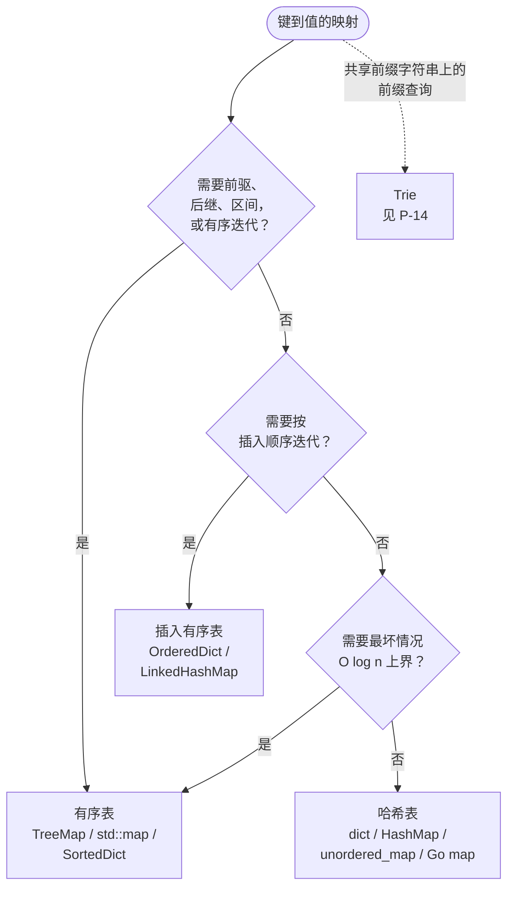

# 哈希表 vs 有序表：平均 O(1) vs 有序 O(log n)

在 n = 10⁶ 时，一次 `TreeMap` 查找大约做 20 次比较；同样规模下一次 `HashMap` 查找平均大约 1.5 次探测。这个比值正是 C++ 标准库把有序版本命名为 `std::map`、把哈希版本命名为 `std::unordered_map` 的全部理由，也正是 Java 面试题上凭直觉选错结构要多付约 13 倍常数因子的全部理由。这两种结构回答的是不同的问题，哪怕它们的类型签名看起来可以互换。

真正值得讨论的决策不在快与慢之间，而在*有序*与*无序*之间，另外还有第三个角标着*插入有序*；这一页要做的，就是别让读者因为某个语言习惯看着眼熟就挑错那个角。

## 如何决策

**问题：** 给定一个键到值的映射，你需要按键有序迭代，还是只需要点查？

**答案：** 如果算法要查询键与键之间的关系（前驱、后继、区间、有序迭代），就用有序表，付 O(log n)。否则就用哈希表，拿平均 O(1)。插入有序迭代是独立的第三种选择，与前两者都不同。

## 流程图

*三道顺序关卡，三个终点。Q1 接住 floor/ceiling/区间这类工作负载；Q2 接住 LRU 那种按遍历顺序的工作负载；Q3 接住生产环境里摊还 O(1) 不够、需要硬上界的情况。虚线把前缀查询类负载指向 [Trie vs 哈希表 vs 有序集合](../../../dsa/patterns/P-14-trie-vs-hash-map-vs-sorted-set.md)。*

## 算法对比

### 哈希表：`dict` / `HashMap` / `unordered_map`

默认选择。一个连续的桶数组，用 `hash(key) mod capacity` 定位，冲突时靠链地址法或开放寻址区分。CLRS 定理 11.1 给出了平均情况界：在简单均匀哈希下，查找、插入、删除的期望代价都是 `Θ(1 + α)`，其中 `α = n/m` 是装载因子。[^1] 用几何扩容把 `α` 限制在常数上，这个表达式就退化为平均 `Θ(1)`。

**何时选择：**

- 点查成员与频次。模式信号是*“这个键我见过吗？如果见过，我当时给它关联了什么值？”*：Two Sum、Group Anagrams、Valid Anagram，以及整个用字符计数做滑动窗口的家族。
- 键集合大到 O(log n) 的开销开始有影响。n = 10⁶ 时，有序表约 20 次比较的上界对哈希表约 1.5 次探测的平均值，大约是 13 倍；n ≤ 100 时这点差别就是噪声。[^4]
- 键可哈希但没有天然的可比较性。混合基础类型的元组、有快速 `hashCode` 却没有 `compareTo` 的自定义类、没有定义序的结构体：哈希表不需要比较器就能接收这些键。

**开销。** 时间上 `get`、`put`、`remove` 平均 `Θ(1)`；最坏情况在冲突堆积或单次扩容时是 `O(n)`。空间上因装载因子阈值留出约 25-33% 的余量。[^1]

**参考：** [哈希表与哈希集合](../part-1-linear-data-structures/03-hash-maps.md) 里有链地址法的证明和各语言的阈值表。

### 有序表：`TreeMap` / `std::map` / Go `*sortedmap`

自平衡二叉搜索树，生产环境里几乎总是红黑树。键通过中序遍历以有序方式存放；树的结构让查找、插入、删除都是 O(log n)，前驱/后继/floor/ceiling/区间查询同样是 O(log n)。Java `TreeMap` 的 Javadoc 直接写明：“对 containsKey、get、put 和 remove 操作保证 log(n) 的时间代价。算法改编自 Cormen、Leiserson 与 Rivest 的《算法导论》。”[^2] CLRS §13.1 引理 13.1 证明了高度上界：含 `n` 个内部节点的红黑树高度至多 `2 lg(n+1)`。[^3]

**何时选择：**

- 前驱或后继查询。信号是题面里的 *floor*、*ceiling*、*next-greater*、*next-smaller* 或 *strictly between* 这些词。Java 的 `NavigableMap` 接口把每个变体都直接命名了：`floorKey`、`ceilingKey`、`higherKey`、`lowerKey`、`firstKey`、`lastKey`。[^2] C++ 则用 `lower_bound`、`upper_bound` 加迭代器回退拼出来。[^5]
- 中序遍历本身就是算法的一部分。扫描线问题、区间调度，以及任何按 x 坐标顺序处理事件的场景。哈希表在这里唯一的办法是“取出键、排序、迭代”，O(n log n)；有序表的中序遍历总共 O(n)。
- 区间查询：*“把 [lo, hi] 里的键全给我”*。Java 的 `subMap(from, true, to, false)` 返回一个视图，建立代价 O(log n)，迭代代价 O(k)；哈希表只能 O(n) 过滤。[^2]
- 硬性的最坏情况延迟预算。有序表的 O(log n) 是确定的上界：没有扩容尖峰，没有对抗性冲突的长尾，也没有概率性论证。n = 10⁹ 时至多约 60 次比较，每次都如此。[^3]

**开销。** 每个点操作最坏情况 `O(log n)`；扫描 `k` 个键的区间是 `O(log n + k)`。红黑树每个节点约占 3 个指针加 1 个颜色位。[^1]

**参考：** [二叉搜索树](../part-6-trees-heaps/05-binary-search-trees.md) 走了一遍中序遍历的证明和 O(h) 前驱/后继的论证。当操作画像从“查找”转向“取最小”或“前 K 个”时，[堆 vs 有序数组 vs 平衡 BST](./P-06-heap-vs-sorted-array-vs-bst.md) 是决策树上往下的下一步。

### 插入有序表：`OrderedDict` / `LinkedHashMap`

第三种选择，大多数候选人都忘了它存在。它就是哈希表，另外用一条双向链表按插入顺序串起所有条目（在 `LinkedHashMap` 的 `accessOrder` 模式下，则按最近访问顺序串）。哈希那边保证平均 O(1) 查找；链表那边给出 O(n) 的有序迭代，不用排序。

**何时选择：**

- LRU 与 LFU 缓存。哈希表提供 O(1) 的“这个键在缓存里吗”；链表提供 O(1) 的“淘汰最老的”，因为淘汰目标永远是头节点。这就是 LC 146 的经典解法。[^8]
- 保序去重。遍历一个字符串列表，逐个插入 `OrderedDict`（或 `LinkedHashMap`），再迭代结果。输出就是按首次出现位置排列的唯一元素，总共 O(n)。
- 配置文件与序列化顺序。键有序的 JSON、环境变量清单，以及任何用户自己敲了顺序、你希望原样保留的场景。

它*不是*什么：有序表。它的顺序是你放进去的顺序，不是排序后的顺序。这个区别正是常见误解一节里代价最大的一条。

**开销。** `get`、`put`、`remove` 平均 `O(1)`；按插入顺序迭代 O(n)。空间上是一个哈希表的开销再加每个条目两个链表指针（64 位系统上约多 16 字节）。

**参考：** [LRU 缓存](../part-5-linked-lists/05-lru-cache.md) 是经典模式；Python 的 `OrderedDict.move_to_end` 和 Java `LinkedHashMap` 的访问顺序模式都是围绕 LRU 的操作集设计的。

## 逐项对比

| 操作 / 属性 | 哈希表 | 有序表 | 插入有序表 |
|---|---|---|---|
| 点查 `get(k)` | **平均 O(1)** | O(log n) | **平均 O(1)** |
| 点插入 `put(k, v)` | **摊还 O(1)** | O(log n) | **摊还 O(1)** |
| 点删除 `remove(k)` | **平均 O(1)** | O(log n) | **平均 O(1)** |
| 最坏情况上界 | O(n)（堆积或扩容） | **硬性 O(log n)** | O(n)（堆积或扩容） |
| 按键有序迭代 | 不支持（需 O(n log n) 排序） | **O(n) 中序遍历** | 不支持 |
| 按插入顺序迭代 | 不支持 | 不支持 | **O(n)** |
| `floor(k)` / `ceiling(k)` | 不支持 | **O(log n)** | 不支持 |
| 覆盖 `k` 个键的区间扫描 `[lo, hi]` | 不支持 | **O(log n + k)** | 不支持 |
| 首个 / 最后一个键 | 不支持 | **O(log n)** | **O(1)**（链表头/尾） |
| LRU 淘汰 | 需要额外的顺序结构 | 结构不对路 | **O(1)**（内置） |
| 每条目内存开销 | 约 25-33% 桶余量 | 约 3 个指针 + 颜色位 | 哈希开销 + 2 个指针 |
| 何时选择 | 点操作、`n` 大、不需要顺序 | floor/ceiling、区间、硬延迟 | LRU、保序去重、配置文件 |

“不支持”这些单元格不是慢，而是 API 里根本没有。绕过办法（取出键、排序、扫描）正是有序查询占主导时哈希表成为错误默认值的原因。

## 三道招牌题

每种主要策略一道。每道题都暴露工作负载的某一个属性，正是它把选择翻转过来。

- [LC 1 — Two Sum](https://leetcode.com/problems/two-sum/) [简单] • 哈希表 ★
  扫一遍数组；对每个 `nums[i]`，问哈希表“我见过 `target - nums[i]` 吗？”常数时间的补数查找把 O(n²) 的暴力解法变成 O(n)。信号是精确键的成员判断：键之间没有关系，不需要中序迭代，也没有区间查询。有序表同样能解这道题，但白白付了 O(n log n)；n = 10⁴ 时就是可测的约 13 倍变慢，收益为零。[^4]

- [LC 729 — My Calendar I](https://leetcode.com/problems/my-calendar-i/) [中等] • 有序表（`floorKey` / `ceilingKey`）
  预订一个半开区间 `[start, end)`；只要与任何已有预订重叠就拒绝。TreeMap 解法为每个预订维护 `start -> end`；每次调用 `book(start, end)` 时，`floorKey(start)` 找到开始时间在 `start` 之前或正好的最晚预订，`ceilingKey(start)` 找到开始时间在 `start` 之后或正好的最早预订。可能重叠的候选只有这两个。两次查询都是 O(log n)；`n` 个预订总共 `O(n log n)`。哈希表版本每次调用都要扫一遍已有预订：每次 O(n)，总共 O(n²)，n = 10⁴ 时就 TLE。

- [LC 146 — LRU Cache](https://leetcode.com/problems/lru-cache/) [中等] • 插入有序表（或哈希表 + 双向链表）
  `get` 和 `put` 都必须平均 O(1)。经典解法把哈希表（key → 节点）与一条双向链表配对（最近使用在头，最老的在尾）。淘汰就是“摘掉尾节点”，O(1)；命中时的提升就是“摘下再插到头部”，O(1)。Java 的 `LinkedHashMap` 配 `accessOrder = true` 把这两半合成一个结构；Python 的 `collections.OrderedDict` 加 `move_to_end` 同理。纯哈希表给不了 O(1) 淘汰，因为找 LRU 条目要扫遍所有值；按 `last_used_tick` 排序的有序表则在每次访问上多加一个 O(log n) 因子。[^8]

## 常见误解

**“Python 的 dict 保持插入顺序，所以它是有序的。”** 不对。插入顺序是你写进 dict 的顺序；排序顺序是按 key 比较后的顺序。从 CPython 3.7 起，`for k in d: ...` 走的是键被赋值的顺序，不是升序。插入 `[3, 1, 2]`，迭代出来的就是 `3, 1, 2`。把“有序”（ordered）和“排好序”（sorted）混为一谈，是 Python 侧在有序表类题目上最常见的 bug，也是这一页存在的原因。如果你需要按 key 升序迭代，一次性扫描用 `for k in sorted(d): ...`；如果整个算法都要有序访问，就用 `from sortedcontainers import SortedDict`。[^7] LeetCode 的 Python 环境预装了 `sortedcontainers`，这是 Python 里有序表的标准引入方式。

**“`TreeMap` 和 `HashMap` 可以互换。”** 它们实现同一个 `Map` 接口，所以类型签名会骗你。一个 `Map<K, V>` 声明两者都收，但迭代顺序、最坏情况上界、常数因子全都不一样。`HashMap` 按某种桶顺序返回键，扩容后这个顺序还可能变；`TreeMap` 按键的自然序返回。`HashMap` 接受任何有合理 `hashCode`/`equals` 的键；`TreeMap` 要求键实现 `Comparable` 或传入显式比较器，两者都没有时第一次 put 就抛 `ClassCastException`。[^2] 因为“它是个 Map”就默认用 `TreeMap`，会把 Two Sum 变成慢 13 倍且毫无收益的代码；在 LC 729 上默认用 `HashMap`，则会变成 TLE。

**“C++ 的 `std::map` 底层是哈希。”** 并不是。`std::map` 是有序关联容器，几乎总用红黑树实现，操作 O(log n)，按键升序迭代。[^5] 哈希版本是 C++11 加入的 `std::unordered_map`。这个命名和所有其他主流语言都相反，也是从 Java 或 Python 过来的候选人最常踩的坑：在 C++ 里，*默认*的 `Map` 形状类型是排序版本。如果你条件反射敲下 `map<int, int>`，你选的是有序版本，每次操作都付 O(log n)，而你多半想要的是平均 O(1)。面试时的反射应该是先敲 `unordered_map`，只有发现自己想要 `lower_bound` 或 `upper_bound` 时才退回 `map`。

**“Java `HashMap` 的迭代顺序是随机的。”** 它是确定的，只是规范未定义。顺序就是桶顺序：先桶 0 里的键，再桶 1，按它们恰好在桶内链接的顺序。同一个 `HashMap` 连续迭代两次得到同样的序列；同一段代码换一个 JVM、换一个装载因子，或者经历一次扩容，就会得到不同的序列。这个顺序是*未指定*，不等于*随机*。（`Map.of(...)` 才是真正的随机那一种：这个不可变映射工厂故意在不同 JVM 运行间打乱迭代顺序，逼你别依赖它。）无论哪种，写 `for (var entry : myHashMap.entrySet())` 还指望某个特定顺序的代码都是坏的；要插入顺序就换 `LinkedHashMap`，要排序顺序就换 `TreeMap`。[^2]

**“有序表就是哈希表加一个有序键列表。”** 很诱人，对读多写少的负载也几乎能用，但一涉及写，数学就崩了。在插入和删除下维护这个有序键列表，每次修改都是 O(n)（要挪动后缀），不是 O(log n)。Python 的 `bisect.insort` 在文档里把这个代价写明了：*“insort() 函数是 O(n) 的，因为对数级的查找步骤被线性时间的插入步骤主导。”*[^7] 真正的有序表需要树（红黑树、AVL）或概率性结构（跳表）。Python 的 `sortedcontainers.SortedDict` 用一种巧妙的作弊方式解决：用“有序列表的有序列表”，这个结构在实践中接近每次操作 O(log n)，但证明方式不同；正因如此，当约束是 LeetCode 的 Python 环境时，它就是面试的标准答案。[^6]

## 参考文献

[^1]: Cormen, Leiserson, Rivest, Stein, *Introduction to Algorithms*, 4th ed., MIT Press, 2022, Ch. 11.

[^2]: Oracle, "Class TreeMap<K,V>," Java SE 17 API. https://docs.oracle.com/en/java/javase/17/docs/api/java.base/java/util/TreeMap.html

[^3]: Cormen, Leiserson, Rivest, Stein, *Introduction to Algorithms*, 4th ed., MIT Press, 2022, Ch. 13.

[^4]: Sedgewick and Wayne, *Algorithms*, 4th ed., §3.4. https://algs4.cs.princeton.edu/34hash/

[^5]: cppreference, "std::map." https://en.cppreference.com/w/cpp/container/map

[^6]: Jenks, "sortedcontainers — SortedDict." https://grantjenks.com/docs/sortedcontainers/sorteddict.html

[^7]: Python 3 docs, "bisect — Array bisection algorithm." https://docs.python.org/3/library/bisect.html

[^8]: LeetCode, "146. LRU Cache." https://leetcode.com/problems/lru-cache/
