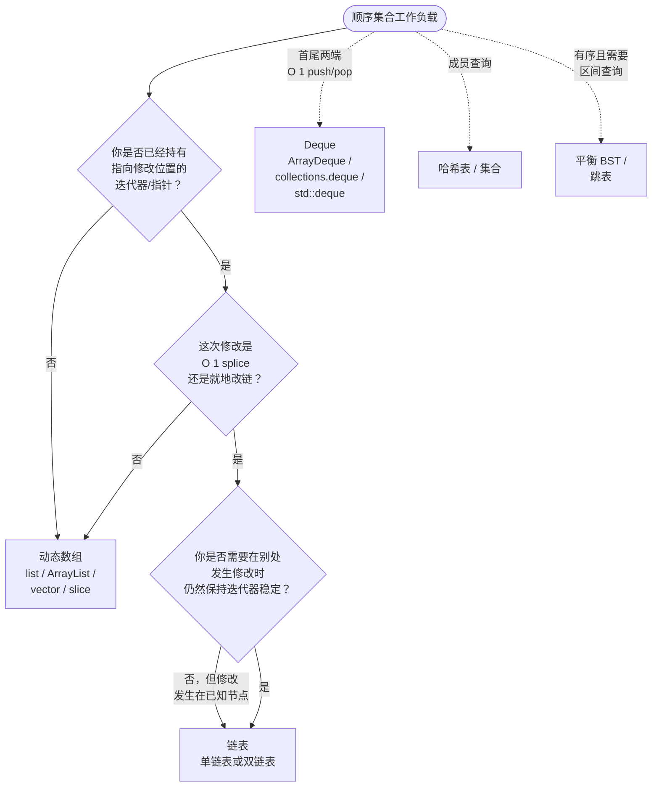

# 数组 vs 链表：各自何时胜出

在 Java 的 `ArrayList` 上往一个 1 万元素的序列中间插入，大约花 294 纳秒；在 Java 的 `LinkedList` 上做同一件事，大约花 46,000 纳秒。教科书复杂度表承诺链表更快的那个操作，实测差了 150 倍。复杂度表没有说谎，它回答的是另一个问题，不是生产代码真正在问的那个。

这个差距就是这一页存在的全部理由。2026 年诚实的默认答案是“动态数组，除非你有具体理由”。这一页要精确走一遍：什么算具体理由，什么不算。

## 如何决策

**问题：** 面对一个顺序集合的工作负载，你该伸手去拿动态数组（`list`、`ArrayList`、`vector`、slice）还是链表（单链表或双链表）？

**答案：** 动态数组，除非你已经持有一个指向结构中待修改位置的指针、需要对整段区间做 O(1) 的 splice，或者需要在别处发生修改时仍保持迭代器稳定。这三种情况就是“链表胜出”的完整清单。除此之外全是数组。

## 流程图

*三道顺序判断。任何一道的答案指向“数组”，就在那里停下；只有三道全偏向链表时，链表才赚回它的成本。虚线边标注的是两者都不归的工作负载：首尾两端操作用 deque，成员查询用哈希表，有序区间查询用 BST。*

## 算法对比

### 动态数组

默认选择。`Python list`、Java `ArrayList`、C++ `std::vector`、Go slice。一块连续缓冲区，增长时按几何倍数扩容，按下标随机访问 O(1)，尾部追加均摊 O(1)。对于任何还没有持有结构内部迭代器的工作负载，动态数组在每一个实测基准上都赢。[^2] [^5]

**何时选择：**

- 按下标随机访问。模式信号是 `a[i]` 里的 `i` 任意。数组给 O(1)；链表给 O(n)，还带一次指针追逐。[^1]
- 尾部追加是主要写入。几何扩容把开销均摊到每一次 push 上。[^6]
- 排序加查找的工作负载。排序需要随机访问，二分查找也需要随机访问。链表在这里不可用。
- 数值与 SIMD 工作负载。NumPy、BLAS、Eigen、Go 的 SIMD 包都作用在连续缓冲区上。
- 任何形式的顺序遍历。CPU 的硬件预取器一次预读一条缓存行；64 字节的缓存行意味着一次内存事务取回 16 个 int。链表最坏情况下每个节点都要付一次缓存未命中，而现代内存延迟大约每次未命中 100 个周期。[^5]

**为什么教科书说它不该赢的地方它也赢。** Stroustrup 的 John-Bentley 实验（把随机整数插入有序序列，再按随机位置逐个删掉）是标准示范。即便有 O(n) 的插入搬移，`std::vector` 在从几个元素到 50 万元素的各个序列规模上都优于 `std::list`。找位置的开销压倒了操作本身的开销。在数组上，这次查找能吃到预取器；在链表上，每个节点都要付一次指针追逐。[^5]

**时间与空间。** 随机访问 O(1)。尾部追加均摊 O(1)，扩容那一次最坏 O(n)。靠前位置的插入或删除 O(n)。内存：有效载荷的 1.0 到 1.5 倍，最坏情况是刚扩容完那一瞬间，容量冗余把它顶到 2 倍。[^6]

**参考：** [动态数组内部实现](../part-1-linear-data-structures/01-dynamic-array-internals.md) 给出了均摊 O(1) 的证明和跨语言扩容系数表。

### 单链表

一串节点，每个节点带一个 `next` 指针。O(1) 头部插入，O(1) 带尾指针的尾部追加，O(1) 头部弹出。适合当积木，很少适合当主序列。

**何时选择：**

- 持久化 / 函数式的结构共享。Haskell、OCaml、F#、Clojure 里的 cons 表，以及 Java、Scala 的不可变列表库，能给出 O(1) 的 `cons(x, oldList)`，原因正是新表与旧表共享尾脊。[^4] 数组做不到这一点，除非把前缀整个复制一遍。在命令式面试代码里，这个问题几乎总是答“不需要”。
- 首端操作是主要模式，且不需要随机访问。用头尾指针实现的 FIFO 队列给出 O(1) 的 `enqueue` 和 O(1) 的 `dequeue`。教科书这么教；生产代码用的却是环形缓冲区。[^1]
- 系统代码里的侵入式链表。Linux 内核的 `list_head`、FreeBSD 的 `LIST_ENTRY` 宏：任何对象都能同时挂在任意多条链表上，每个链接零额外分配，因为指针就长在载荷结构体里面。面试准备用不上，但值得知道它存在。

**什么情况下直接排除它。** 任何需要随机访问的场景。任何操作位置必须靠下标定位的场景（走过去找前驱是 O(n)，还带指针追逐的常数）。任何内存开销敏感的场景：每个节点带一个指针加一个分配器头，64 位系统上一个只装一个 int 的载荷通常占 24 到 32 字节，而同样的 int 放在数组里只占 4 字节。[^2]

**时间与空间。** 无尾指针的尾部追加 O(n)；有尾指针 O(1)。头部插入 O(1)。尾部弹出 O(n)（必须走过去找新的尾）。头部弹出 O(1)。在已知迭代器、已知前驱之后插入 O(1)；在下标 `i` 处插入 O(n)。内存：64 位 JVM 上每个装一个 int 的节点约 24 字节，约为数组的 6 倍。[^2]

**参考：** [链表基础](../part-5-linked-lists/00-linked-list-fundamentals.md) 讲了哨兵写法、四种标准改链方式和 LC 707 的契约。

### 双链表

每个节点带 `prev` 和 `next`。多出来的这个指针买到的是在已知节点上 O(1) 删除，而双链表能成为教学主题，全部理由就是这一条性质。

**何时选择：**

- LRU 缓存。哈希表把 key 映射到节点；缓存命中时，节点从当前位置摘下来再插到头部，两步都是 O(1)，因为节点自己带着 `prev` 和 `next`。这是 [LRU 缓存](../part-5-linked-lists/05-lru-cache.md) 里的标准模式，也是 Java `LinkedHashMap` 访问顺序模式的底层结构。[^7] [^8] 没有双链表，LRU 的契约就无法在 O(1) 内实现：从单链表上摘除节点必须走过去找前驱，那是 O(n)。[^1]
- 两个容器之间 O(1) 地 splice 一段区间。`std::list::splice` 在同一个链表内是常数时间，跨链表时按元素个数计的常数，转移区间既不复制也不移动任何元素。指向被 splice 元素的迭代器和引用仍然有效。[^3] 编辑器的撤销历史、操作系统调度器的运行队列、在队列之间搬运任务的流处理管线都利用这一点。
- 在别处发生修改时保持迭代器稳定。往 `std::vector` 的头部插入会让插入点之后的每个迭代器失效，一次重新分配则可能让容器发出过的所有迭代器都失效。往 `std::list` 插入不会让任何迭代器失效。[^3]

**时间与空间。** 在已知迭代器上插入和删除 O(1)。按下标随机访问 O(n)。内存：每个装一个 int 的节点约 32 到 40 字节（两个指针加头部），而数组里是 4 字节。[^2]

**参考：** [LRU 缓存](../part-5-linked-lists/05-lru-cache.md) 就是“双链表加哈希表”这个模式在面试代码里真正兑现价值的地方。

## 逐项对比

| 操作 / 属性 | 动态数组 | 单链表 | 双链表 |
|---|---|---|---|
| 按下标随机访问 `a[i]` | **O(1)** | O(n) | O(n) |
| 尾部追加 | **均摊 O(1)** | 有尾指针时 O(1) | O(1) |
| 头部插入 | O(n) 搬移 | **O(1)** | **O(1)** |
| 尾部弹出 | **O(1)** | O(n) 走到新的尾 | **O(1)** |
| 头部弹出 | O(n) 搬移 | **O(1)** | **O(1)** |
| 在已知迭代器处插入 | O(n) 搬移后缀 | 找到前驱后 **O(1)** | **O(1)** 就地 |
| 在下标 `i` 处插入（含查找） | O(n) 搬移 | O(n) 走位 + 改链 | O(n) 走位 + 改链 |
| 在已知节点删除 | O(n) 搬移 | O(n)（走过去找前驱） | **O(1)** |
| 跨容器 splice 区间 | 不是基本操作 | O(n) 走位 | **O(1)** |
| 遍历整个容器 | O(n)，每约 16 个 int 一次缓存未命中 | O(n)，每节点一次缓存未命中 | O(n)，每节点一次缓存未命中 |
| 每元素内存开销 | **有效载荷的 1.0 到 1.5 倍** | 载荷 + 8 字节指针 + 约 16 字节分配头 | 载荷 + 16 字节指针 + 约 16 字节分配头 |
| 远端插入/删除下的迭代器稳定性 | 扩容时失效；插入删除时位移 | **除被删节点外稳定** | **除被删节点外稳定** |
| 遍历时的缓存局部性 | **极好**（顺序预取） | 差（指针追逐） | 差（指针追逐） |
| 何时选择 | 随机访问、排序、遍历、追加 | 持久化 cons 表、侵入式系统链表 | LRU 缓存、splice、迭代器稳定 |

“链表胜出”的格子集中在序列前端和已知指针的操作上。凡是工作负载要求“先找到位置 `i`”的格子，两者都退化成 O(n)；而且在真实硬件上，连续内存的搬移在每一个实测基准里都赢。[^2] [^5]

## 三道招牌题

每种主要策略配一道题。每道题都只暴露工作负载的一个属性，而这个属性正好让选择翻转。

- [LC 1 — Two Sum](https://leetcode.com/problems/two-sum/) [简单] • 动态数组
  按下标随机访问、顺序遍历、哈希表查找。链表不可用：题目要返回的下标 `i` 和 `j` 在链表上根本不存在，而哈希表映射的是值到下标，不是值到节点。模式信号是对任意 `i` 取 `a[i]`，那是数组的地盘。

- [LC 146 — LRU Cache](https://leetcode.com/problems/lru-cache/) [中等] • 双链表 + 哈希表 ★
  标准例外。哈希表在 O(1) 内给出节点指针；双链表让你在 O(1) 内把节点摘下再插回头部，因为节点自带 `prev` 和 `next`。单链表不行：删除任意中间节点必须走过去找它的前驱，那是 O(n)。[^8] [^9] 用 `last_used_tick` 字段的数组方案也无法在 O(1) 内淘汰：要找到最久未使用的条目，要么扫描，要么另外维护一个优先队列。

- [LC 25 — Reverse Nodes in k-Group](https://leetcode.com/problems/reverse-nodes-in-k-group/) [困难] • 单链表
  按 `k` 个一组就地改 `next` 指针。题目给你的是单链表并禁止额外空间，所以按规格就排除了转成数组的做法。有意思的是，即便规格允许，转成数组、按组反转、再重建也要多付一次分配和一趟遍历，而就地改链可以省掉。模式信号：输入**本身**就是链表，操作是结构性的而不是位置性的，改写局限在每个 k 窗口内。

## 常见误解

**“链表插入更快。”** 这条迷思毁掉的设计选择比这一页上任何一条都多。你在复杂度表里读到的 O(1)，是**拿到前驱指针之后**的改链。对于任意下标 `i`，你得从头走 `i` 个节点，而这段走位是 O(n)，还带指针追逐的常数。CLRS §10.2 说得很精确：`LIST-INSERT` 是 O(1)，`LIST-SEARCH` 是 O(n)，在下标 `i` 处插入等于先查找再插入，总共 O(n)。[^1] 在真实硬件上，数组的 `memmove` 单核能跑到几十 GB/s；链表的走位被内存延迟卡住，每次缓存未命中约 100 个周期。Oracle 的 JMH 基准给出：n = 10,000 时 `LinkedList` 的中间插入比 `ArrayList` 的中间插入慢 150 倍。[^2] 题目描述里看到“中间插入”时，默认选数组；只有当规格把迭代器直接交到插入位置上，或者题目递给你一个链表并禁止转换（LC 25）时，才翻到链表。

**“Python 的 `list` 是链表。”** 不是。Python 的 `list` 是一块连续的指针动态数组，扩容语义与 `std::vector` 相同，只是增长系数更小（约 1.125 倍）。这个名字有误导性，因为 Python 从 Lisp 借来了 “list” 这个词，而在 Lisp 里它确实指 cons 表，但 `Objects/listobject.c` 里的实现是 `PyObject **ob_item`，一个指针缓冲区。随机访问是 O(1)；`pop(0)` 是 O(n)，原因和 `vector::erase(begin())` 的搬移一样。[^1] 如果你在 Python 里想要真正的链表，双端队列用 `collections.deque`，cons 表得自己写；标准库里没有任何一个原语能直接给你 LC 146 的底层结构。

**“链表不多预留空间，所以更省内存。”** 直觉是这样的：动态数组扩容后最多带 2 倍的容量冗余；链表每个元素正好分配一个节点。算术不同意。每个链表节点带一个节点头、一到两个指针，外加一个分配器头（glibc malloc 上约 16 字节，JVM 开压缩 OOP 时约 16 字节）。对于只装一个 int 的载荷，JOL 实测每个 `LinkedList` 节点 24 字节，再加上装箱 `Integer` 的约 16 字节，而 `ArrayList` 里每个 int 只占 4 字节加容量冗余。Oracle 的实测：1,000 元素的 `LinkedList` 是 24,032 字节，1,000 元素的 `ArrayList` 是 4,976 字节。数组少用 4.8 倍内存，而且这个比例从 1 个元素一直保持到 10,000 个。[^2] 即便拿最坏情况（刚扩容完、50% 冗余）的数组去比，也还是比链表省约 2.4 倍。

**“单链表足够实现 LRU 缓存。”** 不够。LRU 的操作集要求在 O(1) 内摘下任意中间节点（缓存命中）再把它插回头部。从单链表上摘下中间节点是 O(n)，因为必须走过去找前驱；从双链表上是 O(1)，因为节点自己带着 `prev` 指针。[^8] [^9] LC 146 明确要求 `get` 和 `put` 都是 O(1)，标准解法就是双链表加哈希表的组合。CLRS §10.2 习题 10.2-7 里的 XOR 指针技巧能在单链表上换回一部分渐进保证，代价是失去迭代器稳定性和可移植性：学术上有意思，生产上不能用。[^1]

**“FIFO 队列就该用链表。”** 教科书把链表队列当作标准实现，作为教学装置它确实好用：一眼就能验证每操作 O(1) 的断言。[^1] 生产代码用的是环形缓冲区。Java 的 `ArrayDeque`、Python 的 `collections.deque`、C++ 的 `std::deque`、Go 的环形缓冲区 slice：全都给出均摊 O(1) 的 `enqueue` 和 `dequeue`，在内存和常数因子上比链表好 5 到 10 倍，文档里也写着它们是队列和栈工作负载的推荐选择。[^2] 面试官让你实现队列时，两条都说：链表队列是让 O(1) 上界看得见的教科书实现，生产答案是环形缓冲区。

## 参考文献

[^1]: Cormen, Leiserson, Rivest, Stein, *Introduction to Algorithms*, 4th ed., MIT Press, 2022, Ch. 10.

[^2]: Oracle, "ArrayList vs LinkedList," Collections Framework tutorial. https://web.archive.org/web/20260628150327/https://dev.java/learn/api/collections-framework/arraylist-vs-linkedlist/

[^3]: cppreference, "std::list::splice." https://www.cppreference.com/cpp/container/list/splice

[^4]: Okasaki, *Purely Functional Data Structures*, CMU-CS-96-177 thesis, 1996; Cambridge University Press, 1998.

[^5]: Stroustrup, "Are lists evil?" https://www.stroustrup.com/bs_faq.html#list

[^6]: Cormen, Leiserson, Rivest, Stein, *Introduction to Algorithms*, 4th ed., Ch. 17.

[^7]: OpenJDK, `java.util.LinkedHashMap` source. https://github.com/openjdk/jdk/blob/master/src/java.base/share/classes/java/util/LinkedHashMap.java

[^8]: LeetCode, "146. LRU Cache." https://leetcode.com/problems/lru-cache/

[^9]: AlgoMaster, "How to Implement an LRU Cache with O(1) Operations." https://algomaster.io/learn/dsa/lru-cache
