# 栈、队列与双端队列：选对 LIFO/FIFO

## 如何决策

按读写碰的是哪一端来选。读写都在同一端，就是栈（stack）。两端分开、尾部插入、头部删除，就是队列（queue）。两端都是热点、头尾都能 O(1) 压入弹出，就是双端队列（deque）。规则就这一条。

多数时候选择是显然的。这页之所以写得比三段话长，全因为双端队列。Python 的 `collections.deque`、Java 的 `ArrayDeque`、C++ 的 `std::deque`：这些是挑大梁的容器，标准库给它们起的名字严重低估了它们的用途，而在双端队列与它那些长相相似的替代品之间选错，正是 bug 藏身的地方。

## 流程图

```mermaid
flowchart TD
    Start["随时间陆续到达的一串元素"] --> Q1{"读写碰的是哪一端？"}
    Q1 -->|"只在同一端"| Stack["栈<br/>LIFO"]
    Q1 -->|"尾部插入、头部删除"| Queue["队列<br/>FIFO"]
    Q1 -->|"两端都是热点"| Deque["双端队列<br/>double-ended"]

    Stack --> S1{"需要对当前内容做 O&#40;1&#41; 辅助查询？"}
    S1 -->|"是，比如运行中的最小值"| AugStack["增强栈<br/>例如 Min Stack"]
    S1 -->|"否"| StackDone["普通栈"]

    Deque --> D1{"滑动窗口聚合<br/>还是 0-1 BFS？"}
    D1 -->|"滑动窗口最值"| MDeque["单调双端队列"]
    D1 -->|"0-1 BFS 最短路"| DequeBFS["普通双端队列，权重 0 压前端、权重 1 压后端"]
    D1 -->|"两端向中间的双指针"| DequeDone["普通双端队列或两个下标"]
```

*三个问题就能把选择收敛。底座是三种原语之一；叠在上面的模式（增强栈、单调双端队列、0-1 BFS）只是把底座包一层，不改变它的复杂度。*

## 算法对比

下面这些名字跟的是抽象数据类型，不是语言里的具体类型。每种语言都给自己的一套写法，第 4 节把这些写法并排列出。

### 栈

栈是 LIFO 纪律：push、pop、peek 都作用于最近插入的那个元素。CLRS 第 10 章 §10.1 把它描述成这样的 ADT：`DELETE` 操作删除最近插入的元素，正是这一条规则让这个结构适用于延迟匹配类问题。[^1] 每个操作都是 O(1)；用数组实现时对缓存友好，也是每个标准库默认提供的形态。

只要问题带*最近优先*的形状，就该伸手拿栈。招牌案例是括号匹配，[栈与调用栈的类比](../part-1-linear-data-structures/05-stacks.md) 里有详细展开：每个右括号必须与最近一个尚未匹配的左括号配对，计数器编码不了这件事。后缀表达式求值、递归转迭代、以及 [单调栈与双端队列](../part-4-stack-queue-patterns/01-monotonic-deque.md) 里的下一个更大元素一大家族，共享的都是同一种只碰一端的访问方式。

### 队列

队列是 FIFO 纪律：尾部入队、头部出队，绝不反过来。CLRS 给出了标准的循环数组布局，每个操作都是 O(1)。[^1] 队列很少作为一道题的主角数据结构出现；它是上层算法的底座。

头号应用是无权图上的 BFS，在 [广度优先搜索](../part-8-graphs/01-bfs.md) 里讲。FIFO 契约保证了距离为 `d` 的节点一定先于距离为 `d+1` 的节点被访问，这又保证了第一次到达某个节点时走的就是到它的最短路。树的层序遍历就是把邻接表换成树的同一套算法。事件模拟是第三个，事件按被调度的顺序触发。这几种用栈都做不了：基于栈的遍历是 DFS，同样的输入下它返回的是到目标的*某条*路径长度，但不是最短的那条。

### 双端队列

决策到这里才变得有意思。双端队列（deque，读作 "deck"，是 *double-ended queue* 的缩写）支持四个基本操作，每个都是 O(1)：从任何一端压入，从任何一端弹出。CLRS 习题 10.1-5 直接规定了这套四操作契约。[^2] 双端队列是栈与队列能力的严格超集：两者能做的它都能做，还能做那两种严格纪律禁止的操作。

有三族截然不同的算法长在双端队列这个底座上，把它们混为一谈，正是第 6 节里大部分误解的来源。

第一族是**两端向中间的双指针**：回文验证、盛最多水的容器、排序后的三数之和。这些严格说并不*需要*双端队列容器；两个整数下标从数组两端往里走，做的是同一件事，常数更小。只有当遍历过程中底层集合会被修改时，双端队列才配得上它的位置，而这在面试题里很少见。

第二族是**滑动窗口聚合**：每个长度为 k 的连续窗口的最大值或最小值、差值有界的最长子数组、LC 239 这个原型。这必须要双端队列，因为算法在*两端*都会淘汰：下标离开窗口时从头部淘汰，新来的值压过尾部时从尾部淘汰。栈没法 O(1) 淘汰头部，普通队列没法淘汰尾部。这个模式在 [单调栈与双端队列](../part-4-stack-queue-patterns/01-monotonic-deque.md) 里讲。每个下标最多进、出双端队列各一次，所以总工作量是摊还 O(n)。[^9]

第三族是 **0-1 BFS**，用于边权被限制在 {0, 1} 的图上的最短路。Dijkstra 的优先队列塌缩成一个双端队列：权重 0 的边压到前端（新发现的顶点与前驱处在同一条距离带上），权重 1 的边压到后端（远一条带）。双端队列保住了 Dijkstra 所需的按距离有序这个不变量，算法跑 O(V+E) 而不是 O((V+E) log V)。[^9] 依赖这一点的是 [Dijkstra 算法](../part-8-graphs/09-dijkstra.md) 那一章，它把底座的选择引到本页。

双端队列的复杂度画像正是这三族模式都能成立的原因：头部 O(1)，尾部 O(1)，没有例外，单个操作上没有摊还的前提条件。Python 的实现是定长块组成的双向链表；Java 的实现是可扩容的循环数组；C++ 的实现是定长分块组成的段式数组。（不是连续数组，尽管名字让人以为相反：这个事实值得为任何一次代码评审记住。）[^5][^6][^7] 每种布局都在迭代局部性与端指针稳定性之间做了自己的取舍，没有一种是错的；真正要紧的是那四个操作上的契约。

## 逐项对比

| 操作 | 栈（LIFO） | 队列（FIFO） | 双端队列（两端） |
|---|---|---|---|
| 插入 | `push` 尾部，O(1) | `enqueue` 尾部，O(1) | `pushFront` 或 `pushBack`，O(1) |
| 删除 | `pop` 尾部，O(1) | `dequeue` 头部，O(1) | `popFront` 或 `popBack`，O(1) |
| 查看 | `top`，O(1) | `front`，O(1) | `front` 或 `back`，O(1) |
| 遍历中间 | 不支持 | 不支持 | 适配器上不支持；裸双端队列上支持 |

| 语言 | 栈的惯用法 | 队列的惯用法 | 双端队列的惯用法 |
|---|---|---|---|
| **Python** | `list` 配 `append` / `pop()` / `[-1]` | `collections.deque` 配 `append` / `popleft` | 直接用 `collections.deque` |
| **Java** | `Deque<T> stack = new ArrayDeque<>()`（不要用 `java.util.Stack`） | `Deque<T> q = new ArrayDeque<>()`（不要用 `LinkedList`） | 直接用 `ArrayDeque<T>` |
| **C++** | `std::stack<T>`（架在 `std::deque` 上的适配器） | `std::queue<T>`（架在 `std::deque` 上的适配器） | 直接用 `std::deque<T>` |
| **Go** | `[]T` 切片配 `append` 与 `s[:len(s)-1]` | `container/list`，或两段切片摊还，或环形缓冲区 | `container/list`（很少是正确答案）或成对切片 |

这张表里有两个事实带来一堆后果。第一个：在 Java 里，`ArrayDeque` 既是栈的答案，也是队列的答案。接口是 `Deque`，实现是同一个可扩容循环数组，Oracle 的 Javadoc 直接推荐用它替代 `java.util.Stack` 做栈、替代 `LinkedList` 做队列。[^6] 第二个：在 C++ 里，`std::stack` 和 `std::queue` 是容器*适配器*，不是独立容器。两者默认都用 `std::deque` 作底层存储，只在上面暴露一个很窄的 LIFO 或 FIFO 接口。[^7][^8] 当算法需要只碰两端的访问、但不要 LIFO 或 FIFO 的限制时，你直接去用 `std::deque`。

Go 是异类。标准库没有内置的栈或队列类型。做栈，切片惯用法（用 `append` 压、切掉尾部来弹）是 Go 的标准答案，摊还 O(1)。做队列，两种惯用法都没占上风：`container/list` 是双向链表，每个节点单独分配有额外开销，两段切片摊还不地道，环形缓冲区正确但啰嗦。生产环境的 Go 代码大多在队列跨 goroutine 时用无缓冲 channel，不跨时用一个小的自建切片队列。这些都不是错答案；没有唯一正确答案，本身就是答案。[^3]

## 三道招牌题

每种结构一题，选的标准是它多干净地暴露出换一种结构会怎么失败。

- [LC 20 — Valid Parentheses](https://leetcode.com/problems/valid-parentheses/) [简单] • 栈。最近一个未匹配的左括号必须与下一个右括号配对。队列会在第一个右括号时弹出*第一个*左括号，把 `"([)]"` 也认成合法，而它并不合法。
- [LC 102 — Binary Tree Level Order Traversal](https://leetcode.com/problems/binary-tree-level-order-traversal/) [中等] • 队列。正是 FIFO 契约产生了逐层输出。栈会先访问最右边的叶子，再访问它的兄弟。
- [LC 239 — Sliding Window Maximum](https://leetcode.com/problems/sliding-window-maximum/) [困难] • 单调双端队列。两端都会淘汰：下标离开窗口时从头部，新值压过尾部时从尾部。栈和队列都做不到 O(1)。

## 常见误解

下面五个错误的默认做法，出现在生产代码里、面试回答里、教程文章里。每一个都是复杂度 bug 而不是正确性 bug，这正是它们危险的地方：程序能跑，LeetCode 的小用例能过，失败只在规模上来以后、或者在资深面试官给的最坏输入上才现形。

**把 Python `list` 当队列用 `pop(0)`。** 这是 Python 里最常见的一个反模式。`q = []; q.append(node); ...; node = q.pop(0)` 能编译、能跑，然后悄悄退化成 n 次操作总共 O(n²)。Python 文档直接写明了原因：list 对象 "are optimized for fast fixed-length operations and incur O(n) memory movement costs for `pop(0)` and `insert(0, v)` operations which change both the size and position of the underlying data representation."[^5] 每次 `pop(0)` 都把剩下的元素整体往前挪一个槽。修法是加一个 import、换一个方法名：`from collections import deque; q = deque(); q.append(node); ...; node = q.popleft()`。`deque` 的两端都是 O(1)。[^5] 同样的纠正适用于用 `list.insert(0, v)` 做头部插入的情况；`deque.appendleft` 才是那个正确的原语。BFS 在 LeetCode 上 `n = 10⁴` 超时、改了这一行就过，是最典型的症状。

**用 `java.util.Stack` 而不是 `ArrayDeque` 写栈代码。** `Stack` 类早于 Collections 框架，继承自 `Vector`，把 `Vector` 的同步一起继承了。每个 `push`、`pop`、`peek` 都要获取对象上的内置监视器锁，哪怕在单线程代码里。Sedgewick 的 algs4 站点说得很直白："Java has a built in library called Stack, but you should avoid using it."[^4] Oracle 给 `ArrayDeque` 的 Javadoc 从另一个方向也一样直白："This class is likely to be faster than `Stack` when used as a stack, and faster than `LinkedList` when used as a queue. Most `ArrayDeque` operations run in amortized constant time."[^6] 修法是一个声明：`Deque<Integer> stack = new ArrayDeque<>()`。同一个 `ArrayDeque` 实例还能当队列用（通过 `offer` 和 `poll`）、当双端队列用（通过 `addFirst`、`addLast`、`pollFirst`、`pollLast`）。一个实现，三种角色。

**把 `std::queue` 当成一个独立的数据结构。** 它不是。`std::queue<T>` 是容器适配器；cppreference 页面写明它默认用 `std::deque<T>` 作底层容器，适配器只暴露 `front`、`back`、`push`、`pop`、`empty`、`size`。[^7][^8] `std::stack<T>` 同理。当算法需要只碰两端的访问、但不要 LIFO 或 FIFO 的限制时（单调双端队列、0-1 BFS、双指针回文验证），你就直接声明 `std::deque<int>`。适配器不会让你看栈的底部或队列的尾端；底下的双端队列什么都暴露。

**在 Go 里为了栈或队列去用 `container/list`。** Go 的 `container/list` 是双向链表，每个节点单独堆分配，每次遍历都要追指针，缓存表现比切片差。切片惯用法（`append(s, x)` 压、`s = s[:len(s)-1]` 弹）是 Go 做栈的标准答案，摊还 O(1)。做队列，切片惯用法到处是坑：`s = s[1:]` 只是把头部往前推，前缀内存并没有释放，一直泄漏到切片重新分配。Go 里正确的队列，要么是一个小的、基于切片、显式维护 head 与 tail 下标的环形缓冲区，要么在队列跨 goroutine 边界时用无缓冲 channel。`container/list` 对这两种情况都很少是答案。只有当算法真的需要在中间做 O(1) 拼接操作时，才伸手用它。

**把单调双端队列叫"排好序的双端队列"。** 双端队列有序，是*淘汰策略*的结果，不是因为有显式排序这一步。每次压入都淘汰被压过的尾部元素；从头到尾的有序性是自然产物。每个下标最多进、出双端队列各一次，这正是算法总代价摊还 O(n) 的来源。[^9] 说成"每次压入后给双端队列排序"，暗示了每次压入 O(log n) 或 O(n) 的代价，而那个代价并不存在。正确的描述是操作层面的：压入时，把所有被新值压过的尾部元素淘汰掉；每一步，如果头部下标已经滑出窗口就把头部淘汰。有序是结果；算法本身是那个淘汰策略。

## 参考文献

[^1]: Cormen, Leiserson, Rivest, Stein, *Introduction to Algorithms*, 4th ed., MIT Press, 2022, Ch. 10.

[^2]: Cormen et al., *Introduction to Algorithms*, 4th ed., Ch. 10, Exercise 10.1-5.

[^3]: Knuth, *The Art of Computer Programming*, Vol. 1, 3rd ed., Addison-Wesley, 1997, §2.2.1.

[^4]: Sedgewick and Wayne, *Algorithms*, 4th ed., §1.3. https://algs4.cs.princeton.edu/13stacks/

[^5]: Python 3 docs, "collections.deque." https://docs.python.org/3/library/collections.html#collections.deque

[^6]: Oracle, "Class ArrayDeque," Java SE 21 API. https://docs.oracle.com/en/java/javase/21/docs/api/java.base/java/util/ArrayDeque.html

[^7]: cppreference, "std::deque." https://en.cppreference.com/w/cpp/container/deque

[^8]: cppreference, "std::stack." https://en.cppreference.com/w/cpp/container/stack

[^9]: CP-Algorithms, "0-1 BFS." https://cp-algorithms.com/graph/01_bfs.html
