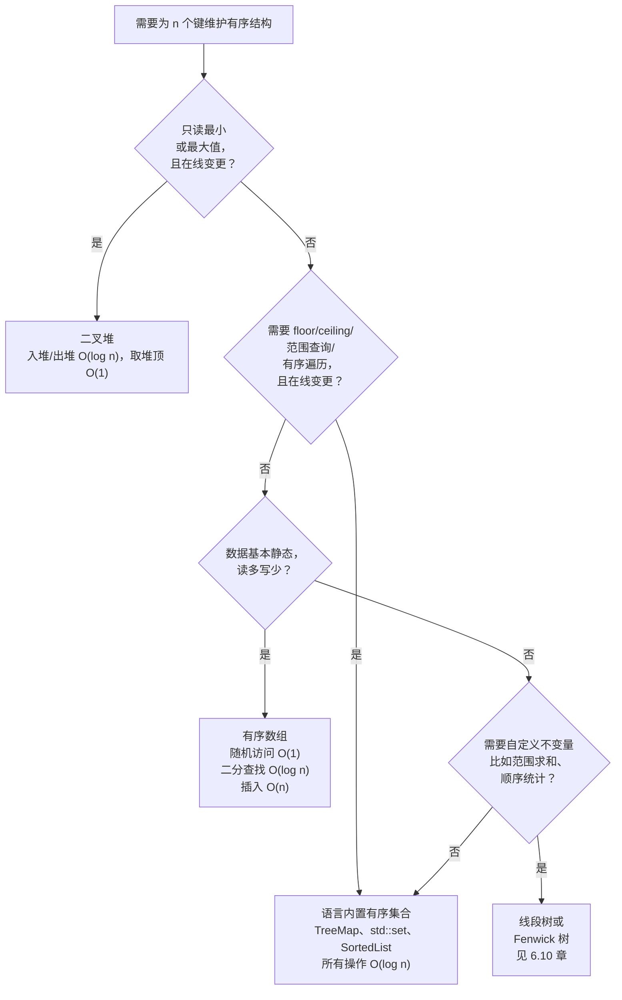

# 堆 vs 有序数组 vs 平衡 BST vs 语言内置有序集合

候选人做到 LC 729（My Calendar I），看到题面里有 "earliest" 这个词就抓了个堆过来，写了 80 行代码，每次预订都把整个堆扫一遍，去找不超过 `x` 的最大开始时间。第三个测试用例就 TLE。修法只有一行，新增代码零行：把 `PriorityQueue<int[]>` 换成 `TreeMap<Integer, Integer>`，调 `floorEntry`。每次插入的时间一样，内存占用一样，但 `floor` 查询从 `O(n)` 掉到 `O(log n)`，整体算法从 `O(n²)` 变成 `O(n log n)`。

这一页就是为了避免这个错误。面试 DSA 里有四种有序数据结构在同台竞争：二叉堆、有序数组、平衡 BST，以及语言自带的有序集合（Python 的 `SortedList`，Java 的 `TreeMap`/`TreeSet`，C++ 的 `std::set`/`std::map`，Go 的 `google/btree` 包）。它们都能“把东西按某种顺序存着”。选错一个，每次查询就多花 `O(n)`，把 `O(n log n)` 的解法拖成 `O(n²)`。

## 如何决策

> **问题：** 该用哪种有序数据结构？
>
> **答案：** 只从数据流里读单个极值，用堆。需要对可变数据做 floor/ceiling/范围查询，用语言内置有序集合。数据是静态的，用有序数组。需要范围计数这类自定义子树不变量，用增强树（6.10 章）。

## 流程图

*自上而下回答，第一个“是”就终止。多数面试题会落到三个彩色框之一，第四个问题则升级到增强树那一章。*

## 算法对比

四种选项，四个 H3。每个 H3 说明触发它的输入形态、它能挣到哪些操作，以及实现在哪一章。

### 二叉堆

**何时选择。** 你只读取或删除单个极值（只取最小或只取最大，绝不同时两者，绝不 floor/ceiling，绝不按排名取第 k 个），并且结构是在线变更的，push 与 pop 交错出现。

**时间与空间。** `O(log n)` 入堆与出堆，`O(1)` 取堆顶，从扁平输入 `O(n)` 建堆，依据是 CLRS 第 6 章 §6.3 的线性时间 `Build-Heap` 论证。[^1] 一块连续数组，零个每节点指针，缓存局部性极好。查找非极值的键是 `O(n)`，因为堆除了根之外不维护任何顺序。

**它在哪。** 二叉堆的机制在[堆与优先队列](../part-6-trees-heaps/04-heaps-priority-queues.md)。流式 top-K 原型（大小为 `k` 的最小堆，每项 `O(log k)`）是高频面试应用；LC 215 的追问、LC 347、LC 692、LC 703 都归约到它。

**信号。** “最小”或“最大”这个词，*不带*“第 k”，后面跟着“随着数据到来”“在流中”或“每次操作之后”。只有问题问的是某个极值、且是在线的，堆才严丝合缝。一旦题目说在静态数组上求一次“第 k 大”，去看 [Quickselect 与堆求 top-K](../../../dsa/patterns/P-22-quickselect-vs-heap-top-k.md)；`O(n)` 平均的 quickselect 打赢 `O(n log k)`。堆模式的两个相邻特化各有自己的页面：LC 295 和 LC 480 见[双堆求中位数范式](./P-06b-two-heap-median-archetypes.md)，LC 23 和 LC 378 见[K 路归并与游标堆](./P-06c-k-way-merge-cursor-heap.md)。

### 有序数组

**何时选择。** 数据在一次加载之后基本静态，访问模式是读多的，而且你需要的要么是按排名的 `O(1)` 随机访问，要么是所有选项里常数因子最小的 `O(log n)` 二分查找。[^2]

**时间与空间。** 建结构 `O(n log n)`（排一次序），二分查找和 floor/ceiling 是 `O(log n)`，范围查询 `O(log n + k)`，按排名随机访问 `O(1)`。输掉的操作是插入，`O(n)`，因为平均要搬移半个数组。一块连续数组，零个每节点指针，缓存局部性完美。

**它在哪。** 二分查找与有序数组的不变量在[二分查找变体](../part-2-search-sort/02-binary-search-variants.md)；按索引取排名的技巧出现在任何做坐标压缩的章节里。

**信号。** 输入描述里写“已排序”，或者“建一次、查很多次”，或者“数据不变”。LC 4（Median of Two Sorted Arrays）是标准实例：输入预先有序，答案是在分割点上二分。失效条件是第一次在线插入到来。每次查询夹一次插入，读的优势就崩了，算法变成平方级。

### 平衡 BST（AVL 或红黑树）

**何时选择。** 你需要在可变结构上做 floor、ceiling、前驱、后继、有序遍历和范围查询，而且你得*自己实现*这个数据结构，不能直接拿来用。在现代面试 DSA 里这几乎不会发生。语言内置有序集合就是平衡 BST，实现早就调好了。[^3] 裸 BST 只在两种场合露面：带自定义子树不变量的增强树（顺序统计树、区间树），以及库作者或系统作者的工作。

**时间与空间。** 插入、删除、查找、floor、ceiling、前驱、后继都是 `O(log n)`；范围查询 `O(log n + k)`；中序遍历 `O(n)`。每个节点三个以上指针（两个子节点、一个父节点、红黑树还有一个颜色位），而且是指针跳转而不是数组寻址，相比数组编码的堆要多付 2-3 倍的常数因子惩罚。[^3]

**它在哪。** 手写 BST 的机制在[二叉搜索树](../part-6-trees-heaps/05-binary-search-trees.md)和 [AVL 旋转](../part-6-trees-heaps/06-avl-rotations.md)；撑起 `TreeMap` 的生产级红黑树记在[红黑树概览](../part-6-trees-heaps/07-red-black-overview.md)。

**信号。** 你在写数据库引擎、内核调度器或库。45 分钟的面试里，答案就是“用语言内置有序集合”。任何人要你手写红黑树，考的是别的东西。

### 语言内置有序集合

**何时选择。** 你需要在可变数据上任意组合 floor/ceiling、范围查询、有序遍历、`O(log n)` 插入与删除，而且你是在解题，不是在实现数据结构。

**时间与空间。** Java 的 `TreeMap`[^4] 和 C++ 的 `std::set`/`std::map`[^5] 里所有标准操作都是 `O(log n)` 最坏情况，两者都由红黑树支撑。Python 的 `sortedcontainers.SortedList` 实践上 `add`、`remove` 和索引都报 `O(log n)`（形式化的摊还上界是 `O(n^(1/3))`，因为它是个两层 B 树式结构，但到了面试规模，立方根项的常数因子比二叉树方案小约 33 倍）。[^6] Go 没有标准库有序集合，事实标准的三方选项是 `google/btree`。相对手写 BST 的优势在于：实现已经存在，已经过了自己的测试，还自带 floor/ceiling/范围方法，否则你得重新发明一遍。

**它在哪。** 四种语言的惯用法（`floorEntry`/`ceilingEntry`、`lower_bound`/`upper_bound`、`bisect_left`、`btree.Get`）在[哈希冲突与装载因子](../part-1-linear-data-structures/04-hash-collisions.md) §3 与哈希对有序的对比一并收录；底下的红黑树出现在 6.7 章。

**信号。** “floor”“ceiling”“严格小于 `x`”“`≤ x` 的最大值”“范围 `[lo, hi]`”“按键的顺序给我下一个”，再配上在线插入与删除。堆不用扫完所有 `n` 就一个都答不了。有序数组读是 `O(log n)`，但每次插入要付 `O(n)`。有序集合是唯一把两者都做到 `O(log n)` 的结构。

## 逐项对比

`n` 是当前存储的键数；`k` 是有序遍历或范围查询返回的结果数。

| 操作 | 二叉堆 | 有序数组 | 平衡 BST | 语言内置有序集合 |
|---|---|---|---|---|
| 入堆 / 插入 | `O(log n)`[^1] | `O(n)`（搬移）[^2] | `O(log n)`[^3] | `O(log n)`[^4][^5][^6] |
| 弹出极值 | `O(log n)`[^1] | 前端或后端 `O(1)` | `O(log n)`[^3] | `O(log n)` |
| 查看极值 | `O(1)`[^1] | `O(1)` | `O(log n)`（下潜到最左叶子） | `O(log n)` |
| 按键查找 | `O(n)`[^1] | `O(log n)`[^2] | `O(log n)`[^3] | `O(log n)`[^4] |
| Floor / ceiling | 不支持 | `O(log n)`[^2] | `O(log n)`[^3] | `O(log n)`[^4][^5] |
| 范围 `[lo, hi]` | 不支持 | `O(log n + k)`[^2] | `O(log n + k)`[^3] | `O(log n + k)`[^4][^5] |
| 按排名随机访问 | `O(n log k)`（部分排序） | `O(1)`[^2] | 只有增强后才能 `O(log n)` | `SortedList[k]` 是 `O(log n)`；`TreeMap` 要 `O(k)` 走一遍 |
| 从 `n` 项建结构 | `O(n)`[^1] | `O(n log n)` | `O(n log n)` | 从有序迭代器 `O(n)`（Java `TreeMap(SortedMap)`）[^4] |
| 内存 | 1 个数组，零指针 | 1 个数组，零指针 | 每节点 3+ 指针[^3] | 树实现：与 BST 相同；`SortedList`：每元素更少[^6] |
| 缓存 | 极好 | 极好 | 差（指针跳转） | 树实现差；`SortedList` 极好 |
| 何时选 | 只要极值、在线 | 静态、读多 | 自己实现该结构 | floor/ceiling/范围、在线 |

决定多数面试结果的只有两格。**堆输在 floor/ceiling 和 `contains` 上**，因为堆除了根之外不保存任何顺序。**有序数组输在写上**，因为每次插入都要 `O(n)` 搬移半个数组，`n` 次插入就是 `O(n²)`。如果题目是流式进数据（LC 295、LC 480、LC 703），有序数组就是错的，哪怕它那几列读的指标看着很诱人。

## 三道招牌题

评分表每行一题；选它们的理由是，用错结构会在 LeetCode 的测试边界上出现肉眼可见的失败。

### LC 215 — Kth Largest Element in an Array（堆）

[LC 215 — Kth Largest Element in an Array](https://leetcode.com/problems/kth-largest-element-in-an-array/) 是经典的“极值，但稍微拐了个弯”：在无序数组里找第 `k` 大。容量为 `k` 的最小堆，一遍扫描，得到 `O(n log k)` 时间和 `O(k)` 空间。每个元素入堆；堆大小超过 `k` 就弹出堆顶。扫完一遍，堆顶就是答案。

好处在于堆大小的上界。朴素的 `O(n log n)` 排序要用满 `n` 个槽位；有界堆只用 `k` 个，当 `k = 10`、`n = 10⁵` 时，空间小四个数量级，速度大约快 `log(n)/log(k) ≈ 5×`。

对*这道题本身*、只有一次静态查询的情况，`O(n)` 平均的 quickselect 打赢 `O(n log k)` 的堆；这个决策在 [Quickselect 与堆求 top-K](../../../dsa/patterns/P-22-quickselect-vs-heap-top-k.md)。一旦题目变成“每次插入后返回第 k 大”，堆就回来了，因为 quickselect 每次操作都得重扫。

### LC 295 — Find Median from Data Stream（双堆）

[LC 295 — Find Median from Data Stream](https://leetcode.com/problems/find-median-from-data-stream/) 是带顺序统计查询的流式题：往流里插入，返回目前所有数的中位数。中位数同时是两个极值——下半部分的最大值、上半部分的最小值。下半部分一个最大堆加上半部分一个最小堆，就把两个极值都留在根上。插入 `O(log n)`，取中位数 `O(1)`。

“一个堆不够用”背后更深的结构，是[双堆求中位数范式](./P-06b-two-heap-median-archetypes.md)的主题，它收录了所有问“流式不变量下的中间元素”的模式，包括 LC 480（Sliding Window Median）——那里双堆技巧要和 `SortedList` 竞争，两者之间的选择并不显然。

### LC 480 — Sliding Window Median（有序集合）

[LC 480 — Sliding Window Median](https://leetcode.com/problems/sliding-window-median/) 是带删除的 LC 295。在数组上滑一个大小为 `k` 的窗口，每一步报中位数。LC 295 的双堆技巧仍然能用，但删除是关键。你不加索引优先队列的增强，就没法在 `O(log n)` 内从二叉堆里删掉任意元素，而那个增强实现起来很重。

更简单的答案是 `SortedList`（Python）或多重集合（C++ `std::multiset`，Java `TreeMap<Integer, Integer>` 记重复计数）。插入 `O(log k)`，删除 `O(log k)`，读 `[k/2]` 处的中位数 `O(log k)`。总共 `O(n log k)`，没有重新平衡的簿记。它相对双堆版本的胜点纯粹在删除：当结构的生命周期和一个既 push 又 pop 的滑动窗口重叠时，有序集合赢在简单。

## 常见误解

下面四个错误在面试记录里出现的频率，比其他所有错误加起来还高。

**“堆把所有东西都排好序了。”** 没有。堆唯一的不变量是根是极值（最小堆是最小值，最大堆是最大值），并且每个父节点压制它的两个孩子。兄弟之间没有顺序关系。堂兄弟之间也没有。问堆“给我第二小的元素”，得看根的两个孩子挑小的那个——这是 `O(1)`，但只因为 2 是个小常数。问堆“给我中位数”，得碰全部 `n` 个元素。堆是一个极值的结构，整笔交易就这么多。

**“`TreeMap` 和 `HashMap` 可以互换。”** 不能。`HashMap` 给 `O(1)` 平均查找但没有顺序；不遍历全部 `n` 个条目，你就没法问它“比 `x` 大的最小键是什么？”。`TreeMap` 给 `O(log n)` 的有序操作，包括 `floorKey`、`ceilingKey`、`firstEntry`、`lastEntry`、`subMap`。访问模式只有点查时用 `HashMap`（LC 1、LC 49、LC 242）。访问模式带顺序时用 `TreeMap`（LC 729、LC 218、LC 327）。抓个 `HashMap` 然后遍历它的键去找 floor，是那种学完哈希表就停下的人的指纹。

**“Python 的 `heapq` 支持最大堆。”** 它只支持最小堆。要最大堆，就压 `-x` 而不是 `x`，弹出时再取负。取负这套写法是惯用法，对整数键没问题；遇到接近可表示值边界的浮点数、以及比较器不能干净地延拓到取负的对象，它就崩。非数值键更干净的变通是压 `(-priority, tiebreaker, payload)` 元组，让 Python 的元组比较去处理顺序。

**“`std::set` 是哈希实现的。”** 不是。`std::set` 是红黑树，`O(log n)` 操作，按键有序维护，支持 `lower_bound`、`upper_bound` 和有序遍历。C++ 里哈希实现的容器是 `std::unordered_set`：名字不同，复杂度不同，用途不同。把这两个搞混，无论往哪个方向混，都要付一个 `O(log n)` 的因子；C++ 模板命名的约定是“没有前缀就是有序，带 `unordered_` 前缀就是哈希”。

**“`SortedList` 的插入是 `O(log n)`。”** 差不多。形式化的摊还上界是 `O(n^(1/3))`，因为这个两层 B 树式结构的装载因子是常数而不是动态的；但在面试规模（`n ≤ 10⁷`）下，立方根项的常数因子比二叉树的 `log₂ n` 小约 33 倍，`SortedList` 实测能追平甚至超过 Java 的 `TreeSet`。[^6] 面试 DSA 的写码和复杂度分析里，把 `SortedList` 的操作当成 `O(log n)`。例外是题目本身跑在十亿级规模、立方根项显形的时候，但那是系统设计题，不是面试 DSA 题。

## 参考文献

[^1]: Cormen, Leiserson, Rivest, Stein, *Introduction to Algorithms*, 4th ed., MIT Press, 2022, Ch. 6.

[^2]: Sedgewick and Wayne, *Algorithms*, 4th ed., §§3.1-3.2. https://algs4.cs.princeton.edu/31elementary/

[^3]: Cormen, Leiserson, Rivest, Stein, *Introduction to Algorithms*, 4th ed., Ch. 13.

[^4]: Oracle, `java.util.TreeMap`, Java SE 25 API. https://docs.oracle.com/en/java/javase/25/docs/api/java.base/java/util/TreeMap.html

[^5]: cppreference, "std::set." https://en.cppreference.com/w/cpp/container/set

[^6]: Jenks, "sortedcontainers — Performance at Scale." https://grantjenks.com/docs/sortedcontainers/performance-scale.html
