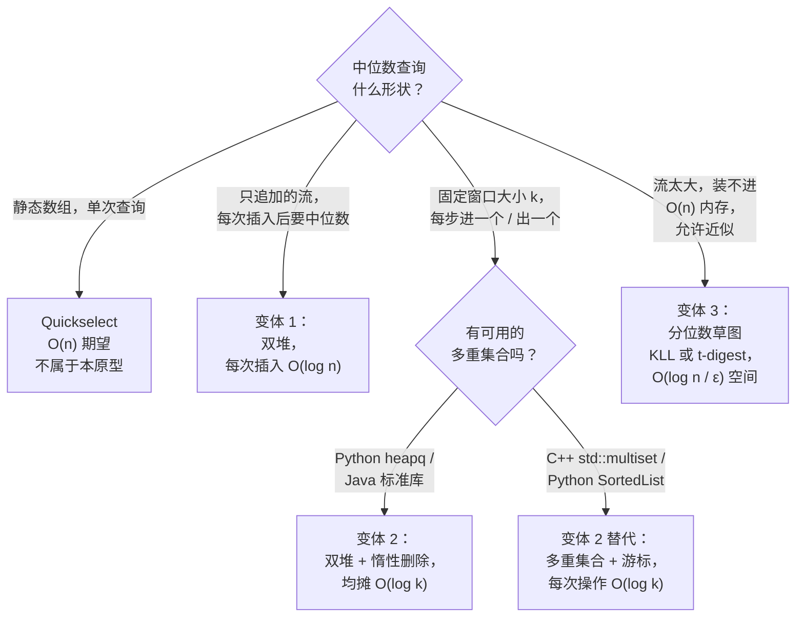

# 双堆中位数原型：一个堆不够用的时候

单个堆只暴露一个极值。中位数在正中间。这个落差就是整个模式：把数据切成有序的两半，较小的一半放进最大堆，较大的一半放进最小堆，两个堆顶就夹住了答案。压入、弹出、读堆顶，外加一次 `O(log n)` 的再平衡，你就能在流上回答运行中位数查询——否则每次插入都得付 `O(n log n)`。

这个原型有三种形态，在白板上看着一模一样，删除模型却差别极大。**流式中位数**（LC 295）是教科书情形：流只追加，惰性删除根本不会登场。**滑动窗口中位数**（LC 480）是同一副形状加一个恶意转折：每一步插入一个值、删除另一个值，而标准二叉堆没法在 `O(log n)` 内删除任意值。**分桶中位数**是面向那种大到撑爆内存的流的近似变体；你放弃精确性，换一个只占 `O(log n)` 空间的草图。判断题目要的是哪个变体，就是本页要教的识别能力。

## 如何决策

把你路由到正确变体的问题很短：

1. **流会无限增长，还是答案窗口固定为 `k`？**
2. **你要的是*精确*中位数，还是 ε 以内的近似也可以？**
3. **如果窗口固定，你的语言标准库里有没有平衡多重集合？**

三个答案，三个变体。只追加的流、要精确中位数，是变体 1。固定窗口的流、要精确中位数，是变体 2（Python 或 Java 不用第三方库时的惰性删除），或者它的多重集合表亲（C++，或装了 `sortedcontainers` 的 Python）。流大到 `O(n)` 内存装不下，就把你整个推出双堆原型，推进分桶分位数草图。

如果数据是一次性交给你的 `n` 个值的静态数组，三个变体都不占优。Quickselect 按[堆、有序数组、平衡 BST 求 top-K 的对比](./P-06-heap-vs-sorted-array-vs-bst.md)在 `O(n)` 期望时间内找出单个中位数，CLRS §9.3 用“中位数的中位数”给出 `O(n)` 最坏情况。[^1] 双堆模式服务的是*在线*查询，此时另一种选择是每次更新都重排一遍。

## 流程图

*三条分支：只追加走双堆流式；固定窗口按语言是否支持有序多重集合分岔；超大的流交给近似草图，离开双堆原型。*

## 变体

### 流式中位数（双堆平衡不变量）

标准情形。一个 `MedianFinder` 暴露 `addNum(int)` 和 `findMedian()`；数字一个一个到达，每次插入之后触发查询。没有删除。

**识别信号：**“运行中位数”“每次插入后的中位数”“目前为止所有值的中位数”，且没有提到窗口或过期。

结构是两个堆加两条不变量。最大堆 `lower` 装较小的一半；最小堆 `upper` 装较大的一半。**大小不变量：**`0 ≤ |lower| − |upper| ≤ 1`。**顺序不变量：**`max(lower) ≤ min(upper)`。总数为奇数 `n` 时，`lower` 多带一个元素，中位数就是它的堆顶；`n` 为偶数时，中位数是两个堆顶的平均。

“先压再轮转”这套动作用三步维持两条不变量：无条件把新值压进 `lower`；把 `lower` 的堆顶移进 `upper`（这一步把新的下半部分最大的那个送过边界，从而强制满足顺序不变量）；然后如果 `upper` 现在比 `lower` 大，轮转一个元素回去。每一步都是 `O(log n)`；`findMedian` 用 `O(1)` 读堆顶。[^2]

**何时选它：**数据只追加，中位数必须精确，`O(n)` 总内存可以接受。Munro 和 Paterson 在 1980 年证明精确的单遍选择需要 `Ω(n)` 空间，所以这个变体正坐在下界上。[^3]

**时间：**每次插入 `O(log n)`，每次查询 `O(1)`。**空间：**总计 `O(n)`。**锚点章节：**[堆与优先队列](../part-6-trees-heaps/04-heaps-priority-queues.md)用四种语言走完了 LC 295 的完整实现。[^4]

### 滑动窗口中位数（惰性删除）

窗口一次滑一步，每一步删掉从左边掉出去的元素，同时插入从右边进来的元素。双堆结构仍然可用，但必须有外援：标准二叉堆支持 `O(log n)` 的“按下标删除”，*不*支持按值删除，因为找一个任意值得先扫一遍数组。[^5]

**识别信号：**“每个长度为 `k` 的连续子数组的中位数”“最近 `k` 个元素的中位数”“滑动窗口中位数”。

惰性删除这个惯用法把真正的删除往后拖。窗口左边界滑过某个值时，在哈希表计数器里把它标成过期（`removals[x] += 1`），并更新一个单独的 `balance` 整数，记录两个堆之间*有效*元素数量的差值。此时先别动堆本身。等 `findMedian` 跑起来，再从堆顶往下剪：如果堆顶的过期计数为正，就把它弹出（真正的删除）并递减计数，一直重复到两个堆顶都有效。均摊下来每个窗口步是 `O(log k)`，因为每个元素只为自己的最终移除付一次账。[^6]

**何时选它：**语言标准库里没有平衡有序多重集合。Python 的 `heapq` 是标准库，但 `sortedcontainers.SortedList` 是第三方；Java 除了 Guava 没有 `TreeMultiset`。在这些语言里，双堆加过期计数器是最干净的答案。

**时间：**每次滑动均摊 `O(log k)`，总计 `O((n − k) log k)`。**空间：**`O(k)` 有效元素，最坏情况下另有最多 `O(k)` 个过期幸存者。

多重集合这条替代路线值得点一下。C++ 的 `std::multiset` 支持 `O(log k)` 插入、`O(log k)` 按迭代器删除，以及首次探测后 `O(1)` 的中位数游标推进；CSES 1076 把它当作标准竞赛解法来教。[^7] 代价在常数因子：平衡 BST 的节点带指针开销，数组实现的堆没有，所以多重集合版本读起来更清爽，实际跑起来更慢。在 Python 里，`sortedcontainers` 的 `SortedList` 扮演同样的角色，只是内部布局不同。

### 分桶中位数（近似，面向超大流）

流的规模超过可用内存时，双堆模式就失效了。Munro 和 Paterson 关于精确流式选择的 `Ω(n)` 下界意味着，十亿行流上的精确中位数需要一个十亿行的数据结构。生产环境的遥测管道（最近一小时的 p99 延迟、最近一周的 p95）付不起这个代价，于是用精确性换近似。

**识别信号：**“近似中位数”“p99 延迟”“内存装不下的流上的运行分位数”“ε-近似分位数”。数据集大到 `O(n)` 存储放不下，而消费方愿意接受与真实中位数相差 ε 以内的答案。

这个结构用*分位数草图*替换两个堆：一个固定大小的摘要，增量吸收流，并以有保证的误差界回答分位数查询。KLL（Karnin-Lang-Liberty）能在 `O((1/ε) · log log(1/εδ))` 空间内给出乘性误差的分位数估计。[^8] Apache DataSketches 把 KLL 作为标准生产选项发布；t-digest、P²、Greenwald-Khanna 是替代草图，误差与空间的权衡各不相同。[^9]

**何时选它：**流大到 `O(n)` 内存不现实，且消费方接受小的 ε 误差。Datadog、Prometheus 和大多数可观测性平台在分位数看板底下用的就是这个。

**时间：**每次插入期望 `O(log(1/ε))`。**空间：**KLL 为 `O((1/ε) log(εn))`。

这个变体住在原型的边缘。数据结构不再是两个堆；可辨识的血缘在于操作形态——一个摘要在次线性时间里回答固定秩的查询。把它当作第三个变体是编辑上的安排：它是变体 1 和变体 2 撞上内存墙之后接管局面的答案。

## 变体对比

| 变体 | 数据形态 | 平衡不变量 | 删除开销 | 单次操作时间 | 经典题目 |
|---|---|---|---|---|---|
| 流式中位数（1） | 只追加的流，精确答案 | 按物理大小满足 `0 ≤ \|lower\| − \|upper\| ≤ 1` | 无删除 | 插入 `O(log n)`，查询 `O(1)` | LC 295 |
| 滑动窗口中位数（2） | 固定窗口 `k`，精确，进一个出一个 | `balance` 计数器按*有效*大小记账；物理大小会漂移 | 惰性删除 + 过期计数器，均摊 `O(log k)` | 每次滑动 `O(log k)` | LC 480 |
| 分桶中位数（3） | 无界流，ε 以内近似 | 草图状态，没有双堆切分 | 旧元素按草图策略丢弃 | 每次插入 `O(log(1/ε))` | 规模化的 LC 295；生产遥测 |

中间那一行才是会咬人的。诱惑是像变体 1 那样用 `len(lower) − len(upper)` 跟踪大小，但那现在是*物理*大小，包含还在等待被剪掉的过期幸存者。决定中位数落在哪个堆的是有效元素计数，它必须活在一个单独的整数里，由惰性删除逻辑显式维护。[^6]

## 三道招牌题

- [LC 295 — Find Median from Data Stream](https://leetcode.com/problems/find-median-from-data-stream/) [困难] • 流式中位数的标准题；双堆实现是教科书答案，第 6.4 章用四种语言走了一遍。
- [LC 480 — Sliding Window Median](https://leetcode.com/problems/sliding-window-median/) [困难] • 惰性删除变体。C++ 有 `std::multiset` 的多重集合解法；Python 和 Java 不用第三方库时，走双堆加过期计数器这个惯用法。
- [LC 1825 — Finding MK Average](https://leetcode.com/problems/finding-mk-average/) [困难] • 分桶的表亲：维护三个有序多重集合（或三个平衡有序结构），分别装最近 `m` 个元素中最小的 `k` 个、中间的 `m − 2k` 个、最大的 `k` 个，然后报告中间那桶的均值。数据流动像滑动窗口，切分逻辑带着双堆的味道，把结构换成近似草图就泛化成分桶中位数。

## 常见误解

**双堆是唯一的中位数模式。** 不是。C++ 候选人习惯用一个 `std::multiset` 加一个停在中间位置的迭代器解 LC 480；CSES 1076 的标准解法就是多重集合。[^7] Python 竞赛选手用 `sortedcontainers.SortedList` 达到同样效果，插入、删除、按下标访问都是 `O(log k)`。双堆模式占优的场合是语言标准库给了堆却没给平衡多重集合，也就是 Python 和 Java 不引第三方库时的处境。在 C++ 里，多重集合版本更短、更好调、渐近代价差不多。挑你的语言能干净支持的那个结构。

**滑动窗口中位数里的惰性删除是免费的。** 均摊分析说每个元素在窗口的整个生命周期里为自己的剪除付一次账，所以每次滑动均摊 `O(log k)`。有两点要提醒。第一，那是*均摊*，不是最坏情况：一长串“已过期但还没浮出”的删除之后，单次 `findMedian` 可能连续弹出多个堆顶，每次弹出都花 `O(log k)`。第二，记账有实打实的常数开销：每步一次 `Counter` 查找、一次 balance 更新、一次剪枝检查。多重集合解法省掉这一切，尽管每节点内存更重，实际往往更快。[^6]

**两个堆必须一样大。** 不必。大小不变量是 `0 ≤ |lower| − |upper| ≤ 1`，不是严格相等。总数为奇数时，一个堆多带一个元素，中位数就是它的堆顶，`O(1)` 读到。总数为偶数时，两堆相等，中位数是两个堆顶的平均。强求严格相等会弄坏读取路径：计数为奇数时，两个堆顶单看都不是中位数，`findMedian` 得做一次比较加一次平均，而这本该只是一次读取。正是这个不对称的不变量让奇数情形下的读取是 `O(1)`，也让实现更容易写对。

**惰性删除里堆的物理大小等于窗口的有效大小。** 这就是 LC 480 提交里冒出来的那个 bug，也是最常见的讨论区翻车方式之一。滑过几次之后，堆里全是停在内部位置等待浮出的过期幸存者；`len(lower)` 是 `lower` 里*所有*元素的计数，不是*有效*元素的计数。修法是另开一个 `balance` 整数，在每次插入和每次惰性标记时同步维护。物理堆大小是结构上滤下滤操作的唯一真相；有效大小才是中位数读取的唯一真相。[^6]

**中位数的中位数是同一个算法。** 不是，名字撞车在面试里会制造混乱。中位数的中位数是 CLRS §9.3 针对*静态*数组的确定性 `O(n)` 最坏情况选择算法，用作 quickselect 的枢轴策略。[^1] 这里的分桶中位数是面向无界数据的*流式*草图家族，答案近似。两个算法解决不同问题：中位数的中位数在有限数组上以精确精度回答一次查询；分桶草图在无限流上以有界误差回答多次查询。面试里别把它们混为一谈。

## 参考文献

[^1]: Cormen, Leiserson, Rivest, Stein, *Introduction to Algorithms*, 4th ed., MIT Press, 2022, Chs. 6 and 9.

[^2]: labuladong, "Implementing Median Algorithm with Two Binary Heaps." https://labuladong.online/algo/en/practice-in-action/find-median-from-data-stream/

[^3]: Munro and Paterson, "Selection and sorting with limited storage," *Theoretical Computer Science* 12 (1980): 315–323.

[^4]: LeetCode, "295. Find Median from Data Stream." https://leetcode.com/problems/find-median-from-data-stream/

[^5]: cstheory.stackexchange, "Nontrivial algorithm for computing a sliding window median." https://cstheory.stackexchange.com/questions/21730/nontrivial-algorithm-for-computing-a-sliding-window-median

[^6]: Paysan, "Sliding Window Median, Lazy Removal (n log k)," Medium, 2024-08-16. https://medium.com/@miguelpaysan/sliding-window-median-lazy-removal-nlogk-a4463c54bb72

[^7]: USACO Guide, "Sliding Median (CSES 1076)." https://usaco.guide/solutions/cses-1076

[^8]: Karnin, Lang, Liberty, "Optimal Quantile Approximation in Streams," FOCS 2016. https://arxiv.org/abs/1907.00236

[^9]: Engelhardt, "Calculating Percentiles on Streaming Data." https://www.stevenengelhardt.com/2018/03/06/calculating-percentiles-on-streaming-data-part-1-introduction/
