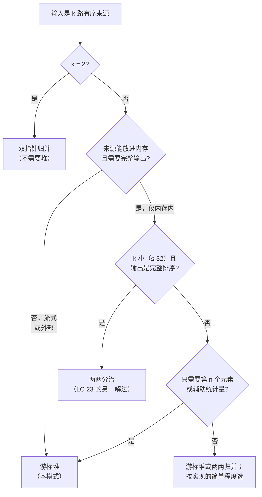

# K 路归并与游标堆

一个 Cassandra 集群做例行 compaction（合并）时，同时从十六个磁盘上的 SSTable 读取数据，每个 SSTable 存着几十 GB 有序键值对，最后写回一个合并后的 SSTable。机器只有 32 GB 内存。合并后的输出有几百 GB。这笔账怎么算都不该成立，可它确实成立，因为归并阶段在任何时刻留在内存里的条目都不超过十六个。堆里存的是游标，不是数据。

这套技巧在教科书里只有一个名字（k-way merge，K 路归并），只有一道标准面试题（Merge k Sorted Lists），只有一个标准结构（大小为 `k` 的小顶堆，每个来源放一个条目，外加推进该来源所需的元信息）。这个结构在 LC 23、LC 378、LC 632、LSM-tree compaction 和 Knuth 的外部排序磁带算法里是同一个。变体之间只有三样东西会变：游标的载荷、下一次 push 什么值的规则、以及算法在堆之外还跟踪哪个辅助统计量。

## 如何决策

模式信号单看输入形状就能认出来。**当输入是 `k` 路有序流（链表、数组、文件、迭代器、矩阵行），而输出需要全局有序、部分有序到第 n 个元素、或者在合并后的序列上做汇总时，就该用游标堆。**[^1] 如果各输入单独并不有序，那这不是这个模式；你回到了全排序的地盘。如果 `k = 2`，根本不需要堆；标准的双指针归并更短也更快。

结构性答案是小顶堆（生产环境的排序算子则用锦标赛树 tournament tree），里面放**每个来源一个游标**，从不放值本身。游标是一个元组 `(value, source_id, position_in_source)`。堆按 `value` 排序；`source_id` 和 `position` 是被动的载荷，用来告诉算法 pop 之后该推进哪个来源。堆的大小由 `k` 界定，而不是由元素总数 `N` 界定。每次 push 和 pop 花费 `O(log k)`。`N` 次 pop 的总工作是 `O(N log k)` 时间、`O(k)` 的堆内空间。[^2]

正确性证明只有两行：未消费元素中的全局最小值一定位于某个来源 `i`；该来源的前沿不会大于来源 `i` 后面的任何元素；堆顶是所有前沿中最小的；所以堆顶就是全局最小值。[^3]

## 流程图

*按输入形状路由，而不是按题目名字。流式与部分输出的场景必须用游标堆；`k` 较小、内存内完整输出的场景可以用更简单的两两归并。*

## 变体

### 归并 k 路有序链表、数组或流（完整输出）

最典型的原型。游标条目是 `(value, source_id, node_or_index)`；从来源 `i` pop 之后，把来源 `i` 推进一位，若该来源还没耗尽就 push 它的下一个值。没有辅助状态。所有来源耗尽时堆变空，吐出的顺序就是归并后的有序输出。

**识别信号。** "给定 `k` 路有序的 X，返回一个有序的 Y"，总共 `N` 个元素。若 `k` 是 2，改用双指针归并。若来源是流式的或受内存限制，游标堆是唯一选择；两两归并排序每轮都要物化约 `~N/2` 的中间段，做不到。

**何时选游标堆而不是两两归并排序。** 对内存内的输入，两两分治归并排序同样是 `O(N log k)`，而且在 `k` 小时写起来更短。[^4] 游标堆胜在这几种场合：来源是流式的；`k` 相对单个来源的长度很大（`k = 3500`、每个来源长度 50，是 LC 632 的真实约束）；或者这套实现要复用到部分输出的变体上。

**开销。** `O(N log k)` 时间、`O(k)` 额外空间。"拍平再排序"这个反模式是 `O(N log N)`，慢了 `(log N / log k)` 倍；`k = 16`、`N = 10^9` 时大约是 7.5 倍的常数。

**章节在哪里讲它。** [堆与优先队列](../part-6-trees-heaps/04-heaps-priority-queues.md) §"Worked example: LC 23, Merge k Sorted Lists" 用四种语言走了完整实现，包括那个承重的 `(value, source_id, node)` 元组形状——它负责打破平局，避免落到不可比较的 `ListNode` 比较上。[^5]

### 有序矩阵中的第 k 小（部分输出）

`n × n` 的行列都有序矩阵，每一行都是自己的有序来源。游标堆按有序顺序把它们归并，跟归并 `n` 个有序链表一样，只是循环在 `k` 次 pop 之后就终止，而不是跑到耗尽。第 `(k+1)` 个被 pop 的值就是第 `(k+1)` 小；我们提前一个停下，因为题目只要第 `k` 小。

**识别信号。** "`n × n` 矩阵按行（可选地也按列）有序，找第 k 小"，或者"给定 `n` 个有序迭代器，给我合并序列的第 n 个元素"。任何要的是隐含合并中的*第 n 个元素*、而不是完整合并的题目。

**何时选游标堆。** 当 `k` 相对 `n²` 较小时，堆会提前停下，工作量是 `O(min(k, n) + k log min(k, n))`。[^6] 当 `k` 接近 `n²` 时，二分答案的变体在渐近上更快，为 `O(n · log(max - min))`，因为搜索空间的界与 `k` 无关。交叉点大约在 `k ≈ n log n`；低于它游标堆赢，高于它二分赢。

**开销。** `O(min(k, n) + k log min(k, n))` 时间、`O(min(k, n))` 空间。堆永远不需要长过 `n` 个条目，因为任何时刻最多只有 `n` 行拥有前沿。

### 多序列流式聚合（生产环境）

这一章存在的意义就是给这个变体正名。Cassandra、RocksDB、LevelDB、ScyllaDB 里的 LSM-tree compaction 把 `k` 个有序 SSTable 合成一个；每个 SSTable 都在磁盘上，归并游标读的是按块缓冲的 chunk，而不是单个值。[^7] 对有序输入做 GROUP BY 或 DISTINCT 的数据库查询引擎用同一套结构。跨 `k` 个分片日志文件、按时间戳聚合的时序日志也是同样的做法。游标的载荷会变（文件偏移、块缓冲指针，有时还有用于消除墓碑的 Bloom filter）；结构骨架不变。

**识别信号。** "归并 `k` 个有序文件 / 流 / 分片 / 分区"，而输入比 RAM 大，或者在归并的同时还要算一个运行中的辅助聚合量（sum、count、分位数）。读者会在分布式日志读取器、时序 join、存储引擎 compaction 这类系统设计题里遇到它。

**何时选游标堆。** 只要输入放不进内存就用它。两两归并排序无法在流式输入上运行，除非把中间的有序段物化到磁盘，而这会让 I/O 成本翻倍。游标堆对每个输入元素只读一次。

**开销。** `O(N log k)` 的比较工作；规模上去之后 I/O 成本占主导，靠每个来源的块缓冲来调，而不是靠比较结构。Knuth 的 *Art of Computer Programming* 第 3 卷 §5.4.1 是关注 I/O 的各变体的标准参考。[^8]

### 外部归并排序的归并阶段（生产环境）

这是其余一切的来处。外部排序分两个阶段：*run-formation*（生成有序段）阶段把能放进内存的输入块排好序，作为有序段写到磁盘；*merge*（归并）阶段把这些段做 k 路归并得到最终输出。归并阶段正是这个原型，游标持有 `(value, run_id, file_offset)`，每个段配一个输入缓冲来摊薄磁盘读取。

**识别信号。** "对 N 个元素排序，而 N 放不进 RAM"，或任何关于排序超内存输入的系统设计题。现代等价物包括 MapReduce 的 shuffle-and-sort、Spark 的外部排序，以及 Unix 上的 `sort -m`。

**何时选游标堆。** 永远选它；这就是教科书结构。在纯比较次数上，锦标赛树和败者树优于二叉堆（每次替换 `log k` 对 `~2 log k`），当比较代价高或 `k` 很大时这一点很关键。[^8] 生产排序算子因此常常偏好败者树；而面试级别的章节代码教二叉堆加游标，因为它写起来短，还能复用语言自带的堆库。

**开销。** `O(N log k)` 比较工作加上 I/O。归并的扇入 `k` 要对着可用内存来调：`k` 个输入段每个都要一块缓冲，所以 `k` 越大，每段的缓冲越小，I/O 往返越多。

## 变体对比

| 变体 | 输入形状 | 输出形状 | 堆状态 | 辅助状态 | 时间 | 空间 |
|---|---|---|---|---|---|---|
| 归并 K 路有序链表 | `k` 个有序链表，共 `N` 个节点 | `N` 个元素的完整有序链表 | `(value, list_id, node)` × min(`k`, 存活来源数) | 无 | `O(N log k)` | `O(k)` |
| 有序矩阵第 k 小 | `n × n` 行列有序矩阵 | 第 `k` 小的标量 | `(value, row, col)` × min(`n`, 存活行数) | 对着 `k` 的 pop 计数器 | `O(min(k,n) + k log min(k,n))` | `O(min(k,n))` |
| 日志 / LSM-tree 归并 | `k` 路有序流（文件、分片） | 合并后的流 + 可选聚合 | `(timestamp, source_id)` × `k` | 运行中的聚合；每来源块缓冲 | `O(N log k)` + I/O | `O(k)` 堆 + 缓冲 |
| 外部排序归并 | 磁盘上 `k` 个有序段 | 磁盘上一个有序段 | `(value, run_id, offset)` × `k` | 每段的块缓冲 | `O(N log k)` + I/O | `O(k)` 堆 + 缓冲 |

四行的结构骨架完全相同。不同的只有游标的载荷、辅助状态、以及 I/O 的来源。看清这一点，四个变体就变成一个变体加四份配置。

## 三道招牌题

- [LC 23 — Merge k Sorted Lists](https://leetcode.com/problems/merge-k-sorted-lists/) [困难] • k-way-merge-min-heap-of-cursors ★
- [LC 378 — Kth Smallest Element in a Sorted Matrix](https://leetcode.com/problems/kth-smallest-element-in-a-sorted-matrix/) [中等] • cursor-heap-with-early-termination
- [LC 632 — Smallest Range Covering Elements from K Lists](https://leetcode.com/problems/smallest-range-covering-elements-from-k-lists/) [困难] • cursor-heap-with-running-max

LC 23 是结构上的标准答案：游标条目、推进被 pop 的来源、跑到耗尽。LC 378 是部分输出的变体：同样的结构，`k` 次 pop 后停下。LC 632 是带辅助状态的变体，它演示了为什么游标堆比两两归并更灵活：在堆之外再维护一个标量 `max_val`，等于当前堆内各值的最大值。窗口 `[heap.peek().value, max_val]` 一定包含每个未耗尽来源的至少一个元素，因为堆里每个来源有一个游标。每轮迭代计算 `current_range = max_val - heap.peek().value`，从来源 `i` pop 掉最小的游标，push 它的下一个值，再更新 `max_val`。任何一个来源耗尽的瞬间就停；再往后不可能有窗口覆盖全部 `k` 个链表。[^9]

在 `[[4,10,15,24,26], [0,9,12,20], [5,18,22,30]]` 上的推演：初始堆里是三个前沿值 `0, 4, 5`，`max_val = 5`，区间 `[0, 5]` 宽度 5。循环走过合并后的流，每次迭代推进一个游标；找到的最小范围是 `[20, 24]`，宽度 4，之后链表 1 耗尽，循环停下。两两归并排序不先物化合并序列就算不出这个运行最大值，那要多花 `O(N log k)` 空间；游标堆在 `O(k)` 内做到，而且答案一固定就停。

## 常见误解

**堆里放的是 `N` 个值，不是 `k` 个游标。** 第一次见到这个模式的候选人最常犯的实现错误，是先把每个来源的每个元素都 push 到堆上，再按顺序 pop 出来。那是 `O(N log N)` 时间、`O(N)` 空间的算法，完全无视了每个输入*本身已经有序*这一性质。游标堆每个来源只 push 一个前沿值，pop 一个，再 push 它的后继；堆的大小从不超过 `k`。渐近差距是 `log N / log k`，`k = 16`、`N = 10^9` 时约 7.5 倍。

**外部排序在归并之后就装进内存了。** 并没有，也从来没有。外部排序之所以存在，*正是因为*输入比 RAM 大；归并阶段产出的输出同样比 RAM 大，按块一次一块地写到磁盘。流式的部分既不是输入也不是输出，而是中间那步归并——内存里常驻的只有 `k` 个游标组成的堆。输出流由调用排序的一方（数据库查询算子、MapReduce reducer、下一轮排序）以归并产出的同样速率消费掉。

**归并 k 个链表是 `O(NK)`，不是 `O(N log K)`。** "每步把所有 `k` 个头部比一遍，挑最小的"这种说法得到的是 `O(NK)`，不是 `O(N log K)`。`log K` 的提升来自堆，不来自归并结构本身；正是它让算法不必在每一步重扫全部 `k` 个前沿。`k = 1024` 时，堆在主导步骤上大约快 100 倍。"扫全部头"的做法是对的但浪费，在面试里，它就是那个栽在追问"如果 `k` 是一百万呢"上的答案。

**K 路归并要求输入有序。** 确实如此，这个前提正是：每条单独的流必须单调。算法对无序输入没有兜底；如果你不知道输入是有序的，正确做法是先 `sort()`，或者做 `sort | uniq` 式的预处理，而不是用游标堆。好消息是这个前提通常在无代价的情况下就满足（LSM-tree 的 SSTable 写出来就是有序的；数据库的排序段按定义有序；LeetCode 的题面会事先声明输入有序）。前提不是免费的时候，K 路归并就不是那个模式。

**平局处理是麻烦事，不是承重结构。** 两个游标的 `value` 比较相等时，堆绝不能落到比较底层对象（LC 23 里的 `ListNode`、LC 378 里的行元组），因为它们通常没有定义顺序。Python 里默认的元组比较会探到第三位并抛 `TypeError`，因为 `ListNode` 没定义 `__lt__`。Java 里 `PriorityQueue<ListNode>` 不带比较器，会在运行时抛 `ClassCastException`。C++ 里默认的 `std::priority_queue` 按指针地址排序，在有重复键时产出不确定的正确性。修法在各语言里都一样：把 `source_id`（或 `list_index`、或 `row_index`）作为次级键放进游标元组，堆就永远探不到第三位。这是 LC 23 Discuss 区报告最多的 bug，任何带重复键的输入在第一次 pop 时就会撞上。

## 参考文献

[^1]: Wikipedia, "k-way merge algorithm." https://en.wikipedia.org/wiki/K-way_merge_algorithm

[^2]: Cormen, Leiserson, Rivest, Stein, *Introduction to Algorithms*, 4th ed., MIT Press, 2022, Ch. 6.

[^3]: Stack Overflow, "Prove the algorithm that uses min-heap to merge k sorted lists." https://stackoverflow.com/questions/10414255

[^4]: walkccc, "LC 23: Merge k Sorted Lists." https://walkccc.me/LeetCode/problems/23/

[^5]: Sedgewick and Wayne, *Algorithms*, 4th ed., §2.4. https://algs4.cs.princeton.edu/24pq/Multiway.java.html

[^6]: LeetCode, "378. Kth Smallest Element in a Sorted Matrix." https://leetcode.com/problems/kth-smallest-element-in-a-sorted-matrix/

[^7]: O'Neil, Cheng, Gawlick, O'Neil, "The log-structured merge-tree (LSM-tree)," *Acta Informatica* 33(4) (1996): 351–385.

[^8]: Knuth, *The Art of Computer Programming*, Vol. 3, 2nd ed., Addison-Wesley, 1998, §5.4.1.

[^9]: LeetCode, "632. Smallest Range Covering Elements from K Lists." https://leetcode.com/problems/smallest-range-covering-elements-from-k-lists/
