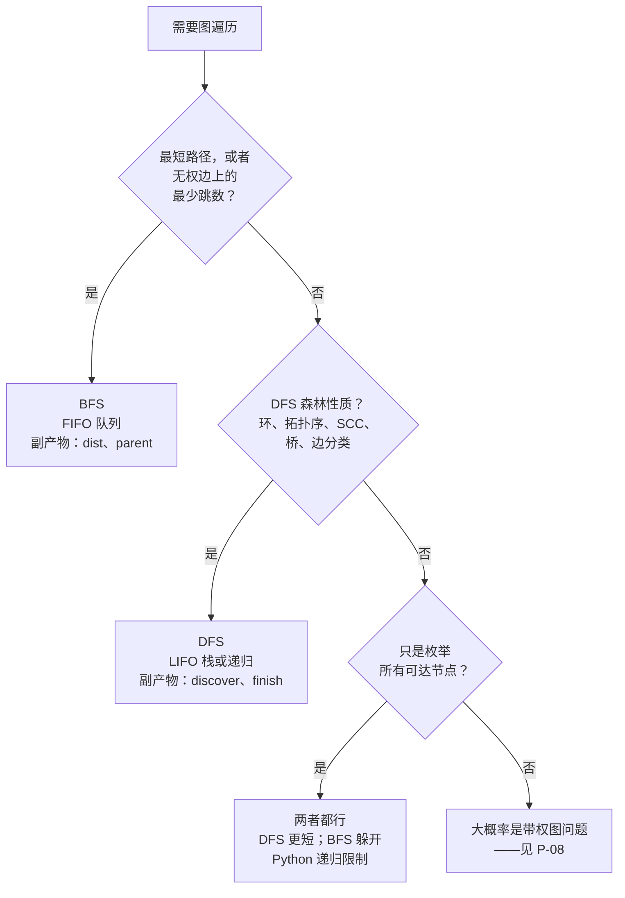

# 图上的 BFS 与 DFS：各自何时才是对的

BFS 和 DFS 都能在 `O(V + E)` 时间内、用 `O(V)` 额外空间访问图上每一个可达顶点。两者的渐近行为一模一样。所以选哪个，问题不是“谁跑得更快”，而是“哪种遍历顺序能产出这道题真正需要的副产物”。一旦选错，本来能过的解法会变成答案错误（Wrong Answer），而不是超时（Time Limit Exceeded）。

这个差别就是这一页存在的理由。图版本的“BFS vs DFS”和树版本确实不是一回事：图有环，所以 visited 的记账必须做对；图还有需要证明的否定性结论（没有环、没有后向边），于是 DFS 能接一些 BFS 接不了的活。树的情形归 [树的 BFS vs DFS：层序与中/前/后序语义](../../../dsa/patterns/P-21-bfs-vs-dfs-trees.md) 管，那里两个算法都不需要 visited 集合，判别依据是哪种遍历顺序能把答案翻出来。

## 如何决策

> **Question.** 题目要的是无权图上的最短路径，还是深度优先森林的某个结构性质？

> **Answer.** 无权图最少跳数用 BFS。路径存在性、用后序做拓扑排序、有向环检测、强连通分量、割点、桥，用 DFS。两者都不沾的情形（就是想做个洪水填充），按代码形态选，让语言的递归深度限制替你决定。

## 流程图

*这套三问判据是自上而下用的。第 1 问是面试里最常见的信号；第 2 问是 DFS 之所以值得单独教的主要理由；第 3 问是“这里两者可以互换”的情形，而教学材料老是在这上面栽跟头。*

让第 1 问成立的那个归约值得先说清楚。**BFS 是一层一层访问图的。** 距源点跳数为 `k` 的顶点，一定全部在第 `k + 1` 层的任何顶点之前出队。这个逐层顺序和树上的层序遍历完全一致，也正是 BFS 能在无权图上见证最短路径的全部原因。CLRS 定理 22.5 把这个保证做得很死：BFS 把顶点 `v` 入队的那一刻，`v.d` 就已经等于真实的图距离 `δ(s, v)`。[^1] DFS 没有对应的定理，也不可能有。这一页的所有判断都绕着这一个洞察转。

两个算法都不太贴合时，题目几乎总是带权图问题，只是套了一身无权图的词。正权重走 Dijkstra。`{0, 1}` 权重走 0-1 BFS。负权重走 Bellman-Ford。那个判断归 [Dijkstra vs Bellman-Ford vs 0-1 BFS vs A*（最短路径决策树）](../../../dsa/patterns/P-08-shortest-paths-decision-tree.md) 管，不在这里。

## 算法对比

### BFS：最短跳数，分层探索

BFS 用 FIFO 队列。顶点按入队的顺序出队，所以按边数最近的那个顶点永远排在下一位。支撑 BFS 存在价值的副产物是 `dist[v]` 和 `parent[v]`：前者是距源点的最少跳数，后者是用来还原路径的前驱。[^1]

什么时候选它。凡是题目里出现最短路径、最少步数、最少移动次数、还有几分钟到 X，而图上每一次转移代价都相同，就选 BFS。网格题里每个格子是顶点（LC 994 Rotting Oranges、LC 542 01 Matrix、LC 1091 Shortest Path in Binary Matrix）。状态空间题里每个状态是顶点、一次编辑是边（LC 127 Word Ladder、LC 752 Open the Lock）。二分图判定里 BFS 的层号正好兼作二着色。[^2]

时间：邻接表上 `O(V + E)`。空间：visited 集合占 `O(V)`，队列再占 `O(V)`，而在宽图上队列可能同时装下一整层（一个中心接 `V - 1` 个叶子的星形图，第 1 层就把所有叶子塞进了队列）。[^1]

教这件事的章节是 [广度优先搜索](../part-8-graphs/01-bfs.md)。多源 BFS、`{0, 1}` 权重用的双端队列变体，以及把网格和状态空间当隐式图看的框架，都在那一章。

### DFS：路径存在性、拓扑序、环检测、连通分量

DFS 用 LIFO 栈。它先往深处钻，再回溯，递归写法里调用栈本身就是那个数据结构。支撑 DFS 的副产物是**深度优先森林**，每个顶点带两个时间戳 `discover[v]` 和 `finish[v]`，再加上每检查一条边时按顶点状态落下来的**边分类**。[^3]

什么时候选它。有五道面试相关的问题都是在解读 DFS 森林的结构，BFS 对其中任何一道都没有标准替代方案。

1. **有向环检测。** 有向图的 DFS 森林里出现一条后向边，就是一个有向环。白/灰/黑三色标记能在一次 DFS 里给出证据；[图上的环检测](../part-8-graphs/06-cycle-detection-graphs.md) 这一章有标准实现。[^3]
2. **用后序做拓扑排序。** 在 DAG 上，把后序完成时间倒过来就是一个合法的拓扑序。CLRS 第 4 版 §20.4 有证明。[^3] 具体应用见 [拓扑排序：基于 DFS（后序倒序）](../part-8-graphs/05-topological-sort-dfs.md)。Kahn 算法则是用一个按入度开关的 BFS 形状队列产出拓扑序，见 [拓扑排序：Kahn 算法](../part-8-graphs/04-topological-sort-kahn.md)，但 Kahn 的边界是按入度算出来的，不是对图做 BFS；只是数据结构碰巧合适，算法本身并不是 CLRS 意义上的 BFS。
3. **强连通分量。** Tarjan（一次 DFS，lowlink）和 Kosaraju（两趟 DFS，第二趟在转置图上跑）都依赖 BFS 产不出来的完成时间。至今不存在只用 BFS 的强连通分量算法。
4. **割点与桥。** Tarjan 的 lowlink 算法维护每棵子树经至多一条后向边能回溯到的最小发现时间。非根顶点 `v` 是割点，当且仅当它某个孩子 `y` 满足 `low[y] >= disc[v]`。[^4] BFS 产不出 lowlink 推理所依赖的“发现者—后代”关系。
5. **有向图上的边分类。** DFS 检查边 `(u, v)` 的那一刻：`v` 为白则是树边；为灰则是后向边；为黑且 `disc(u) < disc(v)` 则是前向边；为黑且 `disc(v) < disc(u)` 则是横叉边。这套分类用在编译器可达性分析、支配树构建，以及若干强连通分量变体里。[^3]

这五件事全都依赖**白路径定理**（CLRS 第 4 版 §20.3 定理 20.9）：DFS 首次访问 `u` 的那一刻，凡是能从 `u` 经一条全白路径到达的顶点，都会成为 DFS 森林中 `u` 的后代。BFS 保不下任何对应物，因为 BFS 不跟踪哪些顶点当前还在递归栈上。[^3]

时间：`O(V + E)`。空间：visited 集合占 `O(V)`，递归栈再占 `O(h)`，其中 `h` 是 DFS 树的深度。路径图上最坏情况 `h = V`；在 Python 里，这一章就是 `sys.setrecursionlimit` 派上用场的地方。教这件事的章节是 [深度优先搜索](../part-8-graphs/02-dfs.md)。

## 逐项对比

| 维度 | BFS | DFS |
|---|---|---|
| 边界数据结构 | FIFO 队列 | LIFO 栈（或递归） |
| 访问顺序 | 逐层推进；深度为 `k` 的顶点先于任何深度为 `k + 1` 的顶点[^1] | 深度优先；逐顶点记录 `discover[v]` 与 `finish[v]`[^3] |
| 时间 | 邻接表 `O(V + E)` | 邻接表 `O(V + E)` |
| 空间 | visited `O(V)` + 队列 `O(V)`（最坏：一整层就装下全部 `V` 个） | visited `O(V)` + 递归 `O(h)`（最坏：路径图上 `h = V`） |
| 副产物 | `dist[v]`、`parent[v]` | `discover[v]`、`finish[v]`、边分类 |
| 能否见证无权最短路径 | 能（CLRS 定理 22.5）[^1] | 不能——只找到*某条*路径，不是最短的[^2] |
| 能否见证有向环 | 不能——分不清后向边和横叉边 | 能——后向边就是证据[^3] |
| 能否产出拓扑序 | 间接可以（Kahn，按入度开关） | 可以——DAG 上后序倒序即拓扑序[^3] |
| 能否见证 SCC、割点、桥 | 没有标准算法 | 可以（Tarjan、Kosaraju）[^4] |
| 最适合 | 最短跳数、二分图判定、有深度上界的状态搜索 | 回溯、结构查询、深而窄的树 |
| 何时选择 | 题目里出现“最短”“最少步”“最少跳” | 环、拓扑序、SCC、割点，以及递归不深时的“所有可达” |

最重要的一行是“能否见证无权最短路径”。在一道“最少移动次数”的题上伸手去拿 DFS，再用“DFS 也能找到路径，所以应该没问题”把失败解释掉，说明整个判断框架搭错了。面试官不一定每次都追问；测试用例每次都会。

## 三道招牌题

- [LC 1091 — Shortest Path in Binary Matrix](https://leetcode.com/problems/shortest-path-in-binary-matrix/) [中等] — BFS。一个 `n x n` 网格，可以走 8 个方向，返回从 `(0, 0)` 到 `(n - 1, n - 1)` 的最短畅通路径，不存在则返回 `-1`。题目说了“最短路径”，且每次移动代价相同，正好落在 BFS 的保证范围内。DFS 会在第一次到达目标时记下某条路径的长度，从而漏掉那条因为先往深处走而恰好没走到的对角捷径。
- [LC 200 — Number of Islands](https://leetcode.com/problems/number-of-islands/) [中等] — DFS 求连通分量。数二维网格里 `'1'` 构成的连通区域个数。两个算法都对，都是 `O(V + E)`；标准章节先教 DFS，因为递归写法只有 10 到 15 行，而且贴合人描述算法的方式（“把每个连通的 `'1'` 格都走一遍”）。如果网格足够深、Python 那 1000 帧的递归限制真有风险，就换成 BFS 或迭代版 DFS。
- [LC 207 — Course Schedule](https://leetcode.com/problems/course-schedule/) [中等] — DFS 判环／拓扑。给定先修课对，判断 `n` 门课是否都能修完。结构查询“有没有有向环？”正是白/灰/黑 DFS 用一条后向边来见证的东西。Kahn 算法用一个按入度为零开关的 BFS 形状队列解同一个问题；两者都对，但 DFS 版本是标准的结构见证算法，[图上的环检测](../part-8-graphs/06-cycle-detection-graphs.md) 也是照这个教的。

## 常见误解

**“DFS 能找到最短路径。”** 在图上几乎从来不行。DFS 找到的是*某条*路径，不是最短那条，因为它先认准深度，再去管广度。第一条到达目标的 DFS 路径会被记成答案；算法没有任何机制去和后来发现的、更深但更短的替代路径做比较。只有两个很窄的例外：在深度均匀的树上，每条根到叶的路径长度都一样，DFS 于是碰巧找到了一条最短的；以及如果你用回溯把每条路径都穷举一遍取最小，那么带记账的 DFS 能以明显更高的代价复现 BFS 的答案。这两个例外都不适用于 LC 1091 / LC 994 / LC 752 那种题面。CLRS 定理 22.5 是 BFS 的证明；如果记不住证明，就记住结论：无权图上的最短路径走 BFS，每一次都是。[^1]

**“BFS 也能用在带权图上。”** 只有在所有边权都相同时才行。BFS 把每条边都当成长度 1，所以权重为 5 的边仍然只算一跳，最短路径保证当场崩掉。有两种情况能救回来。权重一致时 BFS 是对的，因为等权等价于无权。权重正好是 `{0, 1}` 时，**0-1 BFS** 变体用双端队列，把零权邻居从队首压入；分层边界的证明依然成立。任意非负权重就换 Dijkstra。负权重就换 Bellman-Ford。带权最短路径的完整决策树在 [Dijkstra vs Bellman-Ford vs 0-1 BFS vs A*（最短路径决策树）](../../../dsa/patterns/P-08-shortest-paths-decision-tree.md)。

**“DFS 用递归总是没问题。”** 在 Python 里跑长路径就不行。默认递归上限是 1000 帧；最坏情况下 200×200 的网格 DFS 会逼近 40000 帧，在隐藏测试上直接抛 `RecursionError`。有两种能上生产的修法：在模块顶层调一次 `sys.setrecursionlimit(10**6)`，或者用显式栈把 DFS 改写成迭代版。BFS 没有这个问题，因为 FIFO 队列本来就是显式的——这也是在最坏情况确实很深的网格上 BFS 更稳的原因之一。Java、C++、Go 把上限抬高了，但没消除这个问题；线程栈限制会在更大的常数上把同样的毛病翻出来。

**“BFS 用的是栈。”** 不是。BFS 用队列。把这两个搞混是这道算法上最常见的实现 bug。从尾部入、从头部出，逐层性质才成立；从同一端进出，你就不小心写成了 DFS。反过来也是真实的失败模式：在 Python 里用 `list.pop(0)` 写 DFS，出队变成 `O(n)` 的搬移，悄无声息地把 `O(V + E)` 的界毁掉，尽管算法严格来说仍然是深度优先的。这两个 bug 都能靠慢慢读一遍标准实现抓出来；不读就都上线了。

**“图和树的算法可以互换。”** 树不需要 visited 集合，图需要。树从根到任何节点只有唯一一条路径，所以仅靠结构，BFS 或 DFS 对每个节点最多访问一次。图可能有环，于是少了 visited 位，一个三节点的三角形 `A → B → C → A` 会让队列（或递归）里塞满 `A, B, C, A, B, C, ...`，直到内存耗尽。树的决策页 [树的 BFS vs DFS：层序与中/前/后序语义](../../../dsa/patterns/P-21-bfs-vs-dfs-trees.md) 是按遍历顺序做区分（BST 上的中序给了 DFS 一件 BFS 干不了的活）；这一页是按“最短跳数”还是“结构见证”做区分。两页不能互换。

具体到连通性，BFS 与 DFS 的二选一并没有穷尽选项。当连通分量是要在线查询的、边是增量到来的，两种遍历都不是对工具；[并查集 vs DFS 求连通性](../../../dsa/patterns/P-15-union-find-vs-dfs.md) 覆盖那种情况。具体到拓扑排序，Kahn（BFS 形状）与 DFS（后序）之间的权衡另有专页：[拓扑排序：Kahn 与基于 DFS 的两种做法](../../../dsa/patterns/P-16-topological-sort-kahn-vs-dfs.md)。

## 参考文献

[^1]: Cormen, Leiserson, Rivest, Stein, *Introduction to Algorithms*, 4th ed., MIT Press, 2022, Ch. 20 §20.2. https://walkccc.me/CLRS/Chap22/22.2/

[^2]: CP-Algorithms, "Breadth-first search." https://cp-algorithms.com/graph/breadth-first-search.html

[^3]: Cormen, Leiserson, Rivest, Stein, *Introduction to Algorithms*, 4th ed., MIT Press, 2022, Ch. 20 §§20.3-20.4. Edge-classification reference: https://sharmaeklavya2.github.io/theoremdep/nodes/graph-theory/dfs/online-edge-classification.html

[^4]: Wikipedia, "Biconnected component." https://en.wikipedia.org/wiki/Biconnected_component.
