# Dijkstra vs Bellman-Ford vs 0-1 BFS vs A*：最短路径决策树

## 如何决策

问题是这样：*给定图 `G` 上的一个最短路径问题，该伸手去拿哪个算法？* 答案由输入的一个特征决定：**边权集合**。所有边权重都是 1，用 BFS。权重取自 `{0, 1}`，用双端队列的 0-1 BFS。非负实数，用 Dijkstra。混有负权，用 Bellman-Ford。有目标导向、且存在可采纳启发函数的搜索，用 A*。路线选错，代价最小是多做 `log V` 倍的冗余工作；最大是答案错误却没有任何报错——图上只要有一条负权边，Dijkstra 就会悄悄返回垃圾结果。

其余所有判别维度（稀疏还是稠密、单个目标还是全部目标、全源还是单源）都叠在权重集合之上。先读权重。

## 流程图

```mermaid
flowchart TD
    Start["图 G 上的最短路径"] --> Q1{"所有边<br/>权重都是 1？"}
    Q1 -->|"是"| BFS["BFS<br/>O&#40;V plus E&#41;"]
    Q1 -->|"否"| Q2{"权重都取自<br/>{0, 1}？"}
    Q2 -->|"是"| ZBFS["0-1 BFS 双端队列<br/>O&#40;V plus E&#41;"]
    Q2 -->|"否"| Q3{"有边的<br/>权重为负？"}
    Q3 -->|"是"| BF["Bellman-Ford<br/>O&#40;V times E&#41;<br/>能检测负环"]
    Q3 -->|"否"| Q4{"单一目标，<br/>且有可采纳的<br/>启发函数？"}
    Q4 -->|"是"| AStar["A*<br/>最坏情况与 Dijkstra 相同，<br/>实际展开的节点少得多"]
    Q4 -->|"否"| Dijk["Dijkstra 二叉堆<br/>O&#40;&#40;V plus E&#41; log V&#41;"]
```

*这套判据自上而下读；第一个“是”就终止。权重集合挑出算法；启发函数那一问只有在非负分支落地之后才会触发。*

## 算法对比

五个算法，各自在很窄的一段区间里才是正确答案。下面每个 H3 先把那段区间写成对输入的前提条件，再报出渐近复杂度，最后指向承载标准实现的那一章。

### BFS：每条边权重都是 1 时

触发条件：每条边的权重都是 `1`，或者图本身无权。在无权图上，BFS 第一次访问某个顶点，*就是*最短路径意义上的那次访问；松弛退化成“第一次见到 `v`，记下 `dist[v]`，此后再不重访”。没有优先队列，没有堆，也没有松弛记账。时间 `O(V + E)`，空间 `O(V)`。失效条件是出现一条权重大于 `1` 的边：FIFO 不再按距离非降的顺序出队，首次访问不变式随之崩掉。[^1]

标准应用是单词接龙式的字符串变换、多源洪水填充（腐烂的橘子、01 矩阵），以及任何在均匀网格上问“最少移动次数”的问题。[BFS](../part-8-graphs/01-bfs.md) 承载标准的四语言实现；[图上的 BFS 与 DFS](./P-07-bfs-vs-dfs-graphs.md) 讲的是 BFS 何时才是正确的遍历方式。

### 0-1 BFS：权重取自 `{0, 1}` 时

触发条件：每条边的权重正好是 `0` 或正好是 `1`。常见形态有：网格上“免费 vs 代价 1”的转移、“翻转符号 vs 接受方向”这类谜题、层间转移免费的分层图。数据结构是双端队列，不是堆。把 0 代价的松弛压到*队首*，1 代价的松弛压到*队尾*，每轮从队首弹出。任意时刻队列里的顶点最多跨两个相邻的距离层，正是这条不变式让“从队首弹出”站得住脚。[^2]

时间 `O(V + E)`，空间 `O(V)`。它比 Dijkstra 省一个 `log V` 的因子，还彻底去掉了堆的开销，在竞赛规模上这一点很实在。坑在实现上：朴素地把队列换成双端队列、不管权重一律往队尾压，那只是 BFS，遇到任何带 0 权边的输入都错。队首还是队尾这条规则*就是*算法本身。[^2]

[Dijkstra 最短路径算法](../part-8-graphs/09-dijkstra.md) 在其“模式失效的场景”一节里给出了 0-1 BFS 的标准参考。

### Dijkstra：权重为非负实数时

触发条件：单源最短路径，且每条边都满足 `w(u, v) >= 0`。算法用一个以暂定距离为键的最小优先队列，按距离非降的顺序“定稿”顶点。承重的论断是“定稿后不再改动”这条不变式：当 extract-min 返回暂定距离为 `d` 的顶点 `u`，这个距离就是最终值——因为任何尚未发现的到 `u` 的路径，都必须经过某个尚未定稿、且 `dist[v] >= d` 的顶点 `v`，再加一段非负的剩余部分不可能把 `d` 改小。CLRS 定理 22.6 给出了形式化证明。[^1]

时间 `O((V + E) log V)`（二叉堆 + 惰性删除），空间 `O(V + E)`。斐波那契堆变体把界收紧到 `O(E + V log V)`，但没有生产库用它，因为常数太大；在任何现实规模下二叉堆都赢。[^1]

非负这个前提没有商量余地。只要有一条负权边，定稿不变式就崩：之后穿过那条负权边的松弛可以把已定稿顶点的距离改小，可 Dijkstra 早就走过去了。算法返回错误答案，不抛任何异常。Sedgewick 的 `DijkstraSP.java` 参考实现遇到负权边直接抛异常，就是为了不让程序员掉进去；[^3] LeetCode 的运行时一句警告都没有。

默认中的默认：题目只说“带权最短路径”，既没加限定也没有启发函数时，伸手去拿 Dijkstra。[Dijkstra 最短路径算法](../part-8-graphs/09-dijkstra.md) 承载标准四语言实现、惰性删除的惯用写法，以及最小最大路径这一特化。

### Bellman-Ford：可能出现负权（或者检测本身就是问题）

有三个信号指向 Bellman-Ford 而不是 Dijkstra。第一，可能出现负权边（套利、盈亏流）。第二，路径被边数、“停留次数”或“跳数”限制住；LC 787 的“至多 K 次中转”正好对上 Bellman-Ford 的引理“跑完第 `i` 趟后，`dist[v]` 对任何不超过 `i` 条边的路径都是正确的”。跑 `K + 1` 趟就停。第三，负环检测本身就是问题：跑 `V - 1` 趟；如果第 V 趟还有东西被松弛，说明从源点可达一个负环。[^4][^5]

`V - 1` 这个外层上界是算法的核心证明，也是所有对比里被引用最多的论断。CLRS 第 3 版第 24 章（第 4 版第 22 章）把它立为定理 24.4：任何无环最短路径最多 `V - 1` 条边，而算法第 `i` 趟对不超过 `i` 条边的路径是正确的，所以 `V - 1` 趟覆盖了所有无环最短路径。[^1] 第 V 趟只多花 `O(E)`，它是负环探测器；总计 `O(V * E)`，习惯上直接向上取整，而不写成 `(V - 1) * E + E`。[^4][^5]

时间 `O(V * E)`，空间 `O(V)`。相对 Dijkstra 的代价大约是 `V / log V` 倍，在 `V = 10^4` 时就是慢 700 倍——100ms 通过和 70 秒超时之间的差别。只有当负权是真的、或者 K 条边的约束正好对题时，才付这个代价。[^4]

K 条边变体有一个承重的实现细节：每一趟都必须读本趟开始时拍下的 `dist` 快照，否则一次松弛就能在一趟里把两条边传出去，K 条边的界当场塌掉。LC 787 不留快照就是错答案。[^5]

[Bellman-Ford 与负环](../part-8-graphs/10-bellman-ford.md) 承载标准四语言实现与快照技巧。

### A*：只有一个目标且存在可采纳启发函数时

触发条件：单源单目标，并且存在一个估计从 `v` 到目标代价、且从不高估的启发函数 `h(v)`。扩展判据是 `f(n) = g(n) + h(n)`，其中 `g(n)` 是源点到 `n` 的已知代价，`h(n)` 是乐观的剩余代价。按启发函数看离目标很远的节点会被压进开放集深处，永远不扩展；信息量大的启发函数能把搜索区域大幅缩小。[^6][^7]

`h ≡ 0` 时，A*与 Dijkstra 是同一个算法。两个算法扩展同一批节点，最坏情况的界也与 Dijkstra 一致。赢在常数。在 `1000 x 1000` 的网格上，Dijkstra 找到目标前大约要扩展一半的格子；带曼哈顿距离启发函数的 A*只扩展最优对角线附近的一条窄带，同一份输入上常常少扩展 100 到 1000 倍。[^6]

常见的可采纳启发函数：零（平凡可采纳，等同于 Dijkstra）、四方向网格上的曼哈顿距离、路网上的欧氏距离。1968 年的原始论文用可采纳启发函数证明了最优性；Pearl 1984 年的分析是效率方面最权威的证明。[^7] 失效条件：没有可采纳的启发函数、多目标最短路径，或者存在负权。A*在面试轮换里很少见，因为 LC 的题目大多没有天然的几何启发函数；这个算法在生产的寻路里（游戏引擎、机器人）比在编程面试里更亮眼。

## 逐项对比

表中各项都是连通图 `(V, E)` 上的最坏情况界。

| 算法 | 权重前提 | 时间复杂度 | 是否检测负环 | 是否需要启发函数 | 何时选用 |
|---|---|---|---|---|---|
| BFS | 每条边 `= 1`（无权图） | `O(V + E)` | 不适用 | 否 | 单位代价的最短路径；“最少移动次数” |
| 0-1 BFS | 每个权重都在 `{0, 1}` 中 | `O(V + E)` | 不适用 | 否 | 二值代价的转移、网格上“免费 vs 付费”的移动 |
| Dijkstra | 非负实数 | `O((V + E) log V)` | 否（遇负权静默出错） | 否 | 无负权带权图的默认选择 |
| Bellman-Ford | 任意实数 | `O(V * E)` | 是（第 V 趟） | 否 | 可能有负权、有 K 条边约束，或检测本身就是目的 |
| A* | 非负实数 + 可采纳的 `h` | 最坏情况与 Dijkstra 相同 | 否 | 是 | 单一目标，且有几何或领域启发函数 |

表里有三格值得细读。**Dijkstra 那一行的“静默出错”不是夸张**：没有运行时检查、没有异常、没有越界报错。算法正常跑完，返回一个 `dist[]` 数组，错得没有上界。Bellman-Ford 那一行的“检测负环”，明确指*从源点可达*的负环，不是“图里所有负环”；要全源版本就跑 Floyd-Warshall 看对角线。A*那一行的“同样的最坏情况”是读者最常看错的一格；信息量大的启发函数带来巨大的常数因子收益，但渐近界并不会变好。

## 三道招牌题

下面三道题正好落在判据里出现频率最高的三行上。每一道都是对应算法在面试里的标准形态；认出这个形态才是真正的面试技能。

- [LC 743 — Network Delay Time](https://leetcode.com/problems/network-delay-time/) [中等] • Dijkstra 招牌
- [LC 787 — Cheapest Flights Within K Stops](https://leetcode.com/problems/cheapest-flights-within-k-stops/) [中等] • 带 K 条边约束的 Bellman-Ford
- [LC 2290 — Minimum Obstacle Removal to Reach Corner](https://leetcode.com/problems/minimum-obstacle-removal-to-reach-corner/) [困难] • 0-1 BFS 标准题

LC 743 是教科书里的 Dijkstra。在有向带权图上手搓信号传播；答案是所有可达 `v` 上的 `max(dist[v])`。地球上每个标准库在这份输入上跑惰性删除的写法，都远在 100ms 之内完成。LC 787 看着像 Dijkstra 题，其实不是：K 次中转的约束打死了 Dijkstra 的定稿不变式，因为一个顶点可以沿着一条更长但更便宜、且满足 K 上界的路径被重新走到。Bellman-Ford 那条“跑完第 i 趟后，对不超过 i 条边的路径是正确的”引理，正好就是约束要的东西。LC 2290 是 LC 上最干净的 0-1 BFS 形态：每个格子四个邻居，空邻居走过去代价 `0`，障碍物代价 `1`。0 代价的松弛压队首，1 代价的压队尾；总工作量 `O(m * n)`。

## 常见误解

下面这些误用出现得足够频繁，每一条最短路径的面试帖子里都能见到。每一条都对应一个真实的失效模式，也都有一个真实的修法。

**“只要发现更短路径就重置距离，Dijkstra 就能处理负权。”** 不能。贪心不变式（定稿一次、绝不重访）才是 Dijkstra 拿到 `O((V + E) log V)` 界和正确性证明的原因。允许重访只压住了错误答案的症状，却毁掉了那个界：最坏情况下算法在对抗性输入上退化成指数时间。[^3] 这个误解还有第二个版本——“给每条边权加一个常数，让所有权重都非负，然后跑 Dijkstra”——同样不行：常数偏移在长路径上累积得比短路径多，保不住最短路径的同一性。[^3] 正确的重权方法是 Johnson 算法：先从虚拟源点跑一遍 Bellman-Ford 求出每个顶点的势，再在重权后的图上从每个顶点各跑一次 Dijkstra。

**“Bellman-Ford 能检测图里所有的负环。”** 它检测的是*从源点可达*的负环是否存在。与源点不连通的负环，在“先跑 V-1 趟、再看第 V 趟有没有松弛”这套检查里完全不可见。要回答全源版本的问题，跑 Floyd-Warshall 看对角线：`dist[v][v]` 上任何负值都是经过 `v` 的负环。两个算法回答的是不同的问题，把它们混为一谈，在每个多连通分量的测试用例上都会给出错答案。[^4]

**“A*永远比 Dijkstra 快。”** 事实是 A*在渐近意义上*从不*比 Dijkstra 快；最坏情况的界完全相同。收益来自常数因子，而且只有启发函数既可采纳又有信息量时才存在。启发函数不好（会高估）时，A*可能返回次优路径；最优性证明的前提是对每个 `v` 都有 `h(v) <= dist(v, goal)`。[^7] 启发函数可采纳但没有信息量（`h ≡ 0`）时，A*和 Dijkstra 就是*同一个*算法，逐次扩展都一模一样。“永远更快”这个直觉来自网格寻路的演示，那里曼哈顿距离是有信息量的；在没有天然几何结构的图上，A*相对 Dijkstra 什么也没多给。[^6]

**“0-1 BFS 就是换成双端队列的 BFS。”** 数据结构是双端队列没错，但算法不是 BFS。起区分作用的是队首还是队尾这条推送规则：0 代价的松弛压*队首*，1 代价的松弛压*队尾*。朴素的“双端队列 BFS”把一切都压队尾，功能上就是个队列，遇到任何带 0 权边的输入都给出错答案。正是压队首这条规则保住了 BFS 的不变式（“队列里的顶点最多跨两个相邻的距离层”），从而让“弹队首”成为 extract-min 的合法替代。[^2] 丢掉这条规则，`O(V + E)` 的界和正确性一起消失。

**“Floyd-Warshall 是全源问题的安全默认。”** 它是*稠密图*的全源默认。在 `E << V^2` 的稀疏图上，反复跑 Dijkstra（有负权就用 Johnson）的代价是 `O(V * (V + E) log V)`，渐近上比 Floyd-Warshall 的 `O(V^3)` 小。取 `V = 10^4`、`E = 10^5`，反复 Dijkstra 大约 `1.4 x 10^10` 次操作，Floyd-Warshall 是 `10^12`，差两个数量级。Floyd-Warshall 那个常数极小、只有十行的三重循环，才是它在 `E ≈ V^2` 时成为正确选择的理由，而不是某种笼统的“安全”属性。[^8]

最小生成树有一张平行的决策页——[Kruskal 与 Prim：最小生成树的抉择](./P-09-kruskal-vs-prim.md)——它用的是一套平行的判据，由输入的*密度*驱动，而不是*权重集合*。这里的最短路径问题一旦答完，自然的追问就是：同一张图，用什么最便宜的方式把所有顶点连起来？P-09 从那接下去。

## 参考文献

[^1]: Cormen, Leiserson, Rivest, Stein, *Introduction to Algorithms*, 4th ed., MIT Press, 2022, Ch. 22.

[^2]: CP-Algorithms, "0-1 BFS." https://cp-algorithms.com/graph/01_bfs.html. Codeforces, "0-1 BFS [Tutorial]." https://codeforces.com/blog/entry/22276

[^3]: Sedgewick and Wayne, *Algorithms*, 4th ed., §4.4. https://algs4.cs.princeton.edu/44sp/

[^4]: Wikipedia, "Bellman-Ford algorithm." https://en.wikipedia.org/wiki/Bellman%E2%80%93Ford_algorithm

[^5]: Bellman, "On a routing problem," *Quarterly of Applied Mathematics* 16 (1958): 87–90. https://doi.org/10.1090/qam/102435.

[^6]: Wikipedia, "A* search algorithm." https://en.wikipedia.org/wiki/A*_search_algorithm

[^7]: Hart, Nilsson, Raphael, "A Formal Basis for the Heuristic Determination of Minimum Cost Paths," *IEEE TSSC* 4(2) (1968): 100–107. https://doi.org/10.1109/TSSC.1968.300136

[^8]: Wikipedia, "Floyd-Warshall algorithm." https://en.wikipedia.org/wiki/Floyd%E2%80%93Warshall_algorithm
