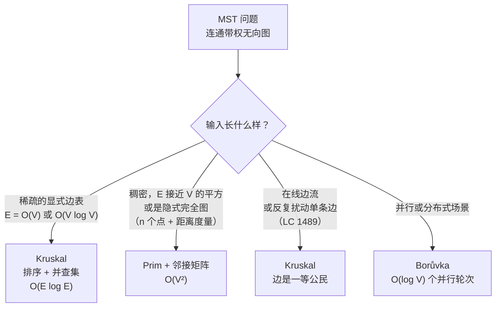

# Kruskal vs Prim：最小生成树怎么选

## 如何决策

问题是这样的：*给定一个连通带权无向图，你该伸手去拿哪个最小生成树算法？* 一句话说清：**输入是稀疏的显式边表就用 Kruskal，图是稠密的或隐式的就用 Prim；两者都正确，在边权互不相同时它们返回同一棵树。** 判别依据不是哪个算法在某种抽象意义上“更快”，而是输入的形状，以及这个形状与切分性质（cut property）如何相互作用。

## 流程图

*本页要教的四分支决策。稠密度决定用哪个算法；建模技巧与并行性叠在上面。大多数面试题落在最上面两个分支。*

## 算法对比

Kruskal 和 Prim 是同一个定理的两个推论。**切分性质**说的是：把顶点任意划分成两个非空集合，横跨这个切分的最轻边一定属于某棵最小生成树。CLRS 在第三版第 23 章（第四版第 21 章）把它作为定理 21.1 证明，即安全边定理，两个算法都是它的特例。[^1] Kruskal 与 Prim 的差别在于*怎么*选切分。Kruskal 按权重顺序扫边，让并查集结构去决定每条边横跨的是哪个切分。Prim 把切分固定成“已经建好的树”与“其余一切”，一次长一个前沿顶点。

### Kruskal：稀疏、边表 + 并查集

输入是一张扁平的带权边表、图又稀疏，也就是 `E = O(V)` 到 `O(V log V)` 时，选 Kruskal。算法的形状就是输入的形状：把边表按权重升序排好，走一遍，端点属于不同分量的边就收下，收满 `V - 1` 条就停。判环是一次 [union-find](../part-8-graphs/08-union-find.md) 调用，均摊 `O(α(V))`，实际等于常数，所以排序之后的循环是 `O(E α(V))`，总体由排序的 `O(E log E)` 主导。[^1][^2] 注意 `O(E log E)` 与 `O(E log V)` 只差常数，因为 `E ≤ V²`，所以 `log E ≤ 2 log V`。

选 Kruskal 更深一层的理由：在它的表述里边是一等公民。当题目要求你*围绕边思考*——留哪些、删哪些、哪条是关键边——扁平的有序列表就是最自然的可扰动数据结构。[最小生成树：Kruskal 算法](../part-8-graphs/11-mst-kruskal.md) 带着四种语言的参考实现和一个七顶点的实例推演。

时间 `O(E log E)`。空间 `O(V + E)`，用于边表和并查集。非连通图可以顺带处理：去掉提前退出，在循环后检查 `accepted == V - 1`，就能判断输入是否真的连通。

正确性证明一步就从切分性质落下来。Kruskal 考察边 `(u, v)` 并发现两端在不同分量时，“u 所在分量”与“其余一切”构成一个合法切分，而 `(u, v)` 正是横跨它的最轻边（所有更便宜的边都已经处理过，要么被收进这两个分量之一，要么因成环被拒）。切分性质说取这条边是安全的。[^1] 重复 `V - 1` 次，结果最优。拒绝的情形是对称的，走环性质：任何被拒的边在它将要闭合的那个环里都是最重的，所以丢掉它同样安全。

### Prim：稠密、顶点前沿 + 小顶堆

图是稠密的，即 `E ≈ V²`，或者图是隐式的——*n* 个点加一个距离度量，任意两点之间的代价都能算出来，否则你得先把 `n(n-1)/2` 条边物化出来才能喂给 Kruskal——这时选 Prim。算法的形状与之相配：为每个未入选顶点维护 `min_edge[v]`，做 `V` 轮“挑出前沿边最小的未入选顶点、标记入树、更新前沿”。用二叉堆的界是 `O(E log V)`；用邻接矩阵扫描、完全不要堆，界降到 `O(V²)`。[^1][^2][^3]

`V ≤ 5000` 的完全图问题，该伸手去拿的就是稠密数组版本。CP-Algorithms 称它是“稠密图的最优解”[^3]，理由很实在：两个数组，没有优先队列，缓存局部性完美。在 LC 1584 上 `n = 1000` 时，数组扫描版 Prim 大约跑 `10⁶` 次操作，而基于堆的 Prim 要做 `10⁷` 次优先队列操作。两者都能过时限，但只有一个留着结构性余量。[最小生成树：Prim 算法](../part-8-graphs/12-mst-prim.md) 带着四种语言的参考实现，以及与 Kruskal 章节相同的七顶点实例推演，两个算法可以在同一份输入上对比。

时间：稠密 `O(V²)`，二叉堆 `O(E log V)`，斐波那契堆 `O(E + V log V)`（理论值，面试里从不用）。空间 `O(V + E)`。Prim 天生不处理非连通图。它从一个起点长起来，前沿空了就停，所以检测不连通要么另做一次连通性检查，要么对每个分量重新启动。

### Borůvka：并行的第三个选项

Borůvka（1926 年，比 Kruskal 和 Prim 都早三十年）值得一段，因为 LeetCode 从不考它，面试官也很少问。每一轮并行地为每个分量选出最便宜的出边；每轮的工作天然并行，轮数是 `O(log V)`，因为每轮分量数至少减半。[^4] 串行代价是 `O(E log V)`。知道它存在的理由：它是 Karger-Klein-Tarjan 的 `O(E)` 期望时间随机 MST、Chazelle 的 `O(E α(E,V))` 确定性 MST，以及文献里每一个共享内存并行 MST 实现的底座。[^4][^5] 如果哪天真出现一道题，要在十亿条边的图上、带并行约束求 MST，答案就是 Borůvka；在那之前，把它当教科书脚注看待即可。

## 逐项对比

| 维度 | Kruskal | Prim（稠密） | Prim（堆） | Borůvka |
|---|---|---|---|---|
| 时间 | `O(E log E)` | `O(V²)` | `O(E log V)` | `O(E log V)` |
| 空间 | `O(V + E)` | `O(V²)` 矩阵 + `O(V)` 辅助 | `O(V + E)` | `O(V + E)` |
| 核心数据结构 | 路径压缩 + 按秩合并的并查集 | 两个数组：`min_edge[v]`、`in_mst[v]` | 按边权的小顶堆 + 访问数组 | 并查集 + 每个分量的最便宜边缓冲 |
| 最适用的场景 | 稀疏、显式边表 | `E ≈ V²`、`V` 较小 | 稀疏到中等、不需要 decrease-key | 并行 / 分布式 |
| 边扰动（强制加入 / 强制排除） | 自然；扁平边表重跑一遍 | 别扭；顶点前沿要重设 | 别扭；与稠密版相同 | 别扭 |
| 非连通输入 | 支持；产出最小生成森林 | 不支持；提前中止 | 不支持；同上 | 支持 |
| 并行性 | 有限；排序是串行的 | 有限；每轮工作串行 | 有限 | 高；每轮工作在各分量之间相互独立 |

与决策相关的维度是时间、输入的先决形状，以及算法能否在边集被扰动时不必重写整套记账。稠密度选行，各列解释原因。

## 三道招牌题

[LC 1584 — Min Cost to Connect All Points](https://leetcode.com/problems/min-cost-to-connect-all-points/) **[中等]**，*稠密图招牌题。* 输入是 `n ≤ 1000` 个二维点，任意两点之间的代价是曼哈顿距离。图是隐式的、完全的：上界处 `E = n(n-1)/2 ≈ 5 × 10⁵`。为了喂给 Kruskal 而物化边表，在算法启动之前就要花掉 `Θ(n²)` 的时间和内存；排序再花 `O(n² log n) ≈ 10⁷` 次比较。稠密 Prim 完全绕开物化，跑 `O(n²) = 10⁶` 次数组操作，实践中快一个数量级。[^3] 两者都能过；只有 Prim 留着结构性余量。这就是“稠密 / 隐式完全图上 Prim 胜”的教科书实例。

[LC 1135 — Connecting Cities With Minimum Cost](https://leetcode.com/problems/connecting-cities-with-minimum-cost/) **[中等，会员题]**，*稀疏显式边招牌题。* 输入是 `n` 个城市和一个列表 `connections[i] = [city1, city2, cost]`。稀疏的显式边表。契约要求图不连通时返回 `-1`。Kruskal 以边为中心的表述与输入形状一一对应：把 connections 排序，走一遍，`union(u, v)` 返回 true 就收下。排序之后的循环是 `O(E α(V))`，总体由排序的 `O(E log E)` 主导。Prim 也能做，但你得先把边表转成邻接表，而这个转换什么也没换来。会员锁题；免费的对应题是 LC 1584，配稠密 Prim 那条路。[^1][^2]

[LC 1489 — Find Critical and Pseudo-Critical Edges in MST](https://leetcode.com/problems/find-critical-and-pseudo-critical-edges-in-minimum-spanning-tree/) **[困难]**，*边扰动招牌题。* 输出两个列表：关键边（删掉它们会让 MST 权重变大）和伪关键边（它们出现在某些 MST 里，但不是全部）。算法是对每条边跑两次 Kruskal：先算出基准权重 `W*`，然后对每条边 `e`，排除 `e` 跑一次 Kruskal 测关键性，强制 `e` 跑一次 Kruskal 测伪关键性。总计 `O(E² α(V))`。Prim 做不到这么干净，因为它以顶点前沿为中心，没有地方自然地表达“强制这条边进来”或“去掉这条边”；你只能每次扰动都换一个起点重设优先队列、重走前沿，记账上什么也没赚到。题目问“如果我改这一条边，MST 会变成什么样”时，正确的工具是 Kruskal，因为边在它的表述里是一等公民。

## 常见误解

关于 MST 这一族有五种误读出现得足够频繁，把它们揪出来就是读这一页的一半价值。第一种是唯一性，它比教科书通常提示的更微妙。第二和第三种关乎算法看起来需要、实际并不需要的数据结构。第四种是与最短路径树的结构混淆，会产生一行看似正确的 bug。第五种是几何直觉的条件反射。

**“MST 是唯一的。”** 只有所有边权都互不相同时才成立。Sedgewick 作为习题 4.3.2 证明了唯一性：边权互不相同时，环性质迫使每条非 MST 边成为某个环里的最重边，MST 随之确定。[^2] 有权重相等时，可以存在多棵总权重相同、边集不同的 MST。Kruskal 和 Prim 因破同分方式不同，可能返回代价相等的不同树。这对 LC 1489 尤其关键：伪关键边恰恰是参与*某些*而非*每一棵* MST 的边，在边权互不相同的图上不可能存在，这也是那道题有意思的全部原因。

**“Prim 需要堆。”** 错，而且正是这个误解让候选人在 LC 1584 上失分。邻接表上的二叉堆 Prim 是 `O(E log V)`；邻接矩阵上的线性扫描 Prim 是 `O(V²)`，根本不涉及堆。稠密图上矩阵版胜出，因为内层循环的工作（扫 `V` 个元素找最小值，扫 `V` 个元素更新前沿）是两个紧凑的 `for` 循环，跨数组、步长为 1 的访问模式。堆版本内存访问不规则，每次 push 和 pop 还带 `log V` 的开销。CP-Algorithms 两种实现都写了，并明确推荐在 `E ≈ V²` 时用矩阵版。[^3] 触发它的信号：输入是几何的（点 + 距离度量），或者约束里 `V` 小、连通稠密。

**“Kruskal 需要并查集。”** 技术上是错的，结构上是对的。你可以把并查集的判环换成每接受一条候选边后，对当前部分生成森林做一次 BFS 或 DFS 连通性检查。这能跑通，总体是 `O(VE)`（每条边做一次 `V + E` 的遍历，共 `E` 条边），相对并查集的 `O(E α(V))` 渐进上是灾难。正解是 [Union-Find](../part-8-graphs/08-union-find.md) 章节里的路径压缩 + 按秩合并组合；两个优化只用其中一个，find 是 `O(log V)`，合起来是 `O(α(V))`，两个都不用则是 `O(V)`。`V ≤ 1000` 时渐进差距不大，但在 LeetCode 的时限边界上常数因子说了算，而困难档的 MST 题正好住在那里。[^6]

**“MST 就是最短路径树。”** 错，而且这个结构混淆正是候选人抄一份 Dijkstra 实现、改一改松弛就出错的原因。MST 最小化的是覆盖每个顶点的树的总边权。以 `s` 为源的最短路径树最小化的是 `s` 到其他每个顶点的路径距离。这两棵树一般不同。具体说：一个权重为 `1`、`2`、`3` 的三角形，以任一顶点为根，MST 是 `{1, 2}`，总权重 `3`；而以权重 1 和权重 3 那两条边的公共顶点为根时，最短路径树是 `{1, 3}`，总路径权重 `4`。Prim 与 Dijkstra 骨架几乎一样，都是从起点长树、用堆维护某个前沿值，但它们的键不同。Dijkstra 的键是 `dist + edge_weight`（到源的路径距离）；Prim 的键只是 `edge_weight`。把 `pq.push((w, v))` 写成 `pq.push((dist[u] + w, v))` 这一行的 bug，产出的是最短路径树而不是 MST——本页对应章节里的陷阱提示正是为它而写。[^1] 关于 Dijkstra 家族，另有 [最短路径决策树](./P-08-shortest-paths-decision-tree.md) 单独归类。

**“把点排序，按顺序走一遍。”** 错，而且这是 LC 1584 上的几何陷阱。候选人看到 `n` 个二维点，就去给*点*排序（按 `x + y`、按极角、按到质心的距离），指望一次扫描式遍历能产出 MST。不行。Kruskal 的契约是“把*边*按权重升序排”，顶点的顺序无关紧要。输入的几何形状会诱使你用几何算法，但 MST 不是扫描问题。要么生成显式边表再排序（并付出 `O(n²)` 的物化代价），要么跑稠密 Prim，压根不建边表。这两者之间的选择，就是本页做的全部决策。

## 参考文献

[^1]: Cormen, Leiserson, Rivest, Stein, *Introduction to Algorithms*, 4th ed., MIT Press, 2022, Ch. 21.

[^2]: Sedgewick and Wayne, *Algorithms*, 4th ed., §4.3. https://algs4.cs.princeton.edu/43mst/

[^3]: CP-Algorithms, "Minimum spanning tree — Prim's Algorithm." https://cp-algorithms.com/graph/mst_prim.html

[^4]: Wikipedia, "Borůvka's algorithm." https://en.wikipedia.org/wiki/Bor%C5%AFvka%27s_algorithm

[^5]: Bader and Cong, "Fast shared-memory algorithms for computing the minimum spanning forest of sparse graphs," *JPDC* 66(11) (2006): 1366–1378.

[^6]: Cormen, Leiserson, Rivest, Stein, *Introduction to Algorithms*, 4th ed., MIT Press, 2022, Ch. 19.
