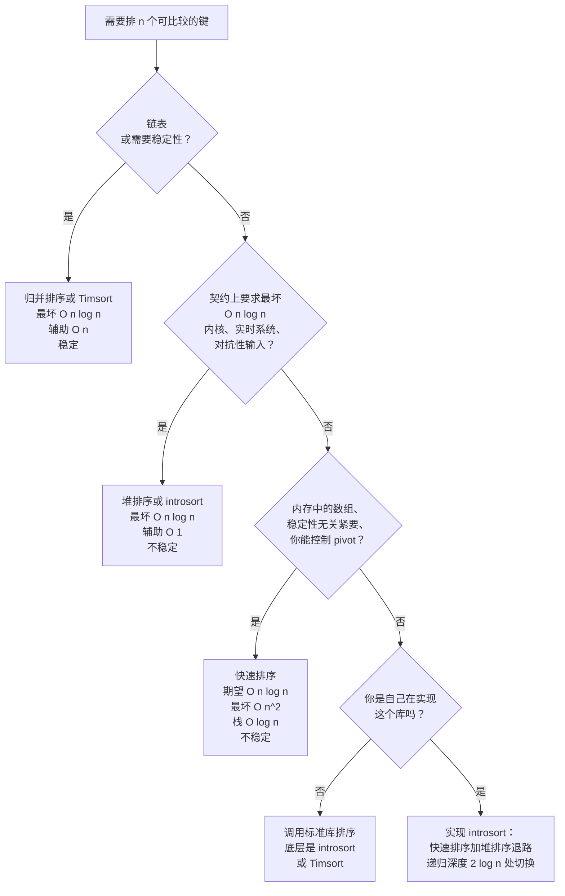

# 快速排序 vs 归并排序 vs 堆排序：选对排序算法

## 如何决策

三种经典的比较排序都在争“该用哪个排序”这个位置，而教科书给的“哪个最好”的答案，放到生产环境里是错的。快速排序赢在平均情况。归并排序赢在最坏情况，而且是三者里唯一稳定的。堆排序赢在空间：`O(1)` 辅助内存，无条件的 `O(n log n)` 上界。按那个真正卡住你的约束来选：要稳定性，或者输入是链表，走归并排序；需要硬性的最坏情况上界又没有临时缓冲区，走堆排序；其余情况，快速排序。

诚实的答案是，你的标准库一个都没实现这三种纯形式。CPython 和 Java 排对象用的是 Timsort，一种归并排序变体，它识别自然有序段（run），在已排序输入上跑 `O(n)`。C++ 的 `std::sort`、.NET，以及 1.19 之前的 Go 交付的是 introsort：以快速排序起步，一旦递归深到暗示碰上了最坏情况输入，就退回堆排序。Rust、Boost，以及 1.19 起的 Go 交付的是 pdqsort，一种带无分支分区的 introsort。2026 年还去手写纯快速排序，几乎总是错的；去用标准库。

## 流程图

下面这四个问题的判据是一套自顶向下的回答方式：第一个“是”就终止，并选定一种算法。多数面试题落在 Q1（要稳定性或链表就用归并排序）或 Q3（否则用快速排序）。Q2 是内核与实时系统的特例通道。Q4 把你导到语言标准库。

*自顶向下的判据。第一个“是”就终止。多数面试题落在 Q1 或 Q3；Q2 是内核的特例；Q4 直接推给语言标准库。*

## 算法对比

### 快速排序：平均情况的赢家

当输入是内存里的连续数组、稳定性无关紧要、而且你能控制 pivot 策略时，快速排序就是对的。Hoare 1962 年的论文提出了“分区加递归”的骨架，同时给出了随机 pivot 的建议——正是这条建议让期望时间的上界成立。[^1] Sedgewick 和 Wayne 实测三数取中随机化快速排序的期望比较次数约为 `1.39 n log₂ n`，是所有标准比较排序里最小的比较次数。[^2] 分区步骤是一次线性扫描，内存访问是顺序的，这正是生产库的排序都由快速排序衍生而来的原因：缓存预取偏爱线性扫描，而快速排序恰好把预取器想要的东西递到它手上。

这个灾难是真实的，不是理论上的。朴素的末元素 pivot 快速排序在已排序输入上会递归 `n` 层，跑成 `O(n²)`。Bentley 和 McIlroy 1993 年的 *Engineering a Sort Function* 记录了能打穿那个显而易见的修法的三数取中杀手序列。[^3] 生产上的答案是 introsort：检测出递归深度异常的情形，一旦深度超过 `2⌊log₂ n⌋` 就退回堆排序。[^4] 对面试 DSA 来说，“我会用随机 pivot”就是正确答案；如果题目明确规定输入可能是对抗性的，就把 introsort 说出来。

[比较排序 II：快速排序、分区与生产级混合算法](../part-2-search-sort/04-comparison-sorts-2.md) 完整覆盖分区原语、三数取中 pivot 选择、三路分区，以及 introsort 混合方案。

### 归并排序：最坏情况的赢家，也是唯一稳定的

当稳定性重要，或者输入是链表时，归并排序就是对的。递归式 `T(n) = 2T(n/2) + Θ(n)` 无条件给出 `Θ(n log n)`，没有依赖输入的逃逸口。[^5] 归并步骤天然稳定：比较 `left[i]` 和 `right[j]`，遇到相等就输出 `left[i]`，相等的键永远不会跨过边界。这就是 Java 用 Timsort 排对象、用双 pivot 快速排序排基本类型的原因。对象排序可能带次要键，次要键之间的相对顺序是有意义的；基本类型排序观察不到稳定性，因为基本类型没有可区分的副本。

代价是 `O(n)` 的辅助内存做临时缓冲区，这让归并排序在内存预算紧张时是错的，在外存溢写的外部排序里是对的。归并步骤在链表上也能用，不需要随机访问，因为每次归并只需要顺着 next 指针顺序访问。自底向上的归并排序在链表上能做到 `O(1)` 额外空间（没有递归栈）；在数组上，递归是 `O(log n)` 的栈，叠在 `O(n)` 的缓冲区之上。

在生产里，归并排序就意味着 Timsort。Tim Peters 2002 年为 CPython 2.3 写了这个算法，为的是利用一条具体的经验规律：真实世界的输入是部分有序的，不是均匀随机的。[^6] Timsort 识别自然有序段，用二分插入排序把短段扩展到 32 到 64 之间的 `minrun`，再用 powersort 调度加 galloping 模式处理偏斜的归并。在已排序输入上它跑 `O(n)`。Java 7 把它用在了 `Arrays.sort(Object[])` 上。[比较排序 I：归并排序](../part-2-search-sort/03-comparison-sorts-1.md) 是标准章节。

### 堆排序：原地的最坏情况赢家

当最坏情况 `O(n log n)` 上界必须无条件成立，*并且*辅助内存必须是 `O(1)` 时，堆排序就是对的。Williams 1964 年提出了这个算法，同时把二叉堆作为一种数据结构引入。[^7] Floyd 同年的论文给出了每个现代实现都在用的 `O(n)` 建堆算法。[^8] 这个组合在三者中是独一无二的：原地、最坏情况有界、对输入顺序不敏感。

Linux 内核的 `lib/sort.c` 就是堆排序，文件头注释明确写下了设计理由：内核代码路径承担不起最坏情况，在内存压力下没法安全地分配临时缓冲区，而且这个排序跑在相对小的数组上，堆排序的缓存惩罚在那里是有界的。实时系统和嵌入式系统做的是同一个权衡。堆排序另一个真正在跑的地方是 introsort 内部，作为快速排序递归深度冲过 `2⌊log₂ n⌋` 之后的退路。

在其他所有场合，缓存惩罚就是那个卡死的约束。LaMarca 和 Ladner 1999 年的研究测出，在超出 L2 的输入上，堆排序的 L2 缓存未命中率大约是快速排序的两倍，这解释了为什么一个实现良好的快速排序在能装进缓存的工作负载上能跑出 2-3× 的墙钟时间优势。[^9] 堆排序的 sift-down 访问当前节点偏移 `2i+1` 和 `2i+2` 处的内存，按 2 的幂跳，打穿了顺序预取。[堆排序与 n log n 下界](../part-2-search-sort/05-heap-sort.md) 覆盖了算法本身和比较排序下界的证明。

**生产现实：混合算法赢。** 2026 年还去伸手拿“纯快速排序”或“纯归并排序”，说明这个候选人十年没用过标准库。Introsort 以快速排序起步，在递归深度 `2⌊log₂ n⌋` 处切到堆排序，元素数低于 ~16 时用插入排序收尾；它出现在 C++ `std::sort`、.NET，以及 pdqsort 之前的 Go 里。Timsort 识别自然有序段，用“段之栈”的不变量把它们归并起来；它出现在 Python、Java 的对象排序和 Android 里。Pdqsort 用无分支的 BlockQuicksort 分区扩展 introsort，出现在 Rust、Boost，以及 1.19 起的 Go 里。Java 的 `Arrays.sort(int[])` 和其他基本类型重载用 Yaroslavskiy 2009 年的双 pivot 快速排序，比较次数比单 pivot 低约 10%。面试里被问“把这个排一下”，正确的回答从“我会调语言标准库，底层是 introsort 还是 Timsort，取决于语言”开始。追问“但如果你从零实现，用哪个？”——那才是流程图里那张判据表发动的时机。

## 逐项对比

| 属性 | 快速排序（三数取中 / 随机化） | 归并排序（自顶向下） | 堆排序（Floyd 建堆） |
|---|---|---|---|
| 时间，平均 | `O(n log n)` 期望 | `O(n log n)` | `O(n log n)` |
| 时间，最坏 | 对抗性输入下 `O(n²)`；有 introsort 退路则 `O(n log n)` | `O(n log n)` | `O(n log n)` |
| 空间，辅助 | `O(log n)` 递归栈 | `O(n)` 临时缓冲区 | `O(1)` |
| 稳定？ | 否 | **是** | 否 |
| 缓存局部性 | 极好（线性分区扫描） | 好（两次线性扫描加一次额外读取） | **差**（sift-down 按 2 的幂跳） |
| 原地？ | 是 | 否（自顶向下数组版本） | 是 |
| 适合链表？ | 否（分区需要随机访问） | **是**（归并只需要顺序访问） | 否（堆需要按索引随机访问） |
| 比较次数（平均） | ~`1.39 n log₂ n`[^2] | `n log₂ n` 到 `n log₂ n + n`[^5] | 自顶向下 ~`2 n log₂ n` |
| 标准库用法 | C++ `std::sort`（introsort）、Java `Arrays.sort(int[])`（双 pivot）、Go `slices.Sort`（pdqsort） | Python `list.sort`（Timsort）、Java `Arrays.sort(Object[])`（Timsort） | Linux 内核 `lib/sort.c`；introsort 的退路 |
| 何时选择 | 内存中的数组、稳定性无关、平均情况最重要 | 需要稳定排序；链表；外部/磁盘排序 | 硬性 `O(n log n)` 最坏情况 *且* `O(1)` 辅助内存 |

决定多数面试结果的是三行。稳定性是最干净的判别条件：只有归并排序免费拿到它；快速排序和堆排序没法在不付内存或时间的情况下被打补丁改成稳定。最坏情况那一列是堆排序和归并排序都赢过快速排序的地方，但归并排序为这个保证付 `O(n)` 辅助空间，堆排序付 2-3× 的缓存未命中惩罚。缓存局部性正是“快速排序因为 `O(n²)` 所以慢”这个反对意见在实践中站不住的原因：生产代码用 introsort，典型情况保住快速排序的缓存行为，病态情况用堆排序救回来。

## 三道招牌题

- [LC 912 — Sort an Array](https://leetcode.com/problems/sort-an-array/) [中等] 是教科书式的快速排序案例。“期望 `O(n log n)` 时间且不能使用内置排序”这条规则排除了 `Arrays.sort`，逼你真的写一个实现。朴素的末元素 pivot 快速排序在隐藏的已排序输入测试上撞 `O(n²)` 超时；能过的答案是随机 pivot 或三数取中快速排序，再加三路分区来应付大量重复的输入。

- [LC 148 — Sort List](https://leetcode.com/problems/sort-list/) [中等] 是标准的链表归并排序题。快速排序的分区需要随机访问；在链表上每次访问是 `O(n)`，总时间塌成 `O(n²)`。堆排序的 sift-down 需要随机访问，同样的问题。自底向上的归并排序是三者里唯一能在单链表上以 `O(1)` 额外空间跑 `O(n log n)` 的。

- [LC 75 — Sort Colors](https://leetcode.com/problems/sort-colors/) [中等] 是 Dijkstra 的荷兰国旗问题，把三路分区这一步抽出来单独练。暴力两趟的计数加覆写是显而易见的那步错棋；最优解是用三个指针的一趟线性扫描，也就是 Bentley-McIlroy 三路快速排序处理大量重复输入时用的同一个原语。

LC 215（Kth Largest）故意不在这个清单上。只需要第 k 个元素时，完整排序是在白干活；`O(n)` 平均的 quickselect 或 `O(n log k)` 的有界堆才是正确答案。见 [Quickselect 与堆求 top-K](../../../dsa/patterns/P-22-quickselect-vs-heap-top-k.md)。

## 常见误解

**“堆排序比快速排序快，因为建堆很快。”** 这是本页最常见的错误直觉，它把一步和整个算法混为一谈。Floyd 的建堆确实是 `O(n)` 而不是 `O(n log n)`：建一次堆很快。[^8] 但堆排序随后要取 `n` 次最大值，每次取是 `O(log n)`。总工作量：`n × log n = O(n log n)`。更糟的是，每次取最大值时的 sift-down 访问当前节点索引 `2i+1` 和 `2i+2` 处的内存，按 2 的幂跳，打穿缓存预取。[^9] 在超出 L2 缓存的输入上，同样的渐进工作量，堆排序比快速排序慢大约 2-3×。建堆快；堆排序不快。

**“快速排序是 `O(n²)`，所以要避开它。”** 用末元素 pivot 的朴素教科书版快速排序在已排序输入上是 `O(n²)`，这是个真 bug；LeetCode 的隐藏测试会让你 TLE。但随机 pivot 的快速排序面对任何固定的输入分布，撞上最坏情况的概率都趋近于零，而 introsort 通过退回堆排序无条件保证了 `O(n log n)` 最坏情况。C++、Rust、Go、.NET 和 Java（基本类型）的生产库排序全都是快速排序衍生的混合算法，它们消掉了最坏情况，同时保住了平均情况的常数因子。`O(n²)` 这个警告针对的是教科书上那六行代码，不是任何你真会发布的东西。

**“归并排序是安全的默认选择。”** 归并排序是稳定性和链表的安全默认选择；它不是任意内存数组的默认选择。纯归并排序要付 `O(n)` 辅助内存，在能装进缓存的输入上常数因子大约是快速排序的两倍。Python 的 `list.sort` 基于归并排序却很快，原因是它是 *Timsort*：带 run 检测、galloping 归并、在已排序数据上 `O(n)` 的归并排序。如果你的意思是“Timsort 是对象排序的安全默认选择”，对；如果你的意思是“永远先拿归并排序”，错。`O(n)` 辅助空间是真实的，在内存压力下是算数的。

**“基本类型不需要稳定性。”** 对裸的整数、浮点数和字符来说是对的：值相等的两个副本无法区分，稳定性观察不到，Java 的基本类型数组排序用不稳定的双 pivot 快速排序正是这个原因。但你一旦排带多个键的对象，这条规则就破了。先按入职日期排员工，再按部门重排：在稳定排序下，同一部门内的员工仍然按入职日期有序。在快速排序或堆排序下，第二次排序把键内的顺序打乱。按主键、再按次键、再按第三键做多键排序，每一步都需要稳定排序（或者一次排序配一个复合比较器）。C++ 把 introsort 作为 `std::sort` 交付，稳定性通过 `std::stable_sort` 选择性提供；Go 的 `slices.Sort` 是 pdqsort，稳定性通过 `slices.SortStableFunc` 选择性提供。搞清楚你所用语言的默认行为，是多键数据上能信它的前提。

**“堆排序是 top-K 的正确答案。”** 不是。堆排序对全部 `n` 个元素建堆，然后把它们一个个全取出来，做的是 `O(n log n)` 的工作。top-K 模式把堆的大小卡在 `k`，做 `O(n log k)` 的工作，或者用 `O(n)` 平均的 quickselect。这个错误把“堆这种数据结构对 top-K 有用”和“堆排序这个算法对 top-K 有用”混为一谈；两者不是一回事。正确答案见 [Quickselect 与堆求 top-K](../../../dsa/patterns/P-22-quickselect-vs-heap-top-k.md)。

## 参考文献

[^1]: Hoare, "Quicksort," *The Computer Journal* 5(1) (1962): 10–16. https://academic.oup.com/comjnl/article/5/1/10/395338

[^2]: Sedgewick and Wayne, *Algorithms*, 4th ed., §2.3. https://algs4.cs.princeton.edu/23quicksort/

[^3]: Bentley and McIlroy, "Engineering a Sort Function," *Software: Practice and Experience* 23(11) (1993): 1249–1265. https://www.cs.dartmouth.edu/~doug/source.html

[^4]: Musser, "Introspective Sorting and Selection Algorithms," *Software: Practice and Experience* 27(8) (1997): 983–993.

[^5]: Cormen, Leiserson, Rivest, Stein, *Introduction to Algorithms*, 4th ed., MIT Press, 2022, Chs. 2, 6, 7, 8.

[^6]: Peters, "listsort.txt," CPython source. https://github.com/python/cpython/blob/main/Objects/listsort.txt

[^7]: Williams, "Algorithm 232, Heapsort," *CACM* 7(6) (1964): 347–348. https://doi.org/10.1145/512274.512284

[^8]: Floyd, "Algorithm 245, Treesort 3," *CACM* 7(12) (1964): 701. https://doi.org/10.1145/355588.365103

[^9]: LaMarca and Ladner, "The Influence of Caches on the Performance of Sorting," *Journal of Algorithms* 31(1) (1999): 66–104. https://doi.org/10.1006/jagm.1998.0985
