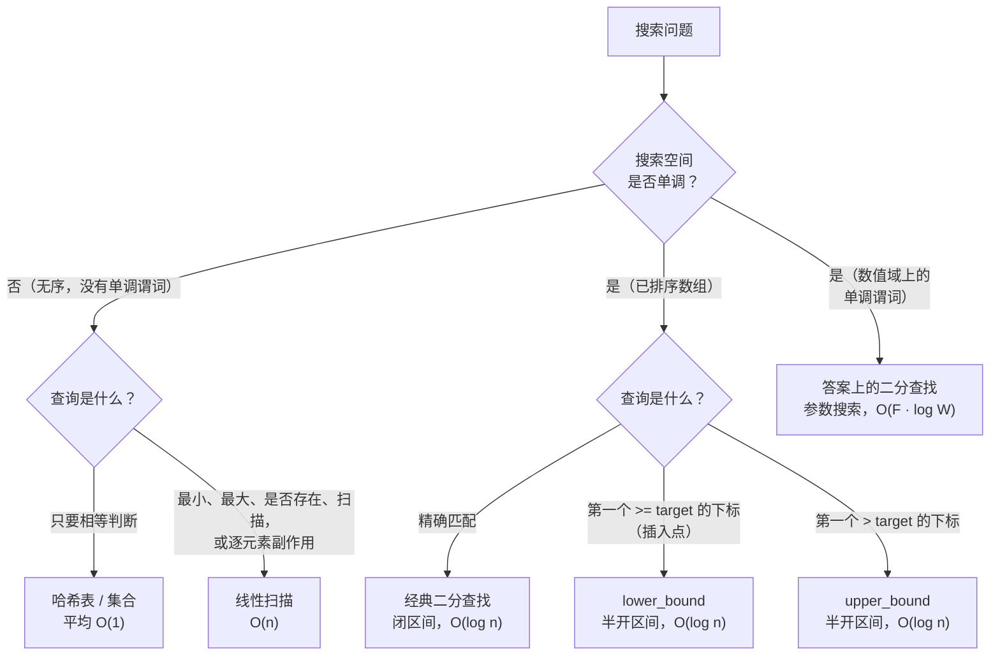

# 二分查找 vs 线性扫描，以及答案上的二分查找

## 如何决策

问题是*你该伸手去拿哪一种搜索：线性扫描、经典二分查找，还是答案上的二分查找？* 一句话：**搜索空间单调就折半，不单调就走一遍。** 有序只是搜索空间单调的一种来路，不是唯一来路；漏掉其它来路，是这个模式上出现频率最高的 bug。

## 流程图

*本页要教的四路决策。最右边那条分支正是刷掉 Google 面试候选人的地方：输入数组无序，但答案空间单调，所以二分查找照样适用。*

## 算法对比

### 线性扫描

何时选它：

- 输入无序，而且只查一次。先排序要花 `O(n log n)` 才能换来一次 `O(log n)` 的查找；扫一遍只要 `O(n)`，反而赢。
- 反正每个元素都得碰。求和、找最大值、跑 Kadane 算法、为哈希把字节过一遍指纹。这些活儿定义上就是 `Theta(n)`，折半买不到任何东西。
- `n` 很小。低于约 100 个元素时，二分查找循环的分支预测失败和缓存未命中惩罚，比一个紧凑的 `for` 循环付出的代价还高。Sedgewick 给出的交叉点在通用硬件上落在 32 到 128 之间 [^1]。渐近意义上这个决策是二值的；在常数级的 `n` 上，更简单的代码赢。

时间 `O(n)`，空间 `O(1)`。这块归 [线性查找及其适用场景](../part-2-search-sort/00-linear-search.md) 管，那一章从 Knuth 的 Algorithm T 推出这个界，并讨论了哨兵优化 [^2]。

### 有序数组上的二分查找

何时选它：

- 输入已排序，而你要问的是一个顺序问题：精确匹配、满足 `nums[i] >= target` 的最小下标 `i`、满足 `nums[i] > target` 的最小下标，或者某个值出现的次数。
- 你要反复查询。先花 `O(n log n)` 排一次序，再查 `q` 次、每次 `O(log n)`；只要 `q` 超过 `log n`，这就赢过 `O(qn)` 的线性扫描。
- 查询是"最接近"或"落在两者之间"。哈希表答不了这类问题，`lower_bound` 一次调用就答了。

三个模板，对应三种提问形状：闭区间精确匹配（LC 704）；半开区间 `lower_bound`，用于插入点和"第一个为真"的谓词搜索（LC 35、LC 278）；半开区间 `upper_bound`，用于"末位之后"和计数（`upper_bound - lower_bound` 就是重复元素的个数）[^3]。C++ 把这两个半开区间模板固化成 `std::lower_bound` 和 `std::upper_bound`，而把 `std::binary_search` 当作一层薄薄的布尔包装，面试里很少有用，因为 LeetCode 要的是下标不是布尔值 [^3]。Java 的 `Collections.binarySearch` 在未命中时返回 `-(insertionPoint) - 1`，这其实就是下界形状加了一层负数编码；候选人要是把这个返回值当成 `-1` 处理，交上去的答案就是错的。

时间 `O(log n)`，空间 `O(1)`（迭代版）。`Theta(log n)` 这个界由决策树论证直接给出：任何基于比较的算法要区分 `n + 1` 种结果（`n` 个命中位置加一次未命中），决策树高度至少得是 `ceil(log_2(n + 1))`，所以在有序数组上做基于比较的搜索，二分查找在渐近意义下就是最优的 [^4]。模板与不变式归 [二分查找：标准版本](../part-2-search-sort/01-binary-search-canonical.md) 管。

关于**插值查找（interpolation search）**补一句，压成一段，因为它在面试里几乎从不值回票价。在均匀分布的数字键上，插值查找按值的分布猜 `mid`、而不是永远把区间对半分，期望复杂度是 `O(log log n)`。最坏情况在刻意构造的分布上是 `O(n)`，常数因子难看得要命，前提假设很脆，而且过去五年公开面经里没有任何一场 FAANG 面试把"我会用插值查找"当作有序数组问题的正确答案接受过。面试官不主动提，你就别提。

### 答案上的二分查找

何时选它：

- 输入数组*不*有序，而且排序也帮不上忙。
- 题目问的是满足某个约束的*最小*（或最大）值，而这个约束是数值域上的一个可行性谓词。
- 该谓词单调：一旦从假翻成真，就一直为真。

这是元模式。搜索空间不是输入数组，而是答案域。Megiddo 1983 年的论文把参数搜索引入为一种技术：通过反复调用一个可行性判定算法来求解最优化问题 [^5]。面试问的那个二分变体是它的初等情形：取一个候选答案 `X`，用多项式时间的谓词问一句"`X` 可行吗"，然后按布尔结果把答案域折半。

LC 875 Koko Eating Bananas 是标准实例。香蕉分成若干堆，`H` 小时倒计时，求最小进食速度 `K`。朴素做法是在答案域上 `K = 1, 2, 3, ...` 线性扫描，代价 `O(n · max(piles))`，而约束里 `max(piles)` 能到 `10^9`，扫描必然超时。在 `[1, max(piles)]` 上二分 `K`，配一个 `O(n)` 的可行性谓词，就是 `O(n · log(max(piles)))`，按 LC 的界算大约 `30n`。同样的输入，快了四个数量级。LC 1011 Capacity to Ship Packages 和 LC 410 Split Array Largest Sum 是同一个模板，只是边界和谓词不同 [^6]。读者一旦认出"数值域上的单调谓词"，算法就定了；剩下的活只有圈定定义域和写出谓词。

时间 `O(F · log W)`，其中 `W = hi - lo` 是答案域的宽度，`F` 是单次谓词的代价。空间取决于谓词需要什么。LC 410 / 668 / 875 / 1011 / 1283 这一整条梯度在 [二分查找变体](../part-2-search-sort/02-binary-search-variants.md) 和第 9 部分 DP 与参数搜索的章节里。

## 逐项对比

| 方案 | 时间 | 需要排序 | 合适的 n 范围 | 代码清晰度 | 何时选它 |
|---|---|---|---|---|---|
| 哈希表 / 集合 | 平均 `O(1)` | 否 | 任意 | 高 | 相等查询、反复查找 |
| 线性扫描 | `O(n)` | 否 | `n < ~100` 时总是；输入无序且只查一次时任意 `n` | 最高 | 输入无序、必须碰每个元素，或 `n` 很小 |
| 经典二分查找 | `O(log n)` | 是 | 大 `n`、反复查询 | 中（模板） | 输入有序，精确匹配或插入点 |
| `lower_bound` / `upper_bound` | `O(log n)` | 是 | 大 `n`、反复查询 | 中 | 输入有序，区间或计数 |
| 答案上的二分查找 | `O(F · log W)` | 否（谓词必须单调） | 任意 `n`，`W` 可到 `~10^18` | 最难 | 求最小 / 最大答案，且有单调的可行性谓词 |

与决策相关的维度是：时间、对输入的前置要求、目标不存在时算法返回什么、以及让算法正确的那个结构特征。判别标准不是有序，而是**单调性**。有序数组只是最常见的单调搜索空间，不是唯一的。

## 三道招牌题

[LC 53 — Maximum Subarray](https://leetcode.com/problems/maximum-subarray/) **[中等]**，*线性扫描的招牌。* 你必须在每个元素上维护一个滚动最大值，才能求出最大连续子数组和。Kadane 算法跑 `O(n)`，而且可以证明是最优的：任何解这个问题的算法都必须读每一个元素，因为改动单个值就可能改变答案。排序会破坏题目依赖的连续性，所以有序数组那套技巧在这里用不上。这就是"线性扫描才是正解"长什么样。

[LC 704 — Binary Search](https://leetcode.com/problems/binary-search/) **[简单]**，*有序数组的标准招牌。* 升序输入、互不相同的整数，返回目标下标，找不到返回 `-1`。题面明确要求 `O(log n)` 运行时间，从构造上就排除了线性扫描。用 `lo + (hi - lo) // 2` 的闭区间模板是标准解；更深的一课是：循环不变式（"目标若存在，必在 `nums[lo..hi]` 内"）决定了其余每一行代码。

[LC 875 — Koko Eating Bananas](https://leetcode.com/problems/koko-eating-bananas/) **[中等]**，*答案上二分查找的招牌。* 输入数组 `piles` 无序，排序也没用。关键是想明白*答案* `K` 落在一个单调的定义域 `[1, max(piles)]` 上：速度更快，吃完的时间绝不会更慢，所以可行性在整个定义域上只从假翻成真一次。对这个答案二分，谓词是 `O(n)`：每堆算 `ceil(p / K)` 小时求和，再和 `H` 比较。总计 `O(n log(max(piles)))`。这是本章被引用最多的单道题，因为它最干净地证明了"二分查找必须有有序数组"是错的。

## 常见误解

**"二分查找永远比线性扫描快。"** 在 `n` 很小的时候是错的。`O(log n)` 对 `O(n)` 的渐近界是真的，但它藏了一次 5-10 倍的常数因子握手。二分查找的访存是不规则的（先跳 `n/2`，再跳 `n/4`，再跳 `n/8`），每次探测都把 L1 数据缓存烧一遍。线性扫描按步长 1 走内存，预取器配合得完美。二分查找每次迭代都有一个难预测的分支；线性扫描的循环分支能被预测器钉在 >99% 的准确率上。Sedgewick 给出的交叉点在现代 x86 硬件上是 32 到 128 个元素之间 [^1]，Khuong 在当代 CPU 上的实验落在同一区间。低于交叉点，就老实写 `for` 循环。懂这一点的面试官和不懂的候选人，玩的不是同一个游戏。

**"二分查找需要有序数组。"** 错，这正是本章存在的理由。二分查找需要的是搜索空间上的单调谓词。有序只是拿到单调性的一条路（`P(i) := nums[i] >= target` 单调，当且仅当 `nums` 非递减），但不是唯一的路。数值域上的可行性谓词之所以单调，是因为结构原因，跟数组顺序毫无关系：`feasible(K) := Koko 以速度 K 在 <= H 小时内吃完` 对 `K` 单调，因为对每个 `p`，`ceil(p / K)` 都随 `K` 非增 [^5]。只把"二分查找用于有序数组"装进脑子的读者，解不了 LC 875、LC 1011 或 LC 410；把"二分查找用于单调谓词"装进脑子的读者，用同一个模板把三道全解了。

**"`(lo + hi) / 2` 只是理论上的溢出，没人真会踩到。"** 错。Joshua Bloch 2006 年在 Google Research 的博客里记录了：这个 bug 在 `java.util.Arrays.binarySearch` 里活了九年，在 Bentley 那本"已被证明正确"的 *Programming Pearls* 实现里活了二十年 [^7]。在 32 位有符号整数上，`lo + hi >= 2^31` 时它就触发，而答案域一旦到 `~10^9` 就必然踩到。LC 410、LC 668、LC 875、LC 1011 的约束都把 `hi` 顶到 `10^9` 或更高。算一下 `lo + hi == 2 * 10^9`，超过了 `INT_MAX` 的 `2,147,483,647`；和溢出成负数；下一个数组下标要么抛异常要么返回垃圾值。修法是 Python、Go、C++ 里写 `mid = lo + (hi - lo) // 2`，Java 里写 `(lo + hi) >>> 1`，其中 `>>>` 是 Bloch 背书的无符号右移 [^7]。把安全写法练成肌肉记忆：每种语言，每一次。

**"线性扫描和二分查找是仅有的两个选项。"** 错，流程图里画了四个。哈希表 / 哈希集合查找平均 `O(1)`，在不分序输入上做反复的相等查询时才是正解，这种场景永远别伸手去拿二分查找。而在有序数组上，提问形状（精确匹配、插入点、计数）决定选哪个模板；把"二分查找"当成一个算法而不是三个，产出的就是 [二分查找：标准版本](../part-2-search-sort/01-binary-search-canonical.md) 里归档的那些差一错误。

**"排完序，二分查找就是白送的。"** 有误导性。排序本身的代价是 `O(n log n)`，把后面每一次 `O(log n)` 查找都盖过去了。为了能用二分查找而排序，只在两种情况下成立：你要反复查询（排序成本摊到多次查询上），或者数组本来就有序（拿过来就是排好的，或者用例本身维护着有序不变式）。对于一次性的"`x` 在不在 `nums` 里"，正解是一趟建好哈希集合、一次调用查完、然后丢掉。别为了做一次二分查找去排序。

## 参考文献

[^1]: Sedgewick 与 Wayne，*Algorithms*，第 4 版，§§1.4、3.1。

[^2]: Knuth，*The Art of Computer Programming*，第 3 卷，第 2 版，Addison-Wesley，1998，§§6.1、6.2.1。

[^3]: cppreference，"std::lower_bound"。https://en.cppreference.com/w/cpp/algorithm/lower_bound。cppreference，"std::upper_bound"。https://en.cppreference.com/w/cpp/algorithm/upper_bound

[^4]: Cormen、Leiserson、Rivest、Stein，*Introduction to Algorithms*，第 4 版，MIT Press，2022，§4.5。

[^5]: Megiddo，"Applying parallel computation algorithms in the design of serial algorithms"，*JACM* 30(4) (1983): 852–865。https://doi.org/10.1145/2157.322410

[^6]: LeetCode，"875. Koko Eating Bananas"。https://leetcode.com/problems/koko-eating-bananas/。

[^7]: Bloch，"Nearly All Binary Searches and Mergesorts are Broken"，Google Research 博客，2006。https://research.google/blog/extra-extra-read-all-about-it-nearly-all-binary-searches-and-mergesorts-are-broken/
