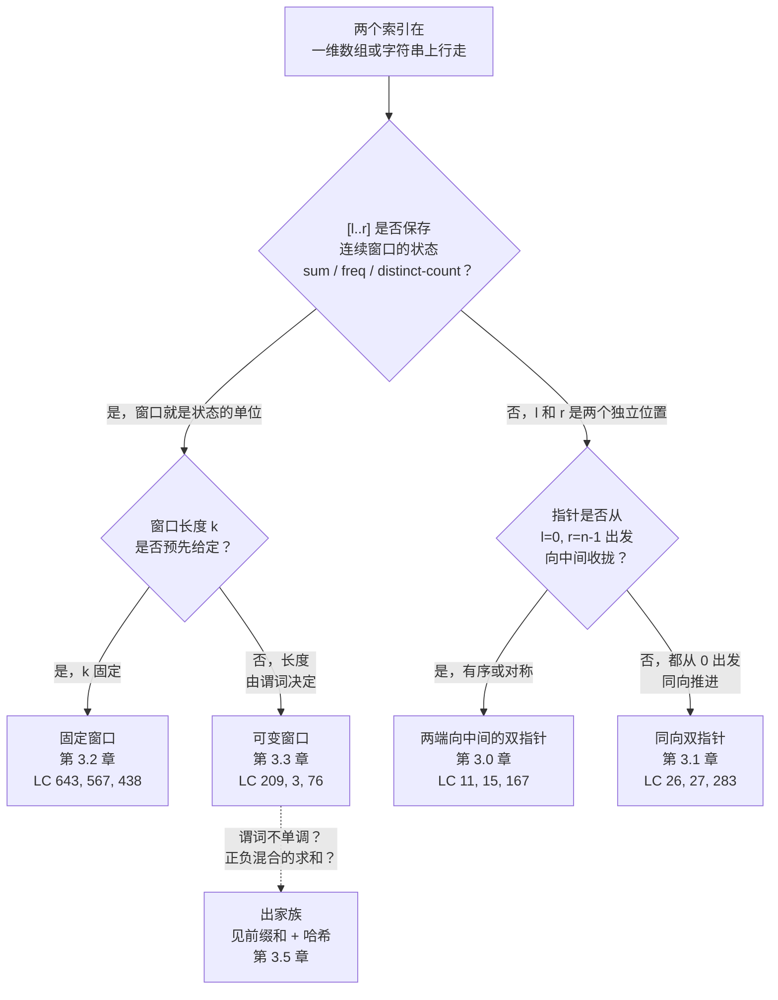

# 双指针与滑动窗口：貌合神离的两类模式

连续四章练的是四个循环，从外面看几乎一模一样。每个都用两个下标走一遍数组，每个都是线性时间，每个每步都只做 O(1) 的工作。选错了，代码照样编译、照样跑起来，第一个测试用例还是过。然后第二个用例挂了：一个符号变了，输入没排序，或者构建阶段少走了一格，你盯着 `while l < r` 的循环，想不通答案为什么是 `[1, 2]` 而不是 `[2, 3]`。

这种混淆被面试站一路加固：它们把“双指针”写成一个筐，把整个家族都装进去。LC 讨论区的高赞指南这么写，YouTube 上大部分经典视频也这么讲。本手册的立场很明确：**双指针和滑动窗口是两种不同的模式，各有不同的不变量**，真正的面试功夫是按不变量选，而不是按循环的表面形状选。

## 如何决策

分水岭不是“有没有两个下标”——这一页上每个算法都有两个下标。分水岭也不是“两个指针是不是一起动”——这里大多数算法至少有一个指针永远在前进。分水岭是一个关于两个指针之间的 `[l..r]` *意味着什么*的问题。

> **算法是在 `[l..r]` 上维护一个连续窗口的不变量，还是 `l` 和 `r` 索引两个独立位置、它们之间的关系才是答案？**

如果 `[l..r]` 是一个窗口，循环在对它做增量汇总（滚动和、频次表、不同字符计数、“无重复”布尔量），模式就是**滑动窗口**。窗口是状态的单位。

如果 `l` 和 `r` 是数组里两个独立位置，答案就是这对位置的取值或相对次序，模式就是**双指针**。指针不定义一个窗口，它们定义两个游标，靠相遇条件或配对检查得出结果。

再问两个次级问题，每个分支各拆成两个子原型。如果走的是滑动窗口，问窗口长度 `k` 是事先给定（固定），还是由某个谓词决定（可变）。如果走的是双指针，问两个指针是分别从两端向中间收拢（有序数组的地盘），还是都从零出发、同向推进（读写或快慢的地盘）。

于是得到四个子模式，对应 Part 3 的每一章。

## 流程图

*分水岭是 Q1：维护着状态的窗口，还是两个独立位置。Q2 和 Q3 把每个分支再拆成 Part 3 各自负责的四个子模式。*

## 算法对比

四个子模式共享表层机制，但在 `[l..r]` 代表什么、什么不允许被破坏上分道扬镳。下面每个 H3 讲一个：什么时候它赢、代价多少、归哪一章，以及那个一旦违反就会把问题送到别的家族的前置条件。

### 两端向中间的双指针（第 3.0 章）

输入有序，或者带有算法可利用的结构对称性（回文位置、两堵墙之间的容器几何）。答案是某一对 `(i, j)`（`i < j`）的性质，这对位置的谓词要拿目标值来检验。指针从 `l = 0, r = n - 1` 出发相向推进，每轮按一次比较决定动哪一个。

锁定的不变量：在有序数组上，如果 `nums[l] + nums[r] < target`，那么推进 `l` 是唯一有用的走法。别的选择要么让搭档变小（和更小），要么把 `nums[l]` 换成一个更小的值——而不可能，因为 `l` 已经是左侧尚未访问过的最小项。`> target` 时镜像论证同样成立。这个证明是分类讨论，该章有标准写法[^1]。

时间：O(n)。空间：O(1)。每步把 `r - l` 恰好减 1，所以循环最多跑 n - 1 次。

在 LC 11 Container With Most Water、LC 15 3Sum（外面套排序 + 外层循环）、LC 167 Two Sum II、LC 125 Valid Palindrome、LC 42 Trapping Rain Water 上它赢。见[双指针：两端向中间](../part-3-pointers-window-prefix/00-two-pointers-opposite.md)。

一旦去掉有序性，它立刻失效。分类讨论的证明崩了，算法开始静默地给出错误答案。没有有序性，就去用哈希表。

### 同向双指针（第 3.1 章）

两个指针都从零出发，从左往右推进。一个是*读指针*（永远前进），一个是*写指针*或*慢指针*（只在保留条件成立时才前进）。不变量是：`nums[0..write)` 是稳定的已保留前缀，`nums[write..n)` 是循环还在原地重写的草稿区。

这一形状有两种口味。**读写**口味负责原地过滤、去重和保持相对次序的分区：LC 26 Remove Duplicates、LC 27 Remove Element、LC 283 Move Zeroes、LC 75 Sort Colors（三指针的特化，即 Dijkstra 1976 的荷兰国旗[^2]）。**快慢**口味用 2 倍速度差检测链表中的环；它单独放在第 5.3 章（Floyd 龟兔算法），因为不变量不同。

时间：O(n)。空间：O(1)。读指针跑 n 次，写指针被读指针约束。

当题目说“原地修改 `nums`”，同时那个操作可以描述成“在保持相对次序的前提下丢弃或覆盖元素”时，它赢。见[双指针：同向推进](../part-3-pointers-window-prefix/01-two-pointers-same-direction.md)。

当重写需要三类或更多输出出口（荷兰国旗特化）、当谓词依赖尚未访问的元素（不可能有读写不变量）、或者当操作不是读指针的局部行为时，它失效。

### 滑动窗口：固定长度（第 3.2 章）

题目要求对每个长度为显式给定 `k` 的连续切片求最优聚合值。滑动每步只花 O(1)，与 `k` 无关：减去 `nums[r - k]`，加上 `nums[r]`，读一次。暴力解法在每个起始下标重算接下来 `k` 个元素，付 O(n × k)；滑动用一个减法替掉了那 `k - 1` 次多余的加法。

时间：O(n)。空间：O(1)（数值聚合）；O(σ)（小字符集上的频次表聚合）。

在 LC 643 Maximum Average Subarray I、LC 567 Permutation in String、LC 438 Find All Anagrams、LC 30 Substring with Concatenation of All Words、LC 1456 Maximum Number of Vowels 上它赢。信号就是题面里那句字面话：“of length k”、“of size k”或“exactly k”。见[滑动窗口：固定长度](../part-3-pointers-window-prefix/02-sliding-window-fixed.md)。

输入里有负数不影响这个模式，因为滑动是纯算术。一旦 `k` 不再给定、而是变成要求的答案，它失效。

### 滑动窗口：可变长度（第 3.3 章）

窗口长度就是未知数。右指针永远前进，左指针只在收缩条件成立时前进。状态随谓词需要而定：滚动和、频次表、覆盖类问题的 `have/required` 整数计数器。

摊还是标准的那一套。每个元素最多经 `r` 进入一次、最多经 `l` 离开一次，所以两个指针的总工作量是 O(n)，内层收缩循环看起来嵌套几层都一样。CLRS 第 17 章 §17.1 原样给了这个论证，并以栈上 MULTIPOP 为实例推演[^3]。

时间：O(n)。空间：O(σ)（字符频次状态），O(1)（求和阈值状态）。

它在三类谓词上赢。非负数组上的求和阈值：LC 209 Minimum Size Subarray Sum。无重复谓词：LC 3 Longest Substring Without Repeating Characters。全覆盖谓词：LC 76 Minimum Window Substring，配 `have/required` 计数技巧[^4]。见[滑动窗口：可变长度](../part-3-pointers-window-prefix/03-sliding-window-variable.md)。

只要元素可能为负、而谓词又是求和阈值，它立刻失效。这种情况改走第 3.5 章的前缀和 + 哈希组合，那里的正确性论证不依赖单调性。

## 逐项对比

| 维度 | 两端向中间的双指针 | 同向双指针 | 滑动窗口（固定） | 滑动窗口（可变） |
|---|---|---|---|---|
| **指针移动** | 每步动一个；两指针相向收拢 | 读指针永远前进；写/慢指针按条件前进 | 两个指针同步各进 1 | 右指针永远前进；左指针按收缩条件前进 |
| **是否要求连续？** | 不，答案是配对而非区间 | 不，答案是新的前缀长度 | 是，`[l..r]` 就是窗口 | 是，`[l..r]` 就是窗口 |
| **是否要求度量单调？** | 不要求，但要求有序 | 不要求 | 不要求（滑动是算术） | 要求，扩展至少在一个方向上单调 |
| **典型复杂度** | O(n) 时间，O(1) 空间 | O(n) 时间，O(1) 空间 | O(n) 时间，O(1) 或 O(σ) 空间 | O(n) 时间，O(σ) 空间 |
| **识别信号** | “有序数组” + “找配对/三元组” + “和/面积/回文” | “原地修改” + “丢弃/去重/分区” | “of length k” / “of size k” / “exactly k” | “最短/最长/任意满足 X 的窗口” + 没给 `k` |
| **终止条件** | `l >= r` | `read == n` | `r == n` | `r == n` 且内层收缩排空 |
| **代表作** | LC 11 Container With Most Water | LC 26 Remove Duplicates | LC 643 Maximum Average | LC 209 Minimum Size Subarray Sum |
| **失效于……** | 输入无序 | 需要三类以上出口 | `k` 未知 | 正负混合求和 + 求和阈值谓词 |

最要紧的两格是*连续性*和*度量单调性*。滑动窗口两者都要，双指针两者都不要。如果题目允许跳过（LC 1 Two Sum 的无序版本，两个下标可以任意），滑动窗口从构造上就是错的，该用哈希表。如果度量在窗口扩展时不单调（LC 560 Subarray Sum Equals K 带负数），可变窗口从构造上就是错的，该用前缀和 + 哈希。

## 三道招牌题

下面三道题把这个模式家族之间的差别钉死。每一道都是它那个子原型的标准选择，而它们之间的对照才是读者真正栽跟头的地方。

**[LC 167 — Two Sum II (Input Array Is Sorted)](https://leetcode.com/problems/two-sum-ii-input-array-is-sorted/)** [简单] 是标准的两端向中间双指针。给定 `numbers = [2, 7, 11, 15]` 和 `target = 9`，返回 `[1, 2]`，因为这两个 1 起始下标位置上的值相加为 9。算法保持 `l = 0, r = n - 1`；若 `nums[l] + nums[r] < target` 就推进 `l`；若 `>` 就回退 `r`；若 `==` 就返回。没有任何元素被聚合过，只有配对检查。去掉有序性，分类讨论的证明就断了（见下面第四条误解）。

**[LC 3 — Longest Substring Without Repeating Characters](https://leetcode.com/problems/longest-substring-without-repeating-characters/)** [中等] 是标准的可变窗口。给定 `s = "abcabcbb"`，返回 `3`。窗口 `[l..r]` 带着一张频次表；`r` 前进并更新表；只要有字符频次超过 1，`l` 就前进并把表里的计数减掉。摊还的依据是总工作量被 2n 限住：每个字符经 `r` 进入一次，最多经 `l` 离开一次。它与 LC 167 的对照正是这一页的全部意义：两者都是两个下标在走，但 LC 167 从不在 `[l..r]` 上聚合，LC 3 永远在聚合。

**[LC 643 — Maximum Average Subarray I](https://leetcode.com/problems/maximum-average-subarray-i/)** [简单] 是标准的固定窗口。给定一个数组和固定的 `k`，返回所有长度为 `k` 的连续切片中的最大平均值。滑动就是一个表达式：`window_sum += nums[r] - nums[r - k]`。值得一提的归约：`k > 0` 时最大平均值和最大和排出完全相同的窗口次序，所以只跟踪整数和，最后除一次。朴素暴力付 O(n × k)，滑动付 O(n)。

## 常见误解

反复出现的五个错误，构成了这个家族里的大多数 bug。其中两个正是这一页的核心对照，另外三个是把模式掰出家族的分水岭。

**滑动窗口只是换了个名字的双指针。** 这一页存在的意义就是纠正这个误解。没错，两者都保持两个从左往右走的下标。不对，它们不是同一个算法。把 LC 3 和 LC 167 摆在一起看：两者都有 `l` 和 `r`。LC 3 在 `[l..r]` 上维护一张频次表，求满足谓词的最长 `r - l + 1`，算法在*汇总*这个窗口。LC 167 的 `l` 和 `r` 分处两端，从不聚合任何东西，只问 `nums[l] + nums[r]` 是否等于目标。滑动窗口是双指针的一个*特化*，额外加了连续窗口这个不变量。每个滑动窗口在技术上都是双指针方案，但大多数双指针方案不是滑动窗口。区分它们的就是那个分水岭问题（流程图里的 Q1）：维护着窗口状态，还是两个独立位置。把两者当成可互换的，你就会把可变窗口套到 LC 167 上（正数输入下正确，负数下崩），或者把两端向中间套到 LC 3 上（到处都崩）。

**在正负混合的数组上用可变窗口。** 经典翻车是拿 LC 209 的模板去做 LC 560 Subarray Sum Equals K：`for r in range(n): while sum >= K: l += 1`。LC 209 的正确性依赖 `nums[i] >= 0`，这使滚动和对窗口长度单调。LC 560 允许负数，窗口变大会让滚动和变小，收缩条件不再对应正确的 `l` 位置，答案就错了。记录了这个陷阱的那篇 Medium 文章，标题直接就叫“Why does sliding window not work?”[^5]。线索“正负混合 + 求和目标”会把问题整个送离滑动窗口家族，转到第 3.5 章的前缀和 + 哈希组合。固定窗口不受影响，因为那里的滑动是纯算术，没有单调性假设。

**把任何带 `l` 和 `r` 的嵌套循环都叫“双指针”。** 一个 O(n²) 的暴力双循环 `for l in range(n): for r in range(l + 1, n): check(l, r)`，因为有两个下标变量就被贴上“双指针”的标签。双指针和滑动窗口的定义性特征是摊还 O(n) 的总工作量，而不是 O(n²)：每个指针单调前进，从不重置，循环靠指针位置而不是下标对的组合来终止。如果内层循环在外层每一轮都从 `l + 1` 重新开始，那这个算法就是带两个下标的暴力解法，不是双指针。

**在无序数组上用两端向中间。** 拿 `l = 0, r = n - 1` 去做 LC 1 Two Sum（无序版）。两端向中间的正确性证明要求有序：分类讨论那句“若 `nums[l] + nums[r] < target`，推进 `l` 是唯一有用的走法”，依赖 `nums[l]` 是左侧尚未访问过的最小项。去掉有序性，证明就断。线索是二值的：有序走两端向中间，无序走哈希表。LC 11 的章节组件里带一个 “unsorted trap” 预设，读者能亲眼看着算法在打乱的输入上给出错误答案。

**在三类出口的场景用同向读写。** 用一对读写指针去做 LC 75 Sort Colors。读写模板只分成两个区，“已保留”和“草稿区”。LC 75 需要三个区（`< 1`、`== 1`、`> 1`），也就是 Dijkstra 1976 的荷兰国旗算法，带一个三指针不变量：`[0..low)` 是红，`[low..mid)` 是白，`[mid..high]` 未排序，`(high..n)` 是蓝。两类出口走读写模板，三类出口走荷兰国旗。

## 参考文献

[^1]: scanny et al., "Proof for LeetCode 11," CS Stack Exchange, 2020. https://cs.stackexchange.com/questions/121472/proof-for-leetcode-11-container-with-most-water-problem

[^2]: Dijkstra, *A Discipline of Programming*, Prentice-Hall, 1976, Ch. 14.

[^3]: Cormen, Leiserson, Rivest, Stein, *Introduction to Algorithms*, 4th ed., MIT Press, 2022, Ch. 17.

[^4]: HelloInterview, "Leetcode 76. Minimum Window Substring." https://www.hellointerview.com/community/questions/minimum-window-substring/cm5eh7nrh04p4838owhtrqcnp

[^5]: Lee, "LeetCode 560: Subarray Sum Equals K," Medium, 2022. https://yuminlee2.medium.com/leetcode-560-subarray-sum-equals-k-9eb688e43534
