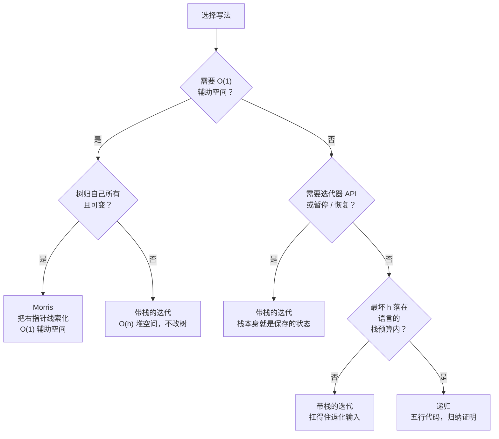

# 迭代 vs Morris vs 递归树遍历

三种写法都能在 O(n) 时间内走完二叉树的每个节点。它们的区别只有一处：把「下一步去哪」这份记忆存在哪儿。递归把它藏在语言的调用栈上。迭代把它搬到由你自己 push、pop 的堆上栈里。Morris 把它藏进树本身——覆写为空的右指针，返回时再拆掉。三者之间的选择是个预算问题，不是审美问题。

## 如何决策

**问题：** 对二叉树做一次深度优先遍历，该写哪种形式？

**一句话答案。** 默认用递归。调用栈深度有风险，或题目要求 `next()` / `hasNext()` 迭代器时，换成带栈的迭代。只有当面试官明确说出「O(1) 额外空间」、这棵树在这次调用期间归你独占、而且你能改写右指针再恢复它们时，才换成 Morris。

## 流程图

*三个依次提问。空间，然后 API，然后深度。只有三问都指向 Morris 时它才存在；任何一问不成立，迭代形式就是安全的退路；什么问题都没把你从默认选项上推走时，剩下的就是递归。*

## 算法对比

Part 6 要求的东西，三种形式全能覆盖。差别在于每种形式把「下一步是什么」这个状态存在哪，以及这份存储要付多少代价。

### 递归

函数在左子树上调用自己，访问本节点，再在右子树上调用自己。中序五行；把 `visit()` 调用在三个位置之间挪一挪，就得到前序、中序、后序。隐式调用栈扛着这些工作；程序除了一个针对 null 的基准情形，什么都不用自己管。

以下情况选递归：

- 面试是通用树题（LC 94、LC 104、LC 226、LC 543）。递归写法是面试官期待你先写出来的那个。
- 遍历要顺着调用往下传状态（最大深度、子树和、父节点引用）。递归的参数列表是传达这些最干净的方式；迭代形式得往栈里压元组。
- 输出顺序是三种标准顺序之一。前序、中序、后序是同一个五行骨架，只是把 visit 调用在三个位置之间挪。[^1]
- 最坏深度落在语言的栈预算之内。Java HotSpot 的 `-Xss` 默认值是 256KB 到 1MB，实践上能容纳 5K 到 25K 个栈帧；C++ 在栈帧很浅时能到百万级。[^2] Python 的默认递归上限是 1000，这条假设最先在这里破。[^3]

| | 时间 | 空间 |
|---|---|---|
| 递归遍历 | Θ(n) | Θ(h) 隐式调用栈 |

Θ(n) 这个界是对子树规模做归纳得来的，T(0) = Θ(1)，T(n) = T(L) + Θ(1) + T(R)；证明是 CLRS §12.1 练习 12.1-4 里的一段话。[^1] 空间开销是最大递归深度，也就是树高 h。平衡树上 h 是 log n。左斜的退化树上 h 是 n − 1，递归栈帧的代价跟一个 n 节点的数组差不多，区别在于它们住在 C 栈上——那是操作系统给的固定大小资源，溢出时是硬崩。

参考：[树遍历：前序、中序、后序](../part-6-trees-heaps/01-tree-traversals.md)。

### 带显式栈的迭代

把递归拿走，栈就得你自己端着。Python 里是 `list`，Java 里是 `ArrayDeque`，C++ 里是 `std::stack`，Go 里是 slice。下行转向（descent-and-pivot）模板从当前指针出发走完整条左链，把每个节点压栈，然后弹出、访问，转向被弹出节点的右子树。栈归程序自己管；不管输入什么形状，JVM 的线程栈都保持平的。[^4]

以下情况选迭代形式：

- 面试官原话说「用迭代」或「不许用递归」。LC 94 的官方题解把迭代中序当作真实的面试追问标了出来，不是教科书脚注。[^4]
- 树确实深到能把调用栈打爆。Python 默认 1000 帧的上限在对抗性测试输入上经常一碰就破；LC 规模的左斜树（5×10⁴ 个节点）不加 `sys.setrecursionlimit` 一定爆 Python 递归。[^3]
- 题目需要一个带 `next()` 和 `hasNext()` 语义的有状态迭代器：BST Iterator（LC 173）、双向中序、超大 BST 上的惰性中序。显式栈 *就是* 迭代器跨调用保存的状态；递归没有协程支持就没有等价物。
- 遍历需要暂停、恢复，或在多棵树之间交错进行。栈能跨函数边界存活；正在跑的递归不行。

| | 时间 | 空间 |
|---|---|---|
| 迭代遍历 | Θ(n) | Θ(h) 堆上的显式栈 |

渐近界和递归一样。常数因子也接近；栈住在堆内存里，任何一台普通机器上，堆都比线程栈大得多。对一棵 10⁶ 节点的斜树，堆上栈和线程栈溢出之间的差别，就是「跑得好好的」和「什么都没打印出来就崩了」之间的差别。

参考：[树遍历：前序、中序、后序](../part-6-trees-heaps/01-tree-traversals.md)、[栈](../part-1-linear-data-structures/05-stacks.md)。

### Morris（线索化）

J. M. Morris 在 1979 年用两页论文发表了这个算法，做成了看起来不可能的事：用 O(n) 时间、按中序走完每个节点，只用两个指针大小的临时变量，不占任何辅助内存。[^5] 窍门是线索化（threading）。对每个左子树非空的节点，找到那棵子树最右的后代（中序前驱）。它的右指针是空的——如果它有右孩子，那个孩子才更靠右。把这个空指针覆写成指回当前节点的指针。往左下行。等找前驱那次行走后来发现这个指针不再是空的，算法就知道自己来过这里，把线索拆掉，访问当前节点，向右走一步。

以下情况选 Morris：

- 面试官问「能不能只用 O(1) 额外空间」，或者「不许递归也不许用栈」。触发信号就是这两句原话；标准二叉树工具箱里没有别的东西能同时满足这两个界。[^5]
- 题目是 **LC 99 Recover Binary Search Tree**，题干明确点出了 O(1) 空间的追问。这是 Morris 的招牌应用。[^6]
- 树极大（百万级节点、嵌入式系统、内存吃紧的流式场景），辅助栈成了瓶颈。省下的每个 Θ(h) 字节都随输入规模增长。
- 树**由这次遍历独占**，不与并发读者、写者、GC 遍历器或序列化器共享。Morris 是单写单读算法。[^7]

| | 时间 | 空间 |
|---|---|---|
| Morris 遍历 | Θ(n) 摊还 | Θ(1) 辅助空间 |

空间界是由构造保证的：两个指针变量 `curr` 和内层行走用的 `pred`，再加上算法临时写入又恢复的那些右指针字段。时间界是摊还的，不是逐点的。逐点直读「n 次迭代 × O(h) 内层前驱行走」会得出 O(n h)，在左斜树上就是 O(n²)。真正的 O(n) 界是给每条树边记一个常数：整趟遍历里每条边最多被碰三次（外循环沿它走一次、装线索一次、拆线索一次）。总共最多 3n 次边访问。[^8]

参考：[Morris 遍历：靠线索化做到 O(1) 空间的中序](../part-6-trees-heaps/02-morris-traversal.md)。

## 逐项对比

| 维度 | 递归 | 迭代（显式栈） | Morris |
|---|---|---|---|
| 辅助空间 | Θ(h) 隐式调用栈[^1] | Θ(h) 堆上的显式栈[^4] | Θ(1) 辅助空间[^5] |
| 最坏情况（斜树） | 调用栈上 Θ(n) | 堆上 Θ(n) | Θ(1) |
| 是否改树？ | 否 | 否 | 是，临时改；右指针装上去再拆掉[^5] |
| 遍历过程中的树状态 | 与开始时一致 | 与开始时一致 | 已线索化；右指针可能指向祖先 |
| 遍历结束后的树状态 | 与开始时一致 | 与开始时一致 | 与开始时一致（逐位恢复） |
| 并发读安全？ | 是 | 是 | 否[^7] |
| 只读 / `final` / `const` 树安全？ | 是 | 是 | 否 |
| 栈溢出风险 | Python 上很高（默认 1000）[^3]；受 JVM `-Xss` 限制[^2] | 无（在堆上） | 无 |
| 重入 / 暂停恢复（迭代器） | 难（需要 `yield` / 协程） | 自然（栈就是状态） | 脆弱（暂停会留下装好的线索） |
| 代码清晰度 | 每种情形一句话 | 读起来像状态机 | 每次迭代两层嵌套判断 |
| 代码行数（中序，Python） | 5 到 7 | 12 到 14 | 18 到 22 |
| 何时选用 | 默认；没有特殊约束 | 「用迭代」；迭代器 API；深的斜输入 | 「O(1) 额外空间」；树归自己独占 |

这张表的一种读法：前三个维度（空间、改树、树状态）把递归和迭代放进同一列，把 Morris 单独隔出来。接下来三个（并发、不可变、栈风险）在安全性上把 Morris 和另外两个分开，方向还相反：Morris 在调用栈上更安全，在别处都更不安全。最后三个（迭代器支持、清晰度、代码行数）解释了为什么生产代码里很少见 Morris：它用一段在压力下出了名难评审的代码形状，去换那个 O(1) 界。

## 三道招牌题

### LC 94 — Binary Tree Inorder Traversal

[LC 94 — Binary Tree Inorder Traversal](https://leetcode.com/problems/binary-tree-inorder-traversal/) [简单]

三种形式并排躺在一起的那一章。递归中序五行。带下行转向模板的迭代中序十二行。Morris 中序二十行。官方题解先走递归形式，再走迭代形式作为「能不能不用递归」的追问，最后提到 Morris 作为常数空间变体。本页的决策树就是照这道题校准的：没有约束，所以默认成立，先交递归。出了追问就换迭代。面试官要 O(1) 而你又有把握写好线索化时，再提 Morris。

### LC 145 — Binary Tree Postorder Traversal

[LC 145 — Binary Tree Postorder Traversal](https://leetcode.com/problems/binary-tree-postorder-traversal/) [简单]

三种形式之间的不对称在这里露得最清楚。递归后序跟中序是同一个五行骨架，只是把 visit 调用挪到最底下。迭代后序在结构上比迭代中序难，因为父节点必须在两个孩子*之后*才访问，而下行转向模板不直接支持这点。标准答案是双栈模板，或者带「上一个访问过的节点」指针的单栈模板。Morris 后序比 Morris 中序难得多；那句诱人的类比——「Morris 前序往一边挪 visit，后序往另一边挪就行」——会产出一个错算法，输出的是反向前序。真正的 O(1) Morris 后序用脊反转（spine reversal），精细到竞赛编程资料都把它当独立算法讲。[^9] 面试官硬要 O(1) 后序时，答案就是脊反转变体；多数人接受 O(h) 的迭代后序作为合理折中。

### LC 173 — Binary Search Tree Iterator

[LC 173 — Binary Search Tree Iterator](https://leetcode.com/problems/binary-search-tree-iterator/) [中等]

迭代按构造就赢的那道题。契约是「暴露 `next()` 和 `hasNext()`，使每次 `next()` 返回下一个中序值」。迭代形式*就是*标准答案：显式栈在 `next()` 调用之间存活，充当迭代器可恢复的状态。[^4] 一份事先把整条中序列表物化出来的递归提交，过不了题目 `next()` 平均 O(1) 的要求。Morris 技术上能用，但走到一半暂停会在树里留下装好的线索，任何在两次调用之间碰到这棵 BST 的读者都会挂。这是三种形式分得最干净的地方：递归在 API 上就是错的，Morris 在所有权上就是错的，迭代是唯一对得上的。

## 常见误解

**「Morris 更快，因为它没有栈开销。」** 并不是。Morris 和其他两种一样是 Θ(n) 时间，但常数因子更差。在 7 节点 BST 上插桩统计的步数：递归 13 次指针读、0 次写；迭代 13 次读、0 次写；Morris 24 次读、6 次写。找前驱的行走会把内部节点走两遍（装线索一遍、拆线索一遍），所以 Morris 的指针读大约翻倍。线索写入碰的是还没热的缓存行。在任何规模合理的平衡树上，按墙上时钟算，递归中序都比 Morris 快。Morris 只在辅助内存是瓶颈时才赢，不是在速度上赢。[^5][^8]

**「迭代不过是加了显式栈的递归。」** 机制相同，能力不同。显式栈买到的是*暂停与恢复*的能力。递归没有协程支持做不到这一点。LC 173 的 BST 迭代器要求 `next()` 平均 O(1) 返回，而且迭代器要跨调用存活。显式栈就是保存的状态；递归调用没法在执行中间暂停、之后再恢复。这就是为什么迭代中序是 LC 173 的标准答案，而事先把整条列表物化出来的递归提交会违反契约。[^4]

**「Morris 改了树，但它把一切都放回去了，调用方看不出来。」** 只要在遍历中途看一眼就能看出来。Morris 自己的论文说得很明确：任何打断这个算法的外部观察者，看到的都是一棵右指针已被线索化的树，其中一些本该为空的指针指向了祖先。[^5] 调试器栈帧、日志回调、panic 处理、另一个线程上的并发读者，看到的都是一棵会绕圈、或者含有明显环的树。对一棵部分线索化的树做朴素的递归读取，会访问到自己的祖先，然后永不终止。Pfaff 的 libavl 注释把这点写明了：Morris 只适用于单线程，且树在这次调用期间完全归算法所有。[^7] 「树会被恢复」这个保证在函数入口和出口成立，不是每条指令都成立。

**「递归栈溢出只会在离谱的深度上发生。」** 这取决于每个栈帧的大小，也取决于语言。Python 的 `sys.getrecursionlimit()` 默认是 1000。[^3] 一棵 1000 多节点的左斜二叉树——远在 LC 声明的 5×10⁴ 上限之内——就会让递归中序崩在 `RecursionError: maximum recursion depth exceeded`。Java HotSpot 的 `-Xss` 默认 256KB 到 1MB，大致能容纳 5K 到 25K 个栈帧才抛 `StackOverflowError`，余量更大，但不是没有上限。[^2] 把 `sys.setrecursionlimit(10**6)` 调高不解决问题；它只是让你递归得足够深，转而把底下的 C 栈打爆，那是静默的段错误。对抗性输入上的正解是迭代形式，不是更高的上限。

**「如果只需要一次中序遍历，树又可改，那就永远用 Morris。」** 默认还是递归。Morris 才是对的场景是：面试官指定 O(1) 辅助空间、树有百万级节点而辅助栈成了瓶颈、或者题目就是 LC 99 且约束写在题干里。对一道 10⁴ 节点的通用树题，递归中序更短、更好评审、墙上时钟也更快。每道树题都条件反射地用 Morris，传递的信号是「我背过一个算法」，而不是「我读了约束」。按预算配形式。

## 参考文献

[^1]: Cormen, Leiserson, Rivest, Stein, *Introduction to Algorithms*, 4th ed., MIT Press, 2022, Ch. 12.

[^2]: Stack Overflow, "What is the default stack size, can it grow, how does it work with garbage collection?" https://stackoverflow.com/questions/20030120/what-is-the-default-stack-size-can-it-grow-how-does-it-work-with-garbage-colle

[^3]: Python 3 docs, `sys.setrecursionlimit`. https://docs.python.org/3/library/sys.html#sys.setrecursionlimit

[^4]: doocs/leetcode, "LC 94 Binary Tree Inorder Traversal." https://github.com/doocs/leetcode/blob/main/solution/0000-0099/0094.Binary%20Tree%20Inorder%20Traversal/README_EN.md

[^5]: Morris, "Traversing binary trees simply and cheaply," *Information Processing Letters* 9(5) (1979): 197–200. https://link.springer.com/article/10.1007/BF01933159

[^6]: walkccc, "LeetCode 99." https://walkccc.me/LeetCode/problems/99/

[^7]: Pfaff, *An Introduction to Binary Search Trees and Balanced Trees*, GNU libavl 2.0.3 manual.

[^8]: Stack Overflow, "How is the time complexity of Morris Traversal O(n)?" https://stackoverflow.com/questions/6478063/how-is-the-time-complexity-of-morris-traversal-on

[^9]: GeeksforGeeks, "Post Order Traversal of Binary Tree in O(N) using O(1) space." https://www.geeksforgeeks.org/post-order-traversal-of-binary-tree-in-on-using-o1-space/
