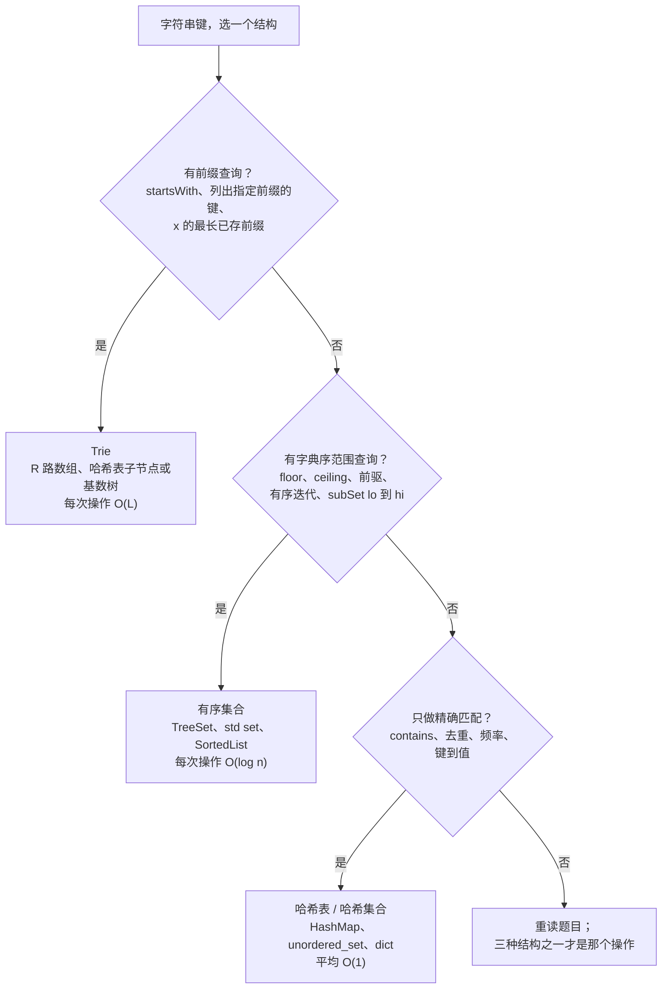

# Trie vs 哈希表 vs 有序集合：前缀查询的决策

候选人看到 LC 208（Implement Trie），读完“存单词，然后回答 `startsWith(prefix)`”，顺手就抓了在其他每道面试题里承包字符串键的那个结构：`HashSet<String>`。插入：`set.add(word)`。查找：`set.contains(word)`。`startsWith(prefix)`：遍历集合，对每个元素跑 `s.startswith(prefix)`，命中任意一个就返回 true。提交能过题面上的小样例，然后在判题机上 TLE——每次 `startsWith` 是 `O(n · L)`，要扛 `3 × 10⁴` 次调用。

问题不在换个更快的哈希函数。哈希函数本身就是问题。哈希在插入那一刻就把输入的前缀结构毁掉了：`hash("car")`、`hash("card")`、`hash("carbon")` 落在互不相干的桶里，想从一个哈希值倒推回共享前缀的那些键，除了把所有键重扫一遍没有别的办法。面试级 DSA 里存字符串键有三个竞争者：哈希表、有序集合、Trie。每个都在特定的操作画像上取胜；选错就把线性算法变成平方级。

## 如何决策

> **问题：** 键是字符串的时候，我该抓哪个结构？
>
> **答案：** 工作负载包含前缀查询就用 Trie。包含字典序范围或 floor/ceiling 查询就用有序集合。其余情况一律哈希表。

## 流程图

*三个是非问句，三个终局选择。Q1 是主导过滤器——一旦键的前缀结构开始有意义，就只有 Trie 的逐字符分叉能把它暴露出来。*

## 算法对比

三个选项，三个 H3。每个都点明触发它的输入形态、它换来的操作，以及实现所在的章节。

### 哈希表（默认选择）

**何时选择。** 操作可以归结为“这个键我见过没有，见过的话当时关联了什么值？”，既没有顺序语义也没有前缀语义。给一个单词列表去重。统计词频。按字母排序后的签名给变位词分组。用逐字符计数判断两个字符串是否互为变位词。1.3 章的哈希表工作负载正是这个：`seen[key] = value; query seen[key]`。[^1]

**时间与空间。** `insert`、`contains`、`delete` 平均 `O(L)`，其中 `L` 是键的长度，开销主要是对键的每个字符做哈希。总内存 `O(N · L_avg)`，外加桶数组上 25-33% 的装载因子余量。CLRS §11.1 给出了这个约定：INSERT、SEARCH、DELETE 这三种字典操作足以支撑编译器的符号表，哈希表是它的标准实现。[^2] OpenJDK 8+ 的 `HashMap` 多了一步树化：某个桶内的链超过八项就转成红黑树，即便面对对抗性碰撞构造的输入，最坏情况下单桶查找也被压到 `O(log L)`。[^3]

**在哪一章。** 四种语言的惯用写法（`HashSet<String>`、`unordered_set<std::string>`、`set` 与 `dict`、`map[string]struct{}`）在 [哈希表与哈希集合](../part-1-linear-data-structures/03-hash-maps.md)。姊妹篇 [哈希表 vs 有序映射](./P-03-hash-map-vs-sorted-map.md) 为整数键校准同一个决策，那里 Trie 根本不进入讨论。

**信号。** 题面里不出现“prefix”、“starts with”、“in lexicographic order”、“floor”、“ceiling”、“range” 中的任何一个。操作就是 `seen[key]` 或 `count[key] += 1`。LC 1（Two Sum，键被转成字符串时）、LC 49（Group Anagrams）、LC 242（Valid Anagram）都落在这里。

### 有序集合

**何时选择。** 工作负载包含字典序范围查询（`subSet("apple", "banana")`）、floor/ceiling 探测（“已存字符串里 `≤ x` 的最大者”），或对键集合做有序迭代，并且工作负载**不**包含 Trie 能答得更好的前缀查询。

**时间与空间。** 每次点操作 `O(L log N)`：`log N` 次比较，每次比较花 `O(L)`，因为字符串比较最坏要读到全长。返回 `k` 个键的范围查询是 `O(L log N + k)`。Java 的 `TreeSet<String>` 文档写明“基本操作（add、remove 和 contains）有保证的 log(n) 时间开销”；[^4] C++ 的 `std::set<std::string>` 写明“查找、删除和插入操作具有对数复杂度，集合通常实现为红黑树”。[^5] 内存是键的 `O(N · L_avg)` 加上红黑树每节点三个指针。

**在哪一章。** `TreeSet` 与 `std::set` 背后的红黑树机制在 [二叉搜索树](../part-6-trees-heaps/05-binary-search-trees.md)。与堆、有序数组的跨模式决策在 [堆 vs 有序数组 vs 平衡 BST](./P-06-heap-vs-sorted-array-vs-bst.md)。

**信号。** “`cat` 的前驱”、“`[apple, banana]` 区间内的单词”、“按有序顺序迭代”、“严格大于 `x` 的最小已存键”。上面任何一条，哈希集合都得花 `O(N)`。Trie 也能做同样的事，但在 R 路数组形态下最坏要付 `O(R · M)` 内存。各语言的怪癖在这里很要紧：Java 和 C++ 的标准库直接自带这个结构，Python 要 `from sortedcontainers import SortedList`，[^6] Go 干脆没有内置的有序集合（在维护好的 `[]string` 上用 `sort.SearchStrings`，或者引入 `google/btree`）。

### Trie

**何时选择。** 前缀查询是一等公民。操作是 `startsWith(prefix)`、`findWordsWithPrefix(prefix)`、`longestStoredPrefixOf(query)`，或者任何以“前缀”而不是完整键为参数的查询。又或者 Trie 是别的算法的底座——Aho-Corasick 的后缀链接、LC 212 棋盘 DFS 的剪枝判据——那里“当前路径是不是某个已存单词的前缀”必须做到每字符 `O(1)` 回答。

**时间与空间。** `insert`、`search`、`startsWith` 每次 `O(L)`，取决于操作输入串的长度，与 `N` 无关。路径长度等于输入长度；每字符代价在 R 路数组形态下是一次 `O(1)` 索引读取，在哈希表子节点形态下是 `O(1)` 平均。内存是代价所在：R 路数组形态最坏 `Θ(R · M)`（每节点 R 个指针，M = 已存字符总数），哈希表子节点形态为 `Θ(M)`，小写英文 `R = 26`，完整 Unicode 则 `R = 1,114,112`。[^7] 甜区是字母表小而固定、前缀共享多的场景；稀疏键的生产级退路是基数树（Morrison 的 PATRICIA，1968），它把单子节点链压成多字符边。[^7]

**在哪一章。** R 路数组实现、LC 208 的走法、LC 212 的剪枝判据模式都在 [Trie](../part-6-trees-heaps/08-tries.md)。把自动补全当设计题来做，在 [带频率的 Trie 自动补全](../part-13-design-the-data-structure/04-trie-autocomplete.md) 里继续展开。

**信号。** 方法签名里有“prefix”这个词。或者 `startsWith` 是必需操作。或者算法每一步都要问“当前状态是不是某个已存单词的前缀”（LC 212 的网格 DFS、Aho-Corasick 的文本扫描）。上面任何一条，哈希集合都不可能答得比 `O(N · L)` 更好。Sedgewick 与 Wayne 的说法最干净：Trie “与哈希一样快，比二叉搜索树更灵活”，而前缀匹配与通配符匹配正是哈希根本无法支持的两种操作。[^8]

## 逐项对比

`L` 是操作输入串的长度。`N` 是已存键的数量。`M` 是所有已存键的字符总数。`R` 是字母表大小。`k` 是前缀查询或范围查询返回的结果数。

| 操作 | 哈希表（平均） | 有序集合 | Trie（R 路数组） |
|---|---|---|---|
| 插入一个键 | `O(L)`[^2] | `O(L log N)`[^4][^5] | `O(L)`[^7] |
| 精确匹配 contains | `O(L)`[^2] | `O(L log N)`[^4] | `O(L)`[^7] |
| 删除一个键 | `O(L)`[^2] | `O(L log N)`[^4] | `O(L)` |
| `startsWith(prefix)` | 不支持（`O(N · L)` 扫描） | 经 `subSet` 做到 `O(L log N)`[^4] | `O(L)`[^7][^8] |
| 列出前缀为 `p` 的所有键（`k` 个匹配） | 不支持（`O(N · L)`） | 走 `subSet`，`O(L log N + k)` | `O(L + k · L_avg)`[^8] |
| `x` 的最长已存前缀 | 不支持（`O(N · L)`） | 反复 `floor` 探测，`O(L · log N)` | `O(L)`[^8] |
| 字典序区间 `[lo, hi]` | 不支持 | `O(L log N + k)`[^4][^5] | `O(L_lo + k · L_avg)` |
| floor / ceiling / lower / higher | 不支持 | `O(L log N)`[^4][^5] | `O(L log N)`（TST 或增强版） |
| 按有序顺序迭代全部 `N` 个键 | `O(N · L_avg + N L log N)`（提取 + 排序） | `O(M)`（中序遍历） | `O(M)`（前序 DFS）[^8] |
| 每个键的内存 | `Θ(L_avg)` + 25-33% 余量 | `Θ(L_avg)` + 每节点 3 个指针 | 最坏 `Θ(R · L_avg)`（R 路）或 `Θ(L_avg)`（哈希子节点）[^7] |
| **何时选择** | 精确匹配、去重、频率 | 范围、floor/ceiling、有序迭代 | 前缀查询、前缀遍历的底座 |

Trie 赢下哈希表根本不支持的三行，并在精确匹配上只差一个常数。有序集合赢下哈希表不支持、Trie 要以更高内存代价才能支持的范围与有序迭代行。没有任何前缀或顺序操作进入范围时，哈希表以常数因子赢下精确匹配。

## 三道招牌题

每个终局选择一道，只给链接。

- [LC 208 — Implement Trie (Prefix Tree)](https://leetcode.com/problems/implement-trie-prefix-tree/) [中等]。“建一棵支持 `insert`、`search`、`startsWith` 的 Trie”这道母题。`startsWith` 的出现就是 Trie 信号；一个存单词的哈希集合，每次查询都不可能答得比 `O(N · L)` 更好，LC 208 的判题在第三个测试用例就把这种写法拒掉。[^9] Trie 每次调用 `O(L)`。
- [LC 211 — Add and Search Words Data Structure](https://leetcode.com/problems/design-add-and-search-words-data-structure/) [中等]。通配前缀查询：搜索串里的 `.` 匹配任意单个字母。走查不再是一条路径；每到 `.` 的位置算法要试遍所有非空子节点，把线性走查变成 Trie 子树上的一次深度优先搜索。LC 的“最多两个点”上限把最坏情况压到每次搜索 `26² = 676` 条路径，这也是这道题可解的结构性原因。[^9]
- [LC 1268 — Search Suggestions System](https://leetcode.com/problems/search-suggestions-system/) [中等]。自动补全题，也是有序数组二分能正当地跟 Trie 竞争的那种少见情形。每敲一个字符，返回共享该前缀的、字典序最小的至多三个产品。Trie 解法在每个节点缓存一份 top-3 有序列表，每次查询 `O(L)`。有序数组方案——把 `products` 排一次序，然后 `bisect_left(products, p)` 往前走至多三项、边走边比对前缀——每次查询 `O(L log N)`，时间压力下代码更短。两种都能过判题；答案数量有界（三条）正是让二分方案保持竞争力的原因。[^10]

## 常见误解

**Trie 做字符串查找总是更快。** 不是。精确匹配的 `contains` 查询，哈希和 Trie 都是 `O(L)`——哈希函数在去桶的路上要读键的每个字符，Trie 沿路径下行也要读每个字符。单次孤立查找，哈希表在常数因子上赢（一次索引读取进桶数组，对比沿 Trie 下行 L 次索引读取）。Trie 真正回本的地方是**前缀工作被复用**：每次按键都重新查询的自动补全 UI，或者 LC 212 的网格 DFS——Trie 指针随棋盘每步前进一条边，碰到任何空子节点就一次性剪掉整棵子树里的所有单词。如果工作负载就是对互不相关的键做点查，哈希表更快，**而且**更省内存。[^11]

**Trie 节点永远都是 26 指针数组。** 每节点一个 26 指针数组是 LC 208 的默认写法，也是小写英文的正确选择，但它在还没算 `is_end`、子节点本身、以及任何值载荷之前，就已经是每节点 `26 × 8 = 208` 字节的内存地板。10 万个节点的 Trie，光 children 数组就是 20 MB，而且大部分是 null。Unicode 键下数组形态彻底崩掉（R = 1,114,112 个码点）。两个替代方案：一是哈希表子节点（Java 的 `HashMap<Character, Node>`、C++ 的 `unordered_map<char, unique_ptr<Node>>`、Python 的子节点 `dict`），每次下行平均 `O(L)`，每节点内存 `O(d_v)`，`d_v` 是实际子节点数；二是基数树，把单子节点链压成多字符的边标签。[^7] CP-Algorithms 把这份权衡讲得很直白：“每个顶点存 k 条链接，就要用 O(mk) 内存。把每个顶点里的数组换成 map，可以把内存降到 O(m)；但这样一来时间复杂度会升到 O(m log k)”。[^11]

**Trie 支持任意范围查询。** 不支持。Trie 支持的是**前缀**查询——给一个前缀，返回共享它的全部内容——而前缀查询只是字典序范围的一个特例（范围 `[prefix, prefix++]`）。像 `subSet("apple", "lemon")` 这样的任意字典序范围是有序集合的地盘：Trie 也能答，两次边界走查加中间一趟中序 DFS，但内存代价更高，代码也比一行 `treeSet.subSet("apple", "lemon")` 多得多。题目说的是“`apple` 到 `lemon` 之间的所有单词”、两个边界本身没有前缀结构时，有序集合是干净的选择。

**自动补全必须用 Trie。** 正统答案是 Trie，在结果数真正无界时（“列出所有以 `re` 开头的单词”）Trie 赢得干脆，因为它不做逐串的 `startswith` 检查。但答案数量少且有界时——LC 1268 的“最多三条建议”——有序数组加二分是同一量级的替代方案，在面试时间压力下明显更短。[^10] 模式识别信号：答案数量有界加上一次性构建，容许二分路线；答案数量无界或需要反复重建，就摆回 Trie。

**`TreeSet` 的字典序和 Trie 的前缀序是一回事。** 几乎，但不完全。`TreeSet<String>` 按完整字典序比较排序，`subSet(prefix, prefixIncremented)` 这个技巧对 ASCII 单字节字母表有效——前提是把最后一个字符正确地递增：`"caz"` 变成 `"cb"`（进位），`"caZ"` 变成 `"ca["`（下一个 ASCII 码点），而 Unicode 感知的前缀还需要处理代理对。cppreference 上 `lower_bound` 与 `upper_bound` 的文档给了边界语义；Java 的 `NavigableSet.subSet` API 没有前缀感知的变体。[^4][^5] 做前缀查询，优先用 Trie。`subSet` 加递增上界的写法能用，但脆，遇到边界字符很容易微妙地搞错。

## 参考文献

[^1]: Cormen, Leiserson, Rivest, Stein, *Introduction to Algorithms*, 4th ed., MIT Press, 2022, Ch. 11.

[^2]: Cormen, Leiserson, Rivest, Stein, *Introduction to Algorithms*, 4th ed., MIT Press, 2022, Ch. 11.

[^3]: OpenJDK, `java.util.HashMap` source. https://github.com/openjdk/jdk/blob/master/src/java.base/share/classes/java/util/HashMap.java

[^4]: Oracle, "Class `TreeSet<E>`," Java SE 21 API. https://docs.oracle.com/en/java/javase/21/docs/api/java.base/java/util/TreeSet.html

[^5]: cppreference, "std::set." https://en.cppreference.com/w/cpp/container/set

[^6]: Jenks, "sortedcontainers — SortedList." https://grantjenks.com/docs/sortedcontainers/sortedlist.html

[^7]: Wikipedia, "Trie." https://en.wikipedia.org/wiki/Trie. Morrison, "PATRICIA," *JACM* 15(4) (1968). https://doi.org/10.1145/321479.321481

[^8]: Sedgewick and Wayne, *Algorithms*, 4th ed., §5.2. https://algs4.cs.princeton.edu/52trie/

[^9]: Fredkin, "Trie memory," *CACM* 3(9) (1960): 490–499. https://doi.org/10.1145/367390.367400

[^10]: doocs/leetcode, "LC 1268 Search Suggestions System." https://leetcode.ca/2019-05-21-1268-Search-Suggestions-System/. walkccc, "LeetCode 1268." https://walkccc.me/LeetCode/problems/1268/

[^11]: CP-Algorithms, "Aho-Corasick algorithm." https://cp-algorithms.com/string/aho_corasick.html
