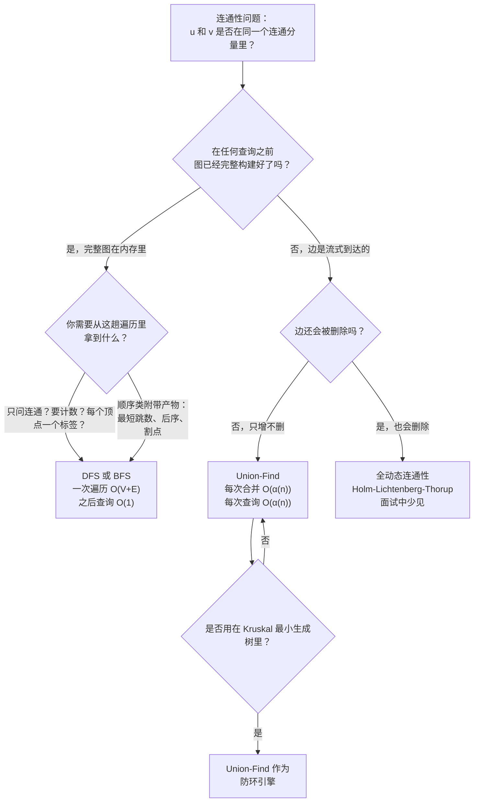

# 连通性问题：Union-Find 还是 DFS

## 如何决策

问题是这样：*图上的一个连通性问题摆在你面前，你是伸手去拿 Union-Find，还是 DFS？* 一句话：**边是在线到达、查询与合并交织在一起时用 Union-Find；图一次性完整交给你、一趟遍历就能回答你此后所有问题时用 DFS。** 决定因素不是哪个结构更快，而是负载模型。在各自拿到的数据上，两者的运行时间实际上都是线性的；差别在于“数据”指什么。

LC 200 *Number of Islands* 与 LC 305 *Number of Islands II* 相隔五百个题号，却正好是这个决策的两行写法。前者交给你一张已经画完的网格。相比之下，LC 305 给你的是一个个陆续到达的 `addLand(r, c)` 调用，每来一个都要求返回当前的连通分量数。LC 200 在 Medium 档，LC 305 在 Hard 档，而难度抬升的全部原因就是：每次更新都重跑一遍 DFS 会超时，而 Union-Find 每次操作只要 `O(α(n))`。

## 流程图

*真正要紧的是两个问题：先看负载模型，再看输出类型。边是流式到达且不删除，落在 Union-Find 上；其余情况都落在 DFS 或 BFS 上。*

## 算法对比

两个算法回答的是同一个表面问题。它们各自在不同的输入上才有价值。

### Union-Find：在线合并，只问归属

当边一条一条到达、每个查询都只问归属时，选 Union-Find：*在到目前为止发生的那些合并之后，u 和 v 是否在同一个连通分量里？* 这个数据结构就是一个父指针森林加一个 rank 或 size 数组；`find(x)` 一路走到根，`union(x, y)` 把一个根改指向另一个根。在 `find` 上做路径压缩、在 `union` 上做按秩合并，每次操作摊还 `O(α(n))`；这是 Tarjan 1975 年的结果，其中 `α` 是反阿克曼函数，对任何装得进物理内存的 `n` 都有 `α(n) ≤ 4`。[^1] 这个界是渐近紧的：Tarjan 1979 与 Fredman-Saks 1989 证明了与之匹配的 `Ω(α(n))` 下界。[^2]

把一道题归到这一类的信号，是“每次操作之后”或“随着边到达”这类措辞。Sedgewick 的 *Algorithms* 把 Union-Find 引作“动态连通性问题”：一对对数据陆续读入，每读到新的一对，都要针对此前读到的全部内容做一次同分量判定。[^3] 同样输入上，每次更新重跑 DFS 是 `k` 次操作共 `O(k(V + E))`，这正是 LC 305 在 Hard 档筛掉的做法。

时间每次操作 `O(α(n))`，实际上是常数。空间 `O(n)`，用于 parent 与 rank 数组。没有路径信息，没有遍历顺序，也没有边方向这个概念。[Union-Find 章节](../part-8-graphs/08-union-find.md)里有四种语言的参考实现与证明。

### DFS：离线图，附带信息全都拿得到

当图完整地交到你手里（顶点和边都已建好），而你要的要么是一个“有多少个连通分量”的一次性答案，要么是更丰富的附带产物时，选 DFS。CLRS 定理 20.7 确立 DFS 在邻接表输入上的总量为 `O(V + E)`。[^4] 一趟遍历把每个顶点和每条边都恰好访问一次，给每个顶点打上连通分量 id，之后的归属查询就退化成 `O(1)` 的数组读取。代价付在前面，此后的查询免费。

把一道题归到这一类的信号是“给定一个图 G，返回 X”。图在这里是个名词。LC 200 *Number of Islands*、LC 547 *Number of Provinces*、LC 695 *Max Area of Island*，以及所有静态网格上的 flood fill，都是拿到一个成品输入、要一个单趟答案。DFS 在给出这个答案的同时，还能顺带积累递归攒得下的一切：每个分量的面积、周长、最大元素、深度、后序时间戳、把边分成树边—回边—前向边—横叉边、割点、强连通分量。[^4] Union-Find 这些一个都产不出来。如果题目里提到“最短路径”“有向环”“拓扑序”或“割点”，Union-Find 从构造上就是错的工具；DFS 产出的发现时间与结束时间才是承重状态。

时间 `O(V + E)`。空间 `O(V)`，用于 visited 数组加递归栈——在 Python 里对一张 `10⁶` 个点的链状图，这会撞穿默认 1000 帧的限制，需要显式 `sys.setrecursionlimit` 或改写成迭代。[连通分量与 flood fill](../part-8-graphs/03-connected-components.md) 章节里有四种语言的参考实现。

### 从每个根出发的 BFS：很少是正确答案

为求完整：面经里还会出现第三种做法——候选人从每个分量里的某一个顶点出发跑 BFS 来数分量个数。这只是换了件衣服的 DFS：总量同样是 `O(V + E)`，同样要求离线图，只是顺带产出 BFS 天然会给出的层号。[^4] 当问题要的是无权最短距离时（LC 994、LC 1091、LC 127），BFS 才是对的；而当问题只是“有多少个连通分量”时，用 BFS 就是把同一件事写得更长。只有当你需要的附带产物按层编号时，才伸手拿它；否则递归 DFS 更短，算法层面的选择就只剩 DFS 与 Union-Find 之间的事。

## 逐项对比

| 维度 | Union-Find（DSU） | DFS / BFS |
|---|---|---|
| 负载模型 | 在线；边一条一条到达[^3] | 离线；完整图在内存里[^4] |
| 每次合并或查询的时间 | 摊还 `O(α(n))`；实际等于 `O(1)`[^1] | 每次遍历 `O(V + E)`；一更新就要整体重跑[^4] |
| 静态图的预处理 | 载入全部边 `O((V + E) α(V))`，之后每次查询 `O(α(n))` | 给每个顶点打标签 `O(V + E)`，之后每次查询 `O(1)` |
| 空间 | `O(n)` 的 parent 与 rank 数组[^3] | `O(V)` 的 visited 数组加最多 `O(V)` 的递归栈[^4] |
| 支持增量加边 | 支持，原生 | 不支持；要重建再重跑 |
| 支持删边 | **不支持**；结构只能增量[^5] | 支持；重建再重跑 |
| 顺序类附带产物 | 无 | 发现／结束时间、后序、层号、边分类[^4] |
| 检测无向环 | 能；`union(u, v)` 遇到同根返回 false | 能；遍历中的回边 |
| 检测有向环 | 不能；没有边方向 | 能；灰点三色 DFS |
| 无权最短路径 | 不能 | 能（BFS 变体） |
| 拓扑序 | 不能 | 能（DFS 后序反转，或 Kahn 算法） |
| 最适用的题干措辞 | “每次 addLand 之后”“这些合并之后 X 和 Y 连通吗”“冗余边”“等式约束”[^3] | “给定图，数连通分量”“给每个格子打标签”“找割点”[^4] |

与决策真正相关的行是前两行和最后两行。中间那些行说明的是：为什么两个算法各自的结构会让负载模型那一行为真。

## 三道招牌题

[LC 547 — Number of Provinces](https://leetcode.com/problems/number-of-provinces/) **[中等]**，*离线图的招牌*。输入是一个 `n × n` 邻接矩阵；返回连通分量数。图是完全构建好的。DFS 和 Union-Find 都能在同样的 `O(n²)` 渐近复杂度内给出答案。DFS 扫描矩阵，对未访问的行递归；Union-Find 遍历上三角，把两个端点 union 起来。DFS 版本更短（一个外层循环、一个递归辅助函数、一个 visited 数组），不涉及摊还分析，也不产出题目用不到的东西。两者都能过；DFS 解法在每个镜像站上都是得票更高的参考解，这不是没原因的。在这里用 Union-Find 是对的，但属于过度设计：都是 `O(n²)`，二十行 DSU 模板对八行递归。

[LC 261 — Graph Valid Tree](https://leetcode.com/problems/graph-valid-tree/) **[中等，会员题]**，*两者都行的招牌*。输入是 `n` 个顶点和一张无向边表；返回这些边是否构成一棵树（连通且无环）。两个算法都能干净地解决。DFS 从顶点 0 出发做一次遍历，记一个 parent 以忽略回到来路的回边，最后检查每个顶点都被访问过、且没有出现别的回边。Union-Find 是同一个形状：走边，第一次遇到 `union(u, v)` 报告两端已同根就返回 false，结束时若恰好成功 union 了 `n - 1` 次就返回 true。两者都跑在 `O(V + E)`。这里的取舍落到面试压力下哪个心智模型更快抓得起来；DSU 的写法通常更短，因为环检测和连通性检测合并进了一个循环。免费的同类题是 [LC 1971 — Find if Path Exists in Graph](https://leetcode.com/problems/find-if-path-exists-in-graph/) **[简单]**，同样的决策，赌注更小。

[LC 1319 — Number of Operations to Make Network Connected](https://leetcode.com/problems/number-of-operations-to-make-network-connected/) **[中等]**，*Union-Find 顺理成章的招牌*。输入是 `n` 台电脑和一张现有网线表；返回把每台电脑都连起来所需的最少移线次数，线不够则返回 `-1`。DSU 的写法和题面一一对应：数冗余边（一次返回 false 的 `union` 就是一根可以挪用的线），数连通分量，只要冗余线够多就返回 `components - 1`。十二行写完。DFS 也行：flood fill 数分量，再单独检查线数。但那个算法读起来是两个阶段靠一个算术检查缝在一起，而 DSU 版本是在边上走一趟。当题目用“连通分量与冗余边”这套语言说话时，说同一套语言的数据结构就是 Union-Find。

## 常见误解

关于连通性工具选型的四种误读反复出现，值得在面试计时开始之前就排掉。

**“Union-Find 支持删边。”** 错，而且这是题目一提到删边就会让人答错的误读。这个结构是增量的：它知道怎么合并两棵树，不知道怎么就一棵树拆开。没有 `un_union` 这个操作，加上它也不是几行代码的事。这个一般化的问题是*全动态连通性*——边既加又删；标准答案是 Holm、Lichtenberg、Thorup 2001 年那个多对数结构，每次更新摊还 `O(log² n)`、每次查询 `O(log n / log log n)`。[^5] 实现有几百行，绝不会出现在面试窗口里。如果某道题真的要删边，而约束又排除了每删一次就整体重建，诚实的回答是：*“我会用 Holm-Lichtenberg-Thorup 结构或者 link-cut tree，但实现量超出四十五分钟。”*

**“DFS 求连通性是 `O(1)`。”** 每次更新之后就不是了。只有当图已经定稿、连通分量 id 数组已经建好时，DFS 才给你 `O(1)` 的归属查询。一旦加进一条边，标签就过期了；想刷新它们，唯一的办法是再扫一遍 `O(V + E)`。在 `k` 次更新、其间交织 `q` 次查询的情况下，总工作量是 `O(k(V + E) + q)`，对 LC 305 的上界输入（`k = 10⁴`、`m = n = 10³`）就是 `10¹⁰` 次操作，直接超时。Union-Find 是 `O((k + q) · α(n))`，小六个数量级。这个误读把“整趟扫描之后归属查询是 `O(1)`”和“归属查询永远是 `O(1)`”混为一谈。

**“Union-Find 的复杂度正好是 `O(log n)`。”** 不精确，而且在面试官要你为这个界辩护时，这种不精确会咬人。只用路径压缩，每次操作的摊还界是 `O(log n)`。只用按秩合并，也是 `O(log n)`。两个启发式*一起*用，摊还界才降到 `O(α(n))`，即反阿克曼函数，而对任何你写得出来的 `n` 都有 `α(n) ≤ 4`（Tarjan 1975）。[^1] 这是算法领域最早的非平凡摊还复杂度结果之一，比摊还分析本身的形式化还早十年。它也是渐近紧的：Tarjan 1979 在指针机模型上给出了匹配的 `Ω(α(n))` 下界。[^2] 如果面试官追问“这是常数时间吗”，正确答案是：*“摊还反阿克曼，对任何真实存在的输入最多是四，所以实际算常数，但可证明地并不精确等于常数。”*

**“DFS 递归总是安全的。”** 在约束范围的上端不是。Python 默认递归上限是 1000 帧；在一张 `10⁵` 个顶点的链状图上，递归会在算法跑完之前就爆栈。C++ 默认大约 8 MB 栈，装得下几十万帧；Java 差不多；Go 的栈会动态增长，最宽容。Python 的修法是在模块作用域里设一次 `sys.setrecursionlimit(10**6)`，不是每个函数设一遍。任何语言里的修法都是换成带显式栈的迭代 DFS。这和遍历侧的 [BFS vs DFS for graphs](./P-07-bfs-vs-dfs-graphs.md) 是同一个注意点：当输入大到递归深度成为约束时，BFS 或迭代 DFS 就绕开了这个问题。Union-Find 这边有它自己版本的同一个坑——在一条没压缩的长链上做递归 `find`，栈深剖面一模一样；标准修法是带路径减半的迭代 `find`。

## 参考文献

[^1]: Tarjan, "Efficiency of a Good But Not Linear Set Union Algorithm," *JACM* 22(2) (1975): 215–225. https://doi.org/10.1145/321879.321884

[^2]: Wikipedia, "Disjoint-set data structure." https://en.wikipedia.org/wiki/Disjoint-set_data_structure

[^3]: Sedgewick and Wayne, *Algorithms*, 4th ed., §1.5. https://algs4.cs.princeton.edu/15uf/

[^4]: Cormen, Leiserson, Rivest, Stein, *Introduction to Algorithms*, 4th ed., MIT Press, 2022, Ch. 20.

[^5]: Holm, Lichtenberg, Thorup, "Poly-Logarithmic Deterministic Fully-Dynamic Algorithms for Connectivity, MST, 2-Edge, and Biconnectivity," *JACM* 48(4) (2001): 723–760. https://doi.org/10.1145/502090.502095
