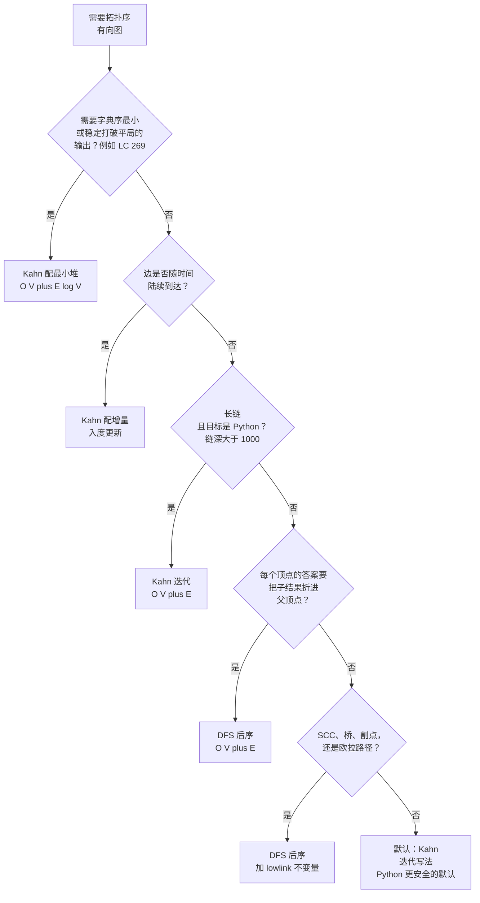

# 拓扑排序：Kahn 与基于 DFS 的版本

## 如何决策

问题是这样：*给你一个有向图，需要按依赖顺序排出顶点，你会伸手去拿哪个算法？* 一句话回答：**需要靠计数器做环检测、需要字典序最小的输出、需要迭代循环、或者边会在线更新时，用 Kahn；需要把后序当作把后代结果折进祖先的天然时机时，用 DFS。** 两者都是 `O(V + E)`。要选的不是谁更快，而是除了排序之外你还要对这个图做什么。

## 流程图

*多数决策在前三行或 D 行就终止了。那些问“我是不是还需要 ___”的行，只有当那个“别的什么”确实要求后序语义时才导向 DFS。*

## 算法对比

两个算法都能在任意有向无环图上用线性时间算出一个拓扑序，也都能顺手检测环。两者都是六十年前就写进教科书的材料：Arthur Kahn 于 1962 年在 *Communications of the ACM* 上发表了入度驱动的版本，[^1] 基于 DFS 的版本最早由 Robert Tarjan 在 1976 年正式见刊。[^2] 维基百科的拓扑排序条目用现代伪代码复现了这两种写法，并指出 CLRS 把 DFS 当作第 22 章（第四版改为第 20 章）的主算法，Kahn 只被降级成一道习题。[^3] 渐近复杂度相同正是陷阱所在。其余每一个维度上两者都分岔，决策就落在那些地方。

### Kahn：入度消除、迭代、队列驱动

当你要一个迭代循环、当题目对输出规定了特定的平局打破规则、当边是随时间陆续到达的、或者当“这是不是 DAG？”本身就是答案的承重部分时，选 Kahn。Kahn 给每个顶点维护一个入度计数器。种子是所有入度为 0 的顶点；循环弹出一个、输出它、把每个后继的计数器减一，任何计数器刚好归零的后继入队。环的判定是循环结束后 `emitted == V`。剩下的那部分就是环的可达闭包。[^4]

容器选择才是 Kahn 赢得口碑的地方。把 FIFO 队列换成以顶点 id 为键的最小堆，Kahn 就能在 `O((V + E) log V)` 内给出字典序最小的合法拓扑序；换成最大堆就得到字典序最大。DFS 后序列表没有对应能力：后序由递归的完成时间决定，而不是顶点 id，把它反转也得不到字典序最小的输出。Kahn 的最小堆变体是 Coffman-Graham 并行调度算法和分层图绘制的内核，[^3] 也是每一份可信题解里 LC 269（Alien Dictionary）默认选 Kahn 的全部理由。

FIFO 队列下时间 `O(V + E)`，用堆则 `O((V + E) log V)`。空间 `O(V)` 的入度数组外加 `O(V)` 的队列。递归深度：零。完全迭代的循环是 LC 输入规模下 Python 的默认选择，因为 Python 的递归上限是 1000 帧，而 LC 207 的 `numCourses ≤ 2000` 允许出现长度 2000 的最坏链。[Kahn 算法](../part-8-graphs/04-topological-sort-kahn.md) 带着四语言参考实现和那个标准的六顶点实例推演。

正确性证明从一句观察就掉出来了：每一步，如果剩余子图里还有入度为 0 的顶点，那么原图在剩余顶点的闭包上就是无环的。等价地说，环上每个顶点都至少有一个前置顶点也待在这个环上，所以它们谁都不可能把入度降到 0。Kahn 的循环是这条性质的构造式写法：能输出就输出，输出不出来的，正是被环卡住的那批。

### 基于 DFS：后序、递归、完成时间驱动

当每个顶点的答案依赖从后代聚合来的结果时，选 DFS。后序那个时刻——DFS 沿着调用栈回退、离开某个顶点的那一瞬间——恰好就是“所有后代都已解决”的时间点。父帧可以在每条出边的常数时间内把子结果折进自己的状态。DAG 动态规划、DAG 上的最长路径、子树大小、祖先累加、可达概率传播，全都用这个模式。Kahn 是在前驱完成时输出顶点，而不是在后代完成时；对后代聚合来说方向反了，硬要补就得把图反转，而那在结构上等同于在原图上跑 DFS。

当真正需要的算法属于 SCC 家族时，选 DFS。Tarjan 强连通分量、Kosaraju 两遍 SCC、Tarjan 桥、Tarjan 割点、Hierholzer 欧拉路径，全都是搭在同一套递归骨架上的 DFS 后序计算。[^2] 它们各自都依赖括号定理（CLRS 第 4 版定理 20.7 / 20.9，由第二版定理 22.7 重述）：对任意树边或前向边 `(u, v)`，发现区间与完成区间正确嵌套。[^3] Kahn 不产生完成时间。不先单独跑一遍 DFS，就没法把 SCC 家族的任何算法改写成 Kahn 形式。

机制是三色。WHITE 表示未见过，GRAY 表示在当前递归栈上，BLACK 表示已完成。DFS 进入时置 `color[u] = GRAY`；对每个子节点，若子节点是 GRAY，说明刚找到一条回边、图有环，若是 WHITE 就递归，若是 BLACK 就跳过。DFS 退出时置 `color[u] = BLACK`，并把 `u` 前插到结果列表。最终列表就是一个合法拓扑序。环的证据就是那条回边本身，DFS 一碰到 GRAY 顶点就抓到了。[^5]

时间 `O(V + E)`。空间 `O(V)` 的颜色数组外加 `O(D)` 的递归栈，其中 `D` 是最长路径。Python 默认的递归上限让这在深度大于 `1000` 的链上成为隐患；[DSH-04 惯用法](../part-8-graphs/05-topological-sort-dfs.md) 在模块顶部用 `sys.setrecursionlimit(10000)` 把上限抬高。Java、C++、Go 的默认栈能扛住 `10⁴` 到 `10⁵` 帧，所以抬上限是 Python 独有的问题。[DFS 后序](../part-8-graphs/05-topological-sort-dfs.md) 带着四语言参考实现，以及与 Kahn 那一章完全相同的六顶点实例推演，两个算法因此能在同一份输入上对比。

## 逐项对比

| 维度 | Kahn | DFS 后序 |
|---|---|---|
| 时间，FIFO / 标准 | `O(V + E)` | `O(V + E)` |
| 时间，字典序最小输出 | `O((V + E) log V)`，配最小堆 | 不直接支持 |
| 空间（辅助） | `O(V)` 入度数组 + `O(V)` 队列 | `O(V)` 颜色数组 + `O(D)` 递归栈 |
| 递归深度 | 零 | `O(D)`；Python 超过 1000 有 `RecursionError` 风险 |
| 环检测 | 循环结束后输出计数 `< V` | 从 GRAY 后继发现回边，循环中途即抓到 |
| 输出顺序可控性 | 有；FIFO、LIFO、最小堆、最大堆、随机化都行 | 无；绑定在递归下降路径和子节点遍历顺序上 |
| 非连通 DAG | 把所有入度为 0 的顶点放进队列做种子；一趟就够 | 外层循环遍历每个 WHITE 顶点；每个连通块产出自己的 DFS 树 |
| 自环 | 环上的入度永不递减；顶点永不入队；靠输出计数发现 | DFS 在同一顶点上看到 GRAY 后继；回边 |
| 心智模型 | 一层一层剥掉已就绪的任务 | 能走多深走多深；回来时再输出 |
| 在 DAG-DP / SCC / 桥 / 欧拉路径上的适配度 | 差；没有后代聚合的时刻 | 极好；后序正是聚合时刻 |
| 在字典序 / 在线 / Python 深链上的适配度 | 极好 | 差 |
| 并行化 | 按层天然并行 | 难；递归把下降过程串行化了 |

两者在标准界上的渐近等价，正是单看复杂度无法做出选择的原因。表里其余每一行抓的都是常数因子或正确性模式上的差别，它们会针对某个具体信号把其中一个算法推上去。

## 三道招牌题

[LC 207 — Course Schedule](https://leetcode.com/problems/course-schedule/) **[中等]**，*DAG 校验的招牌题。* 给定 `numCourses` 和前置课列表 `prerequisites[i] = [a, b]`，含义是*要修 `a` 得先修完 `b`*，返回能否修完全部课程。图是 DAG 当且仅当答案为 `true`。两个算法都能写出地道解法。Kahn 返回 `emitted == numCourses`；DFS 一撞到回边就返回 `false`。面试里的区分点在规模上的健壮性：约束 `numCourses ≤ 2000` 允许出现长度 2000 的最坏链，一份没写 `sys.setrecursionlimit(10000)` 的 Python 递归 DFS 会挂在隐藏用例上。Kahn 完全绕开了这个问题。多数候选人因此先交 Kahn，再在追问时主动给出 DFS 版本。两种都被接受；只是其中一种才是 Python 的安全默认值。

[LC 210 — Course Schedule II](https://leetcode.com/problems/course-schedule-ii/) **[中等]**，*输出顺序的招牌题。* 输入与 LC 207 相同，但函数要返回一个合法的拓扑序，输入带环时返回空列表。Kahn 的解法就是在 LC 207 上改一行：每次 `popleft()` 时把 `u` 追加到结果列表，最后判断长度是否等于 `numCourses` 再返回。DFS 的解法是在后序转入 BLACK 的那一刻把顶点前插到结果里，最后返回整个列表。两者都产出合法顺序。它们在同一个输入上产出*不同*的顺序，而这正是这一对章节里最有教学价值的观察：在第 8.4 与 8.5 章共用的六顶点实例上，Kahn 输出 `[0, 1, 2, 3, 4, 5]`，DFS 后序反转则输出 `[0, 2, 4, 1, 3, 5]`。两者都对。拓扑序并不唯一，除非这个 DAG 恰好是一条哈密顿路径。[^3]

[LC 269 — Alien Dictionary](https://leetcode.com/problems/alien-dictionary/) **[困难]**，*字典序最小输出的招牌题。* 给定一组按未知字母表字典序排好的单词，返回这些字符上任意一个合法的全序。多数判题要求具体是字典序最小的那个。技巧在建图：两两比较相邻单词，找到它们第一个不同的位置，在那个位置的两个字符之间连一条有向边。然后在一个最多 26 个顶点的图上跑 Kahn，用最小堆替代 FIFO 队列，堆每步弹出的就是入度为 0 的字符里字典序最小的那个。DFS 后序没有对等做法。递归前先把每个顶点的邻接表排序是常见的错误修法：它只给递归下降路径加了偏置，改变不了输出顺序，而输出顺序由后代的完成时间决定。Kahn 配最小堆才是正解，LC 269 的全部面试价值就在于把字典序约束识别成选择 Kahn 的信号。[^6]

## 常见误解

拓扑排序这一族有五种误读出现得足够频繁，能识破它们就已经值回读这一页的时间。第一种关于输出是否唯一。第二种关于 Kahn 到底给不给确定答案。第三种是整个 DSA 图论板块里最高频的面试危险信号。第四种是关于哪个算法检测哪类环的结构性混淆。第五种是会让两个算法同时崩掉的输入形状错误。

**“DFS 后序给出的就是*那个*拓扑序。”** 错。拓扑序不唯一。一个 `n` 个顶点、没有边的 DAG 有 `n!` 个合法拓扑序；哪怕是非平凡的 DAG 通常也容得下好几个。DFS 后序的反转只是*一个*合法顺序，Kahn 的 FIFO 输出是*另一个*；在第 8.4 与 8.5 章共用的六顶点实例上，两个算法在同一份输入上给出了不同的顺序。题目要求*那个*字典序最小的顺序时，那是在拓扑排序契约之上又叠了一条平局打破规则，不是契约本身的属性。标准答案是 Kahn 配最小堆；错误答案是“把邻接表排个序再跑 DFS”，它只给递归下降加了偏置，控制不了输出顺序。

**“Kahn 的输出是不确定的。”** 半对，值得说清楚。合法拓扑序的集合是图的性质，但 Kahn 返回的那个具体顺序完全由容器的弹出策略和种子遍历顺序决定。用 `deque` 配 `for v in range(n)` 播种，Kahn 在完全相同的输入上每次运行都返回完全相同的顺序。候选人担心的“不确定性”其实是一种自由：把 FIFO 换成栈，Kahn 给出偏深度的顺序；换成最小堆，Kahn 给出字典序最小；换成随机化容器，Kahn 就在合法顺序里均匀采样。容器是策略，算法始终是同一个算法。

**“Kahn 就是前置图上的 BFS。”** 不是，而且这是拓扑排序板块里最高频的面试危险信号。BFS 是在第一次从源点前沿到达某个顶点时访问它；Kahn 是在某个顶点的入度降到 0 时把它出队。在图 `0 -> 2`、`1 -> 2` 上，从源点 `0` 出发的 BFS 一跳就访问到 `2`，而且永远访问不到 `1`；Kahn 在播种那一步把 `0` 和 `1` 都入队（两者入度都是 0），等两者都输出之后才轮到 `2`。同一个队列，不同的准入条件，不同的机制。面试官听到“Kahn 就是前置图上的 BFS”，听到的是候选人在背“BFS 能处理图”，而没真懂这个算法。正确的框架是*DAG 上的入度消除*：队列里装的是*就绪*顶点，而就绪的意思是入度为 0，不是“第一次被到达”。[图的 BFS 与 DFS 对比](./P-07-bfs-vs-dfs-graphs.md) 单独梳理了 BFS 与 DFS 的取舍，并在反模式一节里明确把 Kahn 与 BFS 区分开。

**“不做三色标记的 DFS 也能检测环。”** 错，而且这是 LC 207 上比任何其他 bug 都更能捞出错交的原因。两色 `visited / unvisited` 的 DFS 在进入时给顶点打标，之后再也不会重访；一条指向仍在递归栈上的顶点的回边，看起来就像兄弟连通块之间的交叉边或前向边，两色 DFS 会默默跳过。后序列表照样能填满，反转之后看起来像个拓扑序，函数在有环输入上返回成功。能抓住它的隐藏用例是两顶点环 `[[0, 1], [1, 0]]`，两色 DFS 会把它输出成 `[1, 0]` 并报告 `true`。修法是 [拓扑排序：DFS 后序](../part-8-graphs/05-topological-sort-dfs.md) 那一章里的 WHITE / GRAY / BLACK 不变量：DFS 一发现 GRAY 后继就判定为回边。维基百科的伪代码用 “permanent mark”（BLACK）和 “temporary mark”（GRAY）表达同一个不变量。[^3]

**“拓扑排序在无向图上也能用。”** 不能。契约要求有向无环图。一条无向边 `{u, v}` 在结构上等价于两条有向边 `u -> v` 和 `v -> u`，它们构成一个两顶点环，也就是说任何带边的无向图都不存在拓扑序。无向输入确实有变体（LC 310 的剥叶算法迭代剥掉度为 1 的顶点，用来找无向树的质心），但那里的算法是*伪 Kahn*，算出来的是质心，不是拓扑序。选中这个变体的信号是“无向树、找中心”，不是“在无向输入上做拓扑排序”。无向图上连通性与连通块的取舍，见 [并查集与 DFS 求连通性](./P-15-union-find-vs-dfs.md)。拓扑排序只是其中一个分支的那棵更大的最短路与 DAG-DP 决策树，见 [最短路决策树](./P-08-shortest-paths-decision-tree.md)。

## 参考文献

[^1]: Kahn, "Topological sorting of large networks," *CACM* 5(11) (1962): 558–562. https://doi.org/10.1145/368996.369025

[^2]: Tarjan, "Edge-disjoint spanning trees and depth-first search," *Acta Informatica* 6(2) (1976): 171–185. https://doi.org/10.1007/BF00268499

[^3]: Cormen, Leiserson, Rivest, Stein, *Introduction to Algorithms*, 4th ed., MIT Press, 2022, Ch. 20. Wikipedia, "Topological sorting." https://en.wikipedia.org/wiki/Topological_sorting

[^4]: Kahn, "Topological sorting of large networks," *CACM* 5(11) (1962): 558–562. https://doi.org/10.1145/368996.369025

[^5]: Tarjan, "Edge-disjoint spanning trees and depth-first search," *Acta Informatica* 6(2) (1976): 171–185. https://doi.org/10.1007/BF00268499.

[^6]: LeetCode, "269. Alien Dictionary" (Premium). Sean Prashad, leetcode-patterns. https://github.com/seanprashad/leetcode-patterns
