# 贪心 vs DP：贪心何时可被证明正确

没有正确性证明的贪心算法，只是一个恰好能编译通过的猜测。它能过掉 LeetCode 给你看的那一个样例，却在隐藏测试上挂掉，还不给你留下任何诊断线索。之所以值得单独写一页，是因为在贪心和 DP 之间做选择，跟审美无关，也跟口味无关：它是一项证明义务。义务能履行，贪心就更快更短。义务履行不了，那么不管代码看着多干净，你手上都是一个错算法。

## 如何决策

**问题。** 给定一个具备最优子结构的优化问题，你要在每一步锁定一个局部最优选择（贪心），还是枚举所有候选子决策并把它们的结果记忆化（DP）？

**判断方法。** 如果某个局部最优选择会被未来的输入逼进死角，你就需要 DP；逼不进去，贪心可能够用，但必须带证明。实战里 30 秒的测试是**反例搜索**：写下最小的一个输入，让某个看似合理的贪心规则出错。找到了，这题就是 DP。找不到，*而且*你也没法在 60 秒内勾出交换论证或贪心始终领先的证明，那就默认用 DP。Skiena 在 *Algorithm Design Manual* 里把这件事讲成了方向性的：DP 是安全的兜底，因为它的正确性可以从递推式机械地推出，而贪心的正确性必须一个问题一个问题去论证。[^1]

## 流程图

```mermaid
flowchart TD
    A["优化问题<br/>具备最优子结构"] --> B{"现在锁定局部最优选择，<br/>是否会挤掉另一个选择<br/>本来能保留的未来选项？"}
    B -- 是，选择相互影响 --> DP1["DP<br/>对所有子选项做记忆化"]
    B -- 否，可当贪心 --> C{"你能在 60 秒内勾出<br/>交换论证或<br/>贪心始终领先的证明吗？"}
    C -- 能 --> G1["带证明的贪心<br/>O&#40;n log n&#41; 排序 + 扫描"]
    C -- 也许 --> D{"可行集系统是否满足<br/>遗传性 + 交换性质？<br/>即拟阵结构"}
    D -- 是 --> G2["贪心<br/>Edmonds 1971 定理"]
    D -- 否 --> E{"30 秒反例搜索<br/>能否给出一个<br/>具体失败案例？"}
    E -- 是 --> DP2["DP<br/>贪心是错的"]
    E -- 没找到反例，<br/>也没证明 --> DP3["默认用 DP<br/>未经证明的贪心不安全"]
    C -- 没有适用的证明手法 --> DP3
```

*先走 B，再走 C，最后用 D 和 E 做一次合理性检查。根节点上最强的信号是问题 B：选择之间会相互影响吗？如果在第 k 步选 x 会改变第 k+1、k+2 步选其他项的价值，那么局部最优选择就依赖未来，贪心根本没法锁定。*

## 算法对比

三种策略覆盖了整个空间。贪心和 DP 是标题上那一对；生产环境的近似场景（“无证明的贪心启发式”）单独给一个简短的 H3，因为真实系统会刻意这么干，你该知道什么时候这种选择站得住脚。

### 可证明正确性的贪心

每一步只做一个局部最优选择，永不回头。时间通常 `O(n log n)`，主要花在排序上；空间 `O(1)` 到 `O(n)`，不需要记忆化表。相对 DP 省下的开销是结构性的：DP 要填一张 `n` 维表，而贪心每个决策只落一次子，在规模为 `n` 的问题上，这就是 `O(n²)` 或 `O(n·W)` 与 `O(n log n)` 的差别。[^2]

区分一个能用的贪心和一个坏掉的贪心，靠的只有这项证明义务。教科书里有三种手法能履行它：

- **贪心始终领先**（greedy stays ahead，Kleinberg-Tardos §4.1）：对某个“进度”度量做归纳，证明贪心第 `k` 次选择至少和最优解第 `k` 次选择一样好。Jump Game 是标准案例：一趟扫描里跟踪能到达的最远下标，证明贪心的最大可达距离在每个前缀上都胜过任何替代方案。[^3]
- **交换论证**（exchange argument，CLRS 定理 15.1）：把最优解的第一个选择换成贪心最早结束的那个，可行性和最优性都不受损。活动选择是教科书上的证明：把 OPT 的第一个活动换成结束时间最早的活动 `f_1`，换出来的解依然可行，规模也一样。[^4]
- **拟阵结构**（matroid，CLRS §15.4 / Edmonds 1971）：如果可行集系统是一个拟阵（满足遗传性与交换性质），那么每次取权重最大的可行元素的简单贪心就是最优的。反过来，如果贪心在所有权重函数下都最优，这个结构必然是一个拟阵。[^4][^5]

面试里的信号是“我按 `<key>` 排了序，取第一个可行的，交换论证两行就能写完”。这个信号响了就用贪心。元算法见[贪心思维：局部最优何时成立，何时不成立](../part-10-greedy/00-greedy-thinking.md)，排序后扫描这一族见[区间调度与合并](../part-10-greedy/01-interval-scheduling.md)。

### 动态规划

DP 枚举所有候选子决策，并把结果记忆化。两个要素：最优子结构（最优解可分解为子问题的最优解），以及重叠子问题（同一个子问题在不同决策路径上反复出现）。[^6] 时间 `O(状态数 × 每个状态的工作量)`；空间 `O(状态数)`，常常能压到滚动的 `O(n)` 或 `O(1)`。递推式就是算法的规格说明，对子问题的良序做归纳，正确性可以机械地得到。[^6]

**选择相互影响**时就该用 DP：取第 `i` 项带来的边际价值，取决于已经取了哪些其他项。0/1 背包是标准案例。贪心“先拿性价比最高的”在 `items = [(10, 60), (20, 100), (30, 120)]`、`W = 50` 时是错的：贪心取走第 1、2 项，得到价值 160，还剩 20 的容量没用；最优解取第 2、3 项，价值 220。[^4] 用 `dp[i][w] = max(dp[i-1][w], dp[i-1][w - weight[i]] + value[i])` 的 DP 能在 `O(n·W)` 内正确求解。

判断方法：只要一个小的具体反例能打穿贪心规则，就换 DP。递推式有可辨识的形状——“取（取这一项，在更小的子问题上递归）与（跳过，在更小的子问题上递归）之中更好的那个”——一旦你能写出这一行，剩下都是记账。从递归到记忆化的转换见 [DP 心智模型：从递归树到记忆化 DAG](../part-9-dynamic-programming/00-dp-recursion-to-memo.md)。DP 胜出之后，下一个决策是自顶向下还是自底向上，那是 [P-02 记忆化与制表](./P-02-memoization-vs-tabulation.md)。

### 无证明的贪心启发式（生产环境里的近似场景）

真实系统里还有第三种选择：上一个你证明不了最优、但能给出近似比的贪心。集合覆盖的贪心是教科书例子，有 `(1 + ln n)` 的近似保证。生产调度器一直在用这个形状：挑局部最好的服务器、路由或分配，接受自己不是最优，并把比值写进文档。

**这不是面试要的东西。** 面试官说“最少硬币数”，指的是真正的最小值。因为“通常能过”就交一个没证明的贪心，正是这页要拦下的失败模式。生产近似只在三个条件同时成立时才站得住：(a) 问题是 NP-hard；(b) 你手里有论文给出的近似界；(c) 需求明确接受近似答案。三条之外，选择只有带证明的贪心，或者 DP。

## 逐项对比

| 维度 | 贪心（带证明） | DP |
|---|---|---|
| **证明义务** | 必须：交换论证、贪心始终领先，或拟阵定理 | 机械：对递推式做归纳 |
| **时间** | 通常 `O(n log n)`，排序主导[^4] | `O(状态数 × 每个状态的工作量)`，常为 `O(n²)` 或 `O(n·W)`[^6] |
| **空间** | `O(1)` 到 `O(n)`，无记忆化表 | `O(状态数)`，可压到滚动的 `O(n)` 或 `O(1)` |
| **通用性** | 只在证明能履行时可用 | 任何具备最优子结构 + 重叠子问题的递推式 |
| **对抗输入的稳健性** | 脆弱：漏掉一个反例，就静默出错 | 稳健：正确性来自递推式，不来自问题结构 |
| **失败模式** | 静默地次优（LC 322，`[1,3,4]`、6：贪心 3 枚，最优 2 枚）[^7] | 递推式写错，在小输入上就露 |
| **首轮投入** | 证明显然时最低；证明卡住时最高 | 自顶向下低；自底向上中等 |
| **何时选择** | 排序后扫描，交换论证两行写完；拟阵结构 | 选择相互影响；目标无法分解成每步的贡献 |

把这张表压成一句话：贪心每步只做一个决策；DP 是“考虑所有决策，记住最好的那个”。贪心的代价是证明，DP 的代价是状态空间。证明显然时，贪心几乎不花你什么；证明做不到时，不管算法多干净，你手上都是一个错算法。[^4][^3]

## 三道招牌题

**[LC 55 — Jump Game](https://leetcode.com/problems/jump-game/) [中等, 贪心]。** 从左往右扫，跟踪能到达的最远下标。贪心始终领先的证明：处理完位置 `i` 之后，贪心的 `max_reach` 不小于任何其他算法此刻的可达距离。若 `i > max_reach`，答案就是 false；否则更新后继续。`O(n)` 时间，`O(1)` 空间。DP 版本要从每个下标走一遍所有可达的跳法，`O(n²)`：同一个问题上，一个是立方级，一个是线性。[^3]

**[LC 322 — Coin Change](https://leetcode.com/problems/coin-change/) [中等, DP]。** “贪心失效、DP 有效”的标准样本。现实中的硬币体系（USD、EUR、GBP、CAD）被设计成规范（canonical）的，存在 `O(log amount)` 的贪心解法。恶意的面额集合会打破它。DP 递推式 `dp[v] = 1 + min over c in coins (dp[v - c])` 在 `O(amount × |coins|)` 内跑完，能处理任意面额集合。[^7] 同一个问题，同样的代码面，只换面额：算法取决于输入的结构性质，而不只是它的形状。

**[LC 45 — Jump Game II](https://leetcode.com/problems/jump-game-ii/) [中等, 临界]。** 看起来像 DP。求从下标 0 跳到 `n-1` 的*最少*跳跃次数，`O(n²)` 的 DP 能过。但这里也有贪心始终领先的证明：在每一层“可达层”上，取能延伸最远的那个下标。这个证明需要比朴素 Jump Game 更强的归纳假设（要对所有 `m ≤ g_k` 量化，而不只是 `g_k` 本身），而这正是候选人把 LC 55 的证明照抄过来时踩的陷阱。[^8] 两个方向都值得写一遍：DP 是安全网，贪心是证明扎实之后的优化。

## 常见误解

**“贪心在小例子上对，一般情况下就对。”** 这正是反例搜索要抓的失败模式。Coin Change，`coins = [1, 3, 4]`，目标 `6`：贪心“先拿最大面额”返回 `4 + 1 + 1 = 6`，三枚。最优是 `3 + 3 = 6`，两枚。[^7] 在一道标为 Medium 的题上，一枚硬币的差距就够挂掉所有隐藏测试。结构上的原因：拿 `4` 剩下 `2`，而 `2` 只能由两个 `1` 拼出来；拿 `3` 剩下 `3`，正好是一枚。贪心的选择在局部最好（能塞下的最大面额），却丢掉了更小面额本来能保住的未来选项。修法是机械的：提交任何贪心之前，先在纸上拿一版 DP 跑一遍小输入反例测试。九十秒的工作量，每次都抓得到。

**“贪心总是比 DP 快。”** 在顺利路径上为真，把证明成本算进来就为假。30 秒勾一个交换论证几乎不花成本；面试中途卡在失败的证明上 5 分钟，比一开始就写 DP 更贵。加权拟阵的拟阵证明是半页纸的论证，候选人现场复现不出来。面试官问“你的贪心对吗，你怎么知道”，能明确说出证明手法（“交换论证”或“贪心始终领先”）时几秒就答完，说不出来就要磨几分钟。速度是运行中算法的属性；正确性是算法加证明的属性。

**“DP 是安全的默认选项。”** 大体为真，但有一点要补充：DP 会掩盖缺失的结构洞察。活动选择就是教科书里的陷阱。写成 DP `dp[i] = max(1 + dp[next non-overlap], dp[i+1])` 是正确的，但比贪心的排序加扫描更慢也更长。面试官看到这份 DP 提交，会理解成“候选人没看出这个问题比递推式要求的结构更丰富”。30 秒的交换论证走得通，就写贪心。默认选 DP 是求稳的动作，不是展示实力的动作；在证明卡住时用它，别把它当第一直觉。

**“我给贪心套个记忆化就安全了。”** 记忆化对 DP 递推式是保正确性的（它缓存子问题解），但它不能把错的变成对的。贪心正确时，记忆化表是死代码；贪心错误时，记忆化救不回来。对一个错的递推式做记忆化，返回的仍然是错答案。[^6] 只选一种策略：要么带证明交贪心，要么一开始就交 DP。混着来在两个方向上都白费力气。

**“分数背包和 0/1 背包是一回事。”** 两者都是物品带重量和价值，再加一个容量上界。分数背包（物品可切分）用性价比贪心，`O(n log n)`。0/1 背包（物品不可分）用 DP，`O(n·W)`，因为不可分性打穿了性价比贪心。反例：`items = [(10, 60), (20, 100), (30, 120)]`，`W = 50`。分数贪心先拿满第 1 项、第 2 项，再拿第 3 项的 `2/3`，价值 `240`。按比值做的 0/1 贪心取第 1、2 项得 `160`，而 0/1 的最优是第 2、3 项得 `220`。[^4] 只记住“性价比是贪心的键”却不区分这两个变体，交到 0/1 上就是错答案。

碰到新问题的走法：先从这里决定贪心还是 DP。如果是 DP，走 [P-02 记忆化与制表](./P-02-memoization-vs-tabulation.md) 决定自顶向下还是自底向上。如果贪心和 DP 都不合适（DP 没有重叠子问题，贪心没有证明），走 [P-18 回溯与 DP](../../../dsa/patterns/P-18-backtracking-vs-dp.md) 找枚举搜索的兜底；当递归具备最优子结构、但没有重叠时（树遍历、分治），走 [P-19 递归与 DP](../../../dsa/patterns/P-19-recursion-vs-dp.md)。

## 参考文献

[^1]: Skiena, *The Algorithm Design Manual*, 3rd ed., Springer, 2020, Chs. 1, 10.

[^2]: Cormen, Leiserson, Rivest, Stein, *Introduction to Algorithms*, 4th ed., MIT Press, 2022, Chs. 14-15.

[^3]: Kleinberg and Tardos, *Algorithm Design*, Pearson/Addison-Wesley, 2006, §4.1.

[^4]: Cormen, Leiserson, Rivest, Stein, *Introduction to Algorithms*, 4th ed., MIT Press, 2022, Ch. 15.

[^5]: Edmonds, "Matroids and the greedy algorithm," *Mathematical Programming* 1(1) (1971): 127–136. https://doi.org/10.1007/BF01584082

[^6]: Cormen, Leiserson, Rivest, Stein, *Introduction to Algorithms*, 4th ed., MIT Press, 2022, Ch. 14.

[^7]: LeetCode, "322. Coin Change." https://leetcode.com/problems/coin-change/.

[^8]: CS Stack Exchange, "Greedy Stays Ahead proof of Jump Game," 2021. https://cs.stackexchange.com/questions/146619
