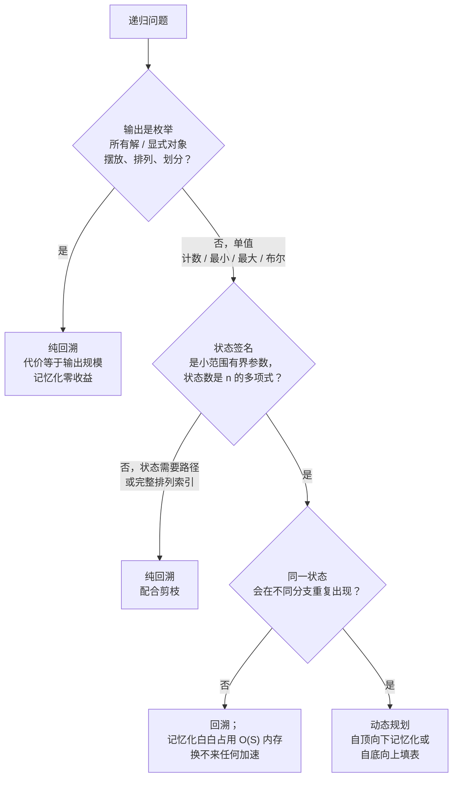

# 回溯 vs DP：子问题是否重叠

面试者看到一个指数级递归，顺手加上 `@lru_cache` 就交卷。在 Word Break 上，运行时间从 30 秒超时塌缩到 8 毫秒；在 N-Queens 上，缓存多吃掉 200 KB 内存，省下的时间是零微秒。同一个直觉，两个相反的判决。这个直觉——“递归就加记忆化”——两头都错，而错因是面试者从未检查过的一个性质。

这个性质有名字。CLRS §14.3 称它为**重叠子问题**（overlapping-subproblems）性质：同一个部分状态会沿递归树的不同分支被再次访问。[^1] 该性质成立时，记忆化把指数级搜索压缩成多项式规模的填表；不成立时，缓存一次都不会命中，你白养了一张没人读的哈希表。这一页给出的判据，能让你在写下缓存那一行之前就把两种情况分开。

## 如何决策

> **同一个状态会不会从不同路径被再次访问？**

会，就上记忆化。递归的状态数很小，多条分支落到同一个 `(i, j)` 或 `(i, remaining)`，缓存把重复计算变成一次查表。这个算法就是动态规划（DP），无论你写成带 memo 的自顶向下，还是带循环的自底向上。

不会，这条递归就是在枚举一个搜索空间，每片叶子对应一条独一无二的决策路径。状态签名就是路径本身；两片叶子永远不会共享状态；memo 表会膨胀到搜索树那么大，而且一次都不会命中。此时唯一正确的算法是带约束剪枝的回溯。

真正的判据不是“这题是不是递归”，甚至也不是“这题是不是指数级”。大量指数级递归注定只能是纯回溯，也有大量多项式状态空间藏在看起来指数级的树后面。判据是状态空间相对递归树的大小。树远大于状态空间时，状态会重复出现，记忆化赢；树**就是**状态空间时，记忆化只是装饰。

## 流程图

*Q1 拦住的是“输出即叶子”的枚举题。Q2 与 Q3 在优化分支上先按状态空间大小切，再按是否重复出现切。命中第一条就停，不要跳行。*

## 算法对比

下面三个选项落在同一条连续谱上，谱的刻度只有一根：算法缓存了递归树的多少。纯回溯什么都不缓存；回溯加记忆化缓存递归恰好重复访问到的那些状态；纯 DP 直接从表出发，别的什么都不探索。下面每个 H3 讲它何时赢、代价是什么、以及哪一章教它。

### 纯回溯（无重叠）

输出是枚举式的（“返回所有合法配置”），或者唯一解本身就是一个结构化对象：皇后的摆放、一个排列、网格里的一条路径。深度 `k` 处的状态签名就是到目前为止走过的整条决策序列；两条不同序列产出两个不同状态；没有任何状态会重复出现。记忆化在这里可证明无用。Walkccc 对 CLRS 习题 15.3-2 的解答一句话说清：“子问题不重叠，因此记忆化不会改善运行时间。”[^2]

这里真正值得做的优化不是缓存，而是**剪枝**。在递归之前就否掉不可行的候选，该候选下面整棵子树就从运行时间里消失。Erickson 第 2 章列出三类剪枝（可行性、支配、对称），并把它们当作该章的核心内容。[^3] 在 8 皇后上，朴素的排列枚举要走 40,320 片叶子；加上列与对角线剪枝只走 113 片。[^3] 算法形状一模一样，差三个数量级。

时间：最坏 `O(B^n)`，`B` 是平均分支因子，`n` 是深度。没有任何剪枝生效时这个界是紧的；实践中运行时间是**剪枝后**树的规模乘以单节点开销。空间：递归栈 `O(n)`，外加输出缓冲区。

这一格的代表题：LC 51 N-Queens、LC 46 Permutations、LC 78 Subsets、LC 37 Sudoku Solver、LC 79 Word Search、LC 17 Letter Combinations。选择 / 探索 / 撤销的骨架见 [回溯模板](../part-7-recursion-backtracking/01-backtracking-template.md)，标准剪枝技巧见 [回溯模板 + 剪枝](../../../dsa/patterns/P-34-backtracking-template-pruning.md)。

### 回溯 + 记忆化（发现重叠）

你先写出最直白的递归，发现它是指数级，然后去检查状态签名是不是真的小。三个信号同时成立，问题就从纯回溯翻进 DP 的地盘。[^1][^4]

输出是**单值**：一个计数、一个是 / 否、一个最小值、一个最大值，或者一个和。不是对象列表。递归有**有界的状态签名**：少量固定的整数参数（或小范围有界结构），足以完全确定返回值。递归**在不同分支重复访问同一状态**。

三条都成立时，给递归套一个 memo 装饰器就能把指数级暴力压成多项式。Word Break 是教科书级的过渡题。定义 `canSeg(i)` 表示“`s[i:]` 能否被切分”。状态只是整数 `i`；不同取值有 `n + 1` 个；不同的单词组合会产出相同的前缀长度，所以同一个 `i` 会被多条分支问到。加一个 `memo: dict[int, bool]`，`2^n` 的递归树就塌成 `n + 1` 个状态，每个状态 `O(len(wordDict) * max_word_len)`。[^4] labuladong 的教学立场（本手册采纳）：加 memo 的那一刻，算法就是 DP，哪怕这题不追求最优解。[^4]

时间：`O(S * work-per-state)`，`S` 是多项式的状态数。空间：memo `O(S)`，加上栈 `O(depth)`。

这一格的代表题：LC 139 Word Break、LC 322 Coin Change（自顶向下）、LC 198 House Robber、LC 70 Climbing Stairs、LC 416 Partition Equal Subset Sum（自顶向下）、LC 300 LIS（自顶向下）。显式讲这层过渡的章节见 [DP 递归到记忆化](../part-9-dynamic-programming/00-dp-recursion-to-memo.md)，递归发生在树上的近邻决策见 [递归 vs DP](./P-19-recursion-vs-dp.md)。

### 纯 DP（重叠来自问题结构）

递推式从题面就能看出来，迭代顺序也干净。状态空间有自然的枚举顺序，每个状态的前驱都在它之前算好：Coin Change 与 House Robber 用一维正序填，Edit Distance 与 LCS 用二维逐行填，0/1 Knapsack 用一维容量序填。你跳过“递归再记忆化”这一步，直接写填表。

在竞赛规模下，三个常数级优势让填表值得这次重写。[^1] 没有递归栈，深状态图上不会撞 `RecursionError`。顺序访问数组对缓存友好，胜过 dict 或 hashmap 的探测。空间优化是机械的（二维滚行，一维单行）。Bellman 1957 年的专著把迭代式状态空间填充作为标准解法引入，CLRS §14.3 至今仍把自底向上当作主要方法，自顶向下只是另一种表述形式。[^5][^1]

状态空间**稀疏**时，权衡反过来。自顶向下只计算算法真正问到的状态；自底向上要把整张表填满。CLRS §14.3 把这一点列为记忆化递归相对填表的主要优势。[^1] 状态空间稠密时（Edit Distance、Minimum Path Sum）自底向上靠常数赢；稀疏时（某些区间 DP 变体）自顶向上靠总工作量赢。

时间：`O(S * work-per-state)`，与记忆化递归相同。空间：`O(S)`，通常能借 [记忆化 vs 填表](./P-02-memoization-vs-tabulation.md) 里的优化降到 `O(rolling rows)`。

这一格的代表题：LC 322 Coin Change、LC 416 Partition Equal Subset Sum（按容量一维自底向上）、LC 72 Edit Distance、LC 5 Longest Palindromic Substring、LC 64 Minimum Path Sum、LC 1143 LCS。贪心选择性质成立、不需要 DP 时的上游决策见 [贪心 vs DP](./P-17-greedy-vs-dp.md)。

## 逐项对比

| 维度 | 纯回溯 | 回溯 + memo（= 自顶向下 DP） | 纯 DP（自底向上） |
|---|---|---|---|
| **状态会在不同分支重复出现？** | 不会，每条路径都唯一 | 会，同一个 `(i, j)` 来自不同分支 | 会，正是这一点让表成立 |
| **时间，最坏情况** | `O(B^n)` 穷举 | `O(S * work-per-state)` | `O(S * work-per-state)` |
| **空间** | `O(depth)` 栈 + 输出 | `O(S)` memo + `O(depth)` 栈 | `O(S)` 表；可降到滚动行 |
| **输出形态** | 所有解，显式对象 | 单值（计数 / 最小 / 最大 / 布尔） | 单值，可选带前驱指针 |
| **核心优化** | 剪枝（可行性、对称、顺序） | 按状态签名查 memo | 状态空间上的迭代顺序 |
| **代码形态** | 用 `try / recurse / undo` 递归 | 用 `if state in cache: return cache[state]` 递归 | 状态嵌套循环，边界处定 base |
| **何时选择** | 输出**就是**搜索树的叶子 | 递归自然；状态空间稀疏 | 状态枚举顺序干净；表稠密 |
| **代表题** | LC 51 N-Queens、LC 46 Permutations | LC 139 Word Break、LC 416（自顶向下） | LC 322 Coin Change、LC 72 Edit Distance |

中间两列描述的是同一个算法，只是挂着两套文化标签。回溯加记忆化与自顶向下 DP 生成的机器码完全一样；说法不同，是因为面试资料是从回溯章节走到这个技巧的，教材是从 DP 章节走过来的。两列在连续谱上落在同一点：缓存递归恰好重复访问的状态。最右列是把同一个算法改写成循环，顺带拿到迭代相对递归的那些常数优势。

## 三道招牌题

三道题，一列一道，选得让对比无从忽略。

**[LC 51 — N-Queens](https://leetcode.com/problems/n-queens/)** [困难] 是纯回溯的标准题。在 `n x n` 棋盘上放 `n` 个皇后，任意两个互不攻击，返回所有不同的布局。三个性质合起来排除了 DP：输出是枚举式的（每片叶子都必须输出）；第 `r` 行的状态签名是已占用的列与两条对角线集合（只属于这条路径）；状态空间最多有 `n!` 个不同的部分摆放，每个至多被访问一次。[^6] 记忆化缓存的，是算法按构造就已经知道的值。`is_valid` 检查（列、对角线-1、对角线-2 三个集合）把树从 `n!` 砍向经验上极小的剪枝树。在这题上伸手去拿 `@lru_cache` 的面试者，还没有把判据的 Q1 内化。

**[LC 139 — Word Break](https://leetcode.com/problems/word-break/)** [中等] 是从回溯通向 DP 的教科书过渡题。给定 `s = "leetcode"` 与 `wordDict = ["leet", "code"]`，返回 `true`。朴素递归 `canSeg(i) = any(canSeg(i + len(w)) for w in wordDict if s[i:].startswith(w))` 的递归树是 `2^n`。状态只有整数 `i` 一个，不同取值 `n + 1` 个；同一个 `i` 会被多种单词组合走到。加上 memo，算法塌成多项式；改写成 `dp[i] = OR over w in wordDict of (dp[i - len(w)] AND s[i - len(w):i] == w)`，你就得到它的自底向上对偶。[^4] 章节 [解码方式与单词拆分](../part-9-dynamic-programming/03-dp-decode-word-break.md) 把两种写法都走了一遍。

**[LC 322 — Coin Change](https://leetcode.com/problems/coin-change/)** [中等] 是纯 DP 的标准题。给定硬币 `[1, 2, 5]` 与金额 `11`，返回 `3`。递推式 `dp[a] = 1 + min over c in coins of dp[a - c]`（`a >= c`，`dp[0] = 0`）的状态空间是一维的，在 `[0, amount]` 上稠密。自底向上按 `a = 1 .. amount` 线性迭代，总计 `O(amount * len(coins))`。这题也能写纯回溯，但在 LC 的约束下会 TLE；自顶向下记忆化是对的，只是在稠密状态空间上多了一层 dict 查找的常数，而自底向上的数组访问更快。

## 常见误解

五个错误覆盖了这一族里的大部分 bug。每一个都是判据在某个具体环节上的失效。

**回溯就是暴力。** 半对半误导。回溯是对决策树的暴力枚举，但暴力指的是**剪不掉**的那一版；这门被命名的技术是带剪枝的暴力。Erickson 第 2 章 26 页里大半篇幅在讲按可行性、支配、对称做剪枝。选择-探索-撤销模板只是骨架，让它能在竞赛规模跑完的是剪枝。[^3] 8 皇后从 40,320 片叶子降到 113 片，靠的是约束传播，不是更快的递归。[^3] 把回溯叫“暴力”却不说剪枝，等于跳过了整章内容。

**DP 和记忆化是一回事。** 半对。自顶向下记忆化递归**就是** DP，因为两个属性（最优子结构、重叠子问题）都成立，缓存消除了重复计算。[^1][^4] 自底向上填表是它的迭代对偶：共享递推式，但遍历顺序不同。把“记忆化”当成独立于 DP 的第三类，是面试里很常见的一个破绽。正确的框架是：自顶向下 DP 与自底向上 DP 是同一个算法的两种实现风格，递推式一模一样，迭代顺序不一样。这个决策见 [记忆化 vs 填表](./P-02-memoization-vs-tabulation.md)。

**递归是指数级，就该换成 DP。** 只有在状态空间是多项式时才成立。把这条直觉用到枚举题上，是本页代价最高的错误。N-Queens 的递归树是指数级的，**不同状态**也是指数级的；Permutations 有 `n!` 片递归叶子，也有 `n!` 个不同状态。memo 会长到叶子那么大，而且一次都不会命中。Walkccc 对 CLRS 习题 15.3-2 的解答用归并排序直接说明了这点：每个 `(i, j)` 对恰好被访问一次，记忆化毫无收益。[^2] 该查的是第三行那个问题：状态空间是多项式的吗？不是，唯一正确的算法仍是纯回溯。

**回溯 + memo 等于 DP。** 语义上是的。这两个词描述的是同一个算法，只是两套文化标签，文献也印证了这点。面试资料经由回溯章节抵达 DP，教材经由填表章节抵达 DP，MIT 6.006 第 19 讲（Demaine）用一句话把它们接上：“DP 是小心翼翼的穷举搜索。”[^7] 名字不同是为了强调，不是为了实质。一章只挑一个词：章节 [回溯模板](../part-7-recursion-backtracking/01-backtracking-template.md) 引入递归形状，章节 [DP 递归到记忆化](../part-9-dynamic-programming/00-dp-recursion-to-memo.md) 显式打通两个词。在一道题上同时用两套叫法把自己绕晕，是只有面试者才会犯的错。

**在并不是状态的东西上做记忆化。** 面试者加了 memo，但键太宽（用路径本身，或用含可变状态的元组），然后说算法“没变快”。memo 的键必须是**最小充分签名**：从这份最小的信息就能完全确定递归的返回值。子集和里的 `solve(i, remaining)`，状态精确是 `(i, remaining)`。按 `(i, remaining, path_so_far)` 记忆化，命中数是零，因为每条路径都唯一。纪律来自 CLRS §14.3 第一步：“刻画最优解的结构。”先把递推式写成 `f(state) = something involving f(smaller_state)`，`f` 的参数**就是** memo 的键。[^1]

## 参考文献

[^1]: Cormen, Leiserson, Rivest, Stein, *Introduction to Algorithms*, 4th ed., MIT Press, 2022, Ch. 14.

[^2]: walkccc, "CLRS Solutions §15.3." https://walkccc.me/CLRS/Chap15/15.3/

[^3]: Erickson, *Algorithms*, 1st ed., 2019, Chs. 2-3. https://jeffe.cs.illinois.edu/teaching/algorithms/

[^4]: labuladong, "How to Convert Backtracking to Dynamic Programming." https://labuladong.online/algo/en/dynamic-programming/word-break/

[^5]: Bellman, *Dynamic Programming*, Princeton University Press, 1957. https://en.wikipedia.org/wiki/Dynamic_programming

[^6]: Stack Overflow, "Time complexity of N Queen using backtracking?" https://stackoverflow.com/questions/21059422/

[^7]: MIT OCW, 6.006 *Introduction to Algorithms*, Lecture 19 (Demaine). https://ocw.mit.edu/courses/6-006-introduction-to-algorithms-fall-2011/resources/lecture-19-dynamic-programming-i-fibonacci-shortest-paths/
