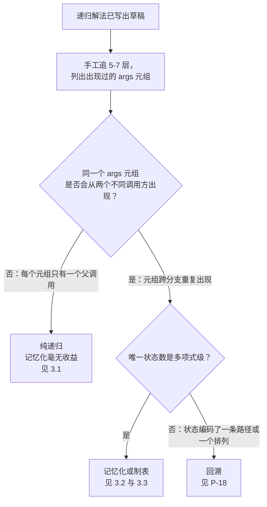

# 递归 vs DP：什么时候没有重叠（树遍历），什么时候有

同一个 `@functools.lru_cache` 装饰器，用在 `fib(n)` 上是正解，用在 `maxDepth(root)` 上是错的。在斐波那契上，它把一个到 `n = 40` 就耗不下去的算法，变成微秒级返回。把同一个装饰器放到二叉树的最大深度上，它会分配一张哈希表：每个节点往里写一次，此后没有任何一次读取命中。同样的语法，同一行代码，两个世界。

判别标准是递归调用图的一条性质，在一个五节点的例子上就能手工验证。这页就是那场检验。一旦这里判定“有重叠”，相邻的[记忆化与制表](./P-02-memoization-vs-tabulation.md)就接手。

## 如何决策

**递归是否会被不止一个调用方访问到同一个子问题？** 不会，就没有 DP；会，就记忆化。

整套判据就这一句。这页剩下的内容是：30 秒的手工追迹里该找什么，以及三个落点各自要付什么代价。

## 流程图

*唯一的判别器是调用图属于哪一种：一棵树、一张带重叠的 DAG，还是一棵状态永不重复的搜索树。树形的调用图用纯递归；带重叠的 DAG 用 DP；携带路径状态的搜索树用回溯。*

## 算法对比

递归有三个落点。落在哪一个取决于追迹结果，而不取决于输入本身恰好是不是一棵树。

### 纯递归（不做记忆化）

递归是贴着输入结构走的。二叉树就是 `Node(left, right) | Null`；递归对每个子节点各发一次调用；调用图**就是**输入这棵树。每个树节点在调用图里恰好由一条父边到达，所以加一份记忆化缓存，结果是每个节点写一条记录，之后没有任何一次读取能命中。树遍历是标准案例。链表反转是同样的形状，只是作用在列表上。分治（归并排序、快速排序、二分查找）在结构上相邻：切分步骤把输入拆成互不相交的两半，因此没有两个调用方会落到同一对 `(low, high)` 上。[^1]

CLRS 习题 15.3-2 把归并排序的这个否定结论写了出来：“MERGE-SORT 对数组的任意一对下标最多只调用一次，因此子问题不重叠，记忆化不会改善运行时间。”[^1] 这个论证可以推广到主定理覆盖的每一个分治递推式：划分互不相交，就保证没有重叠；没有重叠，就保证记忆化白做。

**何时选择。** 递归贴着树、链表或某个递归定义的对象走，且每一块结构都恰好被一个父调用触及。或者递归把输入划分成互不相交的两半，符合主定理形状 `T(n) = aT(n/b) + f(n)`。

**时间与空间。** 对 `n` 个节点的树遍历是 `O(n)` 时间、`O(h)` 调用栈空间，`h` 是递归深度。归并排序按主定理是 `O(n log n)`；快速选择期望 `O(n)`。记忆化会额外加上 `O(n)` 的死内存，渐近加速为零。

**章节引用。** [树遍历](../part-6-trees-heaps/01-tree-traversals.md)、[树 DP](../part-9-dynamic-programming/13-tree-dp.md)。Part 9 的树 DP 章节明确讲了这一点：树 DP 是 `O(n)`，因为依赖图**就是**这棵树，而不是因为有谁在缓存。[^2]

### 递归 + 记忆化（自顶向下 DP）

同一个 `(args)` 元组会被两个或更多不同的调用方到达。斐波那契是教科书案例：`fib(n-2)` 既是 `fib(n)` 的子调用（直接），也是 `fib(n-1)` 的子调用（同样直接）。递归树以大约 `phi^n` 个叶子展开，其中 `phi ~ 1.618`，而唯一状态数只有 `n + 1`。一份记忆表把这棵树压成一张 DAG。每个状态恰好算一次；之后每次访问都是缓存命中。[^3][^4]

诊断手段就是追迹。把这个递归拿过来，在小输入上手工跑一遍，记下每次调用的 `(args)`。如果同一个元组出现在两个不同的父调用下面，调用图就有重叠，DP 适用。CLRS §14.3 把这件事表述为“动态规划的要素”：最优子结构加上重叠子问题。随之而来的界是：记忆化把开销降到（唯一状态数）×（每个状态的工作量）。[^4]

**何时选择。** 追迹里有两个不同调用方落到同一个元组，且唯一状态数是输入规模的多项式。零钱兑换、编辑距离、最长公共子序列、背包、爬楼梯：全部经典 DP。

**时间与空间。** 时间 `O(状态数 × 转移)`。空间 `O(状态数 + 递归深度)`。斐波那契是 `O(n) + O(n) = O(n)`。长度分别为 `m`、`n` 的编辑距离是 `O(mn) + O(m + n) = O(mn)`。

**章节引用。** [DP 心智模型](../part-9-dynamic-programming/00-dp-recursion-to-memo.md)，那里逐行拆解了斐波那契的记忆化，并用引用透明性证明其正确。

### 一开始就写 DP（自底向上制表）

递推式在你写出任何递归代码之前就把重叠暴露出来了。打家劫舍：在房子 `i` 上的选择是 `dp[i-2] + nums[i]`（抢这间）还是 `dp[i-1]`（跳过这间），两个选项都引用更小的 `dp` 值。递推式只有一行，依赖顺序从左到右。正确的做法是完全跳过递归，从下标 0 往上一格一格填表。

信号是你能一上手就干净地写出 `dp[i] = f(dp[i-1], dp[i-2], ...)`：子问题的身份是一个小下标，依赖是局部的，状态上的拓扑序就是一个 for 循环。爬楼梯、打家劫舍、Kadane 算法、LIS 的 `O(n^2)` 形式、网格 DP，全都是自然的表格形态。先写记忆化递归再改写也行，但那是花一倍的力气做两遍。

**何时选择。** 递推式一两行，状态是几个整数的元组，拓扑序从下标上一眼可见。（对区间 DP、树 DP 这类顺序更刁钻的形态，自顶向下记忆化通常更好写；那个决策见[记忆化与制表](./P-02-memoization-vs-tabulation.md)。）

**时间与空间。** 时间和记忆化形式一样是 `O(状态数 × 转移)`。空间降到 `O(状态数)`，因为没有递归栈。常常还能用滚动窗口再压一层：斐波那契的完整表是 `O(n)`，两变量滚动形式能做到 `O(1)`。

**章节引用。** [自底向上制表](../part-9-dynamic-programming/01-dp-bottom-up-tabulation.md)，递归到记忆化那一章的迭代版姊妹篇。

## 逐项对比

| 模式 | 是否会被不同调用方重复访问同一状态？ | 时间 | 空间 | 何时选择 |
|---|---|---|---|---|
| **纯递归** | 不会，调用图是一棵树 | `n` 个节点为 `O(n)`；分治取主定理界 | `O(h)` 调用栈 | 面向树、链表、语法树的结构性递归；划分互不相交的分治 |
| **递归 + 记忆化** | 会，唯一状态数是多项式级 | `O(状态数 × 转移)` | `O(状态数 + 递归深度)` | 递推式有重叠；状态上的拓扑序难以预先写出，于是惰性缓存 |
| **一开始就写 DP（制表）** | 会，唯一状态数是多项式级 | `O(状态数 × 转移)` | `O(状态数)`，常可用滚动窗口再压 | 递推式只有一行，依赖是局部的，状态上的拓扑序就是对下标做一层 for 循环 |

第一列就是判别器。在一个五节点的输入上追一遍递归。如果每个 `(args)` 元组都恰好只有一个调用方，你落在第 1 行，记忆化是死内存。如果某个元组从不同父调用冒出两次，你落在第 2 行或第 3 行，不记忆化的递归会超时。

> [!IMPORTANT]
> **P-19 与 P-02。** 这页回答的是*我到底要不要记忆化？* 姊妹页[记忆化与制表](./P-02-memoization-vs-tabulation.md)回答的是*既然要记忆化，我是自顶向下写递归缓存，还是自底向上写表？* P-19 先命中；只有当 P-19 把答案定在第 2 行或第 3 行之后，P-02 才有意义。

## 三道招牌题

每个落点一题。每道都是它那个模式最干净的样本；判别器从递推式上不到一分钟就能看出来。

**纯递归：[LC 543 — Diameter of Binary Tree](https://leetcode.com/problems/diameter-of-binary-tree/)**（简单）。每个节点上的递归返回穿过该节点的较长子树路径的高度，同时用两棵子树高度之和更新全局最大值。每个节点恰好被访问一次，因为调用图**就是**这棵树。同一个问题，如果用 `@lru_cache` 装饰那个辅助函数，你会得到一张以 `TreeNode` 引用为键的哈希表：每个键都唯一，每次读取都未命中，缓存纯属额外开销。`O(n)` 时间，`O(h)` 栈，不需要记忆化。

**递归 + 记忆化：[LC 322 — Coin Change](https://leetcode.com/problems/coin-change/)**（中等）。递归 `min_coins(amount) = 1 + min(min_coins(amount - c) for c in coins)` 会从许多不同的面额选择上重复访问同一个 `amount`。对 `amount = 11`、coins 为 `[1, 2, 5]`，调用 `min_coins(6)` 会出现在 `min_coins(11)` 下面（减 5）、`min_coins(8)` 下面（减 2）、`min_coins(7)` 下面（减 1），如此等等。没有记忆化，递归是指数级；加上记忆化是 `O(amount × coins)`。缓存在头十几次调用内就开始命中。

**一开始就写 DP：[LC 198 — House Robber](https://leetcode.com/problems/house-robber/)**（中等）。递推式 `dp[i] = max(dp[i-1], dp[i-2] + nums[i])` 只有两项，都指向左边。基准情形是 `dp[0] = nums[0]` 与 `dp[1] = max(nums[0], nums[1])`。没有任何理由先写递归；让 `i` 从 `2` 迭代到 `n-1` 就完了，`O(n)` 时间，（配滚动窗口）`O(1)` 空间。递推式在写下的那一刻就把重叠交出来了。

## 常见误解

面试复盘和章节反馈里反复出现五个错误。每一个都是追迹的误用。

**“递归都该加记忆化。”** 树遍历不该。链表反转不该。归并排序不该。错误在于只要函数是递归的就“为了保险”伸手去拿 `@lru_cache`，最后得到 `n` 条缓存记录，写一次，从不被读。§15.3-2 里 CLRS 那个归并排序的证明就是教科书上的反面例子：划分互不相交，就保证没有重叠；没有重叠，就保证记忆化是死内存。[^1] 修法就是追迹：只要调用图是一棵树，不管函数是不是递归的，缓存都是死内存。

**“只要是递归，就是 DP。”** 只有状态空间是多项式级**且**递归会重访状态时才是。对排列做回溯是递归的，但状态编码了目前为止走过的路径，因此到达同一深度的两条不同路径状态不同。唯一状态数是 `n!`，不是多项式。对回溯递归做记忆化，写进去的缓存键永远不会重复；算法退化成暴力搜索，只是多了哈希开销。[回溯与 DP](./P-18-backtracking-vs-dp.md) 就从这页停下的地方接着讲，以状态空间是否多项式为分界。

**“DP 一定跑在数组或网格上。”** 树 DP 跑在树上。位掩码 DP 跑在一个集合的子集上。区间 DP 跑在 `(left, right)` 下标对上。状态空间可以是任何可数、且带拓扑序的结构；让它成为 DP 的是重叠，不是下标的形状。模式库里有[树 DP 原型](../../../dsa/patterns/P-32-tree-dp-archetypes.md)，收录了树 DP 题目里出现的那些后序递归形状，即便树 DP 本身并不需要缓存。（解释见上文 §3.1：树 DP 有最优子结构但没有重叠，因为调用图就是这棵树。）

**“记忆化的开销总是输给紧凑的递归。”** 斐波那契数列反驳这一点。`n = 30` 时，朴素递归大约做 270 万次调用，跑起来是能感觉到的一秒；记忆化形式做 31 次唯一求解加 29 次缓存命中，微秒就结束。哈希开销是真实的，但它是每个状态的固定成本；当唯一状态数比稠密递归调用数小几个数量级时，记忆化以同样的倍数占优。[^3] 错误在于还没确认渐近界就先算常数因子。

**“记忆化套错了状态签名。”** 当 DP 确实是正解，但缓存键编码了太多东西（目前为止的完整路径、完整的已访问集合、把整个输入前缀当成字符串），唯一状态数会爆到指数级，缓存永远不命中。修法是把状态压缩到最小充分签名：编辑距离里 `(i, j)` 就够，因为输入的其余部分由下标隐含；背包里 `(item-index, capacity)` 就够，因为此前的决策由下标隐含。CLRS §14.3 把状态签名的选择算作“刻画最优子结构”的一部分。[^4] 诊断问题是：到达同一个 `(args)` 元组的两条路径，不管怎么来的，未来是否相同？相同，签名就够；不同，就按“保持唯一状态数多项式”的最小必要去扩它。

贯穿这五条的主线是追迹。挑最小的非平凡输入，把调用序列写出来，找那些从不止一个父调用出现的 `(args)` 元组。找到了，调用图有重叠，DP 胜出。没找到，调用图是一棵树，纯递归就是正解。两页相邻的决策页把这页夹在中间：[递归与迭代](./P-01-recursion-vs-iteration.md)（形式问题）和[贪心与 DP](./P-17-greedy-vs-dp.md)（优化范式问题）。P-19 是它们中间那一问：既然递归是对的形态，它还需不需要一份缓存？

## 参考文献

[^1]: walkccc, "CLRS Solutions §15.3-2." https://walkccc.me/CLRS/Chap15/15.3/

[^2]: DSA Handbook, [树 DP](../part-9-dynamic-programming/13-tree-dp.md). Cormen, Leiserson, Rivest, Stein, *Introduction to Algorithms*, 4th ed., Ch. 14.

[^3]: Wikipedia, "Overlapping subproblems." https://en.wikipedia.org/wiki/Overlapping_subproblems

[^4]: Cormen, Leiserson, Rivest, Stein, *Introduction to Algorithms*, 4th ed., MIT Press, 2022, Ch. 14.
