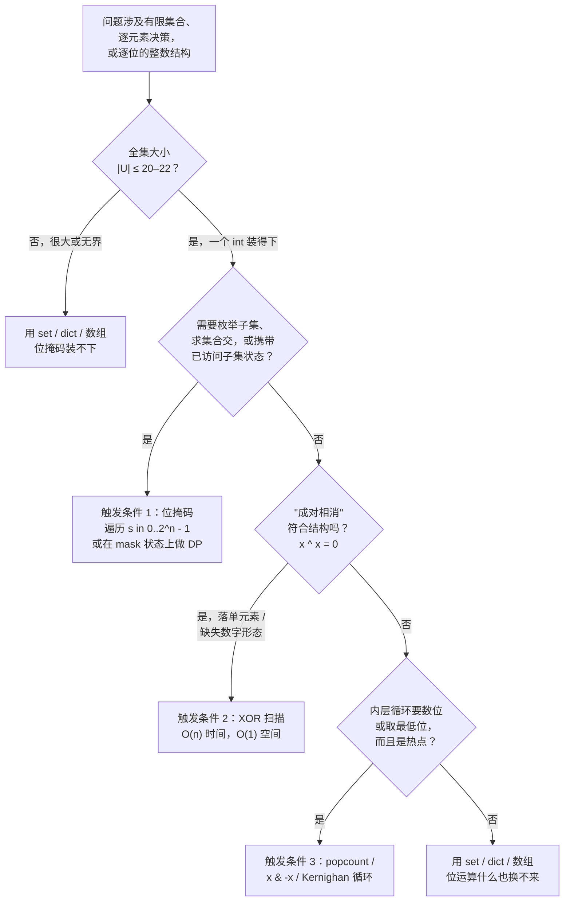

# 何时该动用位运算

大多数动用位运算的代码，其实并不需要它。作者写下 `x << 1` 是因为它“比 `x * 2` 快”，但编译出来跟乘法是同一条指令。XOR 交换这个写法，在 1995 年之后出厂的每一颗 CPU 上都不如一个临时变量。资深评审看不懂的 `mask & (mask - 1)` 循环，是一笔评审税，换不来任何可测量的墙上时钟收益。九成情况下，合适的工具是 `set`、`dict`、`int` 或一个布尔数组，位运算炫技纯属摆姿势。

剩下那一成才是这一页要谈的。有三种题型里，常规编码输给位掩码不是输一个常数因子，而是根本没有别的东西装得下。它们是：全集很小时把状态编码成位掩码；需要成对相消时把 XOR 当作群运算来用；内层循环真的热时用数位技巧。要么命中这三个触发条件之一，要么退回普通数据结构；不要因为“位运算看起来聪明”就选它。

## 如何决策

**问题。** 这道题需要位掩码、XOR 相消，还是 popcount 一类的技巧，抑或 `set`/`dict`/`int` 就能同样解掉？

**判断方法。** 只有当三个触发条件里恰好有一个被触发时，才该动位：

1. **状态即位掩码。** 候选元素全集的大小 `|U| ≤ 20–22`，而算法需要枚举子集、求集合交集，或把“目前访问过哪个子集”作为状态携带。在 `|U| = 22` 以下，一个 32 位整数能编码任意子集；超过之后 `2^|U|` 会超出内存预算，这个技巧本来也就用不了了。
2. **XOR 用于自相消。** 除一个元素外其余全部两两配对，或者答案的结构就是对称差。XOR 的自逆性质（`x ^ x = 0`）是这一族题里唯一能做到 O(1) 额外空间的工具。
3. **数位 / popcount / Brian Kernighan。** 内层循环要数置位位的个数、取最低的置位位，或在稀疏整数里只走置位位。硬件 POPCNT 三个周期就出结果；算法版本（`n &= n - 1`）跑 `popcount(n)` 次迭代，而不是 32 次。

三个都没触发，就写 `set` 版本。常规写法更短，第二遍读就能看懂，而且一旦全集超过 64，两者在渐进复杂度上已经没有区别。

## 流程图

*三个触发条件，一个兜底。三条分支都不触发时，常规编码胜出。位运算不是用来打破平局的；它是留给“没有别的装得下”那类场景的工具。*

## 算法对比

三个触发条件是相互独立的。命中触发条件 2（XOR）的题，通常不会命中触发条件 1（位掩码状态）；命中触发条件 3（popcount）的，通常是更大算法里的一个子步骤。下面每一小节说明这个触发条件在白板上长什么样、算法开销多少、哪一章讲得更深。

### 触发条件 1：当 `|U| ≤ 20–22` 时用位掩码表示状态

**信号。** 题目有一个固定的小全集（26 个小写字母、5 个元音、`n ≤ 20` 的 `n` 元基础集），而算法需要跟踪*当前在场上的是哪个子集*。自然的状态是一个 `set`；位编码的状态则是一个整数，第 `i` 位表示元素 `i` 是否在子集里。集合并变成 `m1 | m2`。集合交变成 `m1 & m2`。子集枚举变成 `for s in range(1 << n)`。子集的子集枚举变成 Knuth 的 `s = (s - 1) & m`。[^1][^2]

**硬上限。** `n = 20` 时 `2^n` 约一百万；一百万条的记忆化表大约占四兆字节，一秒内跑完。`n = 22` 时表里是四百万条，仍然可做。到 `n = 24`，缓存未命中会让墙上时钟翻倍；到 `n = 30`，算法根本跑不起来。20–22 这个天花板不是随手定的，它是 `2^n` 次操作还能塞进比赛预算的最大 `n`。[^2]

**何时选用。** 输入字母表小而固定，*且*内层循环的形状是“并/交/子集关系是什么”或“遍历一个小基础集的每个子集”。LC 78 *Subsets* 的子集枚举和 LC 847 *Shortest Path Visiting All Nodes* 的位掩码 DP 是招牌应用，两者都满足 `n ≤ 20`。跨模式的决策页 [位掩码 DP 的四种形态](../../../dsa/patterns/P-33-bitmask-dp-archetypes.md) 负责给依赖这套编码的四种 DP 形态分流。

**时间与空间。** 子集枚举是 `O(n · 2^n)` 的工作量、`O(2^n)` 的状态。位掩码 DP 的各变体从 `O(n · 2^n)`（指派型，位置隐含在 `popcount(mask)` 里）到 `O(n^2 · 2^n)`（TSP 型，状态多出一个 `last` 维度）。

**对应章节。** [位掩码技巧](../part-11-bit-manipulation/02-bitmask-techniques.md) 讲了完整的枚举机制和 `s = (s - 1) & m` 的推导。

### 触发条件 2：XOR 自相消（LC 136 家族）

**信号。** 题目说“除一个元素外每个元素都出现两次”“找出 `[0, n]` 里缺失的那个数”“有两个元素只出现一次，其余都成对”“答案是两个集合的对称差”。组合结构上就是成对湮灭。XOR 是唯一的常数空间算法，因为 `{0,1}^n` 上的 XOR 构成阿贝尔群：`0` 是单位元，每个元素是自己的逆元，运算满足交换律与结合律。[^3] 把数组在 XOR 下归约，成对的都消成零；落单的那个活下来，因为 `0 ^ x = x`。

**为什么非得是 XOR。** 在位向量上没有别的算术运算符同时具备这几条性质。加法可交换可结合，但不自逆：`x + x` 是 `2x`，不是 `0`。减法自逆，但不可交换。模运算接近了，却引入了溢出处理。XOR 就是 `({0, 1}^n, ⊕)` 上的群运算，就这样，这也是为什么 LC 136 家族有一行解，别的家族没有。

**何时选用。** 题面不变量涉及配对，*且*约束要求 O(1) 额外空间。LC 136 *Single Number* 是标准实例。LC 268 *Missing Number* 是把同一套代数用在连续整数 `0..n` 上：把 `0..n` 全部和整个数组全部异或起来，除了缺失的那个元素，其他都消掉。LC 260 *Single Number III* 用一个切分技巧扩展了这一族：先把所有元素异或得到 `a ^ b`，再按 `a ^ b` 里任意一个置位位把数组切成两半，跑两个 LC 136 子问题。

**时间与空间。** O(n) 时间、O(1) 额外空间，四行代码。常规替代方案 `Counter(arr)` 或一个 `set` 同样是 O(n) 时间，但要 O(n) 额外空间。当题面写“常数额外空间”或问“你能做到 O(1) 空间吗”，XOR 是唯一答案。

**对应章节。** [XOR patterns](../part-11-bit-manipulation/01-xor-patterns.md) 把这一族完整走了一遍，包括 LC 136、LC 137、LC 260、LC 268，以及区间查询的前缀 XOR 变体。

### 触发条件 3：数位、popcount 与 Brian Kernighan 技巧

**信号。** 内层循环要数置位位、取最低的置位位，或只走一个稀疏整数的置位位。朴素扫描不管输入是什么都要迭代 32（或 64）次。位技巧版本迭代 `popcount(n)` 次，每个置位位一次。稠密输入上两者打平；稀疏输入上，位技巧最多快 32 倍。

**两个承重恒等式。** `n &= n - 1` 清掉最低的置位位，这就是 K&R 习题 2-9 里 Brian Kernighan 发表的那个技巧。[^4] `x & -x` 把最低的置位位单独取出来，值是一个 2 的幂，这是树状数组（Fenwick tree）下标行走的主力。两个恒等式都源自补码算术：`-x` 是 `~x + 1`，`+1` 产生的进位穿过尾部的一串零、停在最低的置位位上，再与原值做 AND 就只剩那一位。[^4]

**何时选用。** 内层循环真的热，*且*整数足够稀疏，使得 `popcount(n) << 32`。生产代码不会直接写 Kernighan 的循环，而是调 `Integer.bitCount`（Java）、`__builtin_popcount`（GCC C/C++）、`std::popcount`（C++20）、`bits.OnesCount32`（Go）或 `int.bit_count()`（Python 3.10+）。在支持这些指令的硬件上，它们都编译成一条 CPU 指令（x86-64 自 2008 年起的 `POPCNT`，ARMv8 的 `CNT`）。[^5] 手写循环是教学版本，也是没有内建函数的编译器上的可移植兜底。

**时间与空间。** Kernighan 循环每次调用 O(popcount(n))，硬件内建函数每次调用 O(1)，两种做法的辅助空间都是 O(1)。

**对应章节。** [位运算速查手册](../part-11-bit-manipulation/00-bit-operations-cookbook.md) 收了七个基本操作；[面向性能的位技巧](../part-11-bit-manipulation/03-bit-tricks-performance.md) 讲 SWAR popcount、de Bruijn 序列，以及什么时候该直接调标准库的内建函数。

## 逐项对比

| 触发条件 | 白板上的信号 | 时间 | 空间 | 常见陷阱 | 何时选用 |
|---|---|---|---|---|---|
| **位掩码状态** | 全集 `\|U\| ≤ 20–22`；需要枚举子集或跟踪已访问子集状态 | `O(n · 2^n)` 到 `O(n^2 · 2^n)` | `O(2^n)` | 编码错了维度；掩码 60 个候选人而不是 16 项要求，状态直接从 65K 炸到 10^18 | LC 78、LC 847、LC 1125，以及来自 [P-33](../../../dsa/patterns/P-33-bitmask-dp-archetypes.md) 的位掩码 DP |
| **XOR 自相消** | “除一个元素外每个都成对”或“求对称差”；约束要求 O(1) 额外空间 | `O(n)` | `O(1)` | 忘了 `0 ^ x = x`，结果给单元素数组写了个特例 | LC 136、LC 137、LC 260、LC 268 |
| **Popcount / 低位** | 内层循环数位、取 `x & -x`，或在稀疏整数里走置位位 | 每次调用 `O(popcount(n))`（Kernighan）；每次调用 `O(1)`（内建函数） | `O(1)` | 标准库内建函数本来就编译成一条 POPCNT，偏要手写 Kernighan | LC 191、LC 461、LC 338，树状数组下标行走 |
| **（三个都没触发）** | 三个信号一个都对不上 | 与常规算法一致 | 与常规算法一致 | 毫无测量就“为了性能”去用位运算 | `set`、`dict`、`Counter`、`bool[]` 等 |

一行行看下来，规律是：位运算买到的都是很具体的东西——小全集的编码、常数空间的相消，或者稀疏迭代的加速。当某行的“常见陷阱”正好命中了你的草稿解法，那就是该退回去用常规写法重写的信号。

## 三道招牌题

每个触发条件配一道。每道都是它那一类里最干净的例子，触发条件在一分钟内就能从约束条件里看出来。

**位掩码状态：[LC 78 — Subsets](https://leetcode.com/problems/subsets/)**（中等）。给定 `n` 个互不相同的整数，`1 ≤ n ≤ 10`，返回全部 `2^n` 个子集。约束 `n ≤ 10` 就是破案线索：这是小全集的地盘，`2^n` 枚举是标准编码。循环是 `for s in range(1 << n)`；对每个 `s`，第 `i` 位表示 `nums[i]` 是否被选中。渐进开销与递归回溯相同，但不用栈，也天生可并行。

**XOR 自相消：[LC 136 — Single Number](https://leetcode.com/problems/single-number/)**（简单）。数组里除一个元素外每个都出现两次，返回那个落单的元素，O(n) 时间、O(1) 额外空间。能过的解法就是 `reduce(arr, ^)`，连函数头一共四行。成对的会相消，因为 XOR 自逆；落单的元素与 `0`（累加器的初值）异或，还是它自己。

**Popcount：[LC 191 — Number of 1 Bits](https://leetcode.com/problems/number-of-1-bits/)**（简单）。数一个 32 位无符号整数里置位位的个数。Brian Kernighan 循环 `while n: n &= n - 1; count += 1` 跑 `popcount(n)` 次迭代而不是 32 次，在任何稀疏输入上都胜过朴素扫描。生产里调标准库的内建函数；面试里写 Kernighan，同时把内建函数这条顺嘴说出来。

## 常见误解

面经复盘和代码评审里反复出现五个错误。每一个归根到底都是误读了触发条件。

**“位运算比算术运算快。”** 大体上错，而且这个信念有害。现代编译器会自动把 `x * 2` 强度削减成 `x << 1`；自动把 `x % 2` 削减成 `x & 1`；对无符号类型自动把 `x / 8` 削减成 `x >> 3`。编译出来的结果完全一样。为了“性能”把 `x * 8` 写成 `x << 3` 的作者，一个微秒也没省下，却付了实打实的可读性代价：每个评审都得把意图重建一遍。窄的例外是运算确实没法用标准算术表达（`x & -x`、`x & (x - 1)`、掩码 popcount 那一套），这时位技巧就是算法本身，不是微优化。当*含义*是“移位”时用 `<<` 和 `>>`；当含义是“乘”“除”时用 `*` 和 `/`。编译器不在乎，下一个读者在乎。

**“XOR 只是小聪明。”** 不是：XOR 是代数的。`reduce(arr, ^)` 能解 LC 136，不是因为 XOR 碰巧把成对的消掉了；而是因为 `({0, 1}^n, ⊕)` 是一个阿贝尔群，`0` 是单位元，每个元素是自己的逆，运算可交换、可结合。成对湮灭是群公理，不是花招。一旦你把 XOR 看成 GF(2) 上位向量上的群运算，LC 136 家族就不再是一堆聪明解法的集合，而是一个算法形状加上若干可预测的变体：缺失数字是连续整数那一例，single number III 是按位切分那一例，前缀 XOR 是前缀和的类比。用“聪明”去读，会觉得这些是互不相干的谜题；用代数去读，它们是同一道题。

**“位掩码状态对任何 `n` 都管用。”** 错。硬上限是 `|U| ≤ 22`，而且多数变体更紧：LC 943 限 `n ≤ 12`，LC 698 限 `n ≤ 16`，LC 847 限 `n ≤ 12`。超过 `n = 22`，`2^n` 就超出记忆化预算，算法装不进内存；就算装进了，缓存未命中也会让墙上时钟翻倍。读到 LC 1125 *Smallest Sufficient Team* 里 `n = 60` 个人就去写 `dp[people_mask]` 的读者，建出了 `2^60` 的状态空间，然后断定这题不可解；正确的动作是掩码“要求”（`m ≤ 16`），不是掩码“人”。这个决策的专门走查在 [位掩码 DP 的四种形态](../../../dsa/patterns/P-33-bitmask-dp-archetypes.md)，它按“位掩码该索引哪个维度”给四种 DP 形态分流。

**“Java 的 `>>` 和 `>>>` 可以互换。”** 不能，而且这个 bug 只在负数输入上发作。`>>` 是**算术**右移：它保留符号位，所以移位一个负的 `int` 时高位补的是 1。`>>>` 是**逻辑**（无符号）右移：高位永远补 0。写 `for (int k = 0; k < 32; k++) count += (n >> k) & 1` 来做 popcount，只要 `n` 的符号位为 1 就返回垃圾，因为每次迭代 AND 的是符号扩展填进来的 1，而不是真实的输入位。修法就是取位一律用 `>>>`。C 和 C++ 有同一个陷阱，只是穿了不同的衣服：对负的有符号整数右移，在 C++17 下是实现定义，在更早的标准下是未定义行为。移位之前先转成 `uint32_t`（或者用 `unsigned`）；对语言层面的保证，按“不要假设”处理。

**“XOR 交换能省内存。”** 省不了，而且在每一颗现代 CPU 上都更慢。普通交换里的临时变量落在编译器本来就在用的寄存器里，所以根本不存在内存节省。XOR 交换（`a ^= b; b ^= a; a ^= b`）引入一条三层深的数据依赖链，让 CPU 的乱序引擎没法规约流水，于是在 1995 年之后出厂的每一颗 Intel 和 ARM 芯片上都比临时变量交换慢。遇到指针别名（`xor_swap(&arr[i], &arr[j])` 且 `i == j`）时，它不是空操作，而是悄悄把变量清零。XOR 交换是典型的 bit-golf 反模式：解决一个没人有的问题，在一个作者没考虑到的用例上失败，今天只活在面试传说里。写临时变量交换。C++ 用 `std::swap`，Python 和 Go 用多重赋值的元组交换。把 XOR 留给代数真正在干活的地方，比如 LC 136 和它的兄弟们。

贯穿这五条的主线是同一条：一个没有在解决算法问题的位技巧只是装饰，而装饰就是评审税。三个触发条件告诉你什么时候位运算就是算法本身；除此之外，常规编码才是正确答案。

## 参考文献

[^1]: Warren, *Hacker's Delight*, 2nd ed., Addison-Wesley, 2013, §§1, 2-1, 5-1.

[^2]: Knuth, *The Art of Computer Programming*, Vol. 4A, Addison-Wesley, 2011, §7.1.3.

[^3]: Wikipedia, "Exclusive or." https://en.wikipedia.org/wiki/Exclusive_or

[^4]: Kernighan and Ritchie, *The C Programming Language*, 2nd ed., Prentice Hall, 1988, Exercise 2-9.

[^5]: Oracle, `java.lang.Integer.bitCount`. https://docs.oracle.com/en/java/javase/21/docs/api/java.base/java/lang/Integer.html#bitCount(int
