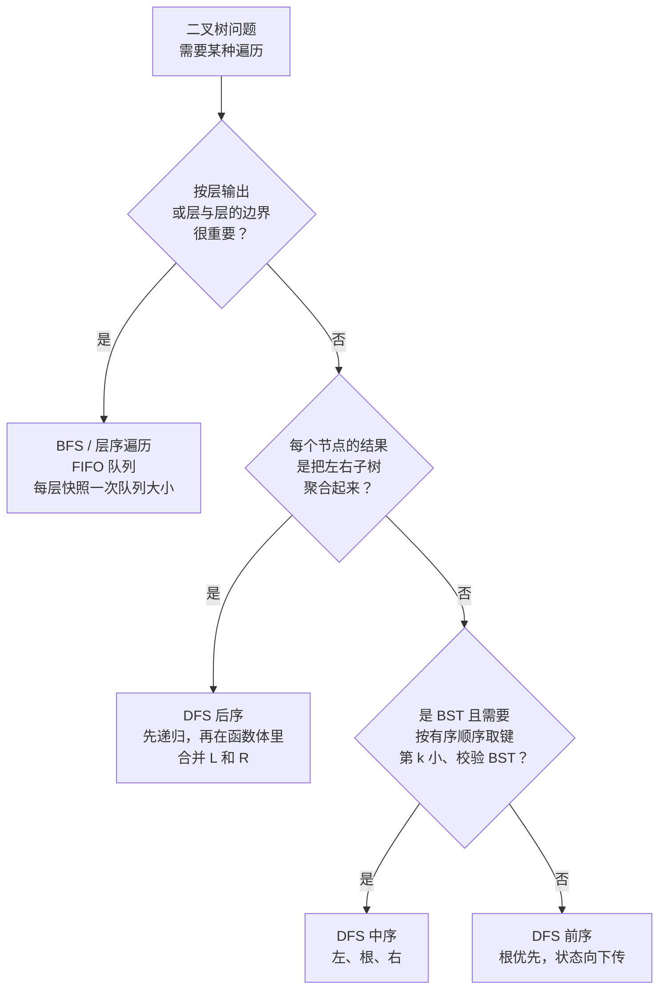

# 树上的 BFS 与 DFS：层序与中/前/后序语义

在二叉树上，BFS 和 DFS 都会访问每个节点，时间复杂度都是 `O(n)`，最坏情况下占用内存也都是 `O(n)`。渐近复杂度选不出算法。真正决定算法的是题目要求你*返回*的数据形状；形状搞错，你的解法就不再是超时（Time Limit Exceeded），而是答案错误（Wrong Answer）。

这一页做的是一个 BFS 加三种 DFS 顺序的四选一决策。“BFS vs DFS”的图版本是另一页，[P-07 BFS vs DFS for graphs](./P-07-bfs-vs-dfs-graphs.md)，那里的判别标准是可达性语义：最短跳数，还是 DFS 森林式的结构性证据。<!-- TODO: P-07 写好后补上链接 --> 树一点都继承不到这些。二叉树没有环、没有回边、不需要 `visited` 集合，图的判别手册搬不过来。到了树上，问题收缩成一个维度：哪一种遍历*顺序*能把题目真正要的数据翻出来。

## 如何决策

> **按输出形状选。BFS 给的是层，DFS 给的是根到叶的路径。**

层，指的是任何以深度为键的东西：每层一个列表、每一层最右的节点、两层之间的分界、X 第一次出现的最浅深度、跨兄弟节点串联 `next` 指针。FIFO 队列天然产出这种形状：每轮外层迭代开头用 `levelSize = len(queue)` 拍一个快照，就把深度边界固定住了，此后追加的子节点全都落在边界之后。对于“给我每层最右边的节点”这类要求，不存在比队列写法更短、更清楚的 DFS 解法；在这里伸手去写带深度参数的 DFS，就是在跟题目对着干。

路径，指的是任何从根读到叶、从叶读到根，或者“由这棵子树的结果算出值”的东西。三种 DFS 顺序对路径的切法不同。**前序**（根先）在子节点递归之前就把父节点的值递下去，状态自上而下流动时正是你要的。**中序**（左、根、右）在 BST 上按键的有序顺序输出，是唯一有这个保证的顺序。**后序**（左、右、根）在节点执行自己的函数体之前，已经把两棵子树的返回值都拿到手了，“从子树结果算值”的题全都要这一点。三者不可互换；选错的那一个，写出来的代码看着对，答案是错的。

## 流程图



*自顶向下的判别顺序。第 2 问是这一页上最值钱的一问：凡是非 BFS 的树遍历长得都像递归，而没有把“子树聚合就意味着**后**序”刻进脑子的人，往往默认写成前序，然后运行时才发现子节点的值还没算出来。*

## 算法对比

### BFS / 层序（第 6.3 章）

边界是一个 FIFO 队列。真正把这个算法定住的是每轮外层迭代开头那次层大小快照：先读 `levelSize = queue.size()`，然后只出队这么多个节点，再考虑下一批。内层循环期间追加的子节点属于下一层，在外层循环转回来之前完全不可见。深度之间的边界，是靠一个计数保住的。

何时选它：按层分组的列表（LC 102）、每行最右的节点（LC 199）、按行的锯齿形输出（LC 103）、用 `next` 指针串联兄弟（LC 116）、按行做归约（LC 515），或者目标出现的最浅深度（LC 111）。这些都是“在第几层”本身属于答案、而不是记账的题。

时间 `O(n)`，空间 `O(w)`，`w` 为最大宽度。在完全二叉树上，最底层同时存在 `n/2` 个节点，所以最坏空间是 `O(n)`。CLRS §20.2 证明了通用图 BFS 的“出队层次单调”不变式；在树上 `V = n`、`E = n - 1`，这个界就退化成 `O(n)`。[^1]

一个不错的推论：面对“找一个深度为 `d` 的目标”这种要求，BFS 能提前结束。它只把深度到 `d` 为止的节点入队，目标较浅时远少于 `n`；而递归 DFS 可能在真正走到深度 `d` 之前，先把一整棵很深的错子树探完。[^1]

参见 [层序遍历：树上的 BFS](../part-6-trees-heaps/03-level-order-traversal.md)。

### DFS 前序（第 6.1 章）

顺序：根，然后左子树（递归前序），然后右子树（递归前序）。父节点在任何一个子节点开始递归*之前*就被处理，所以父节点算出的任何状态都能作为递归参数传下去，被每个后代使用。

何时选它：自上而下的状态继承与序列化。递归形状是 `f(node, state) → use(state); f(left, combine(state, node)); f(right, combine(state, node))`。LC 257（根到叶路径）累积一个路径列表。LC 129（根到叶数字之和）累积 `current * 10 + node.val`。LC 1448（好节点）把 `max_so_far` 一路往下传。LC 297（序列化 / 反序列化）写前序序列加 null 标记，也就是 LC 题解用的那套标准 Codec。树的复制与克隆也是前序最自然：父节点必须先存在，子节点才能挂上去。[^2]

时间 `Θ(n)`，空间 `O(h)`（调用栈），在左斜树上最坏为 `O(n)`。CLRS §12.1 练习 12.1-4 给出了递归形式的 `Θ(n)` 界。[^2]

参见 [树的遍历：前序、中序、后序](../part-6-trees-heaps/01-tree-traversals.md)。

### DFS 中序（第 6.1 章，用于 BST）

顺序：左子树（递归中序），然后根，然后右子树（递归中序）。在满足 BST 不变式的树上，它按键的非降序输出，而且它是**唯一**有这个保证的遍历。Sedgewick 与 Wayne 在 *Algorithms* 的 §3.2 专门讲这条性质，把它当作 BST 能作为有序符号表载体存在的理由；CLRS 练习 12.1-2 则把它和堆不变式明确对照——堆无法在线性时间内产出有序输出。[^2][^3]

何时选它：任何以有序键序列为答案、或拿它当杠杆的 BST 题目。LC 94（中序遍历）就是这个定义本身。LC 230（第 k 小）走中序，第 k 次访问时返回，提前退出把 `O(n)` 压到 `O(h + k)`。LC 98（校验 BST）断言中序序列中每个值都严格大于前一个。LC 173（BST 迭代器）用“把整条左脊柱压栈，弹出后转向右子树”的迭代形状，把中序序列一个元素一个元素地吐出来，空间 `O(h)`，每次 `next()` 摊还 `O(1)`。[^4] LC 99（恢复 BST）在中序序列里找出逆序的那两个值，把它们对调。LC 938（BST 范围求和）用范围边界剪掉不必要的中序访问。

时间：走完整棵树 `Θ(n)`；像 LC 230 这样能提前退出的题是 `O(h + k)`。空间 `O(h)`。

反面的情况同样重要：在*不是* BST 的树上，中序只是一次左-根-右的游走，没有任何顺序保证。在普通二叉树上凭习惯去写中序，什么也换不来。

### DFS 后序（第 6.1 章，用于树形 DP）

顺序：左子树（递归后序），然后右子树（递归后序），然后根。等到 `dp(node)` 的函数体开始执行时，`dp(left)` 与 `dp(right)` 都已经跑完并返回了结果。这是唯一具备该性质的顺序，而这个性质正是“树形 DP”需要的。

何时选它：任何“每个节点的值由它子树的结果决定”的题目。LC 104（最大深度）返回 `1 + max(L, R)`。LC 543（直径）向上返回高度，同时以副作用更新 `max(ans, L + R)`。LC 124（最大路径和）向上返回 `node.val + max(L, R, 0)`，同时以副作用更新 `ans = max(ans, node.val + max(L, 0) + max(R, 0))`，其中的 `max(0, ...)` 裁剪用来丢弃负贡献的子树。LC 110（平衡校验）返回高度，或者用哨兵值 `-1` 短路。LC 337（打家劫舍 III）对每棵子树返回 `(rob_this, skip_this)`。[^5]

递归形状是固定的：

```python
def dp(node):
    if node is None:
        return base_case
    L = dp(node.left)
    R = dp(node.right)
    update_global_answer_using(L, R, node.val)
    return combined_value_to_return_upward
```

两次递归调用都在函数体*之前*发生。前序做不到：它先访问父节点。中序做不到：右子节点在函数体之后才跑。BFS 做不到：父节点比子节点先出队。时间 `Θ(n)`，空间 `O(h)`。[^5]

## 逐项对比

| 对比维度 | BFS / 层序 | DFS 前序 | DFS 中序 | DFS 后序 |
|---|---|---|---|---|
| 输出形状 | 层，以深度为键 | 根到叶的路径，或自根向下的状态 | BST 上的有序键序列 | 每个节点的子树聚合值 |
| 边界结构 | FIFO 队列 | LIFO 栈（调用栈或显式栈） | LIFO 栈（调用栈或“左脊柱压栈”） | LIFO 栈（调用栈或双栈技巧） |
| 访问顺序 | 逐层，从左到右 | 根、左子树、右子树 | 左子树、根、右子树 | 左子树、右子树、根 |
| 时间 | `O(n)` | `Θ(n)` | `Θ(n)` | `Θ(n)` |
| 空间（最坏） | `O(w)`，完全二叉树最底层可达 `O(n)` | `O(h)`，左斜树可达 `O(n)` | `O(h)` | `O(h)` |
| 能拿到子树聚合值？ | 不能，父节点先于子节点访问 | 不能，父节点先于子节点访问 | 不能，根夹在两棵子树之间 | **能，这是标准写法** |
| 能拿到 BST 的有序投影？ | 不能 | 不能 | **能，且是唯一有此性质的顺序** | 不能 |
| 能拿到自上而下的状态继承？ | 别扭（必须把元组塞进队列） | **能，这是标准写法** | 不能 | 不能 |
| 典型用例 | LC 102, 199, 116, 103, 515 | LC 257, 129, 1448, 297-encode | LC 94, 173, 230, 98, 99 | LC 124, 543, 110, 337 |

整张表里最重要的一行是“子树聚合值”那一行。后序是唯一一种函数体执行时两个子节点的返回值都已到手的顺序；前序、中序、BFS 都至少有一个子节点在父节点*之后*才被访问，所以用这些顺序写树形 DP 的函数体，语义根本站不住，子节点的值那时还不存在。有人提出“树的最大路径和用 BFS”或者“求直径用前序”，就是漏了这一点；面试官追问一句“`dp(root)` 到底返回什么？”，三十秒内这个缺口就露出来了。[^5]

## 三道招牌题

- [LC 102 — Binary Tree Level Order Traversal](https://leetcode.com/problems/binary-tree-level-order-traversal/) [中等]。BFS 的标准题。输出是 `List<List<Integer>>`，每个深度一个子列表。层大小快照是那条承重线；没有它，内层循环里追加的子节点会和父节点并进同一个子列表，按层分组就塌了。DFS 也能解——把深度当递归参数传下去，分桶到 `result[depth]`——但输出本身就是层的边界，这样写代码只会更多。
- [LC 94 — Binary Tree Inorder Traversal](https://leetcode.com/problems/binary-tree-inorder-traversal/) [简单]。中序的字面定义。在 BST 上输出有序；在普通二叉树上，它只是左-根-右的一个排列，没有顺序保证。迭代写法（把整条左脊柱压栈，弹出并访问，转向右子节点，重复）是 LC 173（BST 迭代器）复用的结构骨架，用来做到每次 `next()` 摊还 `O(1)`。[^4]
- [LC 543 — Diameter of Binary Tree](https://leetcode.com/problems/diameter-of-binary-tree/) [简单]。教科书式的后序 DP。递归向上返回高度（`1 + max(L, R)`），父节点才能在此基础上继续延伸；副作用更新 `ans = max(ans, L + R)`，让全局答案接住从当前节点拐弯的那条直径。两个量都依赖子节点的值，所以函数体必须待在后序的位置上。[^5]

## 常见误解

**“DFS 能在树上找最短路径。”** 对，但只是因为树上每一条根到叶路径都是唯一的，而深度*就是*距离。从根到任一节点只有一条路径，“最短的那条”和“那条”是同一回事。一旦结构从树换成图，这个误解立刻发作：在有环、或者顶点之间存在多条路径的图里，DFS 会兴高采烈地返回*一条*比最短路径更长的路，只有 BFS（在无权边上）能给出最小跳数。树把这个区别藏起来了，图把它暴露出来。推论是：LC 111（最小深度）用 BFS 和用递归 DFS 都能写出答案相同的解，而 LC 1091（二进制矩阵中的最短路径）只有 BFS 写法成立，因为那个矩阵是图。

**“BFS 比 DFS 更占内存。”** 完全取决于树的形状，而大多数读者记下的那条经验法则是反的。BFS 同时最多只持有一层，所以空间开销是 `O(w)`，`w` 为最大宽度。DFS 要把递归栈一直压到最深的叶子上，所以空间开销是 `O(h)`。在平衡树上，`h ≈ log n`，而 `w` 在最底层可以达到 `n/2`，于是在这个“好对付”的情况里 **BFS 比 DFS 更占内存**。在左斜树上，`h = n - 1` 而 `w = 1`，于是 **BFS 占的内存远少于 DFS**——递归栈会撞上 Python 默认的 1000 帧上限而溢出，队列则自始至终只装一个节点。准确的说法是“BFS 是 `O(width)`，DFS 是 `O(height)`”，而不是“BFS 更重”。

**“前序是 DFS，中序是 BFS。”** 前序、中序、后序三者都是 DFS 的变体。它们共享同一套控制结构（递归左、递归右），区别只在于节点的函数体相对这两次递归调用在*什么时候*执行：之前、之间、还是之后。BFS 是另一个算法，边界结构不同（队列），访问顺序也不同（逐层）。把“前序”读成“DFS”的同义词，再顺手推断“中序”必是另一个东西即 BFS——这就是这个误解产出的失效模式；中序是三种 DFS 顺序之一，区别在访问时机，不在边界结构。

**“树也需要像图那样维护 `visited` 集合。”** 不需要。二叉树按定义就没有环，到同一节点不存在两条路径，也不可能重复入队或重复递归。`visited` 集合额外带来 `O(n)` 空间和每节点一次哈希查找，收益为零。`visited` 是图的概念，存在目的是处理环和汇聚路径；树两者都没有。如果你发现自己在树的 BFS 或 DFS 里写下 `if node not in visited:`，说明错误的心智模型已经从 [P-07 BFS vs DFS for graphs](./P-07-bfs-vs-dfs-graphs.md) 那边串过来了。<!-- TODO: P-07 写好后补上链接 --> 把这个集合删掉，树模板不需要它。唯一会改变这个结论的边角情况是：输入以图的形式给出（父指针和子指针都填满了，如 LC 133 Clone Graph），只是恰好长得像树；即便这样，算法不额外检查就没法区分“以树的形式给出的树”和“以图的形式给出的树”，所以稳妥的默认是图输入保留集合、树输入去掉集合。

## 参考文献

[^1]: Cormen, Leiserson, Rivest, Stein, *Introduction to Algorithms*, 4th ed., MIT Press, 2022, Ch. 20 §20.2.

[^2]: Cormen, Leiserson, Rivest, Stein, *Introduction to Algorithms*, 4th ed., MIT Press, 2022, Ch. 12.

[^3]: Sedgewick and Wayne, *Algorithms*, 4th ed., §3.2. https://algs4.cs.princeton.edu/32bst/

[^4]: walkccc, "LeetCode 173." https://walkccc.me/LeetCode/problems/0173/

[^5]: walkccc, "LeetCode 124." https://walkccc.me/LeetCode/problems/0124/. walkccc, "LeetCode 543." https://walkccc.me/LeetCode/problems/0543/
