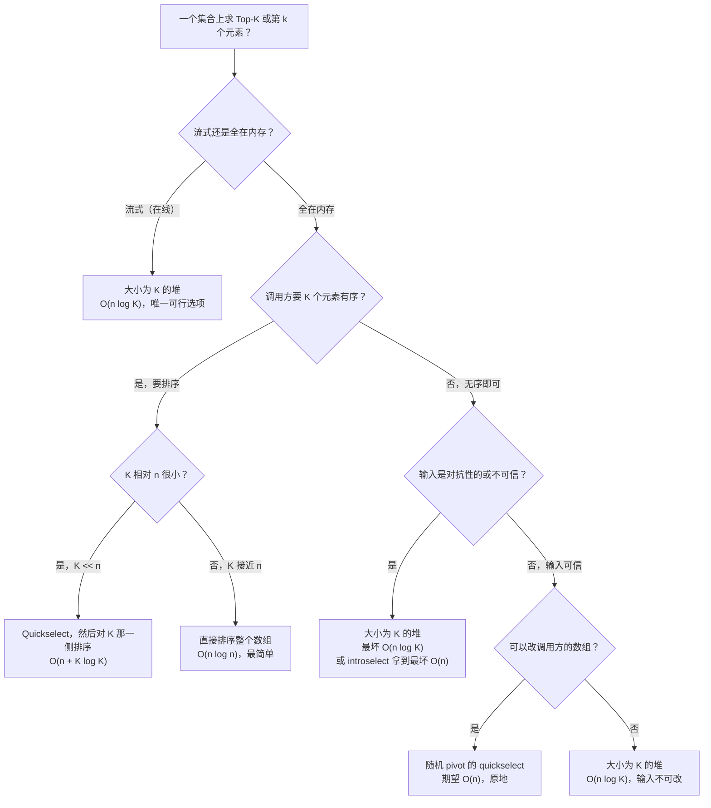

# 求 top-K：Quickselect 与堆的取舍

在无序数组上求“给我前 K 个”，有两个算法能用；面试里选错一个，哪怕代码编得过，这一轮也废了。堆是 `O(n log K)`，你扔什么输入它都扛得住。Quickselect 期望 `O(n)`，碰上刻意构造的输入会退化到 `O(n^2)`。有意思的地方在于两者谁都不占绝对优势：输入形态和输出形态会把结论翻过来。

## 如何决策

**一个问题，一个答案。** 数据是流式的、或者会无界地陆续到达，就用大小为 K 的堆。数据已经躺在内存里、调用方要的是无序的 top-K（或者只要第 k 个值），就用 quickselect。其余都是对这两种情形的附加条件。

这种不对称来自两个算法对数据的需求方式。大小为 K 的堆只装 K 个当前最大的幸存者，所以对数据流扫一遍就够。Quickselect 要在整个数组上交换元素，意味着你必须先拿到整个数组。流式与否是第一道分界线，而且是一道硬分界：不存在在线的 quickselect。

## 流程图

*五个分支问题定下选择。流式那一支是单向的。另外四支分别在权衡实现复杂度、输出形态、鲁棒性和副作用。*

## 算法对比

本页深入比较两位参赛者，另外再加第三位——它常出现在面试答案里，值得用一段话把它降级。

### 大小为 K 的堆（流式场景的默认选择）

要 K 个**最大**值时，形态是上限为 K 个元素的小顶堆；要 K 个**最小**值时，上限为 K 的大顶堆。遍历输入，逐个压入，一旦堆超过 K 就弹出堆顶。一趟走完，堆里就是 K 个幸存者，堆顶是阈值（求最大 K 个时，就是第 k 大的值）。[^1]

**在这些情形选它：**

- 数据是流式的。新值随时间陆续到达，调用方要的是滚动 top-K。LC 703 *Kth Largest Element in a Stream* 就是标准例子。
- 输入不可信或是对抗性的。上界就是 `O(n log K)` 最坏情况，就这么定了；没有输入能把它推高。[^2]
- 调用方要 K 个元素有序。全部弹出自然就是排好的，扫描之后代价 `O(K log K)`。
- K 确实很小（top-10、top-100），`log K` 基本等于常数。
- 输入数组不能改。

**时间：** 最坏 `O(n log K)`。**空间：** `O(K)`。阈值就在堆顶，看一眼是 `O(1)`。机制细节在下一章 [堆与 top-K 模式](../part-6-trees-heaps/04-heaps-priority-queues.md)。[^3]

### Quickselect（离线场景的速度）

围绕随机 pivot 划分数组。pivot 会落到它最终的有序位置上；看这个位置是否等于 `n - k`（求第 k 大时），然后只递归包含目标下标的那一侧。另一侧永远不会被读到。[^4]

**在这些情形选它：**

- 整个数组都在内存里，而你要的只是那个阈值，不是 K 个元素按某种顺序排好。
- K 占 n 的比例不小。求中位数（`K = n/2`）时，堆的 `O(n log K)` 就变成 `O(n log n)`，渐近优势荡然无存；quickselect 能整整省掉一个 `log n` 因子。
- 你可以改调用方的数组，或者入口处已经拷贝了一份。
- 输入可信。随机 pivot 的 quickselect 唯一实质的反对理由就是期望与最坏的差距：期望 `O(n)`，在最坏构造的序列上是 `O(n^2)`。[^4]

**时间：** 期望 `O(n)`（随机 pivot），不做随机化则最坏 `O(n^2)`。**空间：** 迭代写法 `O(1)`，期望递归深度 `O(log n)`。机制在 [Quickselect：线性时间选择](../part-2-search-sort/07-quickselect.md)，期望线性时间的证明走 `E[T(n)] <= E[T(3n/4)] + cn` 这个递归式，见 CLRS 第 9 章。[^5]

关于最坏情况补一句：Devroye 1984 年的指数尾界证明，随机 pivot 的 quickselect 比较次数超过 `Cn` 的概率随 `C` 超指数衰减，所以在随机输入上撞到最坏情况是指数级不可能。[^6] 针对固定 pivot 规则构造的对抗输入就是另一回事了。这正是 introselect（Musser 1997）要防的东西：它数递归深度，在深度达到 `2 log n` 时退回中位数的中位数（median-of-medians），用一个常数因子的代价换回最坏 `O(n)`。libc++ 和 libstdc++ 里的 `std::nth_element` 就是这么做的。[^4]

### 排序后取前缀（该避开的懒惰默认）

`sorted(nums, reverse=True)[:k]`。永远能跑通。永远是 `O(n log n)`。面试考的就是你有没有注意到 K 和 n 之间存在不对称；上来就排序，等于回答“我没注意”。只有 K 基本等于 n 时才用它，而那时部分排序和完整排序本来也收敛到同一件事。

## 逐项对比

三个算法放在同一份输入上（离线的 `n` 个整数数组，给定 K，查 top-K 或第 k 个值）。

| 算法 | 平均时间 | 最坏时间 | 空间 | 支持流式？ | 输出有序？ | 改输入？ | 何时选它 |
|---|---|---|---|---|---|---|---|
| **大小为 K 的堆（求最大 top-K 用小顶堆）** | `O(n log K)` | `O(n log K)` | `O(K)` | 是 | 是（弹出时） | 否 | 流式、输入不可信、要有序输出、输入不可改、K 很小 |
| **Quickselect（随机 pivot）** | `O(n)` | `O(n^2)` | 迭代 `O(1)`，递归 `O(log n)` | 否 | 否 | 是 | 离线、输入可信、K 接近 n/2、只要阈值 |
| **排序后切片** | `O(n log n)` | `O(n log n)` | `O(log n)` 到 `O(n)` | 否 | 是 | 是（或拷贝一份 `O(n)`） | K 接近 n、实现最简者胜，其余情况都是过度设计 |

期望与最坏的差距，正是 quickselect 当不了通用答案的全部原因。在随机输入分布上，quickselect 比堆快一个可测量但很小的常数。Daniel Lemire 在 64 位整数 top-K 查询上做的微基准测到 quickselect 约 45,000 ops/sec，二叉堆实现约 37,000 ops/sec，输入形态相同，提速约 20%。[^7] 面对针对确定性 pivot 规则构造的对抗输入，quickselect 是 `O(n^2)`，而堆毫无变化。堆付出的那个 `log K` 因子，买的就是这份保证。

两者的持平点大致落在 `log K` 与 quickselect 针对中位数目标的 `~3.4` 常数相当的时候。K = 10 时 `log K` 约 3.3，K = 1000 时约 10。K 一过几百，quickselect 就在渐近比较里占上风；再往下，堆在真实机器上仍有竞争力，而且在时间压力下更好写。

## 三道招牌题

FAANG 级面试里被问得最多的三道，配哪个算法、为什么。

### LC 215 — Kth Largest Element in an Array（中等）

两个算法都能用。LeetCode 官方题解先讲堆，再讲 quickselect。[^8] [LC 215](https://leetcode.com/problems/kth-largest-element-in-an-array/) 是 [Quickselect：线性时间选择](../part-2-search-sort/07-quickselect.md) 这一章的招牌题，那里把 quickselect 路线完整展开了。面试的打法是把堆作为可读的答案先说出来，再把 quickselect 作为优化提出来：“如果你要期望 `O(n)`，我可以换成 quickselect；代价是对抗输入下会退化到 `O(n^2)`，可以用随机 pivot 或 introselect 缓解。”

### LC 347 — Top K Frequent Elements（中等）

堆的主场。第一阶段用哈希表做出 `O(n)` 的 `(value, count)` 对；第二阶段在 count 这个维度上跑一个大小为 K 的小顶堆。在 `(value, count)` 对上做 quickselect 同样成立，能给出期望 `O(n)`，但堆读起来更干净，而且按 count 排序的比较器可以直接搬进堆的 API。[LC 347](https://leetcode.com/problems/top-k-frequent-elements/)。

### LC 973 — K Closest Points to Origin（中等）

两个算法都能用，取舍与 LC 215 相同。关键是到原点的平方距离；比较器跑在这个键上，交换移动的是复合对象 `(x, y)`。在派生键上做 quickselect 是 quickselect 那一章的招牌题；用 `(squared_distance, x, y)` 元组的堆版本是面试里稳妥的默认。[LC 973](https://leetcode.com/problems/k-closest-points-to-origin/)。

LC 215 和 LC 973 也出现在[用堆或 quickselect 求 Top-K](../../../dsa/patterns/P-30-top-k-heap-or-quickselect.md) 里，那是负责信号识别的原型页；本页管的是“是，top-K”这个信号触发之后，选哪套机制。再上一层的结构选型（堆 vs 有序数组 vs 平衡 BST）在[堆 vs 有序数组 vs 平衡 BST 求 top-K](./P-06-heap-vs-sorted-array-vs-bst.md)。

## 常见误解

五个看着对、却要丢分的思维模型。

### “堆排比 quickselect 更适合 top-K，因为堆更紧凑”

方向错了。大小为 K 的堆是 `O(n log K)`，quickselect 期望 `O(n)`。离线批量场景里 quickselect 渐近上更优，常数因子也站在它这边：Lemire 的基准显示，同样输入形态的 64 位整数 top-K 查询上，quickselect 比堆快约 20%。[^7] 堆真正站得住的论据是鲁棒性（最坏 `O(n log K)`，没有对抗输入能把它推上去）、流式友好、以及在时间压力下好写，而不是裸速度。把“堆是面试里稳妥的默认”误当成“堆更快”，就是这个 bug。

### “Quickselect 最坏是 `O(n^2)`，所以生产环境别用”

对了一半。固定 pivot 的朴素 Lomuto 划分最坏就是 `O(n^2)`，而且对手只要针对已知 pivot 规则挑输入，每次调用都能打到。随机 pivot 的 quickselect 名义上最坏也是 `O(n^2)`：Devroye 1984 年的指数尾界说明，比较次数超过 `Cn` 的概率随 `C` 超指数衰减，所以在随机输入上撞到上界的概率比 `1/C` 的任何多项式都消失得更快。[^6] 担心对抗输入的生产代码用 introselect：随机 pivot 加一个深度计数器，在 `2 log n` 处退回中位数的中位数，用一点常数因子的税换回最坏 `O(n)`。`std::nth_element` 干的正是这件事。[^4] 诚实的说法是：永远不要上固定 pivot 的朴素 Lomuto，永远用随机 pivot 或 introselect；“别用 quickselect”这句话太重了。

### “把整个数组 heapify，然后 pop K 次”

`heapify(nums)` 按 Floyd 的界是 `O(n)`，听起来是个不错的开头。[^1] 后面那 K 次取堆顶每次 `O(log n)`，加起来是 `O(n + K log n)`。K = n/2 时就是 `O(n log n)`，相对排序没有任何改善。大小为 K 的写法（压入，超了就弹出）是 `O(n log K)`，只要 K 明显小于 n 就渐近更优。诀窍在于把堆的极性翻过来（求最大 top-K 时用小顶堆），并把大小卡在 K。教科书都写对了，第一次提交的代码全都写错。

### “大小为 K 的堆意味着任何时刻都恰好有 K 个元素”

有些实现先压入、溢出再弹出，堆会短暂持有 K+1 个元素。另一些在堆已经满 K 时用一次 `heappushpop`——新值只有越过阈值才顶掉堆顶，堆始终恰好是 K 个。两种都对，K+1 的瞬态没问题，因为渐近界一样（两种形式下每次到达都是 `O(log K)`）。唯一在意这件事的是空间吃紧、你真的没法多分配第 K+1 个槽位的环境，那里 `heappushpop` 才是对的原始操作。Python 的 `heapq.heappushpop` 和 libc++ `priority_queue` 适配器里的对应实现是标准参考。

### “对数据流用 quickselect”

不存在。划分作用在已经完整载入的数组的下标 `[lo, hi]` 上；一个你只看到一部分的流没法划分。想对 LC 703 *Kth Largest Element in a Stream* 用 quickselect，是这个 bug 最常见的版本，而且是硬失败：这个算法没法改造成在线形式。大小为 K 的堆才是流式 top-K 的数据结构，6.4 章有完整的实例推演。[^3]

## 参考文献

[^1]: Cormen, Leiserson, Rivest, Stein, *Introduction to Algorithms*, 4th ed., MIT Press, 2022, Ch. 6.

[^2]: Wikipedia, "Partial sorting." https://en.wikipedia.org/wiki/Partial_sorting

[^3]: DSA Handbook, [堆与优先队列](../part-6-trees-heaps/04-heaps-priority-queues.md).

[^4]: Wikipedia, "Quickselect." https://en.wikipedia.org/wiki/Quickselect

[^5]: Cormen, Leiserson, Rivest, Stein, *Introduction to Algorithms*, 4th ed., MIT Press, 2022, Ch. 9.

[^6]: Devroye, "Exponential bounds for the running time of a selection algorithm," *J. Computer and System Sciences* 29(1) (1984): 1–7. https://doi.org/10.1016/0022-0000(84)90009-6

[^7]: Lemire, "QuickSelect versus binary heap for top-k queries," 2017. http://eklausmeier.goip.de/lemire/blog/2017/06-14-quickselect-versus-binary-heap-for-top-k-queries

[^8]: NeetCode, "Kth Largest Element in an Array." https://neetcode.io/problems/kth-largest-integer-in-an-array
