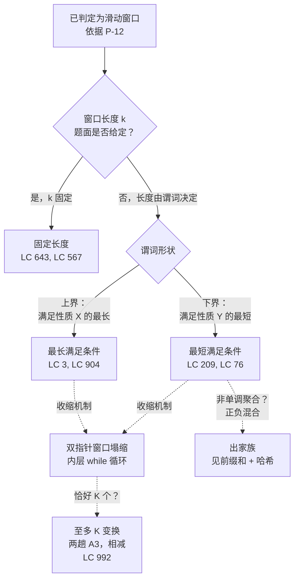

# 滑动窗口原型：五种形态怎么区分

## 如何决策

你已经把题目归到滑动窗口了。把它判进这个家族、而不是判给那些长得像的邻居，这个判别点在[双指针与滑动窗口](./P-12-two-pointers-vs-sliding-window.md)那一页；本页从它停下的地方接着讲。现在的问题是：五种原型里，题目真正想要哪一种。信号分两半：窗口长度是不是被题面钉死；如果不是，驱动扩展和收缩的那个谓词长什么形状。

一条按顺序套用的路由规则：

- 题面里点名了一个常数 `k` → **固定长度**。
- 窗口必须持续满足某个谓词 → **可变长度**，而这一页在那个分支里还要再拆。
- 谓词说的是“满足性质 X 的最长”，X 是上界 → **最长满足条件**。
- 谓词说的是“满足性质 Y 的最短”，Y 是下界 → **最短满足条件**。
- 三个可变长度变体共用的那套机制——那个不断收回左指针、直到窗口重新合法的内层循环——本身值得作为第五种原型单列：**双指针窗口塌缩**。

*题目要什么*和*窗口怎么收*之间的区别，正是大多数人栽跟头的地方。两条轴都认出来，正确的原型一眼就能落定。下面五个变体大致按读者遇到它们的顺序排列：固定长度排第一，因为第 3.2 章在第 3.3 章之前教它；然后是可变长度这把大伞；接着是撑起两个可变长子原型的那套收缩机制；最后是两个子原型本身。

## 流程图

*第一次分叉看 `k` 有没有被点名；第二次按谓词方向拆可变分支；两个可变变体共用同一套内层循环机制，而它自己也够格算一种原型。*

## 变体

### 固定长度

**识别信号：** 题面一上来就给出窗口大小 `k`，“长度恰好为 k 的连续切片”，或者“每个大小为 k 的窗口”。

何时选择：

- 窗口长度是题目给定的整数常数。
- 每个窗口的状态能靠一对进入/离开操作在 `O(1)` 内维护：数值聚合（`+= x` / `-= x`）、小字符集上的频次表，或者与一个参照多重集的比较。
- 聚合在单元素增量下要有合理定义：求和、元音计数、字符频次。最大值和最小值没有，所以那类题目走单调队列，而不是这个原型。

时间 / 空间：`O(n)` 时间，`O(1)` 或 `O(σ)` 空间（字符集）。[^1]

这个变体归[滑动窗口：固定长度](../part-3-pointers-window-prefix/02-sliding-window-fixed.md)所有。招牌题 LC 643（[Maximum Average Subarray I](https://leetcode.com/problems/maximum-average-subarray-i/)）。那一章走一遍 build/slide 的拆分，以及那张在 A1、A2、A3 上反复出现的四基本操作实例表。

### 可变长度

**识别信号：** 长度没给；题目要的是满足切片上某个谓词的最长窗口、最短窗口，或者这类窗口的个数。

何时选择：

- 答案是窗口长度、窗口本身，或者合法窗口的个数，而不是固定宽度下每个窗口的聚合值。
- 谓词在窗口扩展时单调：扩大窗口不可能不先穿过边界，就把谓词从违反变回满足（或从满足变成违反）。这条前置条件正是这个原型的两指针塌缩能成立的原因。[^2]
- 状态和固定长度里是同一类对象（计数器、频次表、不同元素个数整数），但要同时跨扩展*和*收回维护。

时间 / 空间：摊还 `O(n)`，`O(σ)` 空间。[^2]

可变长度这把大伞盖住两个子原型（最长满足条件、最短满足条件），以及两者共用的那套机制（双指针窗口塌缩）。这个变体归[滑动窗口：可变长度](../part-3-pointers-window-prefix/03-sliding-window-variable.md)所有，那一章把两种子形状并排教，因为它们的模板只在内层 while 的触发条件上不同。

### 双指针窗口塌缩

**识别信号：** 左指针只在一个内层循环里前进，而那个循环在右指针最近一次移动把窗口弄成非法时触发（在最短满足条件变体里则是：谓词已满足、窗口可以再收）。

何时选择：

- 这是机制，不是端到端算法。它就是那个内层 `while`，把单指针扫描变成摊还线性的双指针扫描，最长满足条件和最短满足条件两个变体里都有它。
- 收缩条件是局部的：知道 `state(l, r)` 和 `arr[l]` 上的元素，你就能在 `O(1)` 内决定要不要收 `l += 1`。
- 每个元素经 `r` 恰好进入窗口一次，经 `l` 最多离开一次。这就是这套算法长着嵌套循环的样子、却仍然是 `O(n)` 的全部原因。

“左指针只在右指针把约束耗尽时才前进”——这个说法是它够格单独成为一种原型的理由。把它当成挣来 `O(n)` 上界的证明义务：写内层 while 的时候，要回答的问题是“`l` 是不是只往右走，总共是不是最多走 `n` 次”。答案是是，你手里就是一个滑动窗口塌缩；答案是否，框架就错了，那是别的算法。[^2]

时间 / 空间：内层循环整体摊还 `O(n)`（每个元素最多被逐出一次）；状态 `O(σ)`。

这个变体归第 3.3 章，出现在最长满足条件和最短满足条件的模板里。模式页的邻居[双指针原型](./P-24-two-pointer-archetypes.md)讲的是*非*窗口的那些亲戚（两端向中间、快慢指针），塌缩机制在那里用不上。

### 最长满足条件

**识别信号：** 题目说“最长的子串 / 子数组，使其内部满足性质 X”，而 X 是一个*上界*。形状都是熟的：无重复字符、至多 K 个不同字符、至多 K 个零、至多 K 次替换。[^3]

何时选择：

- 答案是最大窗口长度（或那个窗口本身）。
- 谓词会被右侧加进来的错误元素破坏；恢复合法性靠从左边逐出，直到破坏消失。内层 while 跑在*窗口坏掉*的时候。
- 谓词必须在扩展下单调：一旦因扩展被违反，就只能靠收缩恢复。如果一次收缩恢复不了合法性，这个原型就用错了。

时间 / 空间：摊还 `O(n)`，`O(σ)` 空间。[^3]

这个变体归第 3.3 章。招牌题 LC 3（[Longest Substring Without Repeating Characters](https://leetcode.com/problems/longest-substring-without-repeating-characters/)）。直接延伸：LC 904（Fruit Into Baskets，把 `K=2` 白送的镜像版）、LC 1004（Max Consecutive Ones III）、LC 424（Longest Repeating Character Replacement）。

### 最短满足条件

**识别信号：** 题目说“最短的子数组 / 最小窗口，使其满足性质 Y”，而 Y 是一个*下界*。形状：和至少为 target、覆盖 `t` 的全部字符、包含某个必需多重集的全部元素。[^4]

何时选择：

- 答案是最小窗口长度，或最小窗口的内容。
- 谓词靠往右加元素得到满足；一旦满足，你记下当前长度，然后*继续收缩去找一个更小的满足窗口*。内层 while 跑在*窗口是好的*时候。
- 聚合必须在窗口长度上单调。标准情形是非负数组上的求和达标：非负性是前置条件，不是提示。正负混合打破单调性，题目也就整个离开这个家族，去前缀和 + 哈希的地盘。[^5]

时间 / 空间：摊还 `O(n)`，`O(σ)` 或 `O(1)` 空间。[^4]

这个变体归第 3.3 章。招牌题 LC 209（[Minimum Size Subarray Sum](https://leetcode.com/problems/minimum-size-subarray-sum/)）。困难版：LC 76（Minimum Window Substring），状态是 `(window_counts, have, required)`，谓词是 `have == required`。

还有一个近亲值得一提，虽然它不属于这五种原型：当问题问的是“恰好 K 个不同的子数组有多少个”，单趟扫描不行，因为“恰好 K 个”在扩展下不单调。做法是两趟最短满足条件，阈值分别取 `K` 和 `K-1`，再相减。LC 992（Subarrays with K Different Integers）是标准实例。[^6]

## 变体对比

| 维度 | 固定长度 | 可变长度（大伞） | 双指针窗口塌缩 | 最长满足条件 | 最短满足条件 |
|---|---|---|---|---|---|
| 窗口移动 | 两个指针每步各动一次，始终相距 `k` | 两个指针独立移动，长度自然浮现 | 内层循环在收缩条件成立时收回 `l` | `r` 每个外层步前进；`l` 只在收缩时收回 | `r` 每个外层步前进；`l` 只在收缩时收回 |
| 条件形状 | 固定长度窗口上的聚合 | 切片内容上的谓词 | 局部：对 `arr[l]` 做 `O(1)` 判断 | 上界谓词（“至多”“无重复”） | 下界谓词（“至少”“覆盖”） |
| 扩展触发 | 总是：每步滑一格 | 总是：外层循环推进 `r` | 不适用——只描述收缩 | 总是：外层循环推进 `r` | 总是：外层循环推进 `r` |
| 收缩触发 | 总是：与扩展配对，相距固定 `k` | 内层 while，由条件驱动 | 收缩条件成立时 | 谓词被违反时（窗口坏了） | 谓词满足时（窗口是好的） |
| 复杂度 | `O(n)` 时间，`O(1)` 或 `O(σ)` 空间 | 摊还 `O(n)`，`O(σ)` 空间 | 内层工作整体摊还 `O(n)` | 摊还 `O(n)`，`O(σ)` 空间 | 摊还 `O(n)`，`O(σ)` 空间 |
| 标准例子 | LC 643 最大平均值 | LC 3 / LC 209 | LC 3 和 LC 209 里的内层 while | LC 3 最长无重复 | LC 209 最小长度子数组求和 |

前四列用不同词汇说同一件事：固定长度把每次扩展和一对相距固定距离的扩展—收回配对绑在一起，而每一种可变长度原型都把扩展与收缩分到外层/内层循环的边界两侧。最长与最短那两行只在触发词上不同：*坏掉* 对 *好的*。这一位就是可变窗口家族里最常见的 bug 来源，所以它在表里单独占一行，在 §6 里也单独有一段。

## 三道招牌题

### LC 3 — Longest Substring Without Repeating Characters

[https://leetcode.com/problems/longest-substring-without-repeating-characters/](https://leetcode.com/problems/longest-substring-without-repeating-characters/)（中等）。

最长满足条件。状态是一张频次表；上界谓词是“窗口内没有重复字符”，等价于每个键都满足 `freq[c] <= 1`。右指针每步前进。当 `freq[s[r]]` 变成 2，窗口就坏了；内层 while 收回 `l`，直到 `freq[s[r]]` 落回 1，恢复合法性。窗口合法时就读一次最大长度。推演：输入 `"abcabcbb"`，先长成窗口 `"abc"`（长度 3）；然后 `r = 3` 又加入一个 `'a'`，内层 while 把 `l` 收到位置 1，窗口变成 `"bca"`（仍是 3）。答案 3 站得住。[^3]

### LC 209 — Minimum Size Subarray Sum

[https://leetcode.com/problems/minimum-size-subarray-sum/](https://leetcode.com/problems/minimum-size-subarray-sum/)（中等）。

最短满足条件。状态是滚动和；下界谓词是 `sum >= target`。右指针每步前进。一旦 `sum >= target`，窗口就是好的；内层 while 记下当前长度，并在谓词*仍然*满足时收回 `l`，找一个更短的满足窗口。推演：`target = 7`、`nums = [2, 3, 1, 2, 4, 3]`，谓词首次在 `r = 3` 成立（和 8），记长度 4；收到 `l = 1`（和 6）后退出。到 `r = 5`，和达到 9，一路收到 `[4, 3]`、长度 2，这就是答案。[^4]

### LC 643 — Maximum Average Subarray I

[https://leetcode.com/problems/maximum-average-subarray-i/](https://leetcode.com/problems/maximum-average-subarray-i/)（简单）。

固定长度。状态就是一个整数滚动和；`slide_in` 加上进入的元素，`slide_out` 减去离开的元素。最大平均值化简成最大和，因为 `k` 是正常数；返回时再除一次。推演：`nums = [1, 12, -5, -6, 50, 3]`、`k = 4`。先建出和 2；滑到 51（丢 1，加 50）；再滑到 42（丢 12，加 3）。最大值 51，平均值 12.75。[^1]

## 常见误解

**窗口永远在变大。** 只见过固定长度的读者会带着一幅画走：两个指针步调一致，每步都前进。可变长度把这幅画打碎：窗口在外层循环里变大，*同时*又在内层 while 里变小。最长满足条件里，收缩在右侧新来的元素破坏谓词时触发，左指针一路追到合法性恢复。最短满足条件里，收缩触发*是因为*谓词已满足、而当前窗口内部可能还藏着更小的满足窗口。两种形状仍然是摊还 `O(n)`，因为左指针只往右走，总共只走 `n` 次。内层 while 是按整趟运行计的，不是按每个外层轮次计的。不管输入长什么样，外层循环加内层循环的总指针移动不超过 `2n`。

**总要两个指针。** 固定长度原型严格来说只需要一个下标。窗口左边界是隐含的：在外层下标 `r` 处，窗口是 `[r-k+1, r]`。实现可以拿 `r` 从 `k-1` 扫到 `n-1`，每步读 `nums[r]` 和 `nums[r-k]`。两个具名指针是教学道具，为的是和可变长度模板对称。第 3.2 章的固定长度代码用的就是这种单下标形式，拿到的同样是 `O(n)` 上界。[^1]

**哈希表状态必须每轮清空。** 不必须。这个原型的全部意义就在于状态是跨滑动*维护*的，从不从头重算。滑动本身就在记账：`slide_in` 在元素进入时给一个槽位加一，`slide_out` 在元素离开时给一个槽位减一。唯一合法的“清空”是隐式发生的：`slide_out` 让 `freq[c]` 降到零时，那个键在多重集意义上已经不存在了，哪怕实现把那个零留在表里。很多人一看到计数归零就把键从字典里删掉，这对正确性没坏处，还能省一个常数因子的空间，但算法并不要求这么做。它要求的是：你绝不能在运行中途重置状态。

**滑动窗口适用于任何“子数组”题。** 不适用。这个家族的全部地基是“由可增量维护的状态汇总出来的连续切片”。题目一旦允许不连续的子序列（LC 1 Two Sum 的下标对不是切片），或者聚合在窗口长度上不单调（LC 560 Subarray Sum Equals K 带正负混合整数，加进 `nums[r]` 可能让和变小），这个家族就是错的。LC 1 去拿哈希表；LC 560 去拿前缀和 + 哈希。完整的判别方法在决策页[双指针与滑动窗口](./P-12-two-pointers-vs-sliding-window.md)，本页只是它后面的应用。[^5]

## 参考文献

[^1]: DSA Handbook，[滑动窗口：固定长度](../part-3-pointers-window-prefix/02-sliding-window-fixed.md)。

[^2]: Cormen, Leiserson, Rivest, Stein, *Introduction to Algorithms*, 4th ed., MIT Press, 2022, Ch. 17 §17.1.

[^3]: LeetCode, "3. Longest Substring Without Repeating Characters." https://leetcode.com/problems/longest-substring-without-repeating-characters/

[^4]: LeetCode, "209. Minimum Size Subarray Sum." https://leetcode.com/problems/minimum-size-subarray-sum/

[^5]: DSA Handbook，[前缀和 + 哈希表组合](../part-3-pointers-window-prefix/05-prefix-sum-hash.md)。

[^6]: LeetCode, "992. Subarrays with K Different Integers." https://leetcode.com/problems/subarrays-with-k-different-integers/
