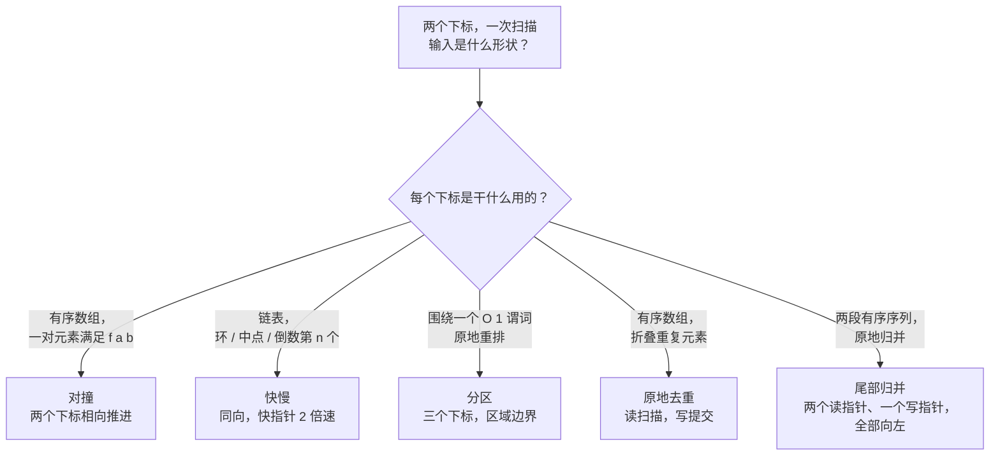

# 双指针原型：对撞、快慢、分区、原地去重、尾部归并

五种算法顶着同一个名字。它们表面上有一个共同特征（两个下标、一次线性扫描、常数级额外空间），除此之外几乎毫无共同点。不变量不同，终止条件不同，每个指针代表什么也不同。选错原型，本来干净的 O(n) 解法要么变成错误答案，要么退化成平方级的烂摊子；想避开这个坑，唯一的办法是看输入的形状，而不是看循环的写法。

## 如何决策

双指针是一个家族，不是单一技巧。写第一行代码之前该问的问题是：这些指针是**干什么用的**。是区域边界？是一对向彼此收敛的候选？是一个扫描位置外加一个独立的写指针？是一个用来判断可达性的探针？还是来自两份不同输入的两条读前沿？

每个答案都指向一个不同的原型。好消息是：输入形状几乎总会告诉你该选哪个。有序数组加一对目标和，选对撞。链表加环或中点问题，选快慢。围绕某个谓词原地重排，选分区。有序数组折叠重复元素，选原地去重。两段有序序列原地归并到尾部预留空间，选尾部归并。这五种输入每次都以同样的方式映射到同样的五种原型。下面这张表就是路由表。

## 流程图

*路由表：按输入形状和指针的含义来选，而不是按循环的表面写法。*

## 变体

五个子原型，各有各的不变量。先读识别信号；如果你的问题对得上，这一行剩下的内容就告诉你大致形状。

### 对撞指针（相向收敛）

**识别信号：有序数组；需要一对 `(a, b)` 相对某个目标满足 `f(a, b)`。**

初始化 `l = 0`、`r = n - 1`。两个指针相向推进；若存在答案对，它一定落在闭区间 `[l..r]` 内。每次迭代，`nums[l]`、`nums[r]` 与目标的比较会排除掉一侧：太小就前移 `l`，太大就后退 `r`，相等就返回。这段情形分析证明——被丢弃的那个方向不可能比留下的那一侧更优——依赖两件事：`nums[l]` 是左侧尚未访问元素中最小的，`nums[r]` 是右侧最大的。这正是有序性换来的东西。

当输入有序（或具有回文、盛水容器那种下标对称性），且谓词相对目标在 `nums[l]`、`nums[r]` 上单调时，选这个。时间 O(n)，空间 O(1)。一旦去掉有序性，正确性立刻消失；LC 1（Two Sum，无序）是哈希表题，不是双指针题。[^1]

CLRS 在快速排序的分区步骤里发展的是同一个双指针手法。[^2] 锚点：[双指针：对撞](../part-3-pointers-window-prefix/00-two-pointers-opposite.md)。

### 链表上的快慢指针

**识别信号：链表；环、中点、倒数第 n 个这类问题。**

两个指针都从头节点出发，同向移动。快指针每步走两个 `next`，慢指针走一个。间距 `(fast - slow)` 每步增长一，直到快指针撞到 null（无环），或者快指针在环内追上慢指针。Donald Knuth 在 TAOCP 第二卷（1969）的习题 6 和 7 中把这个算法归到 Robert W. Floyd 名下。[^3] 该算法并未出现在 Floyd 本人发表的著作里；Wikipedia 把它记成一则很可能是民间流传的定理，而 Knuth 的归属说明是唯一的印刷来源。[^3]

三个问题塌缩到同一套骨架：“有没有环？”（LC 141）、“中点在哪？”（LC 876）、“倒数第 n 个节点是哪个？”（LC 19，先用固定间距热身）。慢指针是**答案位置**，快指针是**探针**——探针一旦终止，就说明答案已可确定。时间 O(n)，空间 O(1)。

当数据结构是单链表、问题问的是一个比例位置或是否存在回边时，选快慢指针。放到数组上，按下标随机访问是 O(1)，用它的理由就没了。锚点：第 5.3 章（链表环检测，按 Part 5 批次延后）。

### 三路分区（荷兰国旗问题）

**识别信号：围绕一个 O(1) 可判定的谓词原地重排；同一类内部的相对顺序无所谓。**

三个指针 `low`、`mid`、`high` 把数组切成四个区域：`[0..low)` 是已定低区、`[low..mid)` 是已定中区、`[mid..high]` 是未分类区、`(high..n)` 是已定高区。Edsger W. Dijkstra 在 *A Discipline of Programming*（1976）里把它当作不变量驱动循环的典范。[^4] 每一步算法读 `nums[mid]`，然后三选一：与 `low` 交换并同时推进两者，只推进 `mid`，或者与 `high` 交换且只后退 `high`。“与 high 交换后不要推进 `mid`”这一行，正是面试压力下最容易被重新发明错的一行：换进来的值来自未分类区，还没被检查过。[^4]

当题目说“原地”“常数级额外空间”“类别数固定且很少”时，选分区。LC 75 Sort Colors 是招牌题。时间 Θ(n)，空间 O(1)。当同一类内部的相对顺序必须保留时，它就失效了（改用尾部填充式的原地去重）。锚点：[双指针：同向](../part-3-pointers-window-prefix/01-two-pointers-same-direction.md)。

### 原地去重（读写同向）

**识别信号：有序数组；用 O(1) 额外空间折叠重复元素（或者做任何稳定的原地过滤）。**

两个指针都从头部出发、同向移动。`read` 一直前进；`write` 只在算法把一个元素提交进保留前缀时才前进。第 3.1 章的不变量：`nums[0..write)` 是按原始顺序稳定保留的前缀，`nums[write..n)` 是草稿区。[^5] 这个模式靠替换 `keep` 谓词来泛化：LC 26 的谓词是“与上一个保留下来的元素不同”；LC 80 的是“不同，或者这正好只是第二份拷贝”；LC 27 的是“不等于目标值”。

与快慢指针的分水岭在于每个指针代表什么。快慢指针把一个指针当答案位置、另一个当探针；原地去重把一个当扫描游标、另一个当保留前缀的长度。数据结构决定用哪个家族。数组默认走原地去重，链表默认走快慢指针，因为数组上的随机访问是 O(1)，而链表上每次探查要 O(n)。

时间 O(n)，空间 O(1)。锚点：[双指针：同向](../part-3-pointers-window-prefix/01-two-pointers-same-direction.md)。

### 尾部归并

**识别信号：两段有序序列；原地归并进其中一段，而这段尾部有多余空位。**

两个读指针 `i = m - 1`、`j = n - 1`，加一个写指针 `k = m + n - 1`。三个指针都从各自范围的最右端出发，一路向左。能做到 O(1) 额外空间的关键是：从右往左写进 `nums1`，永远不会覆盖还没读的 `nums1` 元素，因为写下标 `k` 始终大于读下标 `i`，直到两段都耗尽。从头部归并则会踩掉未读元素，逼你开一个 O(m + n) 的拷贝缓冲。

当题目给你两段有序输入、且目标数组尾部有预留空位时，选它（LC 88 是招牌题）。时间 O(m + n)，空间 O(1)。当输出要落在一块新分配的数组里时，它就失效了；那种场景下 CLRS 教科书式的从左到右归并既正确又简单。[^2] 当有序序列超过两段时也失效；那是 k 路堆归并，另行讨论。锚点：第 1.0 章（数组）。

## 变体对比

| 维度 | 对撞 | 快慢 | 分区 | 原地去重 | 尾部归并 |
|---|---|---|---|---|---|
| 指针移动 | 相向靠近 | 同向，速度差 2 倍 | low/mid 向右，high 向左 | 同向，写指针条件推进 | 全部向左 |
| 是否要求有序 | 是（或结构对称） | 否 | 否 | 是（针对去重这个特化） | 两段输入都有序 |
| 是否原地 | n/a（只读） | n/a（只读） | 是 | 是 | 是 |
| 时间 | O(n) | O(n) | Θ(n) | O(n) | O(m + n) |
| 空间 | O(1) | O(1) | O(1) | O(1) | O(1) |
| 招牌题 | [LC 11](https://leetcode.com/problems/container-with-most-water/) Container With Most Water | [LC 141](https://leetcode.com/problems/linked-list-cycle/) Linked List Cycle | [LC 75](https://leetcode.com/problems/sort-colors/) Sort Colors | [LC 26](https://leetcode.com/problems/remove-duplicates-from-sorted-array/) Remove Duplicates | [LC 88](https://leetcode.com/problems/merge-sorted-array/) Merge Sorted Array |

两条主线从这张表里浮出来。第一条：每个指针代表什么？区域边界（分区）、候选对的端点（对撞）、答案或探针（快慢）、保留前缀的边界（去重），还是跨两份输入的读写前沿（尾部归并）。第二条：输入是一段序列还是两段？前四个都是一段，尾部归并是两段。这两个问题大约读十秒钟，就能把这个家族分清。

## 三道招牌题

每个原型一道，用它们把本篇与其余原型区分开。标签给出的是区分性信号。

- [LC 11 — Container With Most Water](https://leetcode.com/problems/container-with-most-water/) [中等] • 对撞，情形分析证明
- [LC 141 — Linked List Cycle](https://leetcode.com/problems/linked-list-cycle/) [简单] • 快慢指针，Floyd 龟兔算法
- [LC 75 — Sort Colors](https://leetcode.com/problems/sort-colors/) [中等] • 荷兰国旗三路分区

LC 11 是检验情形分析证明最干净的一道：算法跳过的每一对，都被它访问过的某一对所压制，所以被丢弃的那一半藏不住更好的答案。LC 141 演示的是“间距每步加一”的论证，它把快慢指针和任何读写扫描区分开。LC 75 逼着读者正面处理“与 high 交换后不要推进 `mid`”那一行——几乎所有人都是在这里把算法重新发明错的。

## 常见误解

**“双指针要求数组有序。”** 只有对撞要求。快慢指针跑在任意链表上。分区跑在任意数组上；谓词才是它排序的依据，原始顺序无关。原地去重之所以需要有序，只是因为“重复”是相对位置定义的；同一套骨架换个 `keep` 谓词，就是 LC 27（Remove Element）和 LC 283（Move Zeroes）背后的原地过滤，这两道都不假设有序。尾部归并要求两段输入都有序，但那是两个有序，不是一个。“有序蕴含对撞”这句话是对的；反过来才是误解。

**“快慢指针只能用来判环。”** 判环是最上镜的应用，但同一套骨架能回答单链表上任何关于比例位置的问题。偶数/奇数长度链表的中点（LC 876）：当快指针撞到 null 或 `fast.next == null` 时，慢指针在 floor(n/2)。倒数第 n 个（LC 19）：先让快指针走 `n` 步，然后两个一起走，直到快指针撞到 null；慢指针就是答案。回文链表（LC 234）：快慢指针找中点，原地反转后半段，再从两端向中间比对。判环变体（LC 141、LC 142）只是其中一个特化；间距指针家族（P-28，链表原地反转那一组）把这个动作推广成“先让快指针走 k 步，再启动慢指针”。

**“分区需要一个基准值。”** 两个不同的东西共用了 partition 这个名字。Lomuto 分区用一个基准值，返回 `<= pivot` 与 `> pivot` 之间的边界。Hoare 分区用一个基准值和两个相向指针；它平均更快，也是 CLRS 分析快速排序时采用的版本。[^2] 本篇收录的荷兰国旗变体是一个**三路分区**，根本不取基准值。它取的是一个类别谓词（这里是值 0、1、2），产出三个区域。在 LC 75 上伸手去“选个基准，然后……”是范畴错误；这个算法出自 Dijkstra 1976，不是 Hoare 1962。[^4]

**“双指针和滑动窗口是一回事。”** 两者都是两个下标走一遍线性扫描。区分性问题是 `[l..r]` 代表什么：是一个维护着聚合量的窗口（滑动窗口），还是两个独立位置、它们的关系本身就是答案（双指针）？“找一个满足性质 X 的连续子数组”是滑动窗口。“找一对、三元组、做分区”是双指针（对撞或去重）。“找倒数第 n 个 / 中点 / 环”是快慢指针。“原地归并有序序列”是尾部归并。姊妹决策页 [P-12 双指针与滑动窗口](./P-12-two-pointers-vs-sliding-window.md) 详细处理这件事；本篇是在读完那一篇之后再看的。

**“五种原型看着像一种技巧，因为它们都是 O(1) 额外空间。”** 常数级额外空间是实现层面的属性，不是算法的属性。底下的算法各不相同：对撞是有序下标上的情形分析证明；快慢是未知长度环内的间距论证；荷兰国旗是三条交换规则下的四区域不变量；原地去重是稳定过滤；尾部归并是从右往左写的取巧。把这五个当成“同一种技巧的不同装饰”，结果就是读者凭肌肉记忆写出 LC 75 的内层循环——每次交换后都 `mid++`——然后在 `[2, 0, 2, 1, 1, 0]` 上交出一个错答案。

## 参考文献

[^1]: chuka231, "Solved all two pointers problems in 100 days," LeetCode Discuss, 2022. https://leetcode.com/discuss/study-guide/1688903

[^2]: Cormen, Leiserson, Rivest, Stein, *Introduction to Algorithms*, 4th ed., MIT Press, 2022, §§2.3.1, 7.1.

[^3]: Wikipedia, "Cycle detection." https://en.wikipedia.org/wiki/Cycle_detection

[^4]: Dijkstra, *A Discipline of Programming*, Prentice-Hall, 1976. Wikipedia, "Dutch national flag problem." https://en.wikipedia.org/wiki/Dutch_national_flag_problem

[^5]: DSA Handbook, [Two pointers: same direction](../part-3-pointers-window-prefix/01-two-pointers-same-direction.md).
