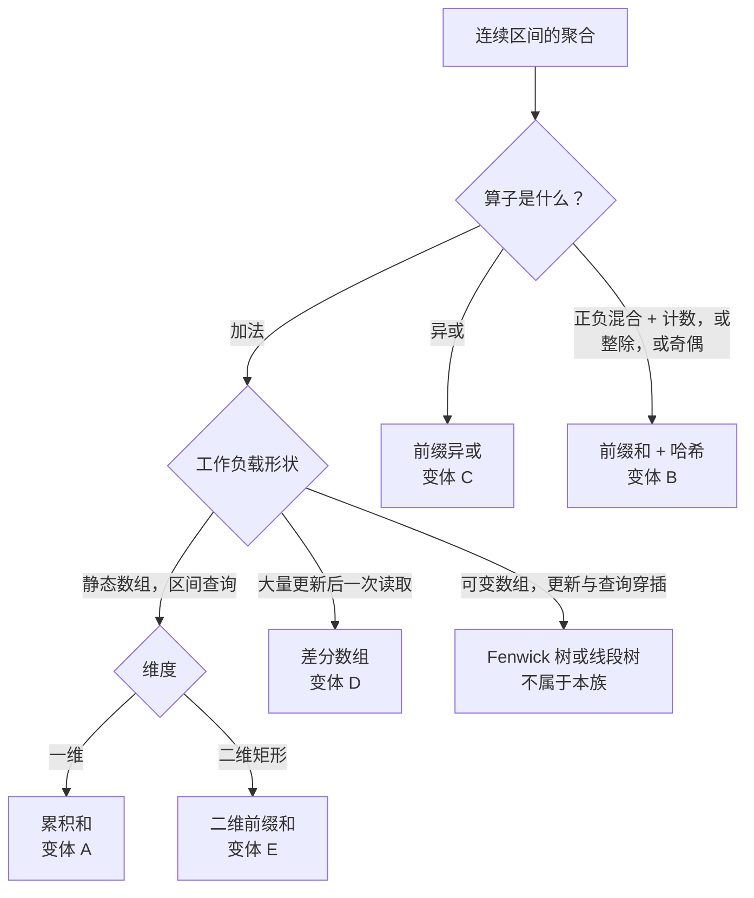

# 前缀和原型

前缀和这一族回答的是同一个问题，只是问法有五种。问题是：*一个序列里某段连续区间的聚合值是多少，能不能不必每次都重新扫一遍这段区间就算出来？* 答案是一条代数恒等式，套到题目交给你的那个算子上去。

## 如何决策

定义 `prefix[0] = 0`，并对 `i` 从 1 到 `n` 定义 `prefix[i] = nums[0] + nums[1] + ... + nums[i-1]`。闭区间 `nums[l..r]` 的和于是塌缩成一次减法：

```text
sum(nums[l..r]) = prefix[r+1] − prefix[l]
```

这条恒等式是本页每个变体的脊柱。用 O(n) 建一次前缀表，每次区间查询 O(1) 回答，只要 Q 与 n 量级相当，就能打赢 O(n × Q) 的暴力扫描。[^1]

这套把戏要成立，得满足三个性质。聚合算子必须**可逆**（减法抵掉加法；异或是自己的逆运算）。输入在查询之间必须**静态**，否则工作负载得是反过来的形状：大量更新、最后一次读取。还有空前缀哨兵 `prefix[0] = 0` 必须是表里一个真实的条目，而不是查询代码里的特例分支。正是这个哨兵让公式在处理 `l = 0` 时不用判分支，而它在本页其他每个原型里都会换一种形状再出现一次：在哈希变体里是 `counts[0] = 1`，在二维变体里是最左一列加上最上一行的零，在差分数组里是隐含的 `diff[r+1] -= delta` 边界。

两个支点把这个家族铺开。**算子聚合的是什么？** 求和、异或、映射成 0/1 的奇偶性、模 K 的余数，在一个可逆二元算子下都表现得像求和。**工作负载是什么形状？** 一维或二维的建一次查多次、带哈希的建与查穿插，或者大量区间更新之后一次读取。下面五个原型就是这两个支点的产物。

## 流程图



*第一层分支看算子，第二层看工作负载形状，第三层看维度。可变数组直接离开这个家族。*

## 变体

### A. 累积和（一维前缀和）

**识别信号：**输入是静态数组，工作负载是大量区间求和查询。提示句是“数组不会变”配上“大量 `sumRange` 调用”，这就是 LC 303 的原文。[^2]

**何时选它：**静态数组、加法算子、查询占主导。建表 O(n)，每次查询一次减法。总成本 O(n + Q) 取代暴力的 O(n × Q)，在 n = Q = 10^4 时就是跑得过和超时的区别。

**状态与时间/空间：**分配长度 `n + 1` 的 `prefix[0..n]`，从左到右跑递推式 `prefix[i+1] = prefix[i] + nums[i]`。建表 O(n)，查询 O(1)，空间 O(n)。开头那个零就是空前缀哨兵，它去掉了 `l = 0` 的分支。

**锚点：**[前缀和与差分数组](../part-3-pointers-window-prefix/04-prefix-sums.md)带着四种语言的参考实现和累积和交互组件。归约 `prefix[r+1] − prefix[l]` 是那一章的招牌。[^1]

### B. 前缀和 + 哈希（LC 560 一族）

**识别信号：**数组正负混合，或者谓词是“恰好等于 K”“能被 K 整除”“奇偶性为 K”。滑动窗口的单调性前提失效了；只要有一个元素可能为负，滑动窗口的和对窗口长度就不再单调。[^3] 约束里的触发句是负的取值下界：任何 `nums[i] >= -1000`（或任何显式写出的负数下界）的 LC 题都路由到这里。

**何时选它：**统计具有精确相等性质的子数组，或者找最长的这种子数组。把脊柱恒等式重新排一下：

```text
prefix[r+1] − prefix[l] = K   iff   prefix[l] = prefix[r+1] − K
```

于是随着 `r` 扫过数组，“以 `r` 结尾、和为 K 的子数组有多少个”就变成“前面有多少个前缀等于 `prefix[r+1] − K`”。把目前见过的每个前缀值放进哈希表，每步就能 O(1) 回答。

**状态与时间/空间：**一个标量滚动和，加上一张 `counts: prefix-value -> int` 的哈希表，预置 `counts[0] = 1`。一趟扫完，先查后插。期望时间 O(n)；对抗性冲突下最坏 O(n²)，那是理论情形，标准输入上观察不到。[^4] 空间 O(n) 用于哈希表。预置的那一项就是搬进哈希表的空前缀哨兵；去掉它，所有从下标 0 开始的子数组都会被少数。

**同一骨架上的变体：**LC 974 把查询键换成 `prefix mod K`；LC 525 把 `0 → -1` 做映射，并按前缀记录首次出现的下标；LC 1248 把每个元素映射成奇偶位，就还原成 LC 560 的形式。

**锚点：**[前缀和 + 哈希表的组合](../part-3-pointers-window-prefix/05-prefix-sum-hash.md)带着完整模式、正负混合的反例推演，以及 LC 560 的四种语言参考实现。[^3]

### C. 前缀异或

**识别信号：**聚合算子是异或，不是加法。提示直接写在题面里：“子数组的异或”“异或等于 K 的子数组”“所有子数组的异或之和”。

**何时选它：**异或是自己的逆运算：`a XOR a = 0`。驱动变体 A 的那条恒等式照搬过来，

```text
XOR(nums[l..r]) = prefix_xor[r+1] XOR prefix_xor[l]
```

变体 B 那套哈希技巧也顺势搬到异或场景：“异或等于 K 的最长子数组”就是在 `counts[prefix_xor]` 里记首次出现的下标，查询键取 `prefix_xor XOR K`。

**状态与时间/空间：**一个标量滚动异或值，加上与变体 B 相同的哈希表形状。建表 O(n)，穿插查询期望 O(1)。空间 O(n)。异或与符号无关，所以变体 B 那些负数输入的顾虑在这里不成立。

**锚点：**第 3.4 章 §5.2 讲了前缀异或这个基本操作；LC 1442 和 LC 1310 是标准的练手题。LC 1442 上的窍门在于 `a == b` 塌缩成 `prefix_xor[i] == prefix_xor[k+1]`，而对每一对满足该式的 `(i, k)`，可选的 `j` 有 `k − i` 个。这个归约是这个变体上杠杆最大的一步。[^5]

### D. 差分数组

**识别信号：**工作负载是变体 A、B 的反面：先来大量区间*更新*，然后一次性读出每个格子。触发句大致是“对一个长度为 n 的数组施加这 B 次区间增量，返回最终数组”。当 B × n 超出时间预算时，每次更新 O(n) 不可接受，而在 B = n = 2 × 10^4 时就是超出了。

**何时选它：**在边界上标记*变化*，而不是动每个格子。对每个更新 `(l, r, delta)`，写 `diff[l] += delta` 和 `diff[r+1] -= delta`。所有更新做完，对 `diff` 原地跑一趟前缀和。结果就是最终数组。

**状态与时间/空间：**一个 `diff[0..n-1]` 数组，初始全零。每次更新 O(2) 次写，最后一趟 O(n)。总时间 O(B + n)，空间 O(n)。前缀和的逆恒等式 `prefix(diff(arr)) = arr` 是代数上的依据：一个全零向量，在 `l` 处 `+δ`、在 `r+1` 处 `-δ`，做前缀和之后就还原成闭区间 `[l..r]` 上的一段 δ 块。把 B 个这样的更新叠起来，线性性就还原出正确答案。

**什么时候失效：**一旦有查询需要数组在流中途的运行状态，差分数组就不管用了。它只知道最终答案。那种场景归 Fenwick 树或线段树。

**锚点：**[前缀和与差分数组](../part-3-pointers-window-prefix/04-prefix-sums.md)带着 LC 1109 的实例推演。LC 1094（Car Pooling）和 LC 2848（Points That Intersect With Cars）是自然的后续。[^1]

### E. 二维前缀和（积分图）

**识别信号：**静态矩阵，矩形求和查询。触发词是“给定一个 `m × n` 的矩阵”加上“大量 `sumRegion(r1, c1, r2, c2)` 调用”。

**何时选它：**同一套代数靠容斥在二维上跑。建一张 `(m+1) × (n+1)` 的前缀表，最左一列和最上一行全为零（`prefix[0] = 0` 的二维对应物）：

```text
P[i+1][j+1] = matrix[i][j] + P[i+1][j] + P[i][j+1] − P[i][j]
```

建表时加上本格、上面那条带子、左边那条带子，再减掉两条带子重叠的那个角上的子矩形。

查询是四角恒等式：

```text
S[r2][c2] − S[r1−1][c2] − S[r2][c1−1] + S[r1−1][c1−1]
```

这里的记号用的是前缀表里做了 `+1` 位移的闭区间右下角（真正的实现读的是 `P[r2+1][c2+1] − P[r1][c2+1] − P[r2+1][c1] + P[r1][c1]`）。符号模式是 `+ − − +`：从原点到右下角的大矩形，减去目标上方和左侧的两条带子，再加上两次减法都多减掉的那个角上的子矩形。

**状态与时间/空间：**建表 O(m × n)，空间 O(m × n)，查询 O(1)：不管矩形多大都恰好是四次数组访问。正是这个结果把积分图带进了 1984 年的计算机图形学（Crow, SIGGRAPH），又带进了 2001 年的计算机视觉（Viola-Jones 人脸检测）。[^6]

**锚点：**第 3.4 章负责二维部分。LC 304 是标准练手题；LC 1314（Matrix Block Sum）和 LC 363（Max Sum of Rectangle No Larger Than K）把这个模式往外延伸。[^1]

## 变体对比

| 变体 | 聚合类型 | 查询形状 | 建表开销 | 查询开销 | 经典题目 |
|---|---|---|---|---|---|
| A. 累积和 | 加法，一维 | `prefix[r+1] − prefix[l]` | O(n) | O(1) | LC 303 |
| B. 前缀和 + 哈希 | 加法，相等 / 取模 / 奇偶 | `counts[prefix − K]` 查表 | 建与查交织 O(n) | 每步期望 O(1) | LC 560 |
| C. 前缀异或 | 异或，一维或哈希 | `prefix_xor[r+1] XOR prefix_xor[l]` | O(n) | O(1) | LC 1442 |
| D. 差分数组 | 逆加法（区间更新） | 末尾一趟前缀和 | 总计 O(B + n) | 最后一次读取 | LC 1109 |
| E. 二维前缀和 | 加法，二维矩形 | 四角容斥 | O(m × n) | O(1) | LC 304 |

## 三道招牌题

三道题锚住了这一族。把这三道做透，剩下两个变体的信号一眼就能认出来。

[LC 303 — Range Sum Query Immutable](https://leetcode.com/problems/range-sum-query-immutable/)是变体 A 最干净的示范。静态数组、大量区间求和查询、空和哨兵把 `l = 0` 的分支从查询里去掉、每次调用两次读取一次减法。如果你能不查资料在纸上推出 `prefix[r+1] − prefix[l]`，变体 A 就是你的了。[^2]

[LC 560 — Subarray Sum Equals K](https://leetcode.com/problems/subarray-sum-equals-k/)是变体 B 的标准题，也是面试轮换里问得最多的子数组计数题。数组正负混合；滑动窗口不适用；哈希表把目前见过的每个前缀值映射到出现次数，预置 `{0: 1}`。做完一遍，再跑一遍 `nums = [1, -1, 1, 1], k = 2` 的推演，看为什么想当然的滑动窗口写法会少数。[^3]

[LC 304 — Range Sum Query 2D Immutable](https://leetcode.com/problems/range-sum-query-2d-immutable/)是最纯粹的变体 E。带 `+ − − +` 符号的四角公式，就是 Crow 在 SIGGRAPH 1984 上给出的容斥恒等式；从图里把它推出来，比背符号模式更快也更可靠。[^6]

## 常见误解

**“前缀和就是把累计和存下来。”** 单存一份累计和数组什么也没做。技术点在*归约* `prefix[r+1] − prefix[l]`：存累计和是为了让任意区间和塌缩成一次减法，同时把空前缀哨兵 `prefix[0] = 0` 当作真实条目，这样 `l = 0` 的边界情形就不需要自己的代码路径。没有减法恒等式，你只是给数组换了个名字；没有哨兵，你多加了一个分支，而任何人写它的时候有一半是错的。

**“前缀和加哈希就是 O(1) 查表。”** 这个查表是期望 O(1)，不是保证 O(1)。建表是 O(n)，每一步对哈希做一次插入、一次查询。CLRS §11.2 在简单均匀哈希下证明了期望 O(1) 的界；§11.4 讲对抗性冲突的情形，那里每次操作退化到 O(n)。[^4] 所以总复杂度是期望 O(n)、理论最坏 O(n²)，而最坏情况在标准测试输入上观察不到，因为生产级哈希函数把对手挡住了。孤立地说这个技术是“O(1)”，是一种省事的说法，它掩盖了开销真正落在哪里。

**“差分数组支持区间更新加点查询。”** 它支持的是对偶的那一对：*点*更新加区间查询，那是 Fenwick 树干的活；差分数组做的是*区间更新*加最后一次性*整体读取*。流中途的点查询它不支持。在做完末尾那趟前缀和之前，数组的中间状态毫无意义。“大量更新，然后一次读取”这个工作负载形状是承重的；只要有查询和更新穿插，差分数组就不适用，模式就路由到 Fenwick 树或线段树。

**“二维前缀和就是四个角。”** 是四个角，但要配对的符号和配对的位置偏移，这两样都容易写错。闭区间的右下角在每个维度上都要做 `+1` 位移（因为那是哨兵位移的那一侧）；左上的开区间角*不*做。符号模式是 `+ − − +`，从容斥推出：大矩形减去目标上方和左侧的两条带子，再加上两次减法都多减掉的那个角上的子矩形。漏掉任何一个 `+1` 在小输入上都看不出来，一旦矩形上边或左边贴着第 0 行或第 0 列，隐藏用例就会挂。纪律是每次都从图里把公式推一遍，而不是背下来。

**“滑动窗口比前缀和加哈希快，所以永远先想它。”** 滑动窗口是 O(1) 空间，对比哈希组合的 O(n)，但它只在严格更窄的一类题上成立：谓词对窗口长度单调，而在求和目标这一族里这要求 `nums[i] >= 0`。约束里一旦没写输入非负，单调性前提就破了，收缩规则就错了，算法给出的就是错答案。信号在约束里，不在题面叙述里：任何负的取值下界都把题目踢出滑动窗口这一族，送进变体 B。

## 参考文献

[^1]: USACO Guide, "Introduction to Prefix Sums." https://usaco.guide/silver/prefix-sums. USACO Guide, "More on Prefix Sums." https://usaco.guide/silver/more-prefix-sums

[^2]: LeetCode, "303. Range Sum Query - Immutable." https://leetcode.com/problems/range-sum-query-immutable/

[^3]: DSA Handbook, [前缀和 + 哈希表的组合](../part-3-pointers-window-prefix/05-prefix-sum-hash.md).

[^4]: Cormen, Leiserson, Rivest, Stein, *Introduction to Algorithms*, 4th ed., MIT Press, 2022, Ch. 11.

[^5]: LeetCode, "1442. Count Triplets That Can Form Two Arrays of Equal XOR." https://leetcode.com/problems/count-triplets-that-can-form-two-arrays-of-equal-xor/

[^6]: Crow, "Summed-area tables for texture mapping," SIGGRAPH '84. https://dl.acm.org/doi/10.1145/800031.808600. Wikipedia, "Summed-area table." https://en.wikipedia.org/wiki/Summed-area_table
