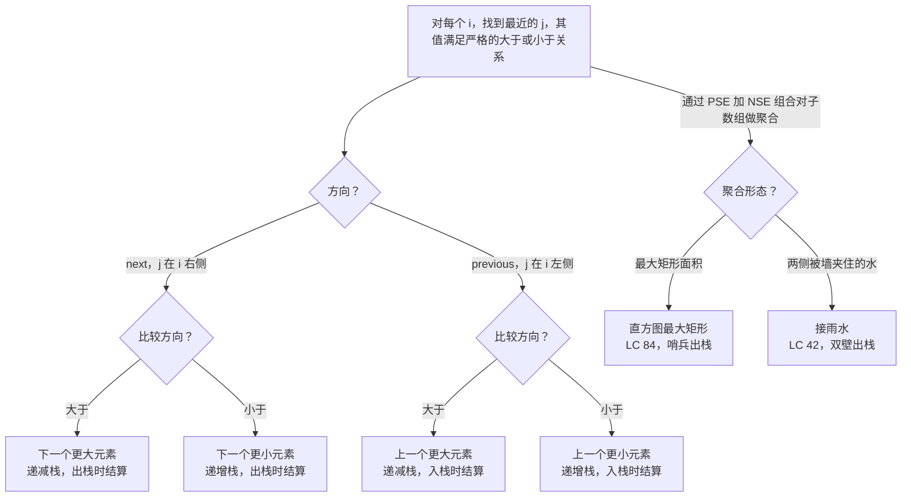

# 单调栈原型

只有两件事同时成立时，单调栈才是对的数据结构：题目要对数组中的每个位置 `i` 回答*左右最近的、值大于（或小于）`nums[i]` 的位置在哪*，并且数组是从一端到另一端按线性顺序扫过去的。[^1] 两个条件缺一不可：哈希表能答“按值最近”，但没有位置顺序；线段树能答“区间查询”，但没有逐元素的最近语义。两者的交集正是单调栈被设计出来解决的那块。

本页枚举这一家族产生的四类原型，并给出在新题上从兄弟原型里挑中其中一个的线索。配套页面是 [P-27 monotonic deque archetypes](./P-27-monotonic-deque-archetypes.md)，它把同一条单调性不变式又推进一步：当固定大小的窗口滑过队头时，头部会多出一次逐出。

## 如何决策

压栈压索引，绝不压值。只要栈顶破坏了选定的单调顺序就弹出。对“下一个”类查询，在出栈事件里结算答案；对“上一个”类查询，在入栈事件里结算（与新的栈顶比较）。两个维度决定具体变体。**方向**：要找的是左边（previous）还是右边（next）最近的合格位置？**比较方向**：所谓的“合格”是大于还是小于？四种组合，一套模板，四个四字母缩写：NGE、NSE、PGE、PSE。

整个过程保持线性，因为每个索引只入栈一次、最多出栈一次。栈操作总数上界是 `2n`，每次都是 O(1)，内层 `while` 看似平方级的开销在聚合分析下被抵消——这是 CLRS 第 16 章的经典例子。[^2] 空间是 O(n)：严格单调的输入一次弹出都不会触发，所有索引会同时留在栈里。

两种组合把这一家族推出逐元素查询之外。直方图最大矩形（LC 84）对每根柱子分别算出左右两侧最近的更矮柱子，再把柱高乘以得到的宽度。接雨水（LC 42）弹出那些水柱此刻两侧都被更高墙夹住的柱子。两者复用同一套模板；两者都该被认成单调栈的实例，而不是当成独立的技巧背下来。

## 流程图

*先定方向（从左到右扫描结算“下一个”答案，从右到左结算“上一个”），再定比较方向（求更大用递减栈，求更小用递增栈）。LC 84 和 LC 42 这两个组合，把“左边更小”的一遍扫描和“右边更小”的一遍扫描折成了单趟。*

## 变体

### 下一个更大元素（NGE）

**识别信号。** 题面里出现 *"next greater"*、*"next warmer"*、*"next bigger"* 这类字眼，或者问右边出现严格更大值还要等多少天。[^3] LC 496 的说法是“对 `nums1` 的每个元素，给出它在 `nums2` 中右侧的下一个更大值”；LC 739 的说法是“距离更暖的温度还有几天”。[^4]

**何时选用。** 逐元素问“右侧最近的更大值”，一趟从左到右扫描就够。栈按 `A[stack[-1]]` 保持严格递减。每次迭代 `i`，只要栈顶的值严格小于 `A[i]` 就弹出，并用 `i`（或 `A[i]`，取决于题目要值还是要距离）为被弹出的索引写下答案。最后压入 `i`。

**时间 / 空间。** 按聚合分析的论证是 O(n) 时间；栈与答案数组共 O(n) 空间。

**章节引用。** [Monotonic stack](../part-4-stack-queue-patterns/00-monotonic-stack.md) 有完整模板、LC 739 的四语言参考，以及 `temperatures = [73, 74, 75, 71, 69, 72, 76, 73]` 的完整推演。

### 上一个更小元素（PSE）

**识别信号。** 题面问每个索引*左侧最近的严格更小值*（或其索引，或左侧连续严格更大值的个数——这是同一件事的反面）。PSE 很少作为独立面试题出现，它出现时通常是*积木*。当算法里说“对每个 `j`，矩形的左边界是左边最近的更矮柱索引”，你就该认出它。

**何时选用。** 逐元素的上一个更小查询，或者作为直方图、贡献计数类组合的左半边。栈保持严格递增。迭代到 `i` 时，只要栈顶的值 `>= A[i]` 就弹出。此时新的栈顶*就是* `i` 的答案：它是 `i` 左侧最近的、值严格小于 `A[i]` 的那个索引。随后压入 `i`。如果弹出过程中栈空了，说明左边没有更小值，答案是 `-1`（或调用方用作数组左边界的哨兵索引）。

**时间 / 空间。** O(n) 时间、O(n) 空间，与 NGE 是同一套账。结算时机从出栈翻到入栈，但“每个索引入栈一次、最多出栈一次”的不变式完全相同。

**章节引用。** [Monotonic stack](../part-4-stack-queue-patterns/00-monotonic-stack.md) 的 §“两个表亲”与 §“实际开销”把 PSE 当作 LC 84 底下的积木来讲，讨论双边界宽度公式时会明确引用它。

### 直方图最大矩形（LC 84）

**识别信号。** “柱宽为 1 的直方图内部最大的矩形”，以及它的二维推广“m × n 的 0/1 矩阵中最大的全 1 矩形”（LC 85，规约成对每一行的列高直方图各跑一遍 LC 84）。[^5] 信号是*聚合*形态：答案是单个整数最大值，不是逐元素查询。

**何时选用。** 当题目就是“求最大矩形面积”时，直接把它认成 LC 84，而不是分两趟用 PSE 加 NSE 拼出来。融合后的单趟实现维护一个非递减的索引栈。迭代到 `i` 时（一直跑到 `n`，*含* `n`，在哨兵那一步令 `cur = 0`），只要 `heights[stack.top()] > cur` 就弹出；对每根被弹出的柱子 `j`，算出高为 `heights[j]`、宽为 `i - new_top - 1` 的矩形（若弹出后栈空，宽度取 `i`）。一路维护最大值。

让 LC 84 区别于朴素 PSE 遍历的两个实现细节，是索引 `n` 处的**哨兵**和**双边宽度**。哨兵是一根并不存在的零高柱子，它保证函数返回前栈里每个残留条目都被弹出；没有它，像 `[1, 2, 3, 4, 5]` 这样的严格递增输入会返回 0 而不是 9。[^5] 宽度公式写成 `i - new_top - 1`（而不是 `i - new_top`）是 LC 84 提交里被引用最多的 bug：新的栈顶本身就是一根严格更矮的柱子，它落在被弹出矩形的*外面*，矩形覆盖的是开区间 `(new_top, i)`，正好 `i - new_top - 1` 个位置。

**时间 / 空间。** O(n) 时间、O(n) 空间，与 NGE 同阶，常数大约 2 倍，因为结算时做的是面积算术而不是一次赋值。

**章节引用。** [Monotonic stack](../part-4-stack-queue-patterns/00-monotonic-stack.md) 的 §“最大矩形：哨兵出栈技巧”有完整推导、差一错误的警告和四语言参考。LC 84 是本章的招牌题（★），附录 C 另有专门的题解组件。

### 接雨水（LC 42）

**识别信号。** 一根根柱子组成的剪影，加上一个问题：“下雨之后柱子上方一共接住多少雨水”。信号是*两侧都被夹住*的形态：每一单位水同时取决于它左边最高的柱子和右边最高的柱子。[^6]

**何时选用。** 当题目就是 LC 42 时，两种教科书写法都能过——双指针（两侧各带一个滚动最大值）和单调栈。单调栈维护一个*递减*的索引栈。迭代到 `i` 时，只要栈顶的高度小于 `heights[i]`，就弹出栈顶索引 `mid`；此时 `mid` 上方的水层左边被新的栈顶（记作 `left`）夹住，右边被 `i` 夹住。把 `(min(heights[left], heights[i]) - heights[mid]) * (i - left - 1)` 累加进总量。然后压入 `i`。结果是一趟线性扫描，O(n) 时间，O(n) 空间。[^6]

双指针解法是更受欢迎的面试答案，因为它只用 O(1) 空间；但单调栈解法更干净地*讲清*了“两侧被夹住”的直觉：出栈那一刻正是算法证明被弹出的位置两侧都已被夹住的时刻，也正是水有地方可待的时刻。如果四象限的框架已经在你脑子里，从栈的角度推一遍 LC 42 十分钟就够了。

**时间 / 空间。** O(n) 时间、O(n) 空间，需要说明的是另一种双指针解法做到 O(1) 空间，也是大多数面试官期待的答案。

**章节引用。** [Two pointers: opposite ends](../part-3-pointers-window-prefix/00-two-pointers-opposite.md) 按题目登记表的归属拥有 LC 42，那里有标准的双指针处理。[Monotonic stack](../part-4-stack-queue-patterns/00-monotonic-stack.md) 以“另见”的方式交叉引用 LC 42，因为单调栈这条推导正好能确认同一个题可以被多个视角解开。

## 变体对比

| 变体 | 比较方向 | 方向 | 栈的纪律 | 结算时机 | 时间 / 空间 | 典型题 |
|---|---|---|---|---|---|---|
| NGE | 大于 | next（从左到右） | 严格递减 | 出栈时 | O(n) / O(n) | LC 496、LC 739 |
| PSE | 小于 | previous（从左到右） | 严格递增 | 入栈时（与新的栈顶比较） | O(n) / O(n) | A5/A6 的积木 |
| 直方图（LC 84） | 小于（两侧融合） | 左右合并 | 非递减，`i = n` 处有哨兵 | 出栈时，面积 `h × (i − new_top − 1)` | O(n) / O(n) | LC 84 |
| 接雨水（LC 42） | 小于（两侧融合） | 左右合并 | 严格递减 | 出栈时，水量 `(min(left, right) − mid) × (i − left − 1)` | O(n) / O(n) | LC 42 |

前两行是纯粹的逐元素查询；后两行是把“上一个更小”扫描和“下一个更小”扫描融成一趟的聚合。NGE 和 PSE 除了复杂度那一列，每一列都不同。LC 84 和 LC 42 复杂度相同、融合单趟的形态也相同，差别在于出栈时累加的是什么：LC 84 累加最大矩形面积，LC 42 累加被夹住的水柱总量。

## 三道招牌题

- [LC 496 — Next Greater Element I](https://leetcode.com/problems/next-greater-element-i/) [简单] • monotonic-stack-next-greater. 最干净的 NGE 入门题。双数组的间接（`nums1` 是 `nums2` 的子集，每个 `nums1[i]` 的答案要在 `nums2` 的扫描里找）在核心机制之上多了一点认知负担。环形版本 LC 503 用 `i mod n` 取索引，把迭代翻倍到 `2n`，模板一字不改。
- [LC 84 — Largest Rectangle in Histogram](https://leetcode.com/problems/largest-rectangle-in-histogram/) [困难] • monotonic-stack-rectangle. 本章招牌题。`i = n` 处哨兵出栈；双边宽度 `i − new_top − 1`。二维推广 LC 85 对每一行的列高直方图跑一遍 LC 84。
- [LC 42 — Trapping Rain Water](https://leetcode.com/problems/trapping-rain-water/) [困难] • monotonic-stack-trapping. 弹出那些水层此刻左侧（新栈顶）和右侧（到来的索引）都被夹住的柱子。双指针是 O(1) 空间的替代解；单调栈是 O(n) 空间的解，也最干净地解释了答案*为什么*是这个数。

## 常见误解

**“单调栈就是栈始终有序。”** 不是。栈是*局部*单调的——每次违反就弹出，而不是等整段跑完再排，局部的“先弹后压”就把顺序恢复了。正确推一遍 LC 739 在 `[73, 74, 75, 71, 69, 72, 76, 73]` 上的过程，会看到栈长到三个（`[2, 3, 4]`，装着值 `75, 71, 69`），然后在第 5 天遇到 72 时塌到两个——内层 `while` 的两次迭代分别弹掉 69 和 71。栈在每一个快照上都是单调的；它*从来*不是输入的某个有序前缀。

**“NGE 和 PSE 问的问题不同，所以要用不同的栈。”** 并不是。两类原型用的是同一个“O(1) 入栈、O(1) 出栈、存索引”的栈，账也一样：每个索引入栈一次、最多出栈一次。变的是两件事：弹出判据里的不等号（NGE 用严格小于，PSE 用 `>=`），以及答案写下的时机（NGE 在出栈时，PSE 在入栈时对着新栈顶写）。leetcopilot.dev 的速查表把“方向搞反”——题目要 NGE 却写出 PSE 的代码——列为第二高发的单调栈 bug，仅次于“存索引而不是存值”。[^3]

**“最大矩形需要 O(n²)，因为每根柱子两侧的最近更矮柱都得单独扫一遍。”** 两趟写法是对的（从左到右跑 PSE，从右到左跑 NSE，然后对每根柱子 `j` 算 `heights[j] × (right_smaller[j] − left_smaller[j] − 1)`）。但它也浪费：LC 84 官方题解里的标准融合单趟写法只用一个非递减栈，在出栈那一刻同时算出两条边界。[^5] 弹出后的新栈顶就是被弹出柱子的上一个更矮索引，引发这次弹出的索引就是它的下一个更矮索引。两者都在 O(n) 总开销里白送。

**“接雨水需要两趟。”** 双指针解法确实做了相当于两趟的活，但它在结构上是单趟——两个索引从数组两端向中间收敛。[^6] 单调栈解法也是单趟：每根柱子入栈一次、最多出栈一次，出栈事件就用左邻居（新栈顶）和右邻居（到来的索引）结算被弹出柱子上方的水层。两个解法都是 O(n) 时间。双指针赢在空间（O(1) 对 O(n)），也是大多数面试官期待的答案；但“LC 42 需要两趟”这个说法，是对比两者都更早的前缀最大值算法的误读。

**“LC 84 里的哨兵是优化，不是正确性要求。”** 在严格递增输入上它就是正确性要求。没有 `i = n` 处 `cur = 0` 的哨兵，像 `[1, 2, 3, 4, 5]` 这样的输入在主循环里一次弹出都不会触发；每根柱子都比前一根高，栈只是一直长，函数返回 `ans = 0` 而不是正确的 9。[^5] 哨兵是冲刷残留柱子的最干净做法；循环后显式写 `while stack: pop and resolve against right boundary n` 效果等价，但哨兵少一条代码路径。

## 参考文献

[^1]: software.land, "Monotonic Stack: Equality Nuances and Pattern Templates." https://software.land/monotonic-stack/

[^2]: Cormen, Leiserson, Rivest, Stein, *Introduction to Algorithms*, 4th ed., MIT Press, 2022, Ch. 16.

[^3]: leetcopilot.dev, "Monotonic Stack Cheat Sheet for Beginners." https://web.archive.org/web/20260418063725/https://leetcopilot.dev/blog/monotonic-stack-cheat-sheet-for-beginners

[^4]: LeetCode, "739. Daily Temperatures." https://leetcode.com/problems/daily-temperatures/

[^5]: walkccc, "LeetCode 84." https://walkccc.me/LeetCode/problems/84/

[^6]: LeetCode, "42. Trapping Rain Water." https://leetcode.com/problems/trapping-rain-water/editorial/
