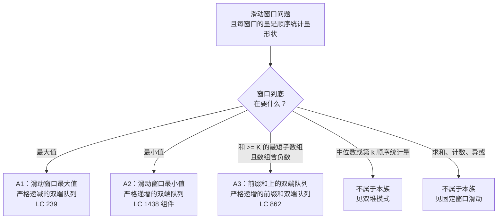

# 单调双端队列原型

## 如何决策

你面对的问题带着连续窗口的味道。窗口在数组上滑动，每滑一次，问题要的都是某个极值：窗口里的最大值、最小值，或者和越过阈值的窗口的最短长度。堆能把这三件事都做到 `O(n log k)`。单调双端队列把这三件事都做到 `O(n)`，而在 LeetCode 较大的约束下，这个差距就是通过和超时的差距。[^1]

信号很窄。聚合结果必须是顺序统计量形状的（最大值、最小值，或者“给出最短合法右锚定子数组的那个前缀和下标”），而双端队列能赢过堆的原因是到达顺序上的单调性。当 `x` 到达时，每一个比它小的活候选都可以证明在 `x` 于窗口内的剩余生命期里毫无用处，因为 `x` 会压过它们可能赢下的任何未来查询。堆是一个一个地以 log 代价弹出，把这些落败者清掉。双端队列一次批量清掉，全程均摊到每个下标是 `O(1)`。[^2]

本页枚举共享这套双端队列不变量的三种原型：滑动窗口最大值、滑动窗口最小值，以及用前缀和上的双端队列解决“和至少为 K 的最短子数组”的那个变体。拥有实现细节的章节是[单调双端队列](../part-4-stack-queue-patterns/01-monotonic-deque.md)；本页负责模式边界。如果你读过[单调栈原型](./P-26-monotonic-stack-archetypes.md)，两者的关系是结构性的：栈从一端弹出，双端队列从两端弹出。其余一切都原样照搬：支配论证、均摊记账证明、存下标不存值这条规矩。

## 流程图

*三条分支通向 A 变体；两条分支被路由出去。按窗口要什么来分支；双端队列的形状由变体决定。*

## 变体

### A1：滑动窗口最大值

**识别信号：**题目说“每个大小为 `k` 的窗口的最大值”，或者表述成“每个长度为 `k` 的连续子数组的最大值”。约束通常是 `n` 到 `10^5`、`k` 到 `n`，专门为了打掉 `O(nk)` 暴力。[^2]

**何时选它：**凡是窗口固定大小、每窗口聚合值是最大值、没有额外花样的场合。双端队列按下标 `nums[idx]` 严格递减的顺序存下标。队头永远是答案；弹尾规则（`while nums[dq.back()] <= nums[i]: pop`）维持单调形状；弹头规则（`if dq.front() <= i - k: popleft`）把已经老化出窗口的下标请出去。全程每个下标最多进队一次、出队一次。[^4]

**时间 / 空间：**`O(n)` 时间，`O(k)` 空间。空间上界是不变量的推论：双端队列里每个下标都满足 `i - dq.front() < k`，所以任何时刻最多只装 `k` 个下标。

**实现在哪：**[单调双端队列](../part-4-stack-queue-patterns/01-monotonic-deque.md)带着四种语言的代码、`nums = [1, 3, -1, -3, 5, 3, 6, 7]` 且 `k = 3` 的实例推演，以及把双端队列轨迹做成动画的交互组件。招牌题 [LC 239 Sliding Window Maximum](https://leetcode.com/problems/sliding-window-maximum/) 是该章的标准测试。[^2]

### A2：滑动窗口最小值

**识别信号：**形状与 A1 相同，只是比较翻了个面：每窗口聚合值是最小值而不是最大值。信号不总是那么直接。LC 1438（Longest Continuous Subarray With Absolute Diff Less Than or Equal to Limit）是实战中最干净的案例：谓词 `max(window) - min(window) <= limit` 需要同时跑一个见证最大值的双端队列和一个见证最小值的双端队列。[^6]

**何时选它：**凡是窗口聚合值是 `min` 而不是 `max` 的场合。不要另写一个函数。语言允许就按比较器参数化，否则复制 A1 的结构，把唯一那个不等号反过来。双端队列变成按 `nums[idx]` 严格*递增*。弹尾规则变成 `while nums[dq.back()] >= nums[i]: pop`。队头现在是运行最小值而不是运行最大值。其余都不动：弹头规则、`i >= k - 1` 的输出闸门、均摊证明。

另一种“窗口最小值”的形态可以不加修改套用 A2：任何 `dp[i] = nums[i] + max(dp[j] for j in [i-k, i-1])` 形状的 DP 递推。对一段长度为 `k` 的已算好的值取 `max`，就是 `dp` 数组上的滑动窗口最大值，同一套双端队列照样适用。LC 1696（Jump Game VI）是标准实例。[^2]

**时间 / 空间：**`O(n)` 时间，`O(k)` 空间。与 A1 完全相同。

### A3：和至少为 K 的最短子数组（前缀和上的双端队列）

**识别信号：**题目要求和至少为 `K` 的最短连续子数组，*且数组含负数*。负数这个词承重。数组非负时，运行窗口和随窗口长度单调，双指针 `O(n)` 就够。一旦允许负数，运行和不再单调，从左边收缩可能丢掉有用的未来前缀，双指针就垮了。[LC 862 Shortest Subarray with Sum at Least K](https://leetcode.com/problems/shortest-subarray-with-sum-at-least-k/) 是标准实例。约束 `1 <= n <= 10^5`、`-10^5 <= nums[i] <= 10^5`、`1 <= k <= 10^9` 让双指针是错的、`O(n log n)` 的有序集合处在临界线上。[^3] [^5]

**何时选它：**这套机制把双端队列用在*和 A1、A2 不同的数组*上。先建前缀和数组 `P[0..n]`，`P[0] = 0`。维护一个前缀和下标组成的双端队列，按 `P[j]` 严格递增。对每个新的右端点 `i`，做两次弹出：

- 弹头：当 `P[i] - P[front] >= K` 时弹出。以 `i` 结尾、从 `front` 后一位开始的子数组合法；把 `i - front` 记为一个候选答案并丢弃 `front`，因为任何更晚的 `i'` 在同一个左端点下只会给出更长的子数组。
- 弹尾：当 `P[back] >= P[i]` 时弹出。当前的 `P[i]` 压过任何在更早下标上不更小的尾部前缀，因为这样的尾部对任何未来的右端点都不可能是最优左端点。

然后压入 `i`。正是严格递增的前缀不变量让两次弹出同时成立。[^3]

值得明说的结构转折：A3 把双端队列跑在*前缀和数组*上，而不是原数组上。滑动窗口是隐式的；双端队列真正维护的是一组候选左端点，排序方式保证最有用的那个永远在队头。除了底料换了，均摊论证和 A1 一模一样：每个前缀和下标进一次、出一次。[^3]

**时间 / 空间：**`O(n)` 时间，`O(n)` 空间。最坏情况下双端队列能装 `n + 1` 个下标（一个严格递增的前缀和序列，直到最后才有合法右端点），所以 `O(k)` 不再构成上界。

## 变体对比

| 维度 | A1：滑动窗口最大值 | A2：滑动窗口最小值 | A3：前缀和最短子数组 |
|---|---|---|---|
| **双端队列不变量** | 按 `nums[idx]` 严格递减 | 按 `nums[idx]` 严格递增 | 按 `P[idx]` 严格递增 |
| **存的是什么** | `nums` 的下标 | `nums` 的下标（DP 变体则是 `dp` 的下标） | 前缀和数组 `P` 的下标 |
| **弹尾触发条件** | `nums[back] <= nums[i]` | `nums[back] >= nums[i]` | `P[back] >= P[i]` |
| **弹头触发条件** | `dq.front() <= i - k`（老化出窗） | `dq.front() <= i - k`（老化出窗） | `P[i] - P[front] >= K`（队头被消费；记录答案） |
| **报告什么** | 窗口填满后的 `nums[dq.front()]` | 窗口填满后的 `nums[dq.front()]` | 所有消费事件上 `i - dq.front()` 的最小值 |
| **时间 / 空间** | `O(n)` / `O(k)` | `O(n)` / `O(k)` | `O(n)` / `O(n)` |
| **经典题目** | [LC 239](https://leetcode.com/problems/sliding-window-maximum/) | [LC 1438](https://leetcode.com/problems/longest-continuous-subarray-with-absolute-diff-less-than-or-equal-to-limit/)（组件） | [LC 862](https://leetcode.com/problems/shortest-subarray-with-sum-at-least-k/) |

A1 和 A2 是镜像；唯一的结构差别是单调方向。A3 反转的不止方向。它把双端队列跑在一个派生数组上，把弹头当作答案抽取事件而不是被动驱逐，并且放弃了 `O(k)` 空间上界，因为“窗口”不再固定长度。

## 三道招牌题

[LC 239 — Sliding Window Maximum](https://leetcode.com/problems/sliding-window-maximum/) [困难]。这个模式的招牌题，也是该章的标准测试。难不是因为算法微妙（双端队列不变量一句话就能说完），而是约束只接受 `O(n)` 解，而实现里有两个差一陷阱（弹尾用 `<=` 还是 `<`；存下标而不是存值）。[^2]

[LC 1696 — Jump Game VI](https://leetcode.com/problems/jump-game-vi/) [中等]。A1 的 DP 变体。递推是 `dp[i] = nums[i] + max(dp[j] for j in [max(0, i-k), i-1])`；对长度为 `k` 的窗口内已算出的 `dp` 值取 `max`，就是 `dp` 数组上的滑动窗口最大值。把 A1 原样搬过来让 `dp` 顶替 `nums`，算法就是 `O(n)`。这道题教人的诊断能力是：认出双端队列作用在 DP 表上，而不是输入上。

[LC 862 — Shortest Subarray with Sum at Least K](https://leetcode.com/problems/shortest-subarray-with-sum-at-least-k/) [困难]。A3 原型。第一眼看上去像 LC 209（长度最小的子数组和），但 LC 209 要求 `nums` 非负，可以用双指针；LC 862 允许负数，双指针就破了。修法是前缀和上的双端队列，而那个顿悟时刻是意识到双端队列必须活在输入之上的一层间接里。[^3]

## 常见误解

**“单调双端队列和单调队列是一回事。”** 它们共享支配论证和均摊证明，但双端队列从两端弹出，队列只从一端。作用域隐式时（队头轮到自己就自然离开）单调队列就够了；作用域显式、队头必须按你检查的条件驱逐（窗口题里的 `dq.front() <= i - k`）时，就需要双端队列。LC 239 是真的双端队列情形。表亲模式[单调栈原型](./P-26-monotonic-stack-archetypes.md)是同一套支配论证的 LIFO 版本，既不用弹头也不用窗口；它覆盖下一个更大元素、每日温度、柱状图中最大的矩形、子数组最小值之和。

**“双端队列里装着 K 个元素。”** 它装的是*最多* `k` 个元素，但在多数输入上远少于此。严格递减的输入把双端队列长到 `k`；严格递增的输入把它保持在长度 1（每个新来的都把身后的一切弹光）。`O(k)` 空间上界是最坏情况陈述，不是稳态陈述。剪枝行为正是让每轮均摊代价是 `O(1)` 而不是 `O(k)` 的原因：一次很长的弹尾循环，由前面那些只做了压入的廉价轮次付账。[^4]

**“滑动窗口最大值需要堆。”** 带惰性删除的最大堆能在 `O(n log k)` 内解决 LC 239，在 `n = 10^5` 上能过时限，所以没接触过单调双端队列的新手会写个堆并且通过。知道双端队列存在的面试官会扣分。诊断点是：这个结构有没有利用到达顺序的单调性。如果更大的值一到，所有被支配的尾部都能永久丢弃，双端队列就是对的工具。支配关系不成立的问题（窗口中位数、窗口第 k 大）才该用堆。

**“LC 862 用的是滑动窗口。”** 不是。窗口长度不固定；算法根本不跟踪当前窗口。它跟踪的是一个前缀和下标组成的双端队列，保持单调，答案在弹头事件上抽取，而不是在窗口结束事件上。把 LC 862 读成“带负数的变长滑动窗口”是通向 bug 解的最常见路径：这种框架暗示的双指针在负数下活不下来，因为从左边收缩不可逆。[^3]

**“为了正确性，弹出规则应该是严格小于。”** 在没有重复值的输入上 `<` 和 `<=` 都正确；有重复值时，`<=` 在新的副本一到就把旧副本驱逐出去，而基于下标的过期检查正需要这一点才能工作。用 `<` 的话，两个相等的值都留在双端队列里，一个过期的队头会遮住它身后仍然存活的那个同值副本。该章的参考实现全部用 `<=`，就是这个原因。

## 参考文献

[^1]: CP-Algorithms, "Minimum stack / Minimum queue." https://cp-algorithms.com/data_structures/stack_queue_modification.html

[^2]: webcoderspeed, "Sliding Window Maximum (LeetCode 239)." https://webcoderspeed.com/blog/dsa-arrays-strings/77-sliding-window-maximum

[^3]: walkccc, "LeetCode 862." https://walkccc.me/LeetCode/problems/0862/

[^4]: Stack Overflow, "Why is the deque solution to Sliding Window Maximum O(n) not O(nk)?" https://stackoverflow.com/questions/53094476

[^5]: stealthinterview.ai, "Leetcode 862: Shortest Subarray with Sum at Least K." https://stealthinterview.ai/blog/leetcode-862-shortest-subarray-with-sum-at-least-k

[^6]: DSA Handbook, [Sliding window archetypes](./P-23-sliding-window-archetypes.md).
