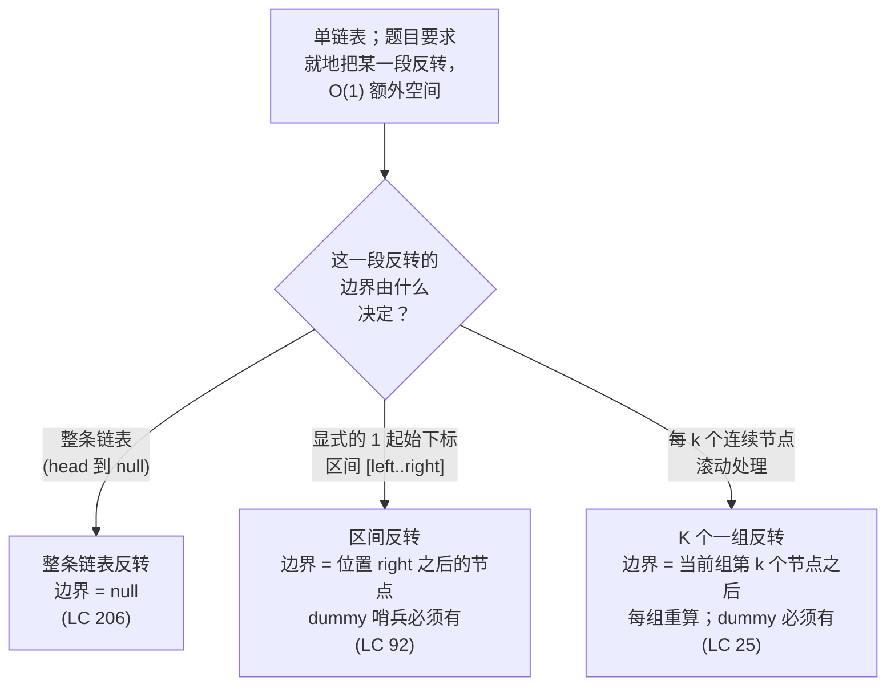

# 链表分组的就地反转

面试官递给你一条单链表。其中某一段连续的节点要反过来。额外空间必须是常数，不许换值，只能改指针。这一段可能是整条链表，可能是用 1 起始下标框出来的子区间，也可能是每 k 个连续节点一组、随链表一路向后滚动。三道题面，三个 LeetCode 经典条目，一个算法。

三种情况用的是同一套三指针轮换。维护 `prev`、`curr` 和一个快照指针；每轮迭代先在任何改写发生之前抓下 `next = curr.next`，再把 `curr.next = prev` 接回去，然后同步推进 `prev = curr`、`curr = next`。这一段里每个节点恰好被改接一次。三个变体之间变的不是改接动作，也不是循环体。变的是**边界的定义**——内层循环在哪儿停，以及刚反转完的这一段怎么重新挂回它左右两边。轮换练熟一次，这一族剩下的都只是记账。

## 如何决策

有三个信号会把题引到这个模式上。**输入形态：**一条单链表，每个节点只知道自己的后继，别的什么都不知道。“没有往回指的指针”这一点，正是逼出“先快照、再改接”这套动作的原因；数组和双向链表都不需要。**改动要求：**题目要的是节点换位置，不是换值。LC 24 和 LC 25 说得很直白（"you may not alter the values, only nodes itself may be changed"），LC 92 和 LC 206 则用 "in place" 的措辞暗示。**空间预算：**follow-up 要求 `O(1)` 额外空间，一下就把“把值复制进数组、再复制回来”这条捷径和递归解法一起排除了（递归要 `O(n)` 的调用栈空间）。

主干就是这套轮换。三个局部指针 prev / curr / next，四个固定顺序的子步骤：快照、改接、prev 前移、curr 前移。每轮迭代里唯一的写入就是 `curr.next = prev`，而它就是整个算法。CLRS 习题 10.2-7 把这个契约写得很直接：一个 `Theta(n)` 时间的非递归过程，反转含 n 个元素的单链表，"using no more than constant storage beyond that needed for the list itself."[^1] 标准解法引入三个指针，记作 `p[1]`、`p[2]`、`p[3]`，正好就是每个面试答案里那三个 prev / curr / next。

变体真正改的是包在轮换外面那层边界跟踪。整条反转在 `curr` 走出表尾变成 `null` 时停；区间反转在改接 `right - left` 次之后停；固定 K 反转每组改接 k 次就停，然后推进到下一组重新开始。轮换本身不知道自己身处哪个变体，边界知道。

## 流程图

*按题目交给你的边界形状挑变体。三条分支里的内层轮换完全一样，变的只是内层循环何时停、反转完的这一段怎么和邻居重新缝合。*

## 变体

### 反转整条链表（LC 206）

**识别信号：**题面只说 *"reverse a singly-linked list"* 或 *"reverse this list"*，不带任何下标线索。边界就是链表末尾，用哨兵值 `null` 表示。[^2]

**何时选它：**这是这一族的根变体，其他几个原型都能归约到它。只有一段，没有接缝要缝，严格说也不需要 dummy 节点（循环退出时算法直接返回 `prev`，`prev` 就是新表头）。为了和其他变体写法统一，仍然建议挂一个 dummy 哨兵；但和 LC 92、LC 25 不同，没有它算法也是对的。初始化 `prev = null`、`curr = head`；循环跑 n 次，改接 n 次，退出时 `curr == null`，`prev` 指向原来的尾节点。

**时间 / 空间：**迭代版 `O(n)` 时间、`O(1)` 辅助空间；递归版 `O(n)` 时间、`O(n)` 栈空间。递归写法只有六行，教学上也更干净，但它的 `O(n)` 栈深度违反题面隐含的 `O(1)` 空间 follow-up，而迭代版刚好满足。CPython 默认 `sys.getrecursionlimit() = 1000`，LC 206 最坏情况 `n = 5000`，提交后会抛 `RecursionError` 运行时崩溃，而不是返回错误答案。[^3]

**章节出处：**[反转模式](../part-5-linked-lists/01-reversal-patterns.md)带着四种语言的参考实现、循环不变式证明，以及 LC 206 的完整推演。

### 反转指定区间（LC 92）

**识别信号：**题面说 *"reverse the nodes from position left to position right"*，用 1 起始的两个端点框出一段连续子区间，还加了 follow-up *"do it in one pass"*。[^4] 边界是位置 `right` 之后的那个节点；要改接的是两端之间（含两端）共 `right - left + 1` 个节点。

**何时选它：**只要题目给的是位置边界，就是它。这里 dummy 哨兵是必须的：当 `left == 1` 时，结果的表头和输入的表头不是同一个节点，如果没有一个坐在下标 0 上的 dummy 节点，算法就得写特例分支去“改接表头指针，而不是前驱的 `next`”。bug 恰恰集中在这个特例里（返回错表头、空输入 NPE、接缝处差一），所以老老实实分配 `dummy = ListNode(0, head)`，用一个 `pre` 指针走到这一段之前那个节点，最后返回 `dummy.next`。

标准写法是**一趟遍历 + 头插**：从 dummy 出发把 `pre` 前推 `left - 1` 步（不是 `left` 步，dummy 算第 0 个位置），然后每轮把 `curr.next` 上那个节点摘出来，插到已反转前缀的头部。整段的第一个节点始终不动，循环退出时它已经变成这一段的尾节点。两条接缝，各只需一次改接：左边 `pre.next = newSegmentHead`，右边 `oldSegmentHead.next = nodeAfterRight`，而头插这种写法把两处都隐式处理掉了。

**时间 / 空间：**`O(n)` 时间，`O(1)` 辅助空间。[^4]

**章节出处：**[反转模式](../part-5-linked-lists/01-reversal-patterns.md)带着头插变体的实例推演，以及 LC 92 的四语言代码面板。

### 按 K 个一组反转（LC 25）

**识别信号：**题面说 *"reverse every k consecutive nodes"* 或 *"reverse k at a time"*，并明确补一句 *"if the number of nodes is not a multiple of k, the left-out nodes at the end should remain as is"*。follow-up *"only constant extra memory is allowed"* 直接把递归解法挡在门外。[^5] 边界每组重算一次：当前组第 k 个节点之后的那个节点，随着一组组完成一路向表尾推进。

**何时选它：**要反转的段是一串固定大小、向前滚动的块之一时，就是它。算法分三个阶段，每组跑一遍：**探路（peek）**——非破坏性地往前看 k 个节点，确认这一组是满的；**反转（reverse）**——对这 k 个节点用同一套 prev / curr / next 轮换，但把 `prev` 初始化成事先存下的 `groupNext`，这样内层循环最后一次改接会自动把新的组尾指向还没处理的尾部；**缝合（re-stitch）**——令 `groupPrev.next = newGroupHead`，再把 `groupPrev` 推进到 `newGroupTail`（也就是缝合前存下的原组头）。

探路是非破坏性的，而且发生在*任何*改接之前。这个顺序就是契约：它保证末尾长度不足 k 的残段不会被反转一半。探路返回 `null`，外层循环就退出，尾部在结构上保持原样。[^5] 两两反转的变体 LC 24（Swap Nodes in Pairs，中等）是同一套算法把 `k = 2` 写死，内层循环展开成显式的配对交换改接。

**时间 / 空间：**迭代版 `O(n)` 时间、`O(1)` 辅助空间；递归版 `O(n)` 时间、`O(n/k)` 栈空间（每组一帧）。[^6]

**章节出处：**[按 K 个一组反转](../part-5-linked-lists/02-reverse-in-groups-k.md)带着三阶段迭代版的四语言参考实现，以及 LC 25 的完整推演。

## 变体对比

| 变体 | 边界形状 | dummy 哨兵 | 内层循环的边界 | 递归选项 | 时间 / 空间 | 经典题目 |
|---|---|---|---|---|---|---|
| 整条（LC 206） | head 到 null；只有一段 | 可选，为写法统一起见建议保留 | `curr == null` | 有；`O(n)` 栈 | `O(n)` / `O(1)` 迭代；`O(n)` / `O(n)` 递归 | LC 206（简单） |
| 按下标区间（LC 92） | `[left .. right]`；一段 | 必须（覆盖 `left == 1`） | 完成 `right - left` 次头插 | 少见；不好表达 | `O(n)` / `O(1)` | LC 92（中等） |
| 固定 K 滚动（LC 25） | 每 k 个连续节点；`floor(n/k)` 段 | 必须（第一组的反转会换表头） | 每组 `k` 次改接；探路返回 null 时外层循环终止 | 有；`O(n/k)` 栈 | `O(n)` / `O(1)` 迭代；`O(n)` / `O(n/k)` 递归 | LC 25（困难） |

三行共用同一套 prev / curr / next 轮换、同样的“先快照再改接”顺序，以及 `O(n)` 时间、`O(1)` 辅助空间的迭代复杂度。分歧在三处：内层循环拿什么当边界（一个哨兵值、已完成的改接次数、一次探路探测）；dummy 哨兵是否必需（LC 206 可选，另外两个必须，因为表头会变）；一趟遍历能反转几段（LC 206 和 LC 92 一段，LC 25 是 `floor(n/k)` 段）。

LC 24（Swap Nodes in Pairs，中等）是 `k = 2` 写死的 K 组变体：外层驱动循环和 dummy 哨兵套路与 LC 25 完全一样，内层循环展开成三次显式改接 `first.next = second.next; second.next = first; prev.next = second`。把 LC 24 单列成第四行是冗余的：它结构上就是 LC 25，只是识别信号是“交换相邻两节点”而不是“每次反转 k 个”。

## 三道招牌题

- [LC 206 — Reverse Linked List](https://leetcode.com/problems/reverse-linked-list/) [简单] • whole-list-reversal-iterative-three-pointer ★。这一族的根。follow-up 明确摆出迭代与递归的选择；面试标准答案是迭代版。
- [LC 92 — Reverse Linked List II](https://leetcode.com/problems/reverse-linked-list-ii/) [中等] • sub-range-reversal-by-position。dummy 哨兵 + 头插的变体；一趟遍历，两条接缝，`O(1)` 额外空间。
- [LC 25 — Reverse Nodes in k-Group](https://leetcode.com/problems/reverse-nodes-in-k-group/) [困难] • k-group-reversal-three-phase。探路—反转—缝合的循环；“只许常数额外内存”这一条把递归写法排除在外。

## 常见误解

**“就地反转需要额外数组。”** 不需要，而且这一族题的全部要点就是不需要。面对 LC 206 的第一反应通常是走一遍链表把值推入数组，再走一遍倒序写回去。这确实能做出来。但它花掉 `O(n)` 额外空间，过不了本章 `O(1)` 的 follow-up，也让面试官看出候选人还没把“改结构”这个动作内化。算法的做法是复用已有节点，改它们的 `next` 指针。三个局部指针 prev、curr、next 就是全部的辅助状态，而这个上界正是 CLRS 习题 10.2-7 *要求*的上界。[^1] 让三个指针够用的是“改接之前先快照”这条不变式：正是因为存下了 `curr.next` 的快照，循环才能在改接毁掉原来的前向边之后继续往前走。

**“LC 206 用递归更干净，所以面试就写递归。”** 递归确实更干净。递归版只有六行，读起来就是一次结构归纳，Sedgewick 也把它当作第二遍理解时的心智模型。但递归要 `O(n)` 调用栈空间，这就过不了迭代版能满足的 `O(1)` 空间 follow-up。CPython 默认递归上限是 1000，LC 206 最坏输入 `n = 5000`，提交时会抛 `RecursionError` 崩溃，除非候选人显式抬高上限。[^3] Java 默认 `-Xss` 和 C++ 主线程能容忍更深一些的深度，但都不是无限；只有 Go 会自动增长的 goroutine 栈能扛住任意 `n`。本书的立场，在[反转模式](../part-5-linked-lists/01-reversal-patterns.md)和[按 K 个一组反转](../part-5-linked-lists/02-reverse-in-groups-k.md)两篇里都写明了：把迭代当作面试标准答案来讲，递归放在第二位、当作结构归纳的透镜，同时点明 `O(n)` 栈空间的代价，让读者看清为什么迭代的 `O(1)` 空间在评分表上赢。

**“LC 25 不过是把 LC 206 套进循环。”** 很接近，这种相似也正是这一族能成立的原因。但改接这一步得记住上一组的组尾才能接回去。LC 206 里，反转段的新表头就是循环退出时 `prev` 指向的节点，函数直接返回它。LC 25 里，每个被反转组的新表头是内层循环退出时 `prev` 指向的节点，而这个表头必须缝回链表——缝在上一组留下的接缝处。于是比 LC 206 多出两次保存：`groupPrev`（上一组的组尾，缝合后成为下一组新表头的前驱）和 `groupNext`（当前组第 k 个节点之后的节点，成为内层循环的边界哨兵和当前组新组尾的后继）。这两者的保存顺序搞反（先缝合、后存原组头），存下来的值就指向了错误的节点，接缝会接到 `null` 上，算法返回一条被截断的链表。探路是第三处结构性增补：在*任何*改接之前先确认存在满 k 个节点的一组，好让末尾不足 k 个的残段在结构上保持原样。[^5]

**“双向链表要用另一套反转逻辑。”** prev / curr / next 轮换照样好用，双向版只是每轮把两个方向都换一下。双向链表里每个节点除了 `next` 字段还有一个 `prev` 字段（回指针）。反转仍然只走一遍链表，每轮交换该节点的 `prev` 和 `next` 字段。局部算法里的 `prev` *变量*（已反转前缀的当前表头）不变，新增的只是每节点的字段交换。这是循环体里加一行的事，不是另一个算法。dummy 哨兵套路、“改接之前先快照”的顺序、按变体拆边界的分解方式，都从单链表原样搬到双向链表。面试几乎总是指定单链表，原因就是回指针会让题变得过于简单：天然遍历本来就支持两个方向，“反转”于是退化成“交换表头表尾，然后反着走”，一次改接都不用。

## 参考文献

[^1]: Cormen, Leiserson, Rivest, Stein, *Introduction to Algorithms*, 4th ed., MIT Press, 2022, Ch. 10 §10.2 (Exercise 10.2-7).

[^2]: LeetCode, "206. Reverse Linked List." https://leetcode.com/problems/reverse-linked-list/

[^3]: Python 3 docs, `sys.setrecursionlimit`. https://docs.python.org/3/library/sys.html#sys.getrecursionlimit. Go FAQ, "Goroutines." https://go.dev/doc/faq#goroutines

[^4]: LeetCode, "92. Reverse Linked List II." https://leetcode.com/problems/reverse-linked-list-ii/

[^5]: LeetCode, "25. Reverse Nodes in k-Group." https://leetcode.com/problems/reverse-nodes-in-k-group/

[^6]: LeetCode, "24. Swap Nodes in Pairs." https://leetcode.com/problems/swap-nodes-in-pairs/
