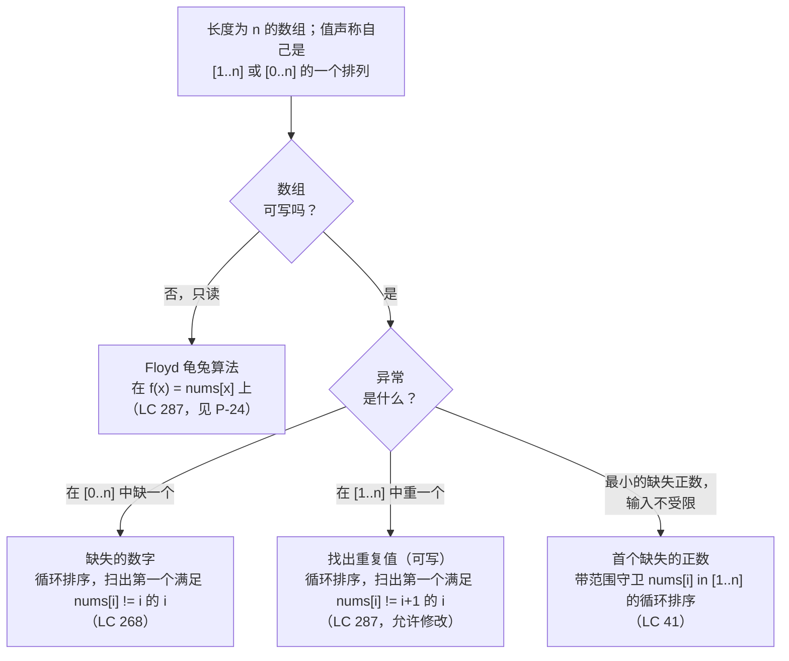

# 循环排序原型：在 [1..n] 排列形态数组中的缺失、重复与首个正数

循环排序（cyclic sort）是一种领域专用的 O(n) 排序，它存在的理由只有一个：数组里的值自己指出了各自该去的下标。当 `nums` 长度为 `n`、每个值都落在 `[1..n]`（视题目也可能是 `[0..n]`）时，值 `v` 就该待在位置 `v - 1`。一趟线性扫描，把每个值交换到正确位置，数组就被重写成一个排列；第二趟线性扫描，报出题目所问的那种偏差。不比较、不建辅助结构、不占额外空间。[^1]

拿掉这个约束，算法就散了。对 `nums = [100, 1, 2]`，值 100 没有家，交换目标 `nums[100 - 1]` 在 C++ 和 Java 里是越界读，在 Python 里是静默读到尾部，在 Go 里直接 panic。规则很硬：输入必须是排列形态的数组，否则变体就得加一道守卫，在交换前把非排列值过滤掉。本页枚举这一家族产生的三类原型，并给出在新题上从兄弟原型里挑中其中一个的线索。[^2]

## 如何决策

触发信号是输入范围的约束，而且题目会把它明写在描述里：*"contains n distinct numbers in the range [0, n]"*（LC 268）；长度为 n、值域 `[1..n]` 的数组上 *"each integer appears once or twice"*（LC 287、LC 442、LC 448）；或者是不带范围限制的形态 *"unsorted integer array"*，配上 *"smallest missing positive integer"* 这个问题（LC 41）。前两种是直接说出来的排列性质。第三种是伪装过的同一条性质：长度为 n 的数组不可能缺一个大于 `n + 1` 的正数，所以 `[1..n]` 之外的值都是噪声，而落在范围内的那一部分仍然允许“值即下标”的把戏。[^3]

三件事决定选哪个变体。**缺什么或重什么：** 缺一个值、重一个值、还是最小的缺席正数。**数组是否可写：** LC 287 禁止修改输入，这一条直接把循环排序踢出局，把题目引向在函数图 `f(x) = nums[x]` 上跑 Floyd 龟兔算法。[^4] **排完之后的扫描规则：** 数组重排好之后要报出什么。一个标量（缺失的下标、最小的违规者）、一个列表（所有重复或所有缺失），还是一个对（一个重复值加上被它挤掉的那个受害者）。

整个过程保持线性，因为每次成功交换都会把一个值放到它的最终位置，而到了最终位置的值不会再被搬动。交换总次数不超过 `n - 1`，所以内层循环看似平方级的开销在整趟跑下来摊还成 O(n)。[^1] 空间是 O(1)，因为重排就发生在输入数组里。

## 流程图

*先走尊重可写性的那条分支（只读直接把题目引出这一家族），再按异常类型选变体。LC 41 的范围守卫是唯一的结构性分歧；家族其余成员共用同一个交换循环，只是排完之后的扫描规则不同。*

## 变体

### 缺失的数字（LC 268）

**识别信号。** 题面说 *"array contains n distinct numbers taken from 0, 1, 2, ..., n"*，并问那一个缺失值。[^3] 范围是 `[0..n]`——比数组长度正好宽一格——答案是单个标量。

**何时选用。** 循环排序在 LC 268 上是正确的，但很少是最强的答案。两个更简单的 O(n)/O(1) 替代解压过它。**求和恒等式** `target = n*(n+1)/2 - sum(nums)` 只有一行；**异或恒等式** `target = (0 ^ 1 ^ ... ^ n) ^ (nums[0] ^ ... ^ nums[n-1])` 不受溢出影响，是面试里被推荐的答案。[^1] 只有在面试官明确禁止算术恒等式、或者 LC 268 被当作家族里更难变体之前的入门题时，才该在这里动用循环排序。值 `v` 的家是下标 `v`（不是 `v - 1`，因为范围从零开始），排完之后的扫描规则是*第一个满足 `nums[i] != i` 的下标 `i` 就是答案；如果数组完全对得上，答案是 `n`*。值 `n` 本身在交换循环里充当哨兵，因为它在数组内部没有家。

**时间 / 空间。** O(n) 的循环排序加上 O(n) 的排后扫描，O(1) 辅助空间。

**章节引用。** [Linear-time sorts: counting, radix, bucket](../part-2-search-sort/06-linear-sorts.md) 覆盖了线性时间排序这个更大的家族，而它们的先决条件恰好把循环排序这种情况排除在外；[Arrays: static, dynamic, multi-dimensional](../part-1-linear-data-structures/00-arrays.md) 承载着“下标即存储”的框架，这个原型正依赖它。

### 找出重复值（LC 287）

**识别信号。** 题面说 *"array of n+1 integers, each in [1..n], exactly one number is repeated"*，并问重复的那个值。[^4] 鸽笼结构（n+1 个值，n 个可能的位置）保证至少有一个重复；题目承诺恰好一个。

**何时选用。** 这是只读约束影响最大的变体。LC 287 的官方题面加了两条改变答案的条款：*"you must not modify the array"* 和 *"you must use only constant, O(1) extra space"*。第一条直接禁止循环排序。第二条禁止了那个显而易见的 O(n) 空间哈希集合兜底。标准答案是在函数图 `f(x) = nums[x]` 上跑 **Floyd 龟兔算法**，也就是 [Cycle detection (Floyd's tortoise & hare)](../part-5-linked-lists/03-cycle-detection.md) 里讲过的同一个算法：每个下标 `x` 指向 `nums[x]`，n+1 个下标映射到 n 个不同的值，鸽笼原理逼出两个下标共享同一个目标，于是序列 `0, nums[0], nums[nums[0]], ...` 进入一个环，而环的入口就是那个重复值。[^4]

如果换个问法、允许修改（有些面试官会在 LC 287 之后把只读条款当作追问撤掉），循环排序就能干净地套上：只要 `nums[nums[i] - 1] != nums[i]` 就把每个值换到位置 `nums[i] - 1`，家已经被相等值占住时前进 `i`，一趟走完，重复值就落在那个唯一的、满足 `nums[i] != i + 1` 的下标上。

**时间 / 空间。** Floyd 变体：O(n) 时间、O(1) 空间、不修改输入。循环排序变体（允许修改）：同样的复杂度，但会改动输入。

**章节引用。** [Cycle detection (Floyd's tortoise & hare)](../part-5-linked-lists/03-cycle-detection.md) 有“环的入口对应重复值”的证明，以及找出它的两阶段算法。配套原型页 [P-24 two-pointer archetypes](./P-24-two-pointer-archetypes.md) 把 Floyd 算法收在快慢指针名下。

### 首个缺失的正数（LC 41）

**识别信号。** 题面说 *"unsorted integer array"*，不给范围约束，问*最小的不在其中的正整数*，并要求 O(n) 时间和 O(1) 额外空间。[^5] 输入里允许出现负数、零和很大的正数。

**何时选用。** 这是循环排序在所有替代解面前真正赢得位置的变体。哈希集合 O(n) 时间、O(n) 空间，违反辅助空间要求。排序 O(n log n)，违反时间要求。唯一的 O(n)/O(1) 算法就是带范围守卫的循环排序。关键的归约是：答案必定落在 `[1..n+1]`，因为数组只有 n 个槽位，所以即使是一个完美的排列 `[1, 2, ..., n]`，答案也是 `n + 1`。`[1..n]` 之外的值都是噪声；真正被排序的是落在范围内的那一部分。[^5]

交换循环多一个条件：`nums[i] in [1..n]` 且 `nums[nums[i] - 1] != nums[i]`。范围外的值（负数、零、任何 `> n` 的数）立刻前进 `i`，因为它们的家不存在。一趟走完之后，排后扫描规则是*第一个满足 `nums[i] != i + 1` 的下标 `i` 返回 `i + 1`；如果数组完全对得上，返回 `n + 1`*。

**时间 / 空间。** 带范围守卫交换的 O(n) 循环排序，O(n) 排后扫描，O(1) 辅助空间。

**章节引用。** [Two pointers: same direction (slow + fast)](../part-3-pointers-window-prefix/01-two-pointers-same-direction.md) 把循环排序列为 STRETCH-Hard 的邻接内容：原地重排家族在结构上贴近读写模板，但它用的是由值推出的交换目标，而不是一个维护中的写游标。

## 变体对比

| 变体 | 输入形态 | 异常类型 | 交换目标 | 时间 / 空间 | 典型题 |
|---|---|---|---|---|---|
| 缺失的数字（LC 268） | 来自 `[0..n]` 的 `n` 个不同值，缺一个 | 一个缺席的标量 | `nums[i] -> index nums[i]`（哨兵 `n` 没有家） | O(n) / O(1) | LC 268（简单） |
| 找出重复值（LC 287） | `[1..n]` 中的 `n+1` 个值，恰好一个重复 | 一个重复的标量 | 只读时用 Floyd；允许修改时 `nums[i] -> index nums[i] - 1` | O(n) / O(1) | LC 287（中等） |
| 首个缺失的正数（LC 41） | 不受限的整数；答案在 `[1..n+1]` | 最小的缺席正数 | 带范围守卫的 `nums[i] -> index nums[i] - 1`，仅当 `nums[i] in [1..n]` | O(n) / O(1) | LC 41（困难） |

三行共享同一个结构形态——*换到家里，再线性扫出违规者*——也共享定义了这个家族的 O(n)/O(1) 界。它们的差别在于交换目标的下标偏移（LC 268 零基，LC 287 和 LC 41 一基）、是否允许修改（LC 287 的只读约束把它引向 Floyd 算法），以及循环是否需要一道范围守卫、在拿一个不存在的家去索引之前先把非排列值过滤掉（只有 LC 41 需要）。

## 三道招牌题

- [LC 268 — Missing Number](https://leetcode.com/problems/missing-number/) [简单] • cyclic-sort. 入门题；求和与异或恒等式是更简单的面试答案，但循环排序这条路是通往家族里更难变体的桥。
- [LC 287 — Find the Duplicate Number](https://leetcode.com/problems/find-the-duplicate-number/) [中等] • cyclic-sort or floyd-tortoise-hare. 只读约束把标准解引向函数图上的 Floyd 龟兔算法；只有把“允许修改”重新设定之后，循环排序才适用。
- [LC 41 — First Missing Positive](https://leetcode.com/problems/first-missing-positive/) [困难] • cyclic-sort with range guard. 在这个变体里循环排序是唯一的 O(n)/O(1) 算法，而范围守卫 `nums[i] in [1..n]` 就是承重的那一行。

## 常见误解

**“循环排序对任何数组都成立。”** 不成立。正确性证明要求“值到家的映射”（一基范围是 `v -> v - 1`，零基范围是 `v -> v`）落在数组内部，而线性时间的界要求这个映射在 `[0..n-1]` 上接近双射，这样每次成功交换都能永久地从交换预算里退掉一个值。对 `nums = [100, 1, 2]`、n = 3，值 100 的交换目标是 `nums[99]`，在四种标准语言里有三种是越界读。判别依据就是题目描述里的范围约束：*"values in [1..n]"*、*"distinct numbers in [0..n]"*。没有这条，循环排序就是错的工具。LC 41 是家族里唯一处理无界输入的成员，做法是加一道范围守卫，跳过非排列值而不去碰它们。[^2]

**“LC 287 必须用循环排序。”** 只有当题目允许修改数组时才行，而官方题面明确禁止。预期解是在函数图 `f(x) = nums[x]` 上跑 Floyd 龟兔算法，它保留输入，O(n) 时间、O(1) 空间。构造方式和链表判环算法一样：每个下标指向一个值（这个值本身也是一个下标，因为值都在 `[1..n]` 里），n+1 个下标塞进 n 个不同的值，鸽笼原理逼出一个环。[^4] Floyd 的两阶段走法定位环的入口，可证明那就是重复值。*如果允许修改*，循环排序也成立，面试官问追问时把它作为补充答案提出来是合理的——但把它当成 LC 287 的唯一答案，是对题面意思的误读。

**“循环排序的交换循环是 O(n²)。”** 不是，而它为什么不是，是本章被问得最多的复杂度问题。内层循环看起来像平方级——外层扫描的每次迭代都可能触发一次交换，而这次交换又喂出一次不推进扫描指针的迭代——但每次交换至少把一个值放到最终位置，而到了最终位置的值不会再被挪走。交换总次数上界是 `n - 1`，扫描指针前进总次数上界是 `n`，总开销按 CLRS 第 16 章成文的势能法论证是 O(n)。[^1] 同一套记账支撑着 patterns 家族里每一趟线性摊还扫描（[P-26 monotonic stack archetypes](./P-26-monotonic-stack-archetypes.md)、[P-30 top-K via heap or quickselect](./P-30-top-k-heap-or-quickselect.md)，以及 quickselect 内部的划分步骤）：表观平方级结构加上每元素退场的不变式，在聚合分析下塌成线性。

**“首个缺失正数需要哈希集合。”** 哈希集合可行，O(n) 时间、O(n) 空间，也是大多数读者最先想到的答案。但它同样不满足 LC 41 明写的要求：O(1) 辅助空间。这道题是家族里唯一在要求的复杂度上找不到更简单替代解的；循环排序在这里的价值恰恰在于它把输入数组当哈希表复用，用本来就存在的数组槽位支付那笔隐式的 O(n)“空间”。[^5] 候选人交上哈希集合解法之后，面试官追问常数空间时，带范围守卫的循环排序就是他们在等的答案。

**“交换守卫写成 `i != nums[i] - 1` 没问题。”** 有问题。重复值导致的死循环陷阱是最常见的循环排序 bug，过程如下。对 `nums = [1, 1]`（长度 2，含一个重复），下标比较式的守卫读作*只要 `i != nums[i] - 1` 就交换*。在 `i = 1`：`1 != nums[1] - 1 = 0`，于是交换 `nums[0]` 和 `nums[1]`。数组还是 `[1, 1]`。条件依然成立，循环永远交换下去。正确的守卫是**值比较**形式*只要 `nums[nums[i] - 1] != nums[i]` 就交换*：同一输入在 `i = 1`，家是 `nums[0] = 1`，候选是 `nums[1] = 1`，值相等，说明家“已被相等的值占住”，此时前进 `i` 而不是交换。心智模型只差一个词：守卫检验的是家有没有被填上，而不是当前下标是不是家。[^2]

## 参考文献

[^1]: Cormen, Leiserson, Rivest, Stein, *Introduction to Algorithms*, 4th ed., MIT Press, 2022, Ch. 16.

[^2]: Compile N Run, "Cyclic Sort Pattern." https://www.compilenrun.com/docs/fundamental/interview/problem-solving-patterns/cyclic-sort/

[^3]: LeetCode, "268. Missing Number." https://leetcode.com/problems/missing-number/

[^4]: LeetCode, "287. Find the Duplicate Number." https://leetcode.com/problems/find-the-duplicate-number/. DSA Handbook, [Cycle detection](../part-5-linked-lists/03-cycle-detection.md).

[^5]: LeetCode, "41. First Missing Positive." https://leetcode.com/problems/first-missing-positive/
