# 用堆或快速选择求 Top-K

## 如何决策

你已经把题目归类成 top-K：从 `n` 个候选里，返回站在某条边界一侧的那 `K` 个，或者返回正好落在边界上的那个值。算法选择（大小为 `K` 的有界堆，还是分区加递归）是一个决策。配方（recipe）选择——堆或分区到底在给什么排序、按哪个键排——是另一个决策，也是本页要解决的那个。

本页是变体目录，不再重复争论堆与快速选择该选哪个；那部分在 [Top-K：快速选择与堆](./P-22-quickselect-vs-heap-top-k.md)，那篇给出了五条判据的流程图（数据源是否流式、输出是否要有序、`K` 与 `n` 谁大、输入是否可能被构造成对抗性用例、是否允许改动输入）。当决策是“该拿哪个*结构*”时，去 P-22。当问题更宽一些——堆、有序数组还是平衡 BST——去 [堆、有序数组与 BST 的对比](./P-06-heap-vs-sorted-array-vs-bst.md)。

这一家族里，三个变体覆盖了 LeetCode 题目的绝大部分。它们只差一个维度：堆或分区在给什么排序。排值本身，你就在 LC 215 的地界；排派生出来的频次，你在 LC 347；用自定义比较器排派生出来的距离，你在 LC 973。下一节的流程图把这条分叉压成一个问题。

## 流程图

```mermaid
flowchart TD
    Start["Top-K 家族<br/>算法选择由 P-22 解决"] --> Q1{"在给什么<br/>排序？"}
    Q1 -- "输入值本身" --> A1["按值第 K 大<br/>LC 215"]
    Q1 -- "从输入算出的<br/>派生频次" --> A2["前 K 个高频<br/>LC 347、LC 692"]
    Q1 -- "自定义比较器下的<br/>派生数值键" --> A3["距离最近的 K 个<br/>LC 973"]
    A1 -.->|"数据源是流？"| S["流式变体<br/>LC 703 —— 同一套配方，在线运行"]
    A2 -.->|"键的取值区间有界？"| B["桶排序替代方案<br/>频次能放进 n+1 个桶时 O&#40;n&#41;"]
    A3 -.->|"语言没有内建元组序？"| C["自定义比较器<br/>按各语言惯用法写"]
```

*区分维度是排序键，不是算法。每个分支都同时接受堆配方和快速选择配方；两者之间怎么选由 P-22 沿五条判据决定，而这五条与排序键无关。*

## 变体

### 按值第 K 大

**识别信号。** 题目要求数组的第 K 大（或第 K 小）元素，比较键就是数组元素本身。措辞很直接：“找出 `nums` 中第 K 大的元素”，没有派生分数、没有复合对象、没有并列时的额外规则。LC 215 是教科书例子。[^1]

何时选用：

- 输入是一维的可比较值数组（整数、按自然序比较的字符串，总之 `<` 直接能用）。
- 答案要么是排序后位置 `K` 上的那个边界值，要么是它一侧的 `K` 个值。没有变换，也没有需要一路携带的负载。
- 允许改动输入；或者用堆配方时，你有 `O(K)` 额外空间放这个有界结构。

堆算法下的配方形态：维护一个大小最多 `K` 的小顶堆。扫数组，每个值压进去；size 超过 `K` 就弹出堆顶。扫完 `heap[0]` 就是第 K 大。size 不变式是任意时刻 `0 <= heap.size() <= K`；阈值不变式是 size 一到 `K`，`heap[0]` 就是目前见过的 `K` 个最大值里最小的那个，新候选只有严格胜过堆顶才被接纳。[^2]

快速选择算法下的配方形态：把第 K 大的下标换算成 0 基的升序位置（`target = n - K`），围绕一个随机基准分区，只在包含 `target` 的那一侧递归。后置条件比完整排序弱：只有 `nums[target]` 落到最终位置，它右侧的 `K` 个值顺序任意——这是 LC 215 被误读最多的地方。[^3]

紧挨着它还有一个流式子变体。LC 703 用的是同一套配方，但在线跑：堆跨多次 `add(val)` 调用存活，预热阶段把它填到正好 `K` 之后，每次新值到达都报告当前阈值 `heap[0]`。快速选择没有在线形式；数据源一旦是流，堆是唯一可行的结构。[^4]

时间与空间：堆配方 `O(n log K)` 时间、`O(K)` 空间，无条件成立。快速选择期望 `O(n)`，在随机基准规则下最坏 `O(n^2)`；introselect（随机基准加 BFPRT 兜底）以常数代价抹平了最坏情况。[^5]

本变体的归属章节：[Quickselect: linear-time selection](../part-2-search-sort/07-quickselect.md) 讲分区配方，[Heaps and priority queues](../part-6-trees-heaps/04-heaps-priority-queues.md) 讲有界堆配方。

### 前 K 个高频

**识别信号。** 题目要的是*频次*（或对输入做的其他计数）最高的 K 个元素，不是值最大的 K 个。信号落在介词“by”上：“top K *frequent* elements”、“top K *most-mentioned* words”。候选对象不再是原始输入，而是你必须先物化出来的 `(value, frequency)` 对，否则任何排序都没有意义。[^6]

何时选用：

- 排序键是从输入算出来的计数、得分或其他聚合量，而不是输入本身。
- 输入里有重复值值得折叠（否则没有频次可排）。
- 可能还要照顾一个可选的次级键（并列时按字典序、按新旧、按下标更小），这意味着堆的比较器必须看懂这个对子，而不只是主键。

配方是两级流水线。第一级是归约：一趟哈希表扫描，`O(n)` 产出 `(value, frequency)` 对。第二级是上一个变体里的有界堆步骤，但键换成 `frequency` 槽，`value` 槽作为负载随行。大小 `K` 的小顶堆；top-K 候选里频次最小的坐在堆顶；溢出时逐出，size 不变式恢复。[^6]

有个配方默默吸收掉的细节：堆里装的是对子，但只比第一个槽。Python 里元组按字典序比较，天然的 `(freq, value)` 顺序白送一个稳定的次级键。Java 里这意思是 `Comparator.comparingInt(p -> p[0])`（如果次级方向要反过来，就得自己写比较器——LC 692 的字典序并列规则就是如此：单词越小排名越靠前，*但*逐出时又希望频次并列中最先被踢掉的是单词最大的那个）。C++ 用 `priority_queue<pair<int,int>, vector<pair<int,int>>, greater<>>`。Go 在切片上实现 `heap.Interface`，手写 `Less`。[^7]

当派生键的取值范围很小时（频次落在 `[0, n]`，字节值落在 `[0, 255]`），桶排序可以完全替掉堆，整条流水线最坏 `O(n)`。流水线变成：计数，把值散射进以频次为下标的 `n + 1` 个桶，从最高频的桶往下走，直到吐出 `K` 个值。这正是 LC 347 题面要求的 `O(n)` 追问，第 6.4 章把它讲成利用“键有界”这一洞察的优化。[^6]

时间与空间：堆配方是归约 `O(n)`，加上对 `d` 个不同值的堆步骤 `O(d log K)`，空间 `O(d + K)`。桶排序时间 `O(n)`、空间 `O(n)`。

本变体的归属章节：[Heaps and priority queues](../part-6-trees-heaps/04-heaps-priority-queues.md)，第 6.4 章的实例推演拿 LC 347 当标准案例。

### 距离最近的 K 个

**识别信号。** 每个候选是一个复合对象（二维平面上的点、多字段的记录、带代价和截止时间的任务），排序键是从对象派生出来的数值分数。几何意义上的“最近”（到原点的欧氏距离、到目标点的曼哈顿距离）是标准情形，但这个变体覆盖任何“堆或分区必须在算出来的键上比较、同时把原对象当作答案负载带着走”的场景。[^8]

何时选用：

- 候选之间不能直接比较；语言默认的 `<` 在这个对象上做的事不是你想要的。
- 你要拿回原对象，不是分数。堆弹出的是一个 `Point`，不是一个距离。
- 分数可以事先廉价地算好，并且运行期间不变。在每次比较器调用里重算是那个陷阱，它把 `O(n log K)` 悄悄变成 `O(n^2 log K)`。[^8]

配方形态：给每个候选缓存分数（K 近点里 `key = dx*dx + dy*dy`，不开方，因为 `sqrt` 单调，而开方的开销会在 `n` 次调用里累积起来）。把 `(score, payload)` 对压进堆，堆按 score 槽排序。用快速选择配方时，直接按分数分区，候选作为整体一起搬动，答案集合才能在原地重排中存活。[^8]

自定义比较器这个角度，是这一变体在实现上区别于前 K 个高频的地方，尽管抽象的配方形态一样。前 K 个高频的堆装 `(frequency, value)`，次级键就是值本身，所以元组的自然序够用。距离最近的 K 个的堆装 `(distance, point)`，距离并列之后再去比较两个点是没有定义的，必须告诉比较器只看距离。Java 里是 `Comparator.comparingDouble`。C++ 里是自定义 struct 或 lambda，作为第三个模板参数传进去。Go 里是 `Less` 方法彻底忽略负载字段。[^7]

有个陷阱值得点名：相减式比较器（`(a, b) -> a - b`）在距离较大时会有符号整型溢出，而“距离较大”恰恰是 LC 973 约束范围内必然出现的情况。Java 用 `Integer.compare(a, b)`，C++ 先用 `long long` 算完再收窄。第 6.4 章把它记作四语言都会踩的惯用法失效模式。[^7]

时间与空间：与前两个变体相同。堆配方 `O(n log K)`，额外空间 `O(K)`。在缓存分数上做快速选择期望 `O(n)`，随机基准下最坏 `O(n^2)`，除每个候选的分数缓存外没有额外空间。

本变体的归属章节：[Quickselect: linear-time selection](../part-2-search-sort/07-quickselect.md)，LC 973 是标准实例。堆配方在讲解价值上与之相当。

## 变体对比

| 维度 | 按值第 K 大 | 前 K 个高频 | 距离最近的 K 个 |
|---|---|---|---|
| 排序键 | 元素本身 | 对输入算出的计数 | 复合对象上的派生数值分数 |
| 比较器 | 值类型上的自然 `<` | 比 `(freq, value)` 的频次槽 | 比 `(score, payload)` 的分数槽 |
| 求 top-K 大时的堆方向 | 大小 `K` 的小顶堆，堆顶被逐出 | 按频次建的大小 `K` 小顶堆，堆顶被逐出 | 按分数建的大小 `K` 大顶堆（最近 = 距离最小，所以大顶堆持有 K 个最小距离） |
| 归约步骤 | 无——输入本身就是候选 | 对 `n` 个元素做哈希计数 | 每个候选的分数缓存一次 |
| 堆配方复杂度 | `O(n log K)` 时间、`O(K)` 空间 | `O(n)` 归约 + `O(d log K)` 堆步骤 | `O(n log K)` 时间、`O(K)` 空间 |
| 快速选择配方复杂度 | 期望 `O(n)` | 在归约后的对子上期望 `O(d)` | 在缓存分数上期望 `O(n)` |
| 招牌题 | LC 215 — Kth Largest Element in an Array | LC 347 — Top K Frequent Elements | LC 973 — K Closest Points to Origin |

堆方向那一行是承重的一列。距离最近的 K 个*看起来*像“第 K 大”，因为它仍然是“优先级最高的 K 个”，但优先级是距离维度上的*小*，这把堆的极性反了过来。极性搞反，算法会把 K 个答案逐出、留下其余全部。

## 三道招牌题

### LC 215 — Kth Largest Element in an Array

[https://leetcode.com/problems/kth-largest-element-in-an-array/](https://leetcode.com/problems/kth-largest-element-in-an-array/)（中等）。

按值第 K 大的标准题。给定 `nums = [3, 2, 1, 5, 6, 4], K = 2`，返回 `5`。堆配方：扫数组，每个元素压进小顶堆，size 一超过 2 就弹堆顶；最后 `heap[0]` 是 `5`。快速选择配方：目标下标 `n - K = 4`，围绕随机基准分区，在包含下标 4 的那一侧递归。两种都能提交；面试场景下的题解答案先用堆作为可读解法，再把快速选择当作面试官可以追问的优化抛出来。[^1]

### LC 347 — Top K Frequent Elements

[https://leetcode.com/problems/top-k-frequent-elements/](https://leetcode.com/problems/top-k-frequent-elements/)（中等）。

前 K 个高频的标准题。给定 `nums = [1, 1, 1, 2, 2, 3], K = 2`，返回 `[1, 2]`。第一级：`Counter(nums)` 产出 `{1: 3, 2: 2, 3: 1}`。第二级：把 `(freq, value)` 对压进按频次槽排序的大小 `K` 小顶堆；最终堆里是 `[(2, 2), (3, 1)]`，答案集合就是值那一列。题面明确要求优于 `O(n log n)`，桶排序变体在最坏 `O(n)` 下满足它。[^6]

### LC 973 — K Closest Points to Origin

[https://leetcode.com/problems/k-closest-points-to-origin/](https://leetcode.com/problems/k-closest-points-to-origin/)（中等）。

距离最近的 K 个的标准题。给定 `points = [[1, 3], [-2, 2]], K = 1`，返回 `[[-2, 2]]`，因为 `|-2|^2 + 2^2 = 8` 胜过 `1^2 + 3^2 = 10`。平方距离就是缓存的键，不调用 `sqrt`。堆配方用按平方距离排序的大小 `K` 大顶堆，每个 `Point` 作为负载随行。在派生键上做快速选择，直接按缓存分数分区。

## 常见误解

**前 K 个高频需要一个装下全部 `n` 个元素的大顶堆。** 只从“我要最大的那些频次”这个角度见过前 K 个高频的读者，会伸手拿大顶堆，把每个不同值都压进去，再取 `K` 次。复杂度是 `O(n + K log n)`——`Build-Heap` 花 `O(n)`，每次取出 `O(log n)`——而且这套配方在那些你永远不会看的元素上多花了 `O(d - K)` 空间。大小 `K` 小顶堆配方正是上界能是 `O(n log K)` 而不是 `O(n log n)` 的全部原因。极性反直觉但自洽：求 top-K *最大*用*小*顶堆，因为 K 个最大值里最小的那个坐在堆顶，而它正是算法需要 `O(1)` 访问的逐出阈值。[^7]

**距离最近的 K 个需要真实距离，所以要开方。** 不需要。`sqrt` 在非负实数上单调：`a < b` 当且仅当 `sqrt(a) < sqrt(b)`。比较平方距离和比较真实距离给出的排名相同，而平方形式在整数输入上全程是整数，完全绕开了浮点比较的隐患。开销是会累积的。每次比较一次 `sqrt`，乘以 `O(n log K)` 次比较，在 LC 973 的输入范围上是实打实的时间；唯一需要算真实距离的理由是*输出*要求它，而题目没有。[^8]

**Top-K 和第 K 个元素是同一件事。** 两者用的是同一族配方，但差别在于算法必须暴露什么。第 K 个元素是一个值，即边界；top-K 是 `K` 个值，即那一侧。堆配方天然同时产出两者：扫完之后 `heap[0]` 是第 K 个值，整个堆就是 top-K（按逐出顺序，从小到大）。快速选择只产出第 K 个。分区把 K 那一侧留成任意顺序，要拿到有序的 top-K 就得再排一次 `O(K log K)`，或者用把排序揉进递归的偏快速排序混合法。这个后置条件差异是 LC 215 追问里被引用最多的困惑点：面试官说“现在把最大的 K 个按顺序给我”，就是在要求你要么换成堆配方，要么在快速选择之后排一下 K 那一侧。[^3]

**堆的方向和题目的方向一致。** 恰好相反。求 top-K 最大用小顶堆，求 top-K 最小用大顶堆。规则是堆顶放*逐出阈值*，也就是幸存者里最差的那个：K 个最大之中最小的，或 K 个最小之中最大的。距离最近的 K 个里，“最近”意味着距离最小，所以要的是 K 个最小距离，堆就是按距离建的大顶堆，最大距离坐在堆顶，有更近的点到来时被逐出。这一点搞错，算法会顺顺当当跑完，然后返回距离最远的 K 个——LC 的测试会抓到，白板不会。[^7]

**快速选择处理流的方式和处理数组一样。** 不一样。快速选择要求调用那一刻整个数据集已经物化；它的分区骨架作用在数组的 `[lo, hi]` 下标上，而不是作用在一个值生成器上。流上的第 K 大问题（LC 703）完全离开快速选择，住进“带预热的有界堆”那套配方。本页的第 K 大变体覆盖离线数组；流式子变体用同样的堆机制，只是堆跨 `add` 调用存活。P-22 的第一条判据就是“流式还是离线批处理”，它把流式情况无条件路由到堆。[^4]

## 参考文献

[^1]: LeetCode, "215. Kth Largest Element in an Array." https://leetcode.com/problems/kth-largest-element-in-an-array/

[^2]: Cormen, Leiserson, Rivest, Stein, *Introduction to Algorithms*, 4th ed., MIT Press, 2022, Ch. 6.

[^3]: DSA Handbook, [Quickselect: linear-time selection](../part-2-search-sort/07-quickselect.md).

[^4]: DSA Handbook, [Quickselect vs heap for top-K](./P-22-quickselect-vs-heap-top-k.md).

[^5]: Cormen, Leiserson, Rivest, Stein, *Introduction to Algorithms*, 4th ed., MIT Press, 2022, Ch. 9.

[^6]: LeetCode, "347. Top K Frequent Elements." https://leetcode.com/problems/top-k-frequent-elements/

[^7]: DSA Handbook, [Heaps and priority queues](../part-6-trees-heaps/04-heaps-priority-queues.md).

[^8]: LeetCode, "973. K Closest Points to Origin." https://leetcode.com/problems/k-closest-points-to-origin/
