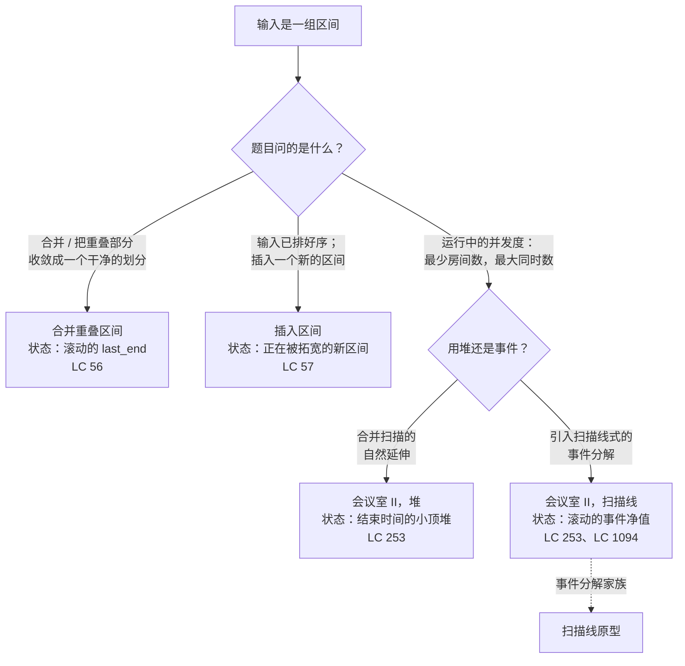

# 合并区间原型

## 如何决策

你已经把题目判成区间题了：输入是实数轴上的一组 `[start, end]` 数对，问题问的是这些数对之间怎么相互作用。把它判进这个家族、而不是判给长得像的邻居，那个判别点在更上层的贪心决策页上；本页从那些页停下的地方接着讲。FAANG 级别面试里遇到的几乎每一道区间题，都能被三种原型覆盖，现在的问题是：题目真正想要哪一种。

三者的骨架一模一样。按起点排序。从左往右扫。维护一份滚动状态，每扫过一个区间就输出或者计数。三者之间的差别只在状态里装的是什么：一个合并后的区间、一个正在被吸收的新区间，或者一堆结束时间。

一条一行就能写完的路由规则，按顺序套用：

- 题目要把一份乱糟糟的日程*收敛*成干净的、互不重叠的一份 → **合并重叠区间**，状态是一个滚动的合并区间。
- 题目给你一份*已排好序*的日程，外加一个新区间要插进去 → **插入区间**，状态是那个正在被拓宽的新区间，而且你完全跳过排序。
- 题目问的是*运行中的并发度*：需要多少间房、最多同时几通电话、任意时刻的最大负载 → **会议室 II**，状态是活动结束时间的小顶堆（或者等价地，`+1/-1` 事件上的一个余额计数器）。

原型层面的决策是在三个近亲之间选，不是在三种不同算法之间选。读题目里的动词，定下状态，写同一个循环。

## 流程图

*第一次分叉看题目的动词；第二次分叉在并发那一支上，按“用哪个数据结构承载滚动计数”拆开。会议室 II 的堆变体和扫描线变体，用同样的复杂度算出同样的答案；它们教的是两套不同的心智模型，而扫描线变体是通往[扫描线原型](./P-35-sweep-line-archetypes.md)的入口。*

## 变体

### 合并重叠区间

**识别信号：**提示说“合并所有重叠区间”“把一份日历收敛成一份”“把预约区间整合成最小的不重叠集合”。输出是一个区间列表。

何时选它：

- 输入无序。按起点升序排序；排序开销主导整趟扫描。
- 排完序之后，唯一还可能和当前这一组重叠的区间，是起点不晚于 `last_end` 的那些，而它们在排序结果里是连续挨着的。[^1] 正是这种连续性，让单趟线性扫描就够了。
- 扫描只维护一个滚动区间 `last`。对每个新区间 `(s, e)`，要么 `s <= last.end`（LC 56 里首尾相接也算重叠，所以用 `<=` 而不是 `<`），那就用 `last.end = max(last.end, e)` 扩展它；要么不满足，把当前这一组输出，`(s, e)` 成为新的滚动区间。
- `max(last.end, e)` 在 `[[1, 10], [2, 3]]` 这种被包含的区间上是承重的。少了 `max`，里面那个 `[2, 3]` 会把合并结果缩成 `[[1, 3]]`。[^2]

时间 / 空间：`O(n log n)` 时间，由排序主导；输出列表 `O(n)`。[^2]

这一变体归属：[区间调度：比较器就是算法](../part-10-greedy/01-interval-scheduling.md)。招牌题 LC 56（[Merge Intervals](https://leetcode.com/problems/merge-intervals/)）。

### 插入区间

**识别信号：**题目明确写了“区间一开始是按起点排好序的”或者“任意两个区间都不重叠”，接着要求插入一个新区间并返回结果。已排序这个前置条件是白送的礼物，不是背景介绍。

何时选它：

- 输入已排序，且两两不重叠。再排一遍等于把前置条件扔掉，换一个没必要的 `O(log n)` 因子，而这条约束本来已经把题目压到了 `O(n)`。[^3]
- 扫描分三个阶段。严格在新区间*之前*的区间直接抄过去（`end < newInterval.start`）；和新区间*重叠*的区间，把 `newInterval` 拓宽成 `[min(start, ...), max(end, ...)]` 来合并；严格在*之后*的区间直接抄（`start > newInterval.end`）。
- 状态就是新区间本身，随着扫描吸收每个重叠的已有区间，它被原地改写。条件反射地写成 `merge(intervals + [newInterval])` 的读者，实现的是合并重叠算法，只是多排了一次序。这个前置条件换来的，正是三段式拼接。

时间 / 空间：`O(n)` 时间（单趟线性扫描，不排序）；输出 `O(n)`。[^3]

这一变体归属：还是第 10.1 章，被当作 LC 56 的兄弟特化来写。招牌题 LC 57（[Insert Interval](https://leetcode.com/problems/insert-interval/)）。

### 会议室 II

**识别信号：**题目问的是*运行中的并发度*：最少需要几间房、最多同时几通电话、任意时刻的最大负载、“`n` 趟行程能不能塞进容量 `c`”。答案是单个数字，不是区间列表。[^4]

何时选它：

- 输入形状和合并重叠区间一样，但问题不再是“合并后的划分长什么样”，而是“任意一个点上最大重叠深度是多少”。滚动状态是一个计数，不是一个区间。
- 两种同样经典的实现，时间都是 `O(n log n)`，空间都是 `O(n)`。

堆变体是合并扫描的自然延伸。按起点排序。维护一个由当前活动区间的结束时间组成的小顶堆 `H`。对每个区间 `[s, e]`：当 `H.peek() <= s` 时（结束最早的那场活动会议已经结束了），弹出。然后压入 `e`。处理完之后的堆大小，就是此刻的并发区间数；全局最大堆大小就是答案。每个区间贡献一次压入、至多一次弹出，所以总工作量是 `O(n log n)`。[^4]

扫描线变体把每个区间 `[s, e]` 拆成两个事件：`(+1, s)` 和 `(-1, e)`。按时间对事件流做字典序排序，同一时刻的 `-1` 事件排在 `+1` 事件*之前*，这样 `[[7, 10], [10, 11]]` 这种首尾相接的边界就不会被重复计数。[^5] 扫一遍，维护前缀和，返回过程中的最大值。扫描线变体引入的事件分解视角，可以推广到天际线（LC 218）、拼车（LC 1094）和矩形面积类问题；这一整族在[扫描线原型](./P-35-sweep-line-archetypes.md)上。

这一变体归属：第 10.1 章同时引用了两种实现。堆的机制（push、pop、peek、push-pop 摊还）在[堆与优先队列](../part-6-trees-heaps/04-heaps-priority-queues.md)里，更广义的“用堆承载状态”这类决策在[用堆或快速选择解 Top-K](./P-30-top-k-heap-or-quickselect.md)上。招牌题 LC 253（[Meeting Rooms II](https://leetcode.com/problems/meeting-rooms-ii/)）。

## 变体对比

| 维度 | 合并重叠区间 | 插入区间 | 会议室 II |
|---|---|---|---|
| 输入是否已排序？ | 否 | 是 | 否 |
| 排序键 | 起点升序 | 无（前置条件白送） | 起点升序（堆变体）；事件时间（扫描线变体） |
| 聚合状态 | 滚动的合并区间 `last` | 正在被拓宽的新区间 | 活动结束时间的小顶堆，*或者*滚动的事件净值 |
| 循环体 | 扩展 `last.end`，或者输出并另起一组 | 三个阶段：之前 / 重叠合并 / 之后 | 堆：弹出过期项，压入新项；扫描线：`+1/-1` 事件的前缀和 |
| 输出形态 | 合并后的区间列表 | 合并后的区间列表 | 单个整数（最大并发度） |
| 复杂度 | `O(n log n)` 时间，`O(n)` 空间 | `O(n)` 时间，`O(n)` 空间 | `O(n log n)` 时间，`O(n)` 空间（两个变体都是） |
| 经典题目 | LC 56 | LC 57 | LC 253 |

前两列用不同的词汇说同一件事：两趟扫描都只维护*一个*区间当状态，要么扩展它，要么输出它。变的是输入的不变式。LC 56 得为排序付钱，因为输入无序；LC 57 白得了排序，于是跑在 `O(n)`。LC 253 把状态从“一个区间”抬成“当前活动的区间集合”，而堆（或事件净值）就是这个集合，堆变体里的比较器仍然是按 `start` 升序。那条共享的脊柱——*按起点排序，从左往右扫，带一份滚动聚合*——贯穿每一列。

## 三道招牌题

### LC 56 — Merge Intervals

[https://leetcode.com/problems/merge-intervals/](https://leetcode.com/problems/merge-intervals/)（中等）。

合并重叠区间。输入无序；按起点排序；带着一个滚动的合并区间扫描。推演：`[[1, 3], [2, 6], [8, 10], [15, 18]]` 已经有序；初始化 `out = [[1, 3]]`。看到 `[2, 6]`：`2 <= 3`，扩展 `last.end = max(3, 6) = 6`，`out = [[1, 6]]`。看到 `[8, 10]`：`8 > 6`，输出并另起一组。看到 `[15, 18]`：`15 > 10`，输出并另起一组。最终 `[[1, 6], [8, 10], [15, 18]]`。`max` 这一步在 `[[1, 10], [2, 3]]` 这种被包含的输入上才显出作用：无条件赋值会把 `last.end` 从 10 缩回 3。[^2]

### LC 57 — Insert Interval

[https://leetcode.com/problems/insert-interval/](https://leetcode.com/problems/insert-interval/)（中等）。

插入到已排序序列。三个阶段，单趟线性扫描，不排序。推演：`intervals = [[1, 3], [6, 9]]`，`newInterval = [2, 5]`。阶段一（之前）在 `intervals[i].end < newInterval.start` 时前进；因为 `2 > 3` 不成立，一个都没匹配上。阶段二（重叠合并）在 `intervals[i].start <= newInterval.end` 时前进；`[1, 3]` 重叠，拓宽成 `[min(1, 2), max(3, 5)] = [1, 5]`，追加。阶段三（之后）抄下 `[6, 9]`。最终 `[[1, 5], [6, 9]]`。walkccc 的参考解把这一步注成 `Time: O(n)`，正是因为它尊重了已排序这个前置条件。[^3]

### LC 253 — Meeting Rooms II

[https://leetcode.com/problems/meeting-rooms-ii/](https://leetcode.com/problems/meeting-rooms-ii/)（中等）。

运行中的并发度。两种实现在 `[[0, 30], [5, 10], [15, 20]]` 上都返回 `2`。堆变体：按起点排序（本来就有序）。看到 `[0, 30]`：`H` 为空，压入 30，大小 1。看到 `[5, 10]`：`H.peek() = 30 > 5`，没有过期项，压入 10，`H = [10, 30]`，大小 2。看到 `[15, 20]`：`H.peek() = 10 <= 15`，弹出，压入 20，`H = [20, 30]`，大小 2。最大堆大小 2。[^4] 扫描线变体：事件为 `(0, +1), (5, +1), (10, -1), (15, +1), (20, -1), (30, -1)`。按字典序排序，同一时刻 `-1` 排在 `+1` 之前（这里没有并列）。前缀和：1, 2, 1, 2, 1, 0。最大 2。同一个答案；不同的心智模型。

## 常见误解

**合并区间总得排序。** 不必。LC 57 就是反例：输入白送了已排序和两两不重叠，算法就是一趟 `O(n)` 的三段式拼接。再排一遍等于把前置条件扔掉，换一个没必要的 `O(log n)` 因子。这个误解更难缠的版本出现在 LC 253：只见过堆变体的读者会以为“合并区间”就等于按起点排序，而扫描线变体根本不按起点排序。它排的是*事件流*，那是另一个域（坐标时刻上的 `+1` 和 `-1` 事件），底下的区间对象在排序结果里从头到尾都不出现。[^5] 纪律是“排算法要扫的那个东西”，不是“排区间”。

**会议室 II 需要堆。** 不需要。扫描线变体用一个计数器和一份事件净值，以同样的 `O(n log n)` 时间和 `O(n)` 空间解掉 LC 253。[^5] 按心智模型选，别按条件反射选：堆变体是合并重叠扫描的自然延伸（仍然按起点走，仍然维护一个当前活动的区间集合），而扫描线变体引入的事件分解视角能推广到天际线和拼车。两种都是经典解法。LeetCode 上免费的镜像题 LC 1094（[Car Pooling](https://leetcode.com/problems/car-pooling/)）在结构上和 LC 253 的扫描线变体完全一致，可以在那里把算法从头到尾跑通，不必买会员。

**输出里的区间不可能乱序。** 这得看题。LC 56 要求合并后的输出按起点有序，这从“先排序再扫描”的纪律里自然掉出来。LC 57 的三段式拼接也产出有序输出，原因相同：已有区间本来就有序，新的合并区间落在正确的位置上。但当问的是单个数字（LC 253）时，根本没有“输出顺序”这回事；而若干区间 DP 题（矩阵链相乘、戳气球）是按长度、或者干脆按某个和起点无关的键排序的。读题目要什么；别假设“按起点排序”会自动传染到输出上。

**重叠的判据是 `b.start < a.end`。** 这对半开区间 `[a.start, a.end)` 成立：端点*不*属于区间，`[1, 4]` 后面跟 `[4, 5]` 算不重叠。LC 435（不重叠区间，在[区间调度：比较器就是算法](../part-10-greedy/01-interval-scheduling.md)上）用的就是这个约定。LC 56 用的是*闭*区间 `[a.start, a.end]`：端点属于区间，`[1, 4]` 和 `[4, 5]` *确实*重叠；比较符是 `<=`，不是 `<`。这一个字符的差别是原型层面的决策，每道题都可能翻面。仔细读题目的示例：如果标准示例把首尾相接当成重叠，就用 `<=`；如果当成不重叠，就用 `<`。同一条纪律也出现在会议室 II 的扫描线变体里：那里“同一时刻 `-1` 事件排在 `+1` 之前”的并列规则，正是让首尾相接的边界不被重复计数的东西——同一个想法，换了个层面。[^5]

**会议室 II 的堆变体跟踪的是活动区间。** 它跟踪的是活动的*结束时间*，这就够了。区间本身从不进堆，堆里只有每个当前活动区间的那个整数结束时间。对下一个区间 `[s, e]` 判断 `H.peek() <= s` 时，堆顶那场会议已经结束，那个整数被弹出。算法不关心它来自哪个区间。这正是堆变体只花 `O(n)` 空间、而不是 `O(n)` 个区间对象的原因。扫描线变体把这种压缩推得更远：每个区间在进入算法的瞬间就被换成两个事件，此后算法再也不会把区间当成一个整体来看。

## 参考文献

[^1]: Cormen, Leiserson, Rivest, Stein, *Introduction to Algorithms*, 4th ed., MIT Press, 2022, Ch. 15. Kleinberg and Tardos, *Algorithm Design*, Pearson/Addison-Wesley, 2006, §4.1.

[^2]: walkccc, "LeetCode 56." https://walkccc.me/LeetCode/problems/56/

[^3]: walkccc, "LeetCode 57." https://walkccc.me/LeetCode/problems/57/

[^4]: leetcode.ca, "253. Meeting Rooms II." https://leetcode.ca/all/253.html

[^5]: walkccc, "LeetCode 1094." https://walkccc.me/LeetCode/problems/1094/
