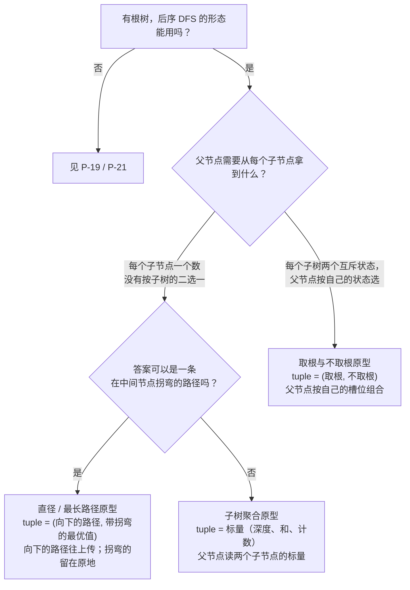

# 树形 DP 原型

树形 DP 是这样一族题：一趟后序递归把所有活都干完。每个节点先访问自己的子节点，把父节点可能需要的一切塞进一个小元组里返回。父节点拆开两个子元组，与自己的值合并，构造自己的元组，再往上传。一趟，O(n) 时间，O(h) 递归栈，不需要记忆化表。

这类原型的标志就是*元组的形状*。这也是写解法时唯一要做的决策。父节点只需要从每个子节点拿一个数就能完成自己的工作时，一个标量就够。父节点的选择取决于每个子节点的一个二值状态——偷这间屋还是不偷——时需要两个槽位。答案可能表现为一条在某个内部节点拐弯、拐过之后就无法再穿过父节点继续延伸的路径时，需要另一类两个槽位。后序骨架始终不变，花招全在元组上。

本页枚举三类原型，LeetCode 上从简单到困难的树形 DP 题大致都落在这三类里：带双量拆分的子树聚合形态（LC 124）、取根与不取根的状态机（LC 337），以及直径技巧（LC 543）。配套的教学章节是 [树 DP](../part-9-dynamic-programming/13-tree-dp.md)，那里有四语言参考实现和完整推演；本页承载的是跨原型的决策内容。

## 如何决策

触发树形 DP 的输入形态很窄。题目给你一棵有根二叉树（或者一棵你可以自己定根的树），每个节点带一个值或一个状态，而整棵树的答案可以由每个节点的值加上它左右两棵子树的摘要信息、用 O(1) 的计算拼出来。这三条都成立时，后序递归就是脊柱，唯一的设计问题只剩“每棵子树的摘要里装什么”。[^1]

脊柱是固定的：递归左子节点，递归右子节点，把两个子元组与 `node.val` 合成当前节点的元组，返回。基准情形是空子树，它返回一个单位元组（identity tuple），选得刚好让合并步骤不必对叶子特判。每道题可以调的旋钮有三个：元组的形状、合并规则，以及（有时）一个由闭包捕获的全局变量，用来吸收元组无法向上携带的答案。

两种情形要转到别处。递归图上出现重叠子问题（同一个 `(state, position)` 对会被不止一条路径到达）时，这属于一般 DP，需要记忆化，而不是树形 DP——见 [P-19 递归 vs DP](./P-19-recursion-vs-dp.md)。问题问的是层序或从根出发的最短路径时，BFS 占优，后序是错的顺序——见 [P-21 树的 BFS vs DFS](./P-21-bfs-vs-dfs-trees.md)。树形 DP 坐在“有根树输入”与“后序能用”的交集上。[^2]

## 流程图

*三类原型，三种元组形状。“答案能不能拐弯”这一分支把标量返回的情形（子树聚合：被比较的数就是被返回的数）与直径情形（比较的量和返回的量是两回事）分开。*

## 变体

### 带双量拆分的子树聚合（LC 124）

**识别信号。** 题目要求在树里找*最优路径*，路径最多只能拐一次，节点值可以为负。LC 124 *Binary Tree Maximum Path Sum* 是这道经典的困难题。[^3] 题面措辞很统一：“求任意非空路径的最大和”、“路径可以经过任意节点”、“路径由父子相连的节点构成”。关键线索：答案是路径，不是计数也不是深度，而答案的自然形态里包含会拐弯的那些。

**元组形态。** 每个节点两个量，但只有一个往上传。辅助函数*返回* `down_path = node.val + max(0, max(left_down, right_down))`，即以本节点结尾、最多伸进一棵子树的最优竖直链。拿去与全局比较的是另一个量：`best_with_bend = node.val + max(0, left_down) + max(0, right_down)`，即在本节点拐弯、同时伸进两棵子树的最优路径。上面的父节点可以把一条竖直链穿过自己继续延伸，但它没法延伸一条已经拐过弯的路径；把父节点粘到拐弯路径上会产生两个弯，结果在 LC 124 的定义下不再是路径。

`max(0, child_down)` 这个截断是代数的一部分，不是防御性的保险。有负值参与时，它编码的是“伸进空子树、贡献 0”这个选项，而它严格优于伸进一棵最优链为负的子树。

**何时选用。** 当答案可能以拐弯路径的形式出现、而父节点吃不掉这个拐弯形态时，就用这类原型。纪律是：两个不同的表达式写在两行里，拐弯的量更新全局，竖直的量被返回。把拐弯的量返回给父节点，是 LC 124 提交里被引用最多的 bug。[^3]

**时间 / 空间。** O(n) 时间、O(h) 递归栈。n 是节点数；h 是树高，平衡树上约为 log n，退化成一条链时是 n − 1。

**章节引用。** [树 DP](../part-9-dynamic-programming/13-tree-dp.md) 的 §“双量拆分：有负值参与时”有完整的四语言参考，并解释了 `best` 为什么初始化成负无穷而不是 0。

### 取根与不取根的状态机（LC 337）

**识别信号。** 题目强制做一个按子树的二值选择，而且这个选择对父节点有后果：偷这间屋还是不偷、在这里放守卫还是靠子节点、把这个节点算进答案集还是排除在外。LC 337 *House Robber III* 是教科书案例。[^4] 线索：父节点的最优选择取决于子节点做了什么，而子节点的最优值又随它自己的决定而不同。

**元组形态。** 一个二元组 `(use_root, skip_root)`：子树在根被选中时的最优值，以及在根被排除时的最优值。对 LC 337，`use_root = node.val + skip_l + skip_r`（取本节点就禁掉两个子节点），`skip_root = max(use_l, skip_l) + max(use_r, skip_r)`（跳过本节点则释放每个子节点，让它们各自独立地挑更好的槽位）。空子树的单位元是 `(0, 0)`。根部的包装取 `max(use_root, skip_root)`。

两个递推式是被题目的约束逼出来的。`use_root` 必须用每个子节点的 `skip` 槽位。`skip_root` 则逐个读每个子节点更好的那个槽位，两个子节点之间互相独立。没有元组，递归就没法一边记住“假设你跳过了的最优”，一边又报告“假设你取了的最优”；返回单个标量等于过早做出承诺，父节点再也收不回来。

**何时选用。** 当父节点必须就每个子节点的两个互斥状态做推理、并为自己的两个状态各挑一个更好的组合时，就用这类原型。这个模式可以推广：LC 968 *Binary Tree Cameras* 用三状态编码（NEEDS_COVER、HAS_CAMERA、COVERED）；LC 1372 *Longest ZigZag Path* 用带方向的二元组。元组的大小与父节点需要推理的状态空间大小一致。

**时间 / 空间。** O(n) 时间、O(h) 递归栈。元组大小恒定；每个节点恰好访问一次。

**章节引用。** [树 DP](../part-9-dynamic-programming/13-tree-dp.md) 的 §“两状态 DP：(rob, skip) 元组”有四语言参考，以及走一遍 LC 337 示例树的推演。

### 直径（LC 543）

**识别信号。** 题目问树里*最长*的路径或链，没有节点值算术、没有负值、没有取或不取节点的选择。LC 543 *Diameter of Binary Tree* 是经典的简单题。[^5] 线索：“任意两个节点之间的最长路径”、“最长路径上的边数”、“任意路径，不一定要经过根”。

**元组形态。** 一个二元组 `(height, longest_path)`，height 是以本节点为根的最长竖直链上的节点数，longest_path 是本子树内任意位置拐弯路径长度的滚动最大值。合并规则：`height = 1 + max(left_height, right_height)`；`longest_path = max(left_longest, right_longest, left_height + right_height)`。空子树的单位元是 `(0, 0)`。

这是直径技巧最干净的形态。穿过本节点的拐弯路径长度是 `left_height + right_height`（按边算）。往上传的新高度是更好的那个子节点高度加一。两个数在同一个元组里一起上行；不需要闭包捕获的全局变量，不过很多参考资料会带着一个全局来写同一份算法，因为把元组第二个槽位提到外面并不影响正确性。

LC 543 是无权原型。上面的 LC 124 是带权、带负值的推广。LC 687 *Longest Univalue Path* 是带约束的版本，链只能沿连接等值节点的边延伸。[^6] 三者共享这类原型的代数形状；变的只是链“携带”什么（深度、和、带谓词的长度），以及谓词对能否延伸做的判断。

**何时选用。** 当答案是路径或链的长度、路径可以出现在树的任何位置、且没有需要父节点推理的按子树二值选择时，就用这类原型。

**时间 / 空间。** O(n) 时间、O(h) 递归栈。

**章节引用。** [树遍历：前序、中序、后序](../part-6-trees-heaps/01-tree-traversals.md) 把 LC 543 作为无权直径原型引入；带权推广（LC 124）和带约束的版本（LC 687）在 [树 DP](../part-9-dynamic-programming/13-tree-dp.md)。

## 变体对比

| 变体 | 元组形状 | 向上返回什么 | 全局跟踪什么 | 时间 / 空间 | 典型题 |
|---|---|---|---|---|---|
| 子树聚合（双量拆分） | `(down_path, best_with_bend)` | `down_path = node.val + max(0, max(left_down, right_down))` | `best_with_bend = node.val + max(0, left_down) + max(0, right_down)`（在所有节点上取最大） | O(n) / O(h) | LC 124 *Binary Tree Maximum Path Sum* |
| 取根与不取根状态机 | `(use_root, skip_root)` | 元组的两个槽位；父节点按自己的槽位挑 | 无；答案是递归结束后的 `max(root.tuple)` | O(n) / O(h) | LC 337 *House Robber III* |
| 直径 | `(height, longest_path)` | `height = 1 + max(left_h, right_h)`；`longest_path` 也会返回，可以外提为全局 | 可选：把 `longest_path` 提到闭包全局 | O(n) / O(h) | LC 543 *Diameter of Binary Tree* |

三行共享后序脊柱和 O(n) 上界。分歧在元组里装什么、以及要不要全局：双量拆分*必须*有全局，因为拐弯的量不能往上传；状态机*不需要*全局，因为两个槽位父节点都能用；直径这一例两种都行，用全局只是风格偏好。

## 三道招牌题

- [LC 124 — Binary Tree Maximum Path Sum](https://leetcode.com/problems/binary-tree-maximum-path-sum/) [困难] • tree-dp-dual-quantity. 带负值的双量拆分；它最标准地示范了被返回的数和被比较的数不是同一个数。
- [LC 337 — House Robber III](https://leetcode.com/problems/house-robber-iii/) [中等] • tree-dp-state-machine. 二元组状态机；它最标准地示范了父节点的选择取决于子节点的选择，返回单个标量不够。
- [LC 543 — Diameter of Binary Tree](https://leetcode.com/problems/diameter-of-binary-tree/) [简单] • tree-dp-diameter. 最简单的直径技巧；也是大多数读者最先见到的入口。

## 常见误解

**“树形 DP 需要一张显式的 DP 表。”** 不需要。递归栈*就是* DP 表：每个后序栈帧恰好存一个节点的元组，而栈帧在栈里的位置就是它的下标。栈帧按定义自底向上弹出（后序总是先跑完子节点才回到父节点），所以求值顺序本来就对，不需要任何辅助数组。在 1D 和 2D DP 章节里学会 `dp[i]`、`dp[i][j]` 下标的读者会把这个习惯带进树题，转而写按节点身份索引的 `dp[node] = ...`。这样能跑，多花 O(n) 空间，每次访问子节点都强加一次哈希查找，而正确性一点没多——递归早就把同样的信息通过辅助函数的返回值传上去了。[^1]

**“必须做自顶向下记忆化。”** 树形 DP 默认是*自底向上*的。后序递归先访问叶子、最后访问根，这与在拓扑排序过的 DAG 上跑一遍填表的求值顺序相同。自顶向下记忆化是子问题重叠时才用的技术，而树上的子问题不重叠（每棵子树恰好出现一次），所以备忘录表纯属累赘。“DP 要么自顶向下、要么自底向上”这个说法漏掉的一点是：后序遍历本来就免费替你选定了其中一种顺序。[^7]

**“直径需要两趟。”** 不需要。一趟后序为每个节点返回 `(height, longest_path)`；父节点以 O(1) 读完两个子元组，用候选值 `left_height + right_height` 更新自己的 `longest_path`，再返回新元组。有些参考资料把 `longest_path` 提到闭包捕获的全局里，好让返回类型保持标量，但那只是风格选择，不是正确性要求。两趟的写法——一趟算高度，第二趟找直径——是有效算法，却白付了一个两倍的因子，渐近上没有半点收益。

**“元组类型是语言相关的。”** 算法与语言无关，语法是相关的。Python 返回元组字面量 `(use_root, skip_root)`。Java 用一个小的 `static class Pair`（或者类上两个独立字段），因为 Java 没有原生元组语法。C++ 用 `std::pair<int, int>` 或一个小 `struct`。Go 返回两个具名值，这是该语言里元组返回的惯用等价物。[树 DP](../part-9-dynamic-programming/13-tree-dp.md) 里的四语言参考把四种实现并排放在一起；每个节点上的代数完全相同，变的只是包着那两个整数的壳。

**“直径技巧和双量拆分是两个模式。”** 它们是同一个模式配不同的谓词。两类原型都向父节点返回一个量（一条父节点可以延伸的链），同时把另一个量拿去与全局或元组的第二个槽位比较（一个父节点无法延伸的拐弯形态）。LC 543 无权（链是节点计数，永远非负）。LC 124 带权且有负值（链是和，这也是 `max(0, ...)` 截断出现的原因）。LC 687 带约束（链只沿等值边延伸）。共享的代数形状才是它们算一个原型、而不是三个的原因。

## 参考文献

[^1]: Cormen, Leiserson, Rivest, Stein, *Introduction to Algorithms*, 4th ed., MIT Press, 2022, Chs. 10, 14.

[^2]: darkshadows, "DP on Trees Tutorial," Codeforces blog entry 20935. https://codeforces.com/blog/entry/20935

[^3]: Hello Interview, "Leetcode 124. Binary Tree Maximum Path Sum." https://www.hellointerview.com/community/questions/binary-tree-max-sum/cm5eh7nrh04qg838ohcis83zd

[^4]: leetcode.ca, "337. House Robber III." https://leetcode.ca/all/337.html

[^5]: leetcode.ca, "543. Diameter of Binary Tree." https://leetcode.ca/all/543.html

[^6]: leetcode.ca, "687. Longest Univalue Path." https://leetcode.ca/all/687.html

[^7]: Erickson, *Algorithms*, 1st ed., 2019, Ch. 3. https://jeffe.cs.illinois.edu/teaching/algorithms/book/03-dynprog.pdf
