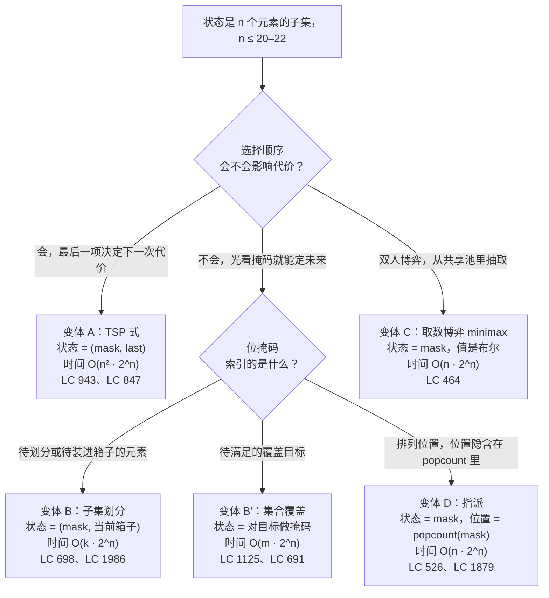

# 位掩码 DP 原型

当问题的自然状态就是*`n` 个元素里哪些已经被访问、覆盖、选中或指派*，而且 `n` 小到整个子集能塞进一个 CPU 寄存器时，位掩码 DP 就是那个对的工具。“小到”这三个字是承重的。`n = 20` 时，状态空间 `2^n` 是 `1,048,576`，大约占四兆字节的记忆化表，写紧凑的代码跑起来不到一秒。`n = 22` 时，`2^n = 4,194,304`，这已经是实际天花板——再往上，缓存未命中会让实测耗时翻倍，多数比赛的时限就崩了。到 `n = 30`，表里是十亿条记录，算法根本跑不起来。

更难的洞见——也是本篇存在的意义，即把它变成可复用的东西——是：光有掩码很少够用作状态。位掩码 DP 每一个有意思的变体，都是把掩码和第二个维度配在一起：TSP 里最近访问过的城市、子集划分里当前正在装的箱子下标、排列问题里那个隐式的位置指针。挑对第二个维度才是设计动作，位运算只是记账。配套章节 [位掩码 DP](../part-9-dynamic-programming/14-bitmask-dp.md) 针对一个标准实例（LC 847 *Shortest Path Visiting All Nodes*）做了完整的思维模型推导；本篇这个原型页则把家族里的四种形状列清楚，并给出在兄弟变体之间做选择的那句提示。

## 如何决策

两个问题就能路由到一个变体。**选择顺序会不会影响代价？** 会，算法就必须知道最后放进去的是哪一项，于是状态多出一个 `last` 维度，复杂度升到 `O(n^2 · 2^n)`。不会，光靠掩码就够，复杂度是 `O(n · 2^n)`，或者 `O(2^n · m)`（`m` 是某个更小的量）。**位掩码索引的是什么？** 可能是元素本身（每一位就是 `n` 个待划分或待排列的东西之一），可能是覆盖目标（每一位是一条必须由某些选择满足的需求），也可能是被抽走的整数（每一位是从共享池里的一次抽取，共同决定当前的运行状态）。

由此分出三种子形状，外加一个给双人博弈用的布尔聚合异类。硬上限是共通的：它们全都是 `n ≤ 22`，而多数变体比这更紧，因为每个状态上的工作量会把实际天花板往下压。LC 943 之所以卡在 `n ≤ 12`，正是这个原因；`n = 22` 时的 `n^2 · 2^n` 量级大概是二十亿次操作，远远超出任何面试的预算。[^1]

## 流程图

*先按“顺序是否影响代价”这一维切；若顺序无关，再用“掩码索引什么”这一维切掉剩下的。变体 C 是那个布尔聚合的异类：它的递推是对各步做逻辑或，而不是数值上的取最小/取最大/求和。*

## 变体

### 变体 A —— TSP 式 `(mask, last)`

**识别信号：**题面要求找一个最小代价的顺序，把每个元素恰好访问一次，而每一步的代价取决于 `(上一项, 下一项)` 这个二元组。招牌说法是*“走遍 `n` 个城市的最短巡游”*（也就是原始的旅行商问题），或者*“包含全部 `n` 个字符串的最短超串”*（两个字符串之间的代价取它们最大重叠的相反数）。凡是出现 `g(prev, next)` 这种函数的场景，都归这一行。

**何时选它：**当算法的未来不只取决于还剩哪些元素，还取决于你此刻正站在哪一个上面。去掉 `last` 维度，递推就算不出下一步的边代价；DP 会返回错答案，因为它分不清穿过同一前缀的两条不同巡游。状态是 `dp[mask][last] = 恰好访问 mask 里的元素、且以 last 结尾的最小代价`，转移写作 `dp[mask][last] = min over k in mask, k != last of dp[mask without last][k] + g[k][last]`。当题目要的是实际巡游而不只是它的代价时，重建还需要一张父指针表。

**时间与空间：**时间 `Θ(n^2 · 2^n)`、空间 `Θ(n · 2^n)`，这个界由 Held 和 Karp 与 Bellman 在 1962 年各自独立发表的论文给出。[^1] 六十多年来时间界没有任何改进；近年的条件性下界结果还说大概率也不会有。

**章节出处：**[位掩码 DP](../part-9-dynamic-programming/14-bitmask-dp.md) 的“实例推演”一节走了一遍 LC 847（无权特例，BFS 就够），“TSP 式：状态多一个 `last` 维度”一节勾勒了推广到带权的 LC 943。

### 变体 B —— 子集划分（对元素做掩码）

**识别信号：**`n` 个互不相同的元素每个都要恰好用一次，算法要把它们分进 `k` 个代价相等的桶（或者某种固定容量的分组）。LC 698 *Partition to K Equal Sum Subsets* 是标准实例：给定 `n ≤ 16` 个整数和一个目标 `k`，判断这些整数能不能恰好划分成 `k` 个子集，每个子集的和都是 `total / k`。[^2] LC 1986 *Minimum Number of Work Sessions to Finish the Tasks* 是同一件事的装箱版，`n ≤ 14`。

**何时选它：**当元素互不相同、每个都必须放恰好一次，而同一个桶内部的放置顺序无所谓。掩码索引的是*元素*（每一位就是 `n` 个待放置的东西之一）；状态的第二个分量要么是当前正在填的桶下标，要么是这个进行中的桶的剩余容量。最干净的编码是 `dp[mask] = 用 mask 里的元素构成的那个进行中子集的剩余和`，约定是当前和一旦打到目标值，剩余量就归零。全集掩码可行，当且仅当 `dp[full] == 0`。

**时间与空间：**时间 `O(2^n · n)`、空间 `O(2^n)`，常数因子主要取决于检查剩余量的开销有多小。带排序剪枝的回溯在 `n ≤ 8` 时因为常数小反而赢，但随着最坏情况被填满、记忆化的摊还生效，位掩码 DP 会反超。

**章节出处：**[位掩码 DP](../part-9-dynamic-programming/14-bitmask-dp.md) 的“模式失效的场景”一节勾勒了划分变体；标准的推演过程在 LC 698 那道梯度题里。

### 变体 B' —— 集合覆盖（对需求做掩码）

**识别信号：**一小撮 `m ≤ 16` 条*需求*（技能、角色、目标位置）必须全部被覆盖，而一个更大的候选池里每一项都能提供其中一部分需求。经典实例是 LC 1125 *Smallest Sufficient Team*：`m ≤ 16` 项必需技能、`n ≤ 60` 个候选人，每个人身上带一个技能位掩码。找出覆盖全部技能的最小团队。[^3] LC 691 *Stickers to Spell Word* 是元素可重复使用的版本。

**何时选它：**当元素数量充裕或者可以重复使用时，掩码必须索引*需求*，绝不能索引元素。看到 `n = 60` 个人就伸手去建 `dp[people_mask]` 的读者，搭出来的是 `2^60` 的状态空间，然后断定题目不可解；正确的状态空间是 `2^16 = 65,536`，人是在转移里迭代的，不进状态编码。递推是 `dp[mask] = min over candidates p of dp[mask without p's contribution] + 1`，代价上限是所需的元素个数，不是被考虑的元素个数。

**时间与空间：**时间 `O(2^m · n)`，`m` 是需求条数、`n` 是候选个数；空间 `O(2^m)`。在 `m = 16`、`n = 60` 时，工作量大约四百万，一秒内绰绰有余。

**章节出处：**[位掩码 DP](../part-9-dynamic-programming/14-bitmask-dp.md) 的“集合覆盖：给需求做掩码，迭代候选项”一节是专门的处理；LC 1125 是那一章的进阶题。

### 变体 C —— 共享池上的取数博弈 minimax

**识别信号：**两名玩家轮流从一个 `n ≤ 20` 的共享整数池里抽取，累计和（或者某个累计谓词）决定胜负，问题问的是先手在双方都最优时能不能逼出胜利。LC 464 *Can I Win* 是标准实例：maxChoosableInteger 最大 20，desiredTotal 最大 300，双方轮流不放回地抽取，先把累计和推到 desiredTotal 或以上的人获胜。[^4]

**何时选它：**当答案是“策略是否存在”的布尔值而不是数值代价，并且递推是 minimax 的时候。状态是 `dp[mask] = "当前玩家从这个局面能赢"`，其中 `mask` 索引哪些整数已被抽走（累计和可以从 `mask` 的位里重建，因为这些整数就是 1 到 `n` 的连续值）。轮到谁走，隐含在 `popcount(mask) mod 2` 里。递推是逻辑或，不是数值聚合：只要存在一步，要么当场取胜，要么把局面转成对手会输的那个，当前玩家就赢。Sprague-Grundy 理论把这套手法推广到 nim 一类的组合博弈，但面试里的标准形态就是位掩码 DP 这一种。[^5]

**时间与空间：**时间 `O(n · 2^n)`、空间 `O(2^n)`。

**章节出处：**变体 C 在 9.14 章里没有专门的小节；那一章的实例推演是无权 TSP 形状加上 `last` 维度的扩展。LC 464 放在那一章的进阶梯度里，作为“在掩码上做 minimax”的标准实例。

### 变体 D —— 位置隐含的指派 / 排列

**识别信号：**算法要在逐位置的谓词或逐对的代价之下，构造 `1..n` 的一个排列（或者把一个 `n` 元集合的元素指派给另一个 `n` 元集合的元素）。每一步恰好放入一个新元素。LC 526 *Beautiful Arrangement* 统计 `1..n`（`n ≤ 15`）的排列数，要求对每个位置 `i`，要么 `perm[i]` 能被 `i` 整除，要么 `i` 能被 `perm[i]` 整除。LC 1879 *Minimum XOR Sum*（`n ≤ 14`）在两个 `n` 元数组之间的所有双射上，最小化逐对的异或和。

**何时选它：**当每次转移都是把一个新元素放到一个完全确定的位置上，于是既不需要 `last` 维度，也不用额外带一个位置计数器。位置指针是隐含的：`popcount(mask)` 就是已经放好的元素个数，所以下一个要填的位置是 `popcount(mask) + 1`。递推是 `dp[mask] = aggregate over j in mask of f(popcount(mask) - 1, j) ⊕ dp[mask without j]`，其中 `f(pos, j)` 是逐位置的谓词（计数类问题）、代价（取最小/最大）或权重（求和）。完整的经典指派问题（`n × n` 二分图最小权匹配）在 `n ≤ 20` 时正是这个形状；`n` 更大时，`O(n^3)` 的匈牙利算法占优。

**时间与空间：**时间 `O(n · 2^n)`、空间 `O(2^n)`。

**章节出处：**[位掩码 DP](../part-9-dynamic-programming/14-bitmask-dp.md) 的“排列 / 赋值：位置就是 `popcount(mask)`”一节带着 LC 526 的完整推演。

## 变体对比

| 变体 | `mask` 表示什么 | 第二状态维度 | 状态数 | 时间复杂度 | 招牌题 |
|---|---|---|---|---|---|
| A —— TSP 式 | 已访问的元素 | `last` ∈ `[0, n)`（最近访问的那个） | `n · 2^n` | `Θ(n^2 · 2^n)` | LC 943 *Find the Shortest Superstring* |
| B —— 子集划分 | 已放置的元素（每个用一次） | 进行中箱子的剩余和（或当前箱子下标） | `2^n` | `O(2^n · n)` | LC 698 *Partition to K Equal Sum Subsets* |
| B' —— 集合覆盖 | 已满足的覆盖目标 | 无（纯 `dp[mask]`） | `2^m`（通常 `m << n`） | `O(2^m · n)` | LC 1125 *Smallest Sufficient Team* |
| C —— 取数博弈 minimax | 已从 `{1..n}` 抽走的整数 | 无（轮次隐含在 `popcount` 里） | `2^n` | `O(n · 2^n)` 布尔 | LC 464 *Can I Win* |
| D —— 指派 | 右侧已被指派的元素 | 无（位置隐含在 `popcount` 里） | `2^n` | `O(n · 2^n)` | LC 526 *Beautiful Arrangement* |

贯穿整张表的唯一区分点，就是第二维度是什么。变体 A 为显式的 `last` 在空间和时间上各付一个 `n` 的因子。变体 B'、C、D 只靠一张大小为 `2^n` 的纯一维表就能过关，因为它们的第二维度要么不存在，要么是隐含的（C 靠 `popcount mod 2`，D 靠 `popcount`）。`n` 的上限逐行不同：变体 A 因为有 `n^2` 因子卡得最紧（LC 943 用 `n ≤ 12`）；变体 C 和 D 能舒服地跑到 `n = 20`；变体 B' 的上限由需求条数而不是候选个数决定，所以它的扩展方式不一样。

## 三道招牌题

- [LC 943 — Find the Shortest Superstring](https://leetcode.com/problems/find-the-shortest-superstring/) [困难] • bitmask-dp-tsp。变体 A 在字符串上的标准 TSP 实例。先算两两重叠 `g[i][j]`（`words[i]` 的后缀匹配 `words[j]` 的前缀），再跑 Held-Karp 的 DP 加父指针做重建。方向搞错的坑是把重叠当成对称的“公共子串”来算，而不是非对称的后缀-前缀匹配；状态搞错的坑是丢掉 `last` 维度。
- [LC 698 — Partition to K Equal Sum Subsets](https://leetcode.com/problems/partition-to-k-equal-sum-subsets/) [中等] • bitmask-dp-partition。变体 B 的标准子集划分实例。`n ≤ 16` 这个上限就是“该用位掩码形式”的信号；最干净的编码用 `dp[mask] = (mask 中元素之和) mod target`，靠归零环绕这个不变量处理换桶。[^2] 带排序剪枝的回溯在 `n` 小时有竞争力，但随着最坏情况填满，会输给记忆化写法。
- [LC 1125 — Smallest Sufficient Team](https://leetcode.com/problems/smallest-sufficient-team/) [困难] • bitmask-dp-set-cover。变体 B' 的教科书级集合覆盖实例。`m ≤ 16` 的技能上限就是信号；坑是伸手去建 `dp[people_mask]`，搭出 `2^60` 的状态空间。修法是在脑子里把“选中的元素子集”换成“已覆盖的需求子集”，当题目要的是团队成员（不只是人数）时，用父指针表重建。[^3]

## 常见误解

**“位掩码 DP 对任何规模都管用。”** 不管用。状态空间是 `2^n`，而 `2^n` 对增长极其残酷：`n = 20` 时表里是一百万条（每条 4 字节，共 4 MB），`n = 22` 时四百万条（16 MB），`n = 25` 时三千三百万条（134 MB），`n = 30` 时超过十亿条。本章的适用区间是 `n ≤ 20-22`，而 `n = 22` 就已经要仔细照顾缓存行为和常数因子了。超过 22 就该往下掉一层找替代方案：元素彼此独立时用 0/1 背包 DP（只关心 popcount，不关心是哪一位），问题有结构时用树分解，或者上近似算法（集合覆盖有 `(1 + ln n)` 近似，TSP 有 Christofides 的 1.5 近似）。反方向的坑也会咬人：看到 `n ≤ 16` 就伸手写回溯的读者，忽略了记忆化是拿开头的 `2^n` 内存换最坏情况的摊还。[^1]

**“子集枚举就是 `O(2^n)`。”** 不是。凭常识读会觉得：遍历每个掩码，再对每个掩码枚举它的子掩码，应该是 `O(2^n · 2^n) = O(4^n)`。真实的界更紧：遍历所有 `(mask, submask)` 对总共只花 `Θ(3^n)` 次操作，不是 `4^n`。证明用二项式定理两行就能写完：全集里的每一位有三种状态（只在 mask 里、同在 mask 和 submask 里、两边都不在），于是总共 `3^n` 种配置。等价地，`Σ_k C(n, k) · 2^k = (1 + 2)^n = 3^n`。[^6] 这件事重要，是因为它让“枚举子掩码”这一类位掩码 DP（一分为二那一族、指派并递归那一族）落在跟朴素想象不同的复杂度级别上。`n = 16` 时，`3^n` 大约四千三百万——勉强可行。`n = 20` 时，`3^n` 超过三十亿——不再剪枝就太慢。子掩码枚举技巧 `s = (s - 1) & m` 让内层循环正好按降序走过 `m` 的全部子掩码，`s == 0` 是循环自然的终止条件（而把 `s != 0` 的判断放在循环底部而不是顶部，就是这个技巧最经典的死循环 bug）。

**“位掩码 DP 一定得摆弄位运算。”** 高级语言完全可以用集合对象或哈希集合对象替掉那个位掩码整数，算法照样正确。Python 的 `frozenset(items)` 就是个可哈希的状态键；Java 的 `BitSet`、Go 里用切片支撑的 `map[int]bool` 也都是可用的替代品。代价在性能上：32 位整数上的位运算比等价的集合成员判定快 10–100 倍，主要因为位掩码形式把整个状态装进一个 CPU 寄存器，而集合形式要做哈希或指针追逐。在比赛的时限面前，这个差距就是 AC 和 TLE 的区别；本章的参考实现用整数形式，正是因为只有整数形式才能让 `O(n^2 · 2^n)` 这个复杂度真正压到它的常数。

**“掩码就是唯一的状态。”** 这是本家族里出现频率最高的设计错误。光有掩码就够，*只*发生在变体 B' 和 D 里，而且两边的原因还不一样：B' 是因为元素根本不属于状态（它们是在转移里被迭代的），D 是因为位置指针隐含在 `popcount(mask)` 里。在变体 A 和 C 里，第二个维度是承重的。变体 A 需要 `last`，因为下一次转移的代价依赖它；一旦去掉，任何“最优巡游必须经过某个特定前驱”的输入都会给出错答案。变体 B 带着箱子下标或者剩余和，跳过它就复现了 LC 698 最常见的那个 bug：DP 允许某个子集冲过自己的目标，然后靠一段并不对应任何真实划分的算术宣布可行。反复出现的教训是：掩码记录的是*已经做了什么*，第二维度记录的是*你现在在哪*，而多数题目两者都要。

## 参考文献

[^1]: Wikipedia, "Held-Karp algorithm." https://en.wikipedia.org/wiki/Held%E2%80%93Karp_algorithm

[^2]: leetcode.ca, "698. Partition to K Equal Sum Subsets." https://leetcode.ca/all/698.html

[^3]: doocs/leetcode, "1125. Smallest Sufficient Team." https://github.com/doocs/leetcode/blob/main/solution/1100-1199/1125.Smallest%20Sufficient%20Team/README_EN.md

[^4]: leetcode.ca, "464. Can I Win." https://leetcode.ca/all/464.html

[^5]: CP-Algorithms, "Sprague-Grundy theorem. Nim." https://cp-algorithms.com/game_theory/sprague-grundy-nim.html

[^6]: CP-Algorithms, "Submask Enumeration." https://cp-algorithms.com/algebra/all-submasks.html

<!-- TODO: 等 P-20（何时该动用位运算）写完后补上链接；目前在第 5 波。 -->
