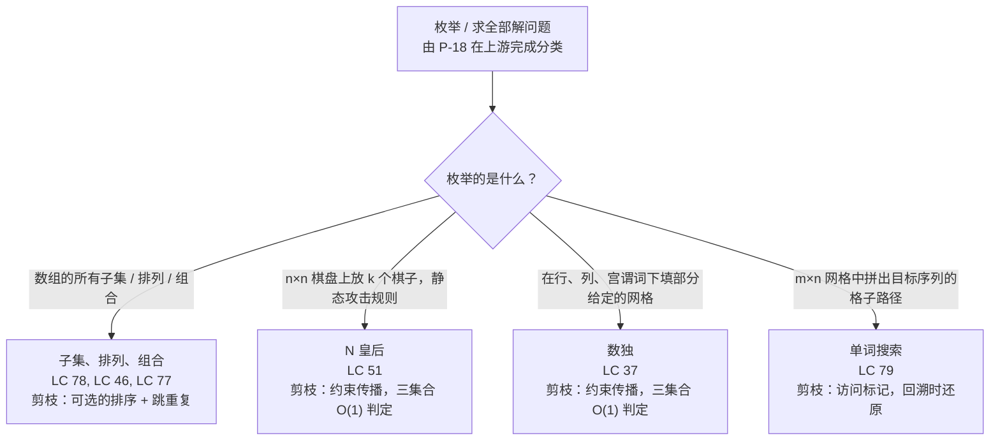

# 回溯模板 + 剪枝

Knuth 在他那本回溯分册的开篇用一句话把这个家族的全部活都干完了：*“它在每个阶段穷举所有可能的候选，但通常不必真的看很多个，因为可以依据部分信息把其余的排除掉。”* 前半句是每个读者做到第二道 LeetCode 题就会写的递归。后半句才是把暴力解法变成能在面试预算内跑完的那一半。这一页把这个家族产出的四种原型编成目录，并为每一种点名：用哪条线索挑它，以及让它在剪枝上跑起来的策略。

上游的判决在 [回溯 vs DP](./P-18-backtracking-vs-dp.md)：一旦题目被归类为枚举或求全部解，而不是重叠子问题优化，下一个问题就是从这四套模板里实例化哪一套。

## 如何决策

每个回溯算法都是同一副骨架、四种写法。**选择**一个候选，递归**探索**该选择下的子树，再**撤销**这个候选、把状态还原。撤销才是纪律所在。同一递归深度上的兄弟分支共享父栈帧与父状态；让第二个兄弟看到的世界与第一个兄弟完全一致的，只有两者之间那次显式 pop。[^2] 少写这次 pop，第二个兄弟就会继承第一个兄弟剩下的选择；算法在极小输入上“能跑”，因为那里只有一个分支，然后在往下每一个多分支的用例里悄悄出错。

在整个家族内部变化的是：枚举什么、剪什么、以及每一层的选择前沿长什么样。四条线索决定选哪个变体。*“所有子集 / 所有排列 / 所有大小为 k 的组合”* 是枚举一切的三件套，模板跑在一个扁平的候选数组上，差别在于下一帧的前沿怎么成形。*“在 n×n 棋盘上放 k 个棋子，且带攻击约束”* 是约束放置，每个落子静态地从未来位置里切出一组闭式的禁位，求解器把这组禁位缓存起来，把单候选判定压到 O(1)。*“在部分给定的网格里填空，使行、列、宫谓词成立”* 是约束传播的丰满形态，即数独家族。*“在网格上走出一个目标序列”* 是网格回溯，访问标记就是状态，撤销是还原那个格子，而不是从列表里 pop。

三种剪枝策略反复出现。**基于界**（bound-based）的剪枝丢弃任何“再怎么扩展也达不到目标值”的部分解，典型例子是组合总和中那句*“target 掉到零以下就放弃这棵子树”*。[^3] **基于约束**（constraint-based）的剪枝丢弃任何违反静态可行性谓词的候选，典型例子是*“皇后不能与已放皇后同列或同对角线”*，对三个预计算集合做 O(1) 判定。[^4] **访问标记**（visited-marker）剪枝禁止复用路径上正在使用的状态，典型例子是把网格单元标成 `'#'` 直到当前路径结束、回溯时再还原。[^5] 第四类概念上的策略——对称性破除（symmetry-breaking）——文献里有，但不在本篇范围内；它是一种优化，不是判别信号。

## 流程图

*四种原型的分水岭在于算法枚举的是什么，而不在递归的形状。递归在每个框里都是同一个“选择 / 探索 / 撤销”循环；剪枝那一栏才是决定性的线索——它决定了哪个变体真能跑、哪个只停留在纸面上。*

## 变体

### 子集、排列、组合（LC 78 / LC 46 / LC 77）

**识别信号。** 题目要*“所有子集”“幂集”“所有排列”“所有顺序”“所有大小为 k 的组合”*，或者*“所有和等于 T 的组合”*。输出是一棵决策树的叶子集合，树的节点是对一个扁平数组的部分选取。LC 78（Subsets，中等）、LC 46（Permutations，中等）、LC 77（Combinations，中等）是三个标准锚点；LC 90、LC 47、LC 39、LC 40 是同一家族的多重集变体与带界目标变体。[^6][^7][^3]

**何时选择。** 候选前沿的形状决定三个子原型里选哪个。子集与组合用 `start = i + 1` 推进，强制按序生成，避免同一个集合以两种顺序出现两次。排列不能用 `start` 下标，因为排列在任意深度都可以挑任意一个未使用元素；正确的前沿是集合差，写成 `used[]` 布尔数组，或者原地交换的写法。组合总和（LC 39）用 `start = i` 而不是 `i + 1` 递归，允许复用同一个候选——这是 LC 77 与 LC 39 之间唯一的结构改动。[^3]

**剪枝策略。** 组合总和用基于界的剪枝：累计目标一旦掉到零以下，任何扩展都不可行，一句 `if target < 0: return` 就把整棵子树跳过。多重集变体（LC 47、LC 40、LC 90）用排序加跳重复：先排序，再加一行谓词，强制重复元素只能从左往右取，把 k 重集里 `k!` 份冗余压缩成一个代表。无重复输入的基准情况（LC 78、LC 46、LC 77）不带剪枝；算法走满整棵树，因为每片叶子都是一个不同的合法输出。

**时间 / 空间。** 子集 O(n × 2^n)；排列 O(n × n!)；大小为 k 的组合是 O(2^n)，上界为 C(n, k)；组合总和是依目标值的伪多项式。[^6][^7][^3]

**章节锚点。** [子集、组合、排列](../part-7-recursion-backtracking/02-subsets-combinations-permutations.md) 载有三个子原型的统一框架、四语言参考实现，以及 `start` 下标写法与 `used[]` 掩码写法之间的对照。

### N 皇后（LC 51）

**识别信号。** 题目要求在 n×n 网格的格位上*放置* k 个棋子，每次落子静态地禁掉一组闭式的未来位置。LC 51（困难）在 n×n 棋盘上放 n 个互不攻击的皇后；LC 52 是只计数的变体。[^4] Wikipedia、*Sedgewick & Wayne*、*Erickson*，以及 Knuth 的 TAOCP 第 4 卷第 5 分册 §7.2.2.1，都是拿这道题引进回溯的，这也是它占住标准原型的位置、而不是当猎奇案例收着的原因。[^1][^8][^2]

**何时选择。** 当结构是“每行选一个位置（或每个格位放一个棋子），并与已放棋子之间遵守静态攻击规则”时。递归逐行下降；在第 `r` 行，选择循环遍历 `j = 0..n-1`，每个候选的可行性判定问的是 `cols[j]`、`diag1[r + j]`、`diag2[j - r + n - 1]` 是否已被占用。[^4] 整套技巧就是这套约束集合的记账。朴素解法在每个候选列上重扫已放皇后，单次判定 O(r)、单行 O(r × n)；三个预计算集合把单次判定降到 O(1)，整行降到 O(n)。第 7.3 章用的位掩码形式把三个集合融成三个整数，候选循环体缩成每个候选一次按位与。[^1]

**剪枝策略。** 约束传播。每放一个皇后置三个标记（列、`/` 反对角线、`\` 对角线）；下一行的每个候选以 O(1) 检查这三个标记。回溯往上走时，撤销这步把三个标记全部清掉，为下一个兄弟恢复约束集合的状态。剪枝正是“n = 12 超时”与“n = 12 毫秒级”之间的分界线；OEIS A000170 记载 n = 12 有 14,200 个解，而算法为了把它们全找出来，探索的节点数远不到一百万。[^9]

**时间 / 空间。** 剪枝前最坏 O(n × n!)；约束传播后的有效分支因子远低于 n。n = 8 从 8! = 40,320 种逐行原始排列中枚举出 92 个解。[^4] 空间 O(n)，用于三个约束集合与递归栈；输出存储另算。

**章节锚点。** [N-Queens：剪枝与约束传播](../part-7-recursion-backtracking/03-n-queens.md) 是承载位掩码写法、n = 1..11 计数所对应的 OEIS A000170 引用，以及那枚专门动画演示约束集合更新的章节组件的那一章。

### 数独（LC 37）

**识别信号。** 题目给一个部分填好的 n×n 网格，要求补出满足一组固定的行、列、区域谓词的唯一解。LC 37（困难）是标准的 9×9 情形，带行、列、3×3 宫约束；同一套模板可以推广到图 k 着色、精确覆盖问题，以及任何“每个选择对应一个小而定长的禁位集合”的约束满足形状。[^1] Knuth 在 TAOCP 第 4 卷第 5 分册里的 *Algorithm X* 与 *Dancing Links* 是标准的一般化。

**何时选择。** 当每个空格位的放置决策都能对三组（或更多）缓存约束集合做闭式可行性判定，且求解器一次下降一个格子、在合法数字中挑一个时。形状是把 N 皇后从“每行一个皇后、三个对角线集合”推广成“每个空格一个数字、按行、列、宫下标索引的三个集合”。每次选择时的三集合更新，与每次撤销时对应的三集合还原，就是同样的两行代码，只是多了第三组下标。

**剪枝策略。** 约束传播，结构与 N 皇后完全一样。每个候选的可行性是 `row_used[r][d] || col_used[c][d] || box_used[box(r, c)][d]`，三次数组查表，合计 O(1)。更强的数独求解器在上面加两个扩展：最少候选优先（most-constrained-variable ordering），下一步挑合法数字最少的空格，而不是从左往右走；以及裸单预处理（naked-singles preprocessing），在递归启动前把约束集合只剩一个合法数字的格子直接填掉。两者都是传播层面的改良；底层模板仍然是“选择 / 探索 / 撤销”这个三角。

**时间 / 空间。** 最坏情况对空格数指数级，但标准谜题上的有效分支因子足够低，一个朴素的三集合求解器能在远不到一秒内解完任何人类可解的数独。空间 O(81) 用于约束数组，加上递归栈（受空格数上界约束）。

**章节锚点。** [数独求解：约束传播与前向检查](../part-7-recursion-backtracking/04-sudoku-solver.md) 载有四语言参考实现、最少候选优先扩展与裸单预处理器；约束传播模板的两个标准归宿，第二个就落在这章。

### 单词搜索（LC 79）

**识别信号。** 题目给一个 m × n 的格子网格，问某个顺序谓词（目标单词的下一个字符、蛇的下一个身位）能否通过走 4 邻接格子满足，且当前路径上不能重访任何格子。LC 79（中等）是教科书例子：给定 `board` 和 `word`，如果 `word` 能由一条穿过 4 邻接未访问格子的路径拼出，就返回 `true`。[^5]

**何时选择。** 当问题问的是*路径*（访问顺序序列），而不是可达性时。这条线索把它与通用图 DFS 区分开，也是它选临时访问标记、而非常驻 `visited[][]` 数组的原因。通用图可达性把 `visited[node] = true` 标一次就再也不复位，因为问题问的是“`t` 能否从 `s` 到达”。单词搜索则把 `board[i][j] = '#'` 标到当前路径结束，回溯时还原，因为换一条以不同格序走的路径，完全可能合法地重访当前路径已经离开的格子。递归在每个格子上的前沿是它的四个邻居；选择这步写入标记，撤销这步把格子还原成原来的字符。

**剪枝策略。** 访问标记，再叠加长度截断与字符不匹配的提前退出。标记禁止当前路径重访格子。字符不匹配判定——*“若 `board[i][j] != word[s]` 就返回 false”*——剪掉任何根节点字母不可能成为目标下一个字母的子树。长度截断判定——*“若 `s == len(word) - 1` 就返回 true”*——是提前接受，一旦找到第一条合法路径就短路返回。没有标记，递归会重访并产出假阳性；没有字符不匹配判定，递归会去探索根本不可能有贡献的格子，在对抗性输入上超时。

**时间 / 空间。** O(m × n × 4^L)，其中 L 是单词长度：m × n 个起点，每个引发一次深度 L 的递归，每层最多分出 4 个方向。空间 O(L) 用于递归栈；访问标记就地打在 `board` 上，不需要额外的 visited 数组。[^5]

**章节锚点。** [单词搜索与网格回溯](../part-7-recursion-backtracking/05-word-search.md) 把“临时访问标记”这个写法当作本章区别于通用图 DFS 的标志；它带 LC 79 作为标准实例推演，以及四语言参考实现。

## 变体对比

| 变体 | 枚举的是什么 | 剪枝风格 | 状态形状 | 时间 / 空间 | 标准题 |
|---|---|---|---|---|---|
| 子集 / 排列 / 组合 | 扁平数组决策树的叶子 | 可选的界剪枝（`target < 0`），或排序 + 跳重复 | `path` 列表，排列另加 `used[]` 掩码 | 子集 O(n × 2^n) / O(n × 2^n)；排列 O(n × n!) / O(n × n!) | LC 78, LC 46, LC 77 |
| N 皇后 | 逐行放置皇后 | 约束传播，三集合 O(1) 可行性判定 | 大小为 n、2n-1、2n-1 的 `cols`、`diag1`、`diag2` 布尔数组 | O(n × n!) / O(n) | LC 51 |
| 数独 | 空格位填数字 | 约束传播，三集合 O(1) 可行性判定 | `row_used`、`col_used`、`box_used` 三个 9×9 布尔数组 | 最坏指数级，标准谜题亚秒级 | LC 37 |
| 单词搜索 | 拼出目标的网格路径 | 访问标记 + 字符不匹配提前退出 | 就地标记 `board[i][j]`，回溯时还原 | O(m × n × 4^L) / O(L) | LC 79 |

从这张表里浮出两个结构性观察。前三行共享约束集合这一套：在一个结构化的候选空间上枚举，选择时改动一小组可行性标记，撤销时还原。第四行有一处结构性不同：状态就是棋盘本身，撤销是把单个格子还原成原值，而不是从列表里 pop。四行里，“选择 / 探索 / 撤销”这个三角都是同样三个操作、同样顺序；变的只是改的是什么，以及什么算一次合法扩展。

## 三道招牌题

- [LC 78 — Subsets](https://leetcode.com/problems/subsets/) [中等] • backtracking-subsets ★。全家族最干净的入门题。搜索树的每个节点都是一个合法子集，所以 `accept` 在每一层都触发，而不只在叶子上。`start = i + 1` 的推进正是防止同一个子集以两种顺序出现的东西；没有它，`[1, 2]` 和 `[2, 1]` 都会输出，输出规模从 2^n 变成 3^n。
- [LC 51 — N-Queens](https://leetcode.com/problems/n-queens/) [困难] • backtracking-constraint-propagation。标准的约束传播例子。在位掩码形式下，三个预计算集合把单候选可行性判定压成一次按位与。章节组件动画演示递归逐行下降时对角线集合的更新。
- [LC 79 — Word Search](https://leetcode.com/problems/word-search/) [中等] • backtracking-grid-with-visited-marker。临时访问标记写法的教科书例子。格子在整个当前路径期间被标成 `'#'`，回溯时还原；忘记还原是这个原型上出现频率最高的 bug。

## 常见误解

**“回溯就是递归。”** 不对。撤销那一步才是它成为回溯的原因。没有撤销的递归是一种合法的递归形状，但不是回溯模板；它只在递归帧拥有自己私有的状态副本时才正确，也就是按值传递的情形。面试时用到的每一种按引用传递的语言——Python 的 list、Java 的 `ArrayDeque`、C++ 的 `std::vector`、Go 的 slice——递归帧都*别名共享*父帧的状态，而父帧的不变量（函数入口处的状态等于函数出口处的状态）只有在每次选择都配上对应的撤销时才成立。Stanford 的 CS106B 讲义把这个列为全家族最常见的单个 bug。[^2]

**“剪枝是可选的。”** 对任何会走到最坏情况的输入，它都不是可选的。没有基于界的剪枝，LC 39 组合总和在 target = 500 时要先探索完整的 4^target 棵树，才能在叶子处把“凑不出 target”的子树丢掉；加上 `if target < 0 return` 这一刀，同样的输入毫秒级跑完。[^3] 没有约束传播，N 皇后在 n = 12 时要走完完整的 12! = 479,001,600 片叶子的排列树；加上三集合 O(1) 判定，有效分支因子急剧下降，同一道题不到一秒跑完。[^4] 剪枝决定的是算法能不能用，不是它对不对。

**“回溯会访问搜索树的每一片叶子。”** 不会，而这正是这个家族的全部要点。Wikipedia 的形式化说得很明确：在每个节点上，`reject` 谓词决定是否跳过该节点下的整棵子树。如果 `reject` 永远返回 false，算法就是暴力枚举；如果 `reject` 能正确地把不可行的部分解早早识别出来，一整棵叶子子树就被一次判定消掉。[^1] N 皇后在 n = 8 时，为找出那 92 个解大约访问 113 个节点，而完整排列树有 40,320 片叶子。被剪掉的子树是*整体跳过*；算法的运行时间是实际走过的树的大小，不是完整树的大小。[^8]

**“必须在每次调用时复制状态。”** 有时需要。这里的分界线是两种实现风格，两者都正确。**改后还原**（mutate-then-restore）只维护一份共享的 `path` 列表（或 `board`、或约束集合），选择时 push，撤销时 pop；兄弟分支继承同一份共享状态，撤销这一步才让它们彼此独立。这是网格（LC 79）、约束放置（LC 51、LC 37）、组合总和（LC 39）的标准实现。**记录时快照**（copy-on-record）同样让递归的工作状态只有一份共享 `path`，但在记录叶子的那一刻做 `path.copy()`（或 `"".join(path)`）快照；当语言按引用存放结果时这一步是必需的，否则 `result` 里的每一项最后都指向同一个列表。两种风格互不替代：每个回溯实现都必须在工作状态上做改后还原，而每个在遍历途中记录结果的实现都必须在记录那一刻做快照。

**“记忆化能加速回溯。”** 在枚举问题上不能。记忆化有用，是同一条递归状态在多条分支上反复出现的时候，那是动态规划的形状。在输出就是叶子本身的枚举问题上，每条搜索树路径都产出独一无二的状态，memo 一次都不会命中。给 N 皇后或子集加上 `@functools.lru_cache(...)`，付的是 O(状态数) 的内存，换来的加速是零。在记忆化与回溯之间做选择的那份四问清单在 [回溯 vs DP](./P-18-backtracking-vs-dp.md)，它把这同一个失效模式当作本家族“不要记忆化”的经典陷阱。

## 参考文献

[^1]: Wikipedia, "Backtracking." https://en.wikipedia.org/wiki/Backtracking. Knuth, *The Art of Computer Programming*, Vol. 4, Fascicle 5, Addison-Wesley, 2019.

[^2]: Stanford CS106B Lecture 11, "Recursive Backtracking and Enumeration." https://web.stanford.edu/class/cs106b/lectures/11-backtracking1/

[^3]: walkccc, "LeetCode 39." https://walkccc.me/LeetCode/problems/0039/

[^4]: walkccc, "LeetCode 51." https://walkccc.me/LeetCode/problems/0051/

[^5]: walkccc, "LeetCode 79." https://walkccc.me/LeetCode/problems/0079/

[^6]: walkccc, "LeetCode 78." https://walkccc.me/LeetCode/problems/0078/

[^7]: walkccc, "LeetCode 46." https://walkccc.me/LeetCode/problems/0046/

[^8]: Skiena, *The Algorithm Design Manual*, 3rd ed., Springer, 2020, §9.1.

[^9]: OEIS, "A000170 — Number of ways of placing n non-attacking queens." https://oeis.org/A000170
