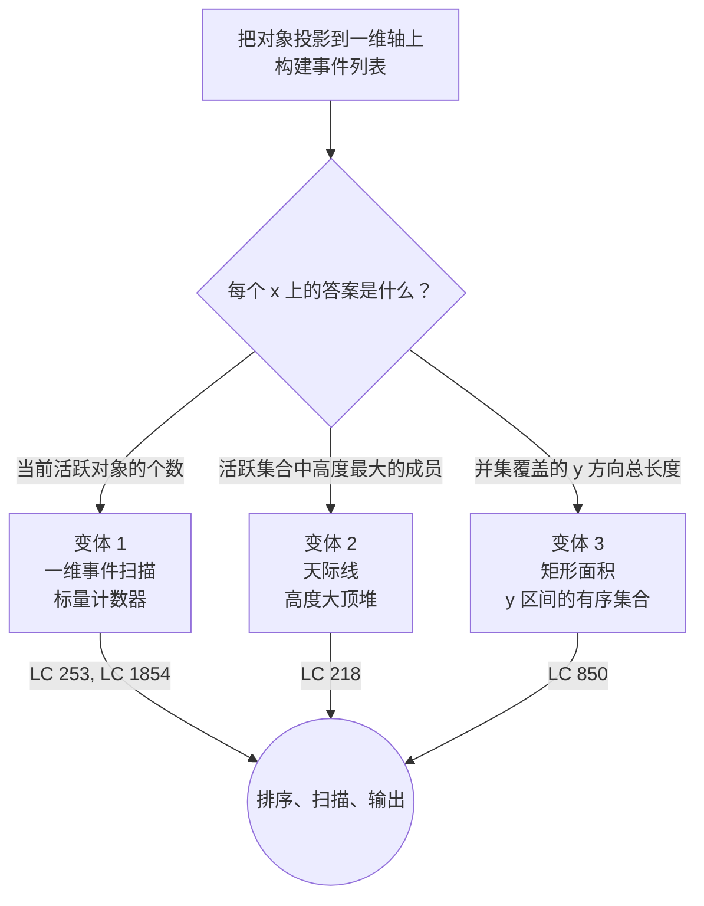

# 扫描线原型

当一个问题的本质是让一条想象中的竖线沿一维轴（几乎总是 x 轴）从左扫到右，看着一小组对象穿过这条线，并回答一个取决于集合每一刻 *形状* 的问题时，扫描线（sweep-line）就是对的工具。集合只在有限多个可预测的 x 坐标上变化：区间端点、矩形边、线段端点。在这些事件之间，什么都不会发生。算法枚举的是事件而不是坐标，这正是它能在与输入规模成线性、而不是与坐标范围（可能达到 `10^9`）成线性的时间里跑完的全部原因。

本页列出面试级别题目里会出现的三种原型，并给出在陌生问题上从同族原型中挑出一个的判据。姊妹页是 [P-31 区间合并原型](./P-31-merge-intervals-archetypes.md)，它处理更简单的情形：活跃集合只是一个滚动区间，不需要辅助结构。两页的分界线在“常见误解”一节。

## 如何决策

三条规则定义了这个家族。按 x 排序事件。从左到右扫描。维护一个形状由问题决定的活跃集合；在活跃集合发生变化的那些转换点上输出答案。

这就是主干。其余的一切（用哪种活跃集合结构、同时发生的事件怎么定序、输出什么）都是墙纸。主干把 LC 253 *Meeting Rooms II*、LC 218 *The Skyline Problem*、LC 850 *Rectangle Area II* 统一成一门技术的三副面孔。这套范式由 Bentley 和 Ottmann 在 1979 年为线段求交做了形式化[^1]，并在 de Berg 教材的计算几何一章里被确立为通用的算法技术。[^2]

活跃集合的键与扫描方向垂直。对事件计数类问题，集合是一个标量：一个整数 `count`，在起点事件加一、在终点事件减一。对天际线，集合是按高度排序的建筑高度多重集，因为每个 x 上的问题是“当前哪栋楼最高”。对矩形面积，集合是竖直 y 区间的有序集合，因为每个 x 上的问题是“y 轴上当前被覆盖的总长度是多少”。[^3] 活跃集合的形状就是用来区分各原型的判别依据。

整个家族的工作量上界是一致的。排序占主导，O(N log N)。每个事件在活跃集合上触发常数次操作；如果活跃集合是平衡 BST、堆或多重集，每次操作是 O(log N)。[^3] 总工作量 O(N log N)，空间 O(N)。坐标可以横跨整个 32 位整数范围，而算法毫无感觉。

## 流程图

*图注：三种原型共享“排序—扫描—输出”这条主干，只在活跃集合结构上不同。读每个 x 上的问题在问什么来选结构；算法的其余部分完全相同。*

## 变体

### 一维事件扫描（LC 253、LC 1854）

**识别信号。** 题面说 *“任意时刻重叠区间的最大数量”*、*“最少需要多少间会议室，才能让没有两个同时进行的会议共用一间”*，或 *“人口最多的那一年”*。[^3] [^6] 活跃集合不携带查询所需的成员元数据。一个标量计数器就够。

**何时选用。** 每个 x 上的答案是当前活跃区间数量的函数，通常是 `max`，或“计数首次冲到峰值时的那个 x”。两种实现都可行，都是 O(N log N)。第一种把起点和终点分别排进两个数组，用两个指针走：每个起点让计数器加一，每个终点让它减一。第二种把 `+1`、`-1` 增量压进一个以 x 为键的有序表，再按序遍历该表累加 `count`。双数组版本常数更小、代码最简单；有序表版本在输入后来变成在线插入流时能自然泛化。[^6]

当输入范围很小且有界时，固定大小的**差分数组**把两者都打赢，代价 O(N + R)，R 是坐标范围。LC 1854 的年份落在 `[1950, 2050]`，就是教科书案例。

同时事件的定序是唯一值得提前标出的坑。半开区间 `[s, e)` 要求终点先于起点处理，这样一场正好在另一场开始的瞬间结束的会议不会被记成一次重叠。闭区间 `[s, e]` 规则相反：起点先于终点。

**时间 / 空间。** O(N log N) 时间，O(N) 空间。[^3] [^6]

**章节引用。** [区间调度：比较器就是算法](../part-10-greedy/01-interval-scheduling.md) 用更简单的“合并区间”比较器处理 LC 56、LC 57 和 LC 435。LC 253 的事件扫描版本位于该章的进阶梯度里，是“当问题从‘合并后的输出是什么’变成‘每个 x 上的计数是多少’时，怎么升级一个区间问题”最干净的例子。

### 天际线（LC 218）

**识别信号。** 题面说 *“重叠矩形从侧面看过去的外轮廓”*、*“输出轮廓高度发生变化的那些关键点”*，或者直接给一张城市天际线的图。[^4] 每个 x 上，答案取决于活跃集合里**键最大的成员**，而不是数量。诊断句：线扫过去时，问题问的是哪个活跃成员最大，而不是有多少个活跃成员。

**何时选用。** 每个 x 上的答案是当前重叠建筑中最高的那栋的高度。自然的选择是以高度为键的大顶堆，但有个麻烦：普通二叉堆不支持删除任意元素，所以当某栋楼的右边界触发时，你没法直接把它的高度从堆里摘掉。公开的技巧是**惰性删除（lazy deletion）**。把 `(neg_height, end_x)` 压进堆，在读取当前最大值之前，从堆顶弹出 `top.end_x <= current_x` 的条目。[^4] C++ 的替代方案是按高度排序的 `std::multiset<int>`，插入、删除、取最大值都是 O(log N)。两者都达到 O(N log N)。

排序键的定序是第二个坑。如果一栋高楼和一栋矮楼在同一个 x 进入，先处理矮楼会在该 x 输出一个虚假的关键点。把高度取负编进排序键就能修好：默认字典序下，元组比较会把更负（更高）的排在前面。[^4]

**时间 / 空间。** O(N log N) 时间，O(N) 空间。[^4]

**章节引用。** [堆与优先队列](../part-6-trees-heaps/04-heaps-priority-queues.md) 完整讲了带惰性删除的堆这一手；天际线算法把它复用在扫描线主干之上。LC 218 是堆那一章的招牌 ★ 题，附录 C 给它配了专属题解组件。

### 矩形面积（LC 850）

**识别信号。** 题面说 *“N 个与坐标轴对齐的矩形，其并集覆盖的总面积，不重复计算”*，且矩形坐标可以到 `10^9`。[^5] 每个 x 上的答案既不是计数也不是最大值，而是一个*测度*：y 轴上当前被至少一个矩形覆盖的总长度。

**何时选用。** 每个 x 上的答案是活跃集合并集在 y 方向上的覆盖长度。每个矩形贡献两个事件：一个 `(x_left, +1, y_low, y_high)` 的矩形进入事件，一个 `(x_right, -1, y_low, y_high)` 的矩形离开事件。相邻两个事件之间，对总面积的贡献是 `(x_next - x_current) * y_covered_length`，累加起来。每个事件上的 y 合并步骤本身就是一个一维区间并问题；对排序去重后的 y 值（最多 2N 个）做**坐标压缩**之后，每次合并退化成对压缩格子的 O(N) 扫描，整体是 O(N²)。[^5] 在压缩后的 y 坐标上建线段树、带惰性的“完全覆盖”计数，可以降到 O(N log N)，但这个升级依赖 Part 6.10，算进阶内容。

这里的定序是“进入先于离开”，这样零宽的竖条不会虚假地清空活跃 y 集合、把面积累加搞坏。[^5]

**时间 / 空间。** 坐标压缩下 O(N²) 时间，O(N) 空间；用线段树是 O(N log N)。[^5]

**章节引用。** 线段树与惰性传播在 [线段树入门](../part-6-trees-heaps/10-segment-tree.md) 里讲。没有那一章，O(N²) 版本就是正确答案；有了它，线段树升级读起来就是一段“把活跃 y 集合换成一棵区间更新树”的练习。

## 变体对比

| 变体 | 事件 | 活跃集合 | 每个 x 的查询 | 时间 / 空间 | 代表题 |
|---|---|---|---|---|---|
| 一维事件扫描 | `(x, +1)` 起点、`(x, -1)` 终点 | 标量 `int count`（或有序表增量） | 跨各个转换点见过的最大计数 | O(N log N) / O(N) | LC 253 *Meeting Rooms II*、LC 1854 *Maximum Population Year* |
| 天际线 | `(x, -h, end_x)` 进入、`(x, +h)` 离开 | 带惰性删除的 `(neg_height, end_x)` 大顶堆（或 `multiset<int>`） | 每个事件之后的最大高度；与上一个不同时输出 | O(N log N) / O(N) | LC 218 *The Skyline Problem* |
| 矩形面积 | `(x, +1, y1, y2)` 进入、`(x, -1, y1, y2)` 离开 | 活跃 y 区间的有序多重集 | y 并集覆盖的总长度 | O(N²) / O(N)（或线段树 O(N log N)） | LC 850 *Rectangle Area II* |

前两行的差别在于活跃集合存什么：一个标量，还是一个装着成员元数据的堆。把活跃集合从“有多少个”提升到“哪个最大”，正是从变体 1 到变体 2 的升级路径。第三行的差别在于输出什么：不是计数也不是最大值，而是一个积分，按 `width * covered_y_length` 在相邻事件之间累加。

## 三道招牌题

- [LC 253 — Meeting Rooms II](https://leetcode.com/problems/meeting-rooms-ii/) [中等] • sweep-line-event-counting。最干净的一维事件扫描入门。把问题重述成“最少会议室数等于最大同时会议数”，就是主干本身之外的全部教学内容。LC 253 在 LeetCode 上是付费题；该算法在社区文章里有复刻，包括 labuladong 的扫描线讲法。[^6]
- [LC 218 — The Skyline Problem](https://leetcode.com/problems/the-skyline-problem/) [困难] • sweep-line-max-heap-with-lazy-deletion。堆即活跃集合这一类原型。两个反复出现的 bug：忘了惰性删除的哨兵 `(0, INF)`，读最大值时堆永远不空；以及同时开始时负高度的定序搞错。[^4]
- [LC 850 — Rectangle Area II](https://leetcode.com/problems/rectangle-area-ii/) [困难] • sweep-line-coordinate-compression。二维测度这一类原型。在 y 轴上做坐标压缩，是让算法在坐标达到 `10^9` 的输入上仍可行的工程步骤；没有它，按格子逐个标记的暴力法需要 O(W * H) 内存，根本不可行。[^5]

## 常见误解

**“扫描线就是多绕几步的区间调度。”** 区间调度只是一个变体的一个角落。一维事件扫描能处理“最大重叠”，但推不到 LC 218 或 LC 850，因为那些问题里每个 x 上的答案取决于计数器无法表示的成员元数据（高度、y 跨度）。扫描线与区间合并的分界在 [P-31 区间合并原型](./P-31-merge-intervals-archetypes.md)：当活跃集合是隐式的（一个滚动区间）、唯一的问题是“按顺序合并后的输出是什么”时，区间合并才是对的工具。当活跃集合有形状（计数、堆、多重集）、且答案要在每个转换点上被查询时，扫描线才是对的工具。

**“事件永远是 `(start, +1)` 和 `(end, -1)` 这样成对出现的。”** 只有变体 1 是这个形状。天际线把进入事件编码成 `(x, neg_height, end_x)`，因为高度必须同时流经排序键和活跃集合；离开事件携带的是建筑的结束坐标而不是高度，高度由堆重建。矩形面积把事件编码成 `(x, +1, y_low, y_high)`，每个事件带两个 y 坐标，因为活跃集合是一个投影到 y 轴上的二维结构。把“事件就是成对的”当成普适规则，正是读者在 LC 218 上伸手去拿错的活跃集合结构的原因。

**“活跃集合永远是个计数器。”** 它有时是计数器，有时是堆，有时是多重集，有时是线段组成的平衡 BST。活跃集合的选择由每个 x 上的查询决定，选错的失败方式有两种截然不同的样子。把堆用在 LC 253 的查询上，是为计数本身就能给出的答案白付一个 log 因子。把计数器用在 LC 218 上，返回的答案完全错误，因为没有任何计数器能报告哪个活跃成员最高。“变体对比”一节里那张按问题选结构的表就是查找表；读题就是查找键。

**“扫描线总是要 O(N log N)。”** 有时不用。输入范围很小且有界时，差分数组给出 O(N + R)，LC 1854 的年份落在 `[1950, 2050]` 就是 log 因子彻底消失的标准案例。是一般情形下排序这一步逼出了 O(N log N)；当事件按构造就已经有序（或者能装进固定大小的差分数组），扫描本身只是一趟线性遍历。“扫描线是 O(N log N)”这个复杂度说法是默认值，不是定律。

## 参考文献

[^1]: Bentley and Ottmann, "Algorithms for reporting and counting geometric intersections," *IEEE Transactions on Computers* C-28(9) (1979): 643–647. https://doi.org/10.1109/TC.1979.1675432

[^2]: de Berg, van Kreveld, Overmars, Schwarzkopf, *Computational Geometry: Algorithms and Applications*, 3rd ed., Springer, 2008, Ch. 2.

[^3]: c0d3m, "Line Sweep Algorithms," LeetCode Discuss, 2022. https://leetcode.com/discuss/study-guide/2166045

[^4]: AlgoMap, "218. The Skyline Problem." https://algomap.io/problems/the-skyline-problem

[^5]: AlgoMap, "850. Rectangle Area II." https://algomap.io/problems/rectangle-area-ii

[^6]: labuladong, "Scheduling Meeting Rooms (LC 253)." https://labuladong.online/algo/en/frequency-interview/scan-line-technique/
