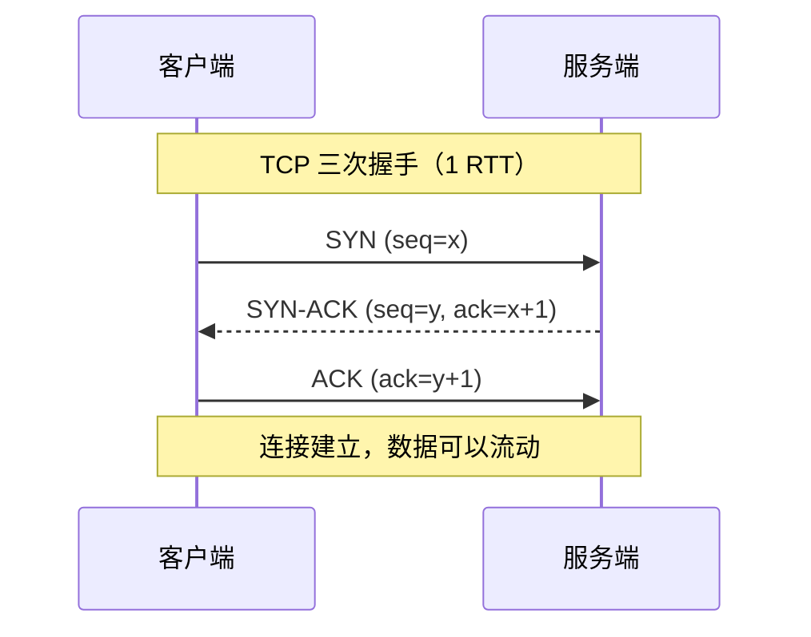
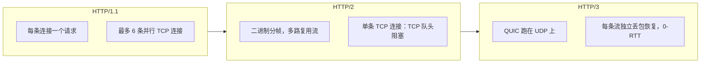
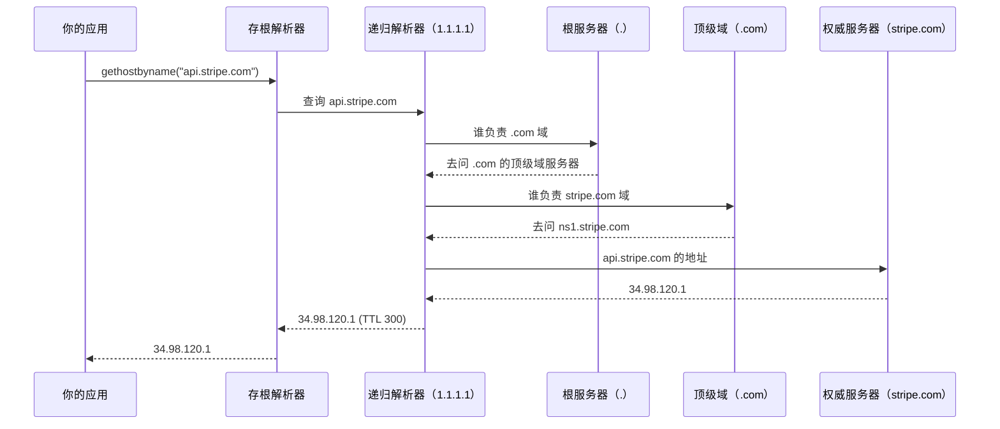
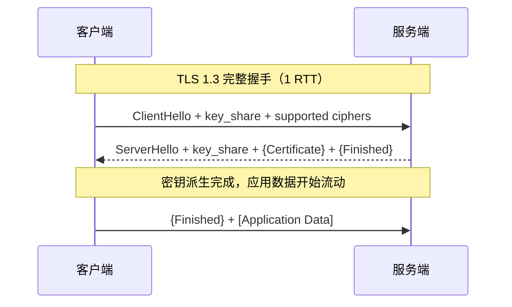
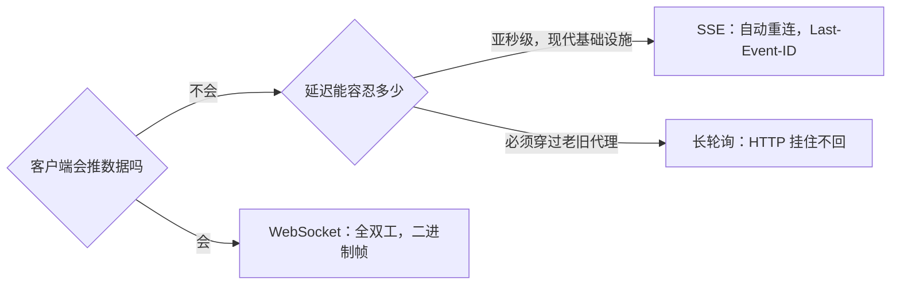

# 系统设计中的网络基础

> **TL;DR**: 每个分布式系统本质上都是网络问题换了身衣服。跨大西洋首次连接一台服务器，在第一个应用字节流过去之前，要先付 3 次往返（DNS + TCP + TLS），大约 300 毫秒的沉默 [^1]。把 TCP 与 UDP 的区别、三代 HTTP、DNS、TLS 1.3 和三种实时传输方式搞明白，“设计 X”这类题目里就有 80% 变得可以下手了。

## 学习目标

学完这一节，你应该能够：

- [ ] 说清每个 OSI 层在做什么，以及它在真实基础设施里出现在哪
- [ ] 针对具体负载在 TCP 与 UDP 之间做选择
- [ ] 讲清队头阻塞，以及 HTTP/2 和 HTTP/3 各自怎么应对
- [ ] 从自己的笔记本出发，一步步走到权威服务器，讲完一次 DNS 查询
- [ ] 画出 TLS 1.3 握手，并说明什么时候用 0-RTT 是安全的
- [ ] 选出合适的实时传输方式：WebSocket、SSE，还是长轮询

## 直觉理解

想象你要往海外寄一个包裹。你不会去想货船怎么开、海关怎么验、分拣中心怎么转。你把包裹交给邮局，写个地址，它就送到了。互联网是同一个道理：一层层软件和硬件在你看不见的地方配合，才让你的浏览器能说出“页面加载完成”。

但麻烦在这里：每一层都要花时间。邮局给你的包裹盖戳（DNS 查询）。海关核对你的身份（TLS 握手）。货船要等集装箱装满才开（TCP 拥塞窗口）。把这些延迟叠在一条从纽约到伦敦的首次连接上，就是大约 300 毫秒的沉默，一个有用的字节都还没动。这一节要讲的就是这些时间花到哪去了，为什么有些协议感觉是瞬时的而另一些总是卡，以及怎么给每种场景挑对传输方式。

## 原理

### OSI 模型的实际视角

OSI 模型有 7 层。实际工作里，系统设计者真正打交道的只有 4 层：

| 层 | 它做什么 | 你会见到的例子 |
|-------|--------------|----------------------|
| 7 应用层 | 你的代码所说的协议 | HTTP、gRPC、SMTP、DNS |
| 4 传输层 | 进程之间的端到端投递 | TCP、UDP、QUIC |
| 3 网络层 | 主机之间的报文路由 | IP、ICMP |
| 2 数据链路层 | 在铜线或无线电上搬运帧 | Ethernet、Wi-Fi |

TCP/IP 模型把这几层压成 4 层（应用、传输、网际、链路）。大多数工程师两个模型混着用。有人说“七层负载均衡器”，指的是它解析 HTTP，能按路径、请求头或 Cookie 路由。AWS ALB 就是七层的，默认空闲超时 60 秒 [^2]。“四层负载均衡器”只看 TCP 五元组（源 IP 与端口、目的 IP 与端口、协议），然后转发原始字节。AWS NLB 是四层的，默认 TCP 空闲超时 350 秒 [^3]。

> [!TIP]
> 排查问题时先问一句：“哪一层坏了？” DNS 失败是第 7 层。丢包是第 3 层或第 4 层。Wi-Fi 信号抖动是第 2 层。

### TCP 与 UDP

TCP 给你一条可靠、有序的字节流。它握手，丢了包就重传，还会自我调速以免把网络压垮。UDP 给你的是一份数据报：发出去，然后忘掉它。

*TCP 在任何应用字节流动之前要付 1 次往返的沉默；UDP 完全跳过这一段。*

在一条 100 毫秒的跨洲链路上，这次握手就是 100 毫秒的沉默。纽约到伦敦走海底光缆的理论最小往返约 56 到 62 毫秒（光在玻璃里大约 204,000 km/s，是真空光速的三分之二）[^4]。真实世界的跨大西洋往返在 70 到 90 毫秒之间 [^5]。

**该用 TCP** 的时候：正确性比速度重要——HTTP、数据库连接、文件传输、SSH。

**该用 UDP** 的时候：丢一点能接受，或者你打算自己实现可靠性——DNS 查询（一个包，丢了重发）、视频通话（丢一帧好过整条流卡住）、游戏联网，以及 QUIC（它在 UDP 之上重新造了一套可靠传输）。

### HTTP/1.1 HTTP/2 与 HTTP/3

Web 核心协议的三代，每一代修掉上一代的瓶颈。

**HTTP/1.1**（RFC 9112）是文本协议，串行执行：一条 TCP 连接上一次只有一个请求。浏览器绕这个限制的办法是对同一个源最多开 6 条并行连接 [^6]。HTTP/1.1 至今到处都在：内部服务、curl 脚本、健康检查。

**HTTP/2**（RFC 9113）用二进制分帧和 HPACK 头部压缩，把许多请求复用到一条 TCP 连接上 [^7]。一条连接，多条并行流。坑在于：TCP 的队头（HOL）阻塞。只要有一个 TCP 段丢了，所有 HTTP/2 流都会停住等重传，哪怕某条流跟丢掉的那个包毫无关系 [^1]。

**HTTP/3**（RFC 9114）跑在 QUIC（RFC 9000）上，QUIC 跑在 UDP 上。QUIC 自己实现流，每条流独立做丢包恢复，所以丢一个包只卡住它所属的那条流 [^8]。QUIC 还把传输握手和 TLS 握手合并成一次 1-RTT 操作，并支持 0-RTT 恢复：回访的客户端在第一个包里就能带上数据。

*HTTP/2 在一条 TCP 流上做多路复用（因此受 TCP 队头阻塞影响）；HTTP/3 通过跑在 UDP 上的 QUIC 让每条流各自做丢包恢复。*

2023 年 5 月，Cloudflare 公布 HTTP/3 承载了其全球流量约 28%，HTTP/2 约 64%，HTTP/1.1 约 9% [^9]。Chrome Mobile 当时已有大约 40% 的请求走 HTTP/3 [^9]。到 2025 年，Cloudflare Radar 显示 HTTP/3 占打到其网络的请求的 21%，HTTP/2 占 50%，HTTP/1.x 占 29% [^10]；统计口径与 2023 年那篇博客不同（一个是打到 Cloudflare 的请求，一个是 Cloudflare 服务出去的流量），直接对比要谨慎。

### DNS 解析

DNS 把 `api.stripe.com` 这样的名字翻译成 IP 地址。这次查询会沿着一条缓存层级往上走。

*每一次 DNS 查询都是一次按层级走的缓存遍历；每一层都有缓存，所以热门名字在缓存热的时候一毫秒内就能解析出来。*

操作系统自带一个很小的**存根解析器**（`gethostbyname` 调的就是它）。它把查询转给**递归解析器**，比如 Cloudflare 1.1.1.1 或者你 ISP 的服务器。递归解析器做的是迭代式遍历：根、顶级域、权威域名服务器。每一层都有缓存，按 TTL 生效。

Cloudflare 的 1.1.1.1 解析器在其 Anycast 网络上每秒处理约 6700 万次 DNS 查询（权威查询加递归查询合计）[^10]。DNS 查询超过 512 字节时用 UDP 53 端口，响应更大就回退到 TCP。DNS-over-HTTPS（DoH）和 DNS-over-TLS（DoT）把查询加密，从而增加隐私。

> [!IMPORTANT]
> 短 TTL（30 到 60 秒）用缓存效率换更快的故障切换。长 TTL（300 秒以上）意味着数据库切过去之后，客户端还会继续用好几分钟的旧 IP。按你的故障切换 SLA 来定。

### TLS 1.3 握手

TLS 1.3（RFC 8446）把握手从 TLS 1.2 的 2 次往返压到 1 次往返 [^11]。在每次往返要 50 到 200 毫秒的移动网络上，这笔省下来的时间很可观。

*TLS 1.3 让客户端在第一条消息里就带上 key_share，从而把握手压到 1 RTT；0-RTT 恢复在这批数据里再加早期数据，但可以被重放。*

客户端猜服务端偏好的密钥交换组，在第一条消息里就把自己的公钥发过去。服务端回以自己的公钥、证书和 Finished，ServerHello 之后的内容全部加密。一次往返，结束。

对于重复访问，TLS 1.3 支持 **0-RTT 恢复**：客户端用上一次会话的预共享密钥，在第一个包里就带上应用数据。这很快，但很危险。0-RTT 数据没有前向保密，抓到这批早期数据的攻击者可以把它重放到多个服务实例上 [^11]。Cloudflare 默认不启用 0-RTT，并且自动拒绝走 0-RTT 的非幂等方法（POST、PUT）[^12]。

> [!WARNING]
> **绝不要用 0-RTT 发会改状态的请求。** 攻击者可以重放通过 0-RTT 发出的 `POST /transfer-money`。0-RTT 只允许用在安全、幂等的 GET 请求上。回一个 HTTP 425 Too Early，逼客户端走完整握手重试。

### 实时传输方案 WebSocket SSE 与长轮询

HTTP 是请求-响应式的。要服务端主动推数据（聊天消息、股票行情、通知），你需要一条长连接通道。有三种选择：

**长轮询（long polling）** 发一个 HTTP 请求，服务端压着不回，直到有数据或者超时。简单，任何代理都能过。开销大：每条消息都是一次全新的 HTTP 请求，头部一个不少。

**Server-Sent Events（SSE）** 用一条长期挂着的 HTTP 响应，`Content-Type: text/event-stream`。服务端持续推文本事件。单向（服务端到客户端），靠 `Last-Event-ID` 内建断线重连，HTTP/1.1 和 HTTP/2 都能跑。在 HTTP/1.1 下浏览器每个域名最多 6 条并发连接，SSE 会占掉其中一个名额 [^6]。到了 HTTP/2，这个上限变成协商出来的 `SETTINGS_MAX_CONCURRENT_STREAMS`；RFC 9113 没有规定初始值，但建议不小于 100；大多数服务器（Kestrel、nghttp2、curl）就报 100。

**WebSocket**（RFC 6455）把一条 HTTP 连接升级成全双工二进制通道。每条消息开销很低：2 到 14 字节的帧头 [^13]。用在聊天、多人游戏和协同编辑器这类双向都要推数据的场景。

*默认选 SSE 做服务端到客户端的流；只有客户端也要推的时候才上 WebSocket；长轮询只当万能兜底。*

**带观点的建议：** 默认选 SSE。它零会话保持复杂度，能覆盖 90% 的实时场景（看板、通知、LLM token 流）。只有当客户端频繁发应用数据（聊天输入、游戏状态、光标位置）时才伸手去拿 WebSocket。只有在必须支持那些把其他方式全封死的环境时，才用长轮询。

## 真实案例

Cloudflare 从 2019 年 9 月开始在全球网络上推 HTTP/3，QUIC 规范那时还在草案阶段他们就上线了支持 [^1]。他们的边缘栈用自己的开源 QUIC 库（quiche），架在 Anycast BGP 后面，并把大流量传输的拥塞控制从 New Reno 换成了 CUBIC。

在他们 2020 年 4 月的生产基准里，HTTP/3 的平均首字节时间（TTFB）是 176 毫秒，HTTP/2 是 201 毫秒，提升 12.4% [^1]。加载一个 15 KB 的页面，HTTP/3 用了 443 毫秒，HTTP/2 用了 458 毫秒。收益主要来自省掉那次额外的 TLS 往返（QUIC 把传输握手和加密握手合并了），以及在有丢包的移动链路上按流做丢包恢复。

到 2023 年 5 月，HTTP/3 承载了 Cloudflare 全球流量约 28%（2019 年还近乎为零），Chrome Mobile 约 40% [^9]。到 2025 年底，Cloudflare 平均每秒处理约 8100 万次 HTTP 请求，峰值超过 1.29 亿次 [^10]。

关键的一课：HTTP/3 最大的收益出现在有丢包、高延迟的移动网络上，那儿 TCP 队头阻塞伤得最重。在快速的有限链路上，差别很小。永远要通过 `Alt-Svc` 头宣告 HTTP/2 作为回退，因为有些企业防火墙仍然封掉出方向的 UDP 443。

## 权衡

| 传输方式 | 优点 | 缺点 | 什么时候最合适 | 我们的选择 |
|-----------|------|------|-----------|----------|
| TCP | 可靠有序的字节流，有拥塞控制 | 1-RTT 握手，有丢包的链路上会 TCP 队头阻塞 | 正确性关键的流量（HTTP、数据库连接、SSH） | API 与数据的默认选择 |
| UDP | 零建连开销，每包开销低 | 没有可靠性、有序性和拥塞控制 | 视频、语音、游戏、DNS、QUIC/HTTP/3 | 你要在它之上自己造可靠性时 |
| HTTP/1.1 | 通用，能用 curl 调试，代理支持简单 | 每条连接一次一个请求，头部冗长 | 内部服务、curl 脚本、健康检查 | 简单和通用工具链比吞吐量重要时 |
| HTTP/2 | 单连接多路复用，HPACK 压缩 | 有丢包的链路上会 TCP 队头阻塞 | 可靠网络上的现代 Web | 大多数 Web 流量的默认选择 |
| HTTP/3 | 基于 QUIC 的按流丢包恢复，0-RTT 恢复 | 部分企业网络封 UDP | 移动优先流量，全球用户 | 你能控制边缘时（CDN 宣告 `Alt-Svc`） |
| WebSocket | 全双工二进制通道，2-14 字节帧开销 [^13] | 需要会话保持，代理行为古怪，重连逻辑要自己写 | 聊天、多人游戏、协同编辑 | 客户端也需要推数据时 |
| SSE | 走普通 HTTP，简单，靠 `Last-Event-ID` 自动重连 | 只能单向，载荷只能是文本 | 看板、通知、LLM token 流 | 服务端推送的默认选择 |
| 长轮询 | 任何 HTTP 代理或防火墙都能过 | 每条消息开销高（完整 HTTP 往返） | 中间设备封掉 WebSocket 和 SSE 时的兜底 | 必须做到普适兼容时 |

## 常见陷阱

> [!WARNING]
> **数据库故障切换时忘了 DNS TTL。** RDS 的 CNAME 切过去之后，客户端在缓存 TTL 到期前会继续连那个已经死掉的 IP。300 秒的 TTL 意味着最多 5 分钟的报错。给要参与故障切换的记录用 30 到 60 秒的 TTL [^14]。

> [!WARNING]
> **HTTP/2 多路复用被爱说话的七层代理废掉。** 你端到端上了 HTTP/2，但 Nginx 代理终止 HTTP/2，然后每个请求都新开一条 HTTP/1.1 上游连接。多路复用的好处全丢了。修法：配 `proxy_http_version 1.1` 加 keepalive，或者换 Envoy，它原生支持 HTTP/2 上游。

> [!WARNING]
> **SSE 就够用时却上了 WebSocket。** 如果数据只从服务端流向客户端（看板、通知、比分更新），WebSocket 只会带来一堆没必要的复杂度：会话保持、自己写重连、代理兼容问题。用 SSE 配 `EventSource`，自动重连白送你 [^6]。

> [!WARNING]
> **TLS 1.3 的 0-RTT 用在了非幂等请求上。** 攻击者截获一个走 0-RTT 的 `POST /transfer-money` 然后重放。服务端就处理了多次。把你的 TLS 终止端配成在 POST、PUT、DELETE 上拒绝 0-RTT。Cloudflare 自动这么做，并回一个 HTTP 425 Too Early [^12]。

> [!WARNING]
> **SSE 卡在 HTTP/1.1 浏览器 6 连接上限。** 一个重度用 SSE 的应用开了多个标签页，第 7 个标签页开不出流，因为浏览器撞到了每个域名 6 条连接的上限。这在 Chrome 和 Firefox 里都标记为“不修复” [^6]。修法：用 HTTP/2 跑 SSE（默认 100 条并发流），或者拆到多个子域名上。

## 练习

> **设计挑战**：你要做一个 1000 万并发用户的实时体育比分应用。比赛期间比分每几秒更新一次。延迟要求在 1 秒以内。设计客户端到服务端的传输方案。你选哪个协议，为什么？重连、扩展和冷启动怎么处理？

提示

问问自己：客户端到底会不会推数据，还是只听？客户端多久重连一次？CDN 把连接断掉时会发生什么？答案八成不是 WebSocket。

参考方案

**选 SSE。** 数据流是单向的（服务端推比分），载荷是很小的 JSON，而且 SSE 会自动重连并带上 `Last-Event-ID` 头，客户端能从断点接着收。WebSocket 也能做，但会引入复杂度：会话保持、心跳、自己写重连逻辑，还有你根本用不上的全双工分帧。

**拓扑：** 一批“扇出”服务器，每台扛大约 10 万条 SSE 连接。它们后面用 Redis 发布订阅或 Kafka topic 分发比分更新。源数据库里某场比赛更新时，一个服务发布，所有扇出服务器推给自己连着的客户端。

**扩展：** 1000 万 / 10 万 = 每个区域 100 台扇出服务器，再为延迟乘上 3 到 5 个区域。前面用四层负载均衡器（AWS 上的 NLB），按客户端 IP 哈希来做会话分布。HTTP/2 多路复用在这里没用，因为每个客户端只有一条 SSE 流。

**冷启动：** 新客户端先去 CDN 拿首屏页面，然后直接向扇出服务器开 SSE 流。用健康检查开一条假连接来预热进程。

**重连：** 浏览器的 `EventSource` 会自动重连。服务端给每个事件带上 `id:` 字段。重连时客户端发 `Last-Event-ID`，服务端从一小段 Redis 缓冲（最近 30 秒）里把漏掉的事件补发过去。

## 要点回顾

- TCP 用延迟换可靠性，UDP 用可靠性换延迟。QUIC 在 UDP 之上造出可靠流，两头都要。
- 首次 HTTPS 连接要付 3 次 RTT（DNS + TCP + TLS 1.2）。TLS 1.3 省掉 1 次；HTTP/3 把传输和加密合成总共 1 次 RTT。
- HTTP/2 修掉了 HTTP/1.1 的一条连接一个请求，但继承了 TCP 的队头阻塞。HTTP/3 用按流丢包恢复把它消掉。
- DNS 是一套按层级、缓存优先的系统。短 TTL 换来快速故障切换；长 TTL 降低解析器压力。
- 0-RTT 恢复在第一个包里就发数据，但可被重放。非幂等请求绝不能用。
- 服务端实时推送默认用 SSE。只有客户端也要推时才用 WebSocket。长轮询是最后的兜底。
- Cloudflare 的 HTTP/3 上线数据显示 TTFB 改善 12.4%，收益最大的地方是有丢包的移动网络。

## 延伸阅读

- [RFC 9114: HTTP/3](https://www.rfc-editor.org/rfc/rfc9114) - HTTP over QUIC 的权威规范；读第 1 到 3 节了解动机与流映射。
- [RFC 8446: TLS 1.3](https://www.rfc-editor.org/rfc/rfc8446) - 握手看第 2 节和第 4 节；0-RTT 的安全性分析看附录 E。
- [Comparing HTTP/3 vs HTTP/2 Performance](https://blog.cloudflare.com/http-3-vs-http-2/) - Cloudflare 2020 年的生产基准，有 TTFB 数据、页面加载扫描，以及 CUBIC 与 BBR 的对比分析。
- [Even faster connection establishment with QUIC 0-RTT](https://blog.cloudflare.com/even-faster-connection-establishment-with-quic-0-rtt-resumption/) - Cloudflare 为什么默认关掉 0-RTT，以及他们怎么防重放。
- [How Discord Scaled Elixir to 5,000,000 Concurrent Users](https://discord.com/blog/how-discord-scaled-elixir-to-5-000-000-concurrent-users) - 大规模 WebSocket 扇出的真实案例：单个 Elixir VM 上 50 万会话、自研批处理，以及级联故障模式。
- [MDN: EventSource](https://developer.mozilla.org/en-US/docs/Web/API/EventSource) - SSE 浏览器行为的权威参考，包括 6 连接上限和 `Last-Event-ID` 的语义。
- [The QUIC Transport Protocol: Design and Internet-Scale Deployment](https://research.google/pubs/the-quic-transport-protocol-design-and-internet-scale-deployment/) - Google 在 SIGCOMM 2017 的论文，讲 QUIC 如何部署到互联网流量的 7%。
- DDIA 第 8 章（Designing Data-Intensive Applications，Martin Kleppmann），第 274 到 287 页 - “The Trouble with Distributed Systems”，讲不可靠网络与时间假设。

## 记忆卡片

**Q:** 首次 HTTPS 连接在发出应用数据之前要付哪 3 次往返？
**A:** DNS 查询（1 次 RTT 解析名字）、TCP 握手（1 次 RTT 完成 SYN/SYN-ACK/ACK）、TLS 握手（TLS 1.3 是 1 次 RTT，TLS 1.2 是 2 次）。HTTP/3 把传输和 TLS 合成 1 次 RTT。

**Q:** HTTP/2 明明做了多路复用，为什么还会有队头阻塞？
**A:** HTTP/2 跑在一条 TCP 连接上。TCP 保证有序投递，所以丢一个包就会卡住所有复用流，直到重传到达。

**Q:** HTTP/3 怎么解决 TCP 队头阻塞？
**A:** HTTP/3 跑在 UDP 之上的 QUIC 上。QUIC 让每条流独立做丢包恢复，丢的包只卡住它所属的那条流，其他流照常走。

**Q:** TLS 1.3 完整握手要几次往返，0-RTT 又为什么危险？
**A:** 完整握手 1 次 RTT。0-RTT 用预共享密钥在第一个包里就发数据，但可被重放攻击。只对幂等的 GET 请求用。

**Q:** 什么情况下你会选 UDP 而不是 TCP？
**A:** 丢包能接受，或者你打算自己造可靠性：视频通话、语音、游戏、DNS 查询，以及 QUIC（它在 UDP 之上造可靠流）。

**Q:** 递归查询和迭代查询的 DNS 有什么区别？
**A:** 递归解析器接下你的查询，替你干完所有活（依次走根、顶级域、权威服务器）。迭代查询里，每个服务器只回一句“去问 X”，走腿的是客户端。

**Q:** 选个传输方式：实时股票行情推到浏览器，客户端从不发数据。WebSocket、SSE 还是长轮询？
**A:** SSE。数据单向流动（服务端到客户端），SSE 靠 `Last-Event-ID` 自动重连，而且能跑在任何 HTTP 基础设施上，不需要会话保持。

**Q:** 你把 DNS TTL 设成 300 秒，然后数据库切换到了新 IP，会发生什么？
**A:** 缓存了旧 IP 的解析器后面的客户端，会继续连那台已经死掉的服务器，最多 5 分钟。给要参与故障切换的记录用 30 到 60 秒的 TTL。

**Q:** 浏览器里 HTTP/1.1 每个域名允许几条并发连接，HTTP/2 又怎么改变这一点？
**A:** 浏览器给 HTTP/1.1 的上限是每个域名 6 条连接。HTTP/2 在一条连接上多路复用，协商出的并发流上限是 100 条（服务器可配）。

**Q:** 纽约到伦敦的理论最小往返时间是多少，为什么？
**A:** 约 56 到 62 毫秒。光在光纤里大约 204,000 km/s（真空光速的三分之二）。真实跨大西洋 RTT 是 70 到 90 毫秒，因为有路由、排队和中间设备的延迟。

## 参考文献

[^1]: Sreeni Tellakula, “Comparing HTTP/3 vs. HTTP/2 Performance”, Cloudflare 博客，2020 年 4 月 14 日。https://blog.cloudflare.com/http-3-vs-http-2/
[^2]: AWS, “Edit attributes for your Application Load Balancer”（默认空闲超时 60 秒）。https://docs.aws.amazon.com/elasticloadbalancing/latest/application/edit-load-balancer-attributes.html
[^3]: AWS, “Introducing NLB TCP configurable idle timeout”（默认 TCP 空闲超时 350 秒）。https://aws.amazon.com/blogs/networking-and-content-delivery/introducing-nlb-tcp-configurable-idle-timeout/
[^4]: M2 Optics, “Calculating Optical Fiber Latency”, 2012。标准单模光纤（G.652）在 1550 nm 的折射率约 1.468，对应传播速度约 204,000 km/s。https://www.m2optics.com/blog/bid/70587/calculating-optical-fiber-latency
[^5]: Verizon IP Latency SLA 数据（跨大西洋伦敦-纽约 90 毫秒以内）。https://verizon.com/business/terms/latency/
[^6]: MDN Web Docs, “EventSource”，以及关于每域名 6 连接上限的相关浏览器 bug 跟踪记录。https://developer.mozilla.org/en-US/docs/Web/API/EventSource
[^7]: Martin Thomson, Cory Benfield（编）, “HTTP/2”, RFC 9113, 2022 年 6 月。https://www.rfc-editor.org/rfc/rfc9113
[^8]: Mike Bishop（编）, “HTTP/3”, RFC 9114, 2022 年 6 月。https://www.rfc-editor.org/rfc/rfc9114
[^9]: David Belson, Lucas Pardue, “Examining HTTP/3 usage one year on”, Cloudflare 博客，2023 年 6 月 6 日。https://blog.cloudflare.com/http3-usage-one-year-on/
[^10]: Cloudflare, “Radar 2025 Year in Review”, 2025 年 12 月 15 日。https://blog.cloudflare.com/radar-2025-year-in-review/
[^11]: Eric Rescorla, “The Transport Layer Security (TLS) Protocol Version 1.3”, RFC 8446, 2018 年 8 月。https://www.rfc-editor.org/rfc/rfc8446
[^12]: Alessandro Ghedini, “Even faster connection establishment with QUIC 0-RTT resumption”, Cloudflare 博客，2019 年 11 月 20 日。https://blog.cloudflare.com/even-faster-connection-establishment-with-quic-0-rtt-resumption/
[^13]: Ian Fette, Alexey Melnikov, “The WebSocket Protocol”, RFC 6455, 2011 年 12 月。https://www.rfc-editor.org/rfc/rfc6455
[^14]: AWS re:Post, “Resolve Aurora failover downtime and connection errors”。https://repost.aws/knowledge-center/failovers-aurora-mysql
