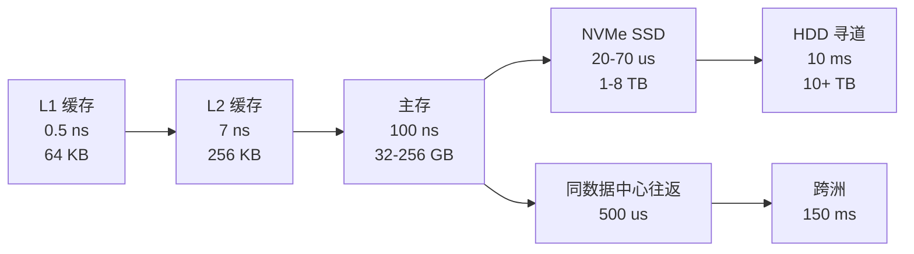
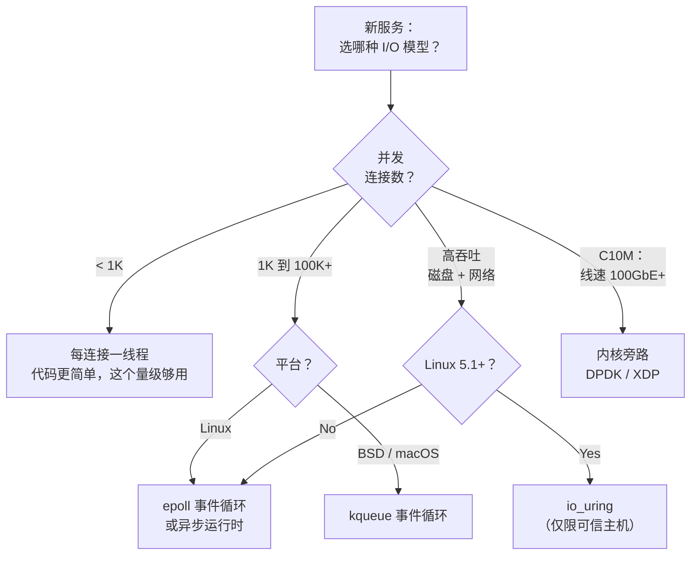
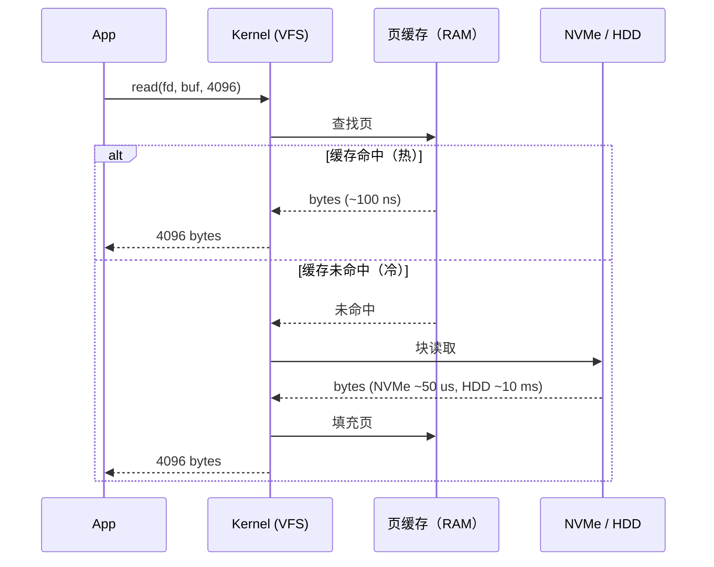
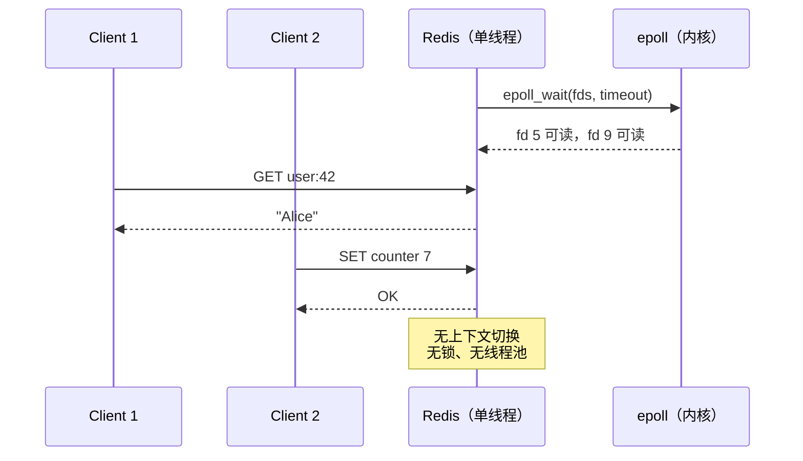

# 系统设计所需的操作系统基础

> **TL;DR**: 你的数据库慢，是因为磁盘寻道。你的 API 慢，是因为阻塞式 I/O。你的服务在一万连接时倒下，是因为你用了线程而不是事件循环。操作系统是每个系统设计立足的地板，而它各层之间的差距横跨八个数量级。

## 学习目标

学完本章，你将能够：

- [ ] 说清进程切换和线程切换的成本差异
- [ ] 背出内存层级，并带上量级的延迟数字
- [ ] 为具体负载选对 I/O 模型（阻塞、多路复用或异步）
- [ ] 说明页缓存做了什么，以及它在什么情况下对持久性撒谎
- [ ] 讲清 `fsync` 为什么昂贵，以及组提交如何解决它
- [ ] 判断什么情况下内核旁路是合理的，什么情况下是杀鸡用牛刀

## 直觉理解

把计算机想成一座带装卸平台的工厂。CPU 是装配线：快得惊人，但它只能加工已经摆在台面上的材料。主存是隔壁的仓库：取一次比从台面上拿慢 100 倍，但能装很多。SSD 是城另一头的储物仓：又慢 1,000 倍，但容量巨大。而一次跨洲网络调用，就像从另一个国家订零件：比从台面上抓一个零件慢 300,000 倍。

分布式系统里每一个性能问题，追到底都是有人明明零件就在仓库里，却把装配线派去了城另一头的储物仓。更糟的是，为每一颗螺栓都跑一趟海外。

本章给你那套心智模型：一个线程究竟要花多少成本，`epoll` 为什么存在，`read()` 调用背后页缓存在做什么，以及 Redis、Kafka 这类生产系统如何利用这些层，在普通商用硬件上跑出每秒数百万次操作。

## 原理

### 进程与线程

**进程（process）** 是一个隔离的执行环境：它有自己的虚拟地址空间、页表、文件描述符表和内存保护。两个进程不通过显式的 IPC，就彼此读不到对方的内存。

**线程（thread）** 是进程内部的一条执行流。线程共享堆、全局变量和文件描述符。在 Linux 上，两者都由 `clone(2)` 加不同标志位创建：线程共享 `CLONE_VM` 和 `CLONE_FILES`，这让创建和切换更便宜，因为 TLB（translation lookaside buffer，地址转换后备缓冲）保持热的 [^1]。

**上下文切换（context switch）** 保存一个任务的寄存器、恢复另一个任务的。同一进程内的线程之间，成本大约 1 微秒。进程之间是 3 到 5 微秒，因为 TLB 必须刷新 [^2]。

| 特性 | 进程 | 线程 |
|----------|---------|--------|
| 内存空间 | 隔离 | 进程内共享 |
| 创建成本 | ~1 ms | ~10 us |
| 上下文切换 | ~3-5 us（TLB 刷新） | ~1 us（TLB 热） |
| 崩溃爆炸半径 | 隔离 | 拖垮整个进程 |
| 共享状态 bug | 无（需要 IPC） | 竞态条件 |

> [!TIP]
> 如果 `vmstat` 显示每秒几十万次上下文切换、CPU 时间大多耗在 system time 上，说明可运行任务太多了。降低并发度，或者改用事件循环。

### 内存层级

下面这些数字你应该背到滚瓜烂熟。它们来自 Jeff Dean 那篇经典的 “Latency Numbers Every Programmer Should Know” [^3]，并按现代 NVMe 存储做过更新 [^4]：

| 操作 | 延迟 | 相对 L1 |
|-----------|---------|-----------------|
| L1 缓存访问 | 0.5 ns | 1x |
| 分支预测失败 | 5 ns | 10x |
| L2 缓存访问 | 7 ns | 14x |
| 互斥锁加锁解锁 | 25 ns | 50x |
| 主存访问 | 100 ns | 200x |
| 通过 1 Gbps 网络发送 1 KB | 10 us | 20,000x |
| NVMe SSD 随机读 4 KB | 20 到 70 us | 40,000 到 140,000x |
| 同数据中心往返 | 500 us | 1,000,000x |
| HDD 磁盘寻道 | 10 ms | 20,000,000x |
| 跨洲往返 | 150 ms | 300,000,000x |

*层级里每往下一层就慢 10 到 100 倍；让热数据留在更高一层，收益压倒其他一切优化。*

实用的结论是：热数据留在内存里。做不到，就留在 NVMe 上。再做不到，就围绕磁盘寻道那 10 ms 的成本来设计，用批处理、流水线化和异步 I/O 把它摊薄。

> [!IMPORTANT]
> 一次跨洲往返（150 ms）的墙上时间，等于 3 亿次 L1 缓存访问。永远不要把网络调用当成廉价的。

### I/O 模型与 C10K 问题

1999 年，Dan Kegel 提出了一个问题：一台机器怎样才能服务 10,000 个并发连接 [^5]？答案推动了事件驱动 I/O 的普及，也塑造了今天每一台服务器。

**阻塞式 I/O（每连接一线程）。** 线程在内核里挂起，直到数据到达。代码简单，调试容易。超过几千个连接就撑不住，因为每个线程要预留约 8 MB 栈空间（Linux 默认 `ulimit -s`，其中大部分是虚拟内存），还要加上上下文切换开销。

**I/O 多路复用（事件循环）。** 一个线程盯住许多文件描述符。内核告诉你哪些就绪，你在循环里处理它们。`select` 是 O(n)，且上限 1,024 个 fd。`poll` 去掉了这个上限，但仍然是 O(n)。`epoll`（Linux 2.5.44+，2002 年 10 月）把监视集合放在内核状态里，只返回就绪的 fd，耗时 O(ready) [^5]。`kqueue`（FreeBSD、macOS）在 BSD 系统上提供了同样的模式。

**异步 I/O（io_uring）。** Linux `io_uring`（内核 5.1，2019 年）用两个共享环形缓冲区：提交队列和完成队列。用户态和内核之间传递操作，不需要每个操作一次系统调用；在微基准测试里，相比“每操作一次系统调用”的做法能拿到数倍吞吐 [^6][^7]。

*按并发目标选 I/O 模型：1K 连接以下阻塞式够用，1K 到 100K+ 由事件循环主导，到 C10M 前沿才需要内核旁路。*

> [!WARNING]
> **io_uring 的安全攻击面。** Google 报告说，他们 2022 年 kCTF 项目收到的 Linux 内核漏洞提交里，有 60% 针对 `io_uring` [^8]。Google 在生产服务器上禁用了它，Android 对应用禁用了它，ChromeOS 干脆整个禁用。用它跑可信的高吞吐服务（数据库、CDN 缓存），不要用在多租户容器里。

### 文件系统与页缓存

**文件系统**把块设备上的字节组织成文件和目录。**inode** 存放文件的元数据以及指向数据块的指针。目录负责把名字映射到 inode 号。

**日志（journaling）** 防止崩溃后数据损坏。修改元数据之前，文件系统先写一条描述意图的日志记录。崩溃之后，恢复过程重放日志。ext4 默认是 `data=ordered` 模式：元数据走日志，数据在元数据提交之前写出 [^9]。

**页缓存（page cache）** 是内核用内存缓存的文件内容。热的时候读命中它（纳秒级）。写落在脏页上，之后再刷到磁盘。这就是为什么第二次跑基准测试比第一次快 10 到 100 倍：第一次跑的时候，把数据从磁盘填进了缓存。

*热读从内存返回，纳秒级；冷读要付满 SSD 或 HDD 的代价，两者差 100 倍到 100,000 倍。*

**持久性需要 `fsync`。** `write()` 返回，只代表字节进了页缓存，不代表进了磁盘。要持久就得 `fsync()`，它强制设备把写缓存刷到稳定介质上：NVMe 上 1 到 10 ms，HDD 上 10 到 30 ms [^4]。每次写都 fsync 一次，吞吐就被压在每秒几百次持久写。解法是**组提交（group commit）**：把写缓冲起来，成批追加，调用一次 `fsync`，然后给这一批里的所有客户端回 ack。

### 系统调用与内核开销

系统调用是一次特权级切换：保存用户寄存器、进入内核态、干活、返回。在 x86_64 Linux 上，这个往返是几百纳秒 [^10]。`clock_gettime` 这类热路径调用走 vDSO（virtual dynamic shared object，虚拟动态共享对象）——一块由内核映射的页，让用户态不必进内核就能读到内核数据，成本降到 20 到 30 ns [^10]。

任何假设系统调用免费的代码，很快就会撞墙。每条消息一次 socket `write()`，上限就是每秒几十万次。批处理（`sendmmsg`、`io_uring` 的提交环）能把这次切换的成本摊到许多操作上 [^6]。

## 真实案例

**Redis：单线程事件循环，每秒 10 万次操作。**

Redis 把所有 I/O 多路复用封在一个叫 `ae`（Async Event）的小抽象后面。编译期它挑当前平台最好的后端：`evport`（Solaris），其次 `epoll`（Linux），再其次 `kqueue`（BSD/macOS），最后兜底 `select` [^11]。

主循环调用 `epoll_wait`（Linux 上），它会阻塞，直到至少有一个 fd 就绪或者有定时器触发。对每个就绪的 fd，Redis 调用注册好的读或写回调。整个命令执行是单线程的：数据结构上没有锁，没有竞态条件，命令之间没有上下文切换 [^12]。

这样能行，是因为每条 Redis 命令都是 O(1) 或 O(log n)，微秒级完成。瓶颈在网络或内存带宽，不在 CPU。单条 Redis 线程在普通商用硬件上每秒处理约 10 万次操作、几万个并发连接 [^12]。

*Redis 在单线程上顺序处理命令；epoll 告诉它哪些连接有数据，于是它不需要几千个线程。*

Netflix 的 Open Connect CDN 把这条路推得更远：跑着定制服务软件的 FreeBSD 机器，用 `kqueue` 和内核 TLS，单机 TLS 视频吞吐从 200 Gbps（2020 年）提到 400 Gbps（2021 年），再到 800 Gbps（2022 年）[^13][^14][^17]。它们把操作系统页缓存直接当内容缓存用，用 `sendfile(2)` 做零拷贝传输，还调优 NUMA 拓扑以减少跨节点内存流量。单机从 100 Gbps（2017 年）走到 800 Gbps（2022 年）这件事说明：只要你懂，操作系统的每一层都是可调的。

## 权衡

| 方案 | 优点 | 缺点 | 适用场景 | 我们的选择 |
|----------|------|------|-----------|----------|
| 每连接一线程 | 代码简单，调试容易 | 每线程约 8 MB 栈（虚拟内存），超过 1K 连接后上下文切换成本高 | 1K 连接以下，单请求偏 CPU 密集 | 低并发内部服务 |
| epoll/kqueue 事件循环 | 可扩到 100K+ 连接，每连接内存极小 | 回调复杂，边沿触发有坑 | 网络密集型服务器（Redis、Nginx、Node.js） | **网络服务的默认选择** |
| io_uring | 磁盘和网络都是真异步；在 Axboe 的微基准里比每操作一次系统调用高数倍吞吐 [^6] | 仅 Linux 5.1+，攻击面大，API 还在演进 | 可信主机上的高吞吐存储 | 现代 Linux 上的数据库、CDN 缓存 |
| 异步运行时（Tokio、Netty） | async/await 用起来顺手，生态好 | 运行时开销，函数着色（function coloring） | CPU 和 I/O 混合负载 | 应用层服务 |
| 内核旁路（DPDK、XDP） | 单核线速 10M+ pps | 要自己重实现 TCP，运维复杂 | C10M、电信、100GbE 中间盒 | 只在证明内核是瓶颈时 |

## 常见陷阱

> [!WARNING]
> **以为 `fsync` 是免费的。** 每次写都 `fsync`，NVMe 上吞吐就被压在每秒几百次写。用组提交：把写缓冲几毫秒，成批追加，`fsync` 一次，然后给整批回 ack。Kafka 就是靠这个在单个 broker 上撑住每秒数百万次写 [^15]。

> [!WARNING]
> **阻塞式 I/O 下的线程池耗尽。** 16 个线程的池子，下游 p99 是 500 ms，即使 CPU 空闲，吞吐也卡在 32 req/s。改用异步客户端，让线程在等待期间回到池里；或者为 I/O 密集型工作单独开一个超配的池子。

> [!WARNING]
> **epoll 边沿触发丢事件。** 用 `EPOLLET` 时，如果你的处理函数读了一部分数据就返回，没有一直读到 `EAGAIN`，fd 会一直处于“就绪”状态，但不会再触发事件。连接就此永久卡住。永远用循环 `read()` 读到 `EAGAIN`，或者像 Redis 那样用水平触发模式 [^16]。

> [!WARNING]
> **冷页缓存的基准测试。** 第一次跑读的是磁盘，第二次读的是内存。你的基准测试在第二轮看起来快了 100 倍。要么每轮跑之前 drop caches，要么预热后报告稳态数字。永远说清你测的是哪一种。

## 练习

> **设计挑战**：你要写一个日志摄取服务，需要接收客户端每秒 10 万次写，并在回 ack 之前把每次写持久化。每次写约 1 KB。你选哪种 I/O 模型？怎么让 fsync 变便宜？

提示

每秒 10 万次写、每次 1 KB，就是 100 MB/s，远在 NVMe 带宽之内。真正的挑战是每次 fsync 的延迟。如果许多次写共用一次 fsync 呢？

解答

**I/O 模型：** 异步事件循环（基于 epoll 的运行时，比如 Tokio 或 Netty；写磁盘则用 `io_uring`）。10 万个并发 TCP 连接，早就超出每连接一线程的扩展上限了。

**用组提交让 fsync 变便宜：**

1. 把写接进一个按到达顺序排列的内存缓冲。
2. 每 5 ms（或者缓冲达到 4 MB 时），把缓冲追加到只追加的日志文件，调用一次 `fsync`。
3. `fsync` 返回后，给这一批里所有客户端发 ack。

这样就把一次约 1 ms 的 fsync 摊到几百次写上。最大延迟是 5 ms 加 fsync 时间。吞吐由磁盘带宽决定（NVMe 上约 3 GB/s），不再由 fsync 频率决定。

**其他设计选择：**

- 用 `O_APPEND` 保证追加的原子性。
- 单独开一个 fsync 线程，让事件循环永不阻塞。
- 按固定大小（1 GB）滚动日志段，方便复制和清理。

Kafka 的日志结构存储大致就是这样：顺序写只追加的段、用页缓存服务热读、用 `sendfile` 做零拷贝投递、用组提交换吞吐 [^15]。

## 要点回顾

- 线程共享内存，切换约 1 us；进程相互隔离，切换约 3-5 us。用能满足隔离需求的最轻抽象。
- 内存层级横跨 8 个数量级：L1 的 0.5 ns 到跨洲的 150 ms。围绕这些差距做设计。
- 1K 以上并发连接，用事件循环（epoll/kqueue）。每连接一线程在这个量级之上就扩展不动了。
- 页缓存让读变快，但在持久性上会骗你。只有 `fsync` 能保证字节落到磁盘，而它要花 1 到 10 ms。
- 组提交把昂贵的逐写 fsync 变成便宜的逐批 fsync，换来 100 倍吞吐。
- `io_uring` 是 Linux 异步 I/O 的未来，但带安全风险。用在可信主机的高吞吐负载上。
- Redis 证明了一件事：只要每个操作都够快、I/O 模型选对了，单线程事件循环就能撑住每秒 10 万次操作。

## 延伸阅读

- [每个程序员都该知道的延迟数字](https://gist.github.com/jboner/2841832) - Jeff Dean 那张经典表格；做任何容量估算之前，先记住各层之间的量级差距。
- [The C10K Problem](http://www.kegel.com/c10k.html) - Dan Kegel 1999 年的宣言，推动了 epoll 和 kqueue 的普及；至今仍是解释“每连接一线程为什么不行”的最佳框架。
- [Efficient IO with io_uring](https://web.archive.org/web/20261012162519/https://www.kernel.dk/io_uring.pdf) - Jens Axboe 的设计论文，讲透提交环与完成环；在生产环境采用 io_uring 之前先读它。
- [从单台 Open Connect 设备提供 100 Gbps](https://netflixtechblog.com/serving-100-gbps-from-an-open-connect-appliance-cdb51dda3b99) - Netflix 以页缓存为中心的 CDN 设计，展示操作系统调优如何释放极限吞吐。
- [Apache Kafka 设计](https://kafka.apache.org/42/design/design/) - “Don't fear the filesystem” 那一节解释了顺序写、页缓存和 sendfile 为什么让 Kafka 变快。
- [Redis 事件库：ae.c](https://github.com/redis/redis/blob/unstable/src/ae.c) - 一个小巧、可读的跨平台事件循环；读 `ae_epoll.c` 你会看到 epoll 封装层有多薄。
- [Operating Systems: Three Easy Pieces](https://pages.cs.wisc.edu/~remzi/OSTEP/) - 免费教材，讲进程、虚拟内存和并发；如果本章讲得太快，这是最合适的下一站。
- [NGINX 1.9.1 中的 socket 分片](https://www.nginx.com/blog/socket-sharding-nginx-release-1-9-1/) - 用 `SO_REUSEPORT` 实测到 2-3 倍吞吐、延迟降低 30%；操作系统层面调优的具体例子。

## 记忆卡片

**Q:** 主存比 L1 缓存慢多少？
**A:** 约 200 倍。L1 约 0.5 ns，主存约 100 ns。

**Q:** 什么是上下文切换，要花多长时间？
**A:** 内核保存一个任务的寄存器、恢复另一个任务的。同一进程内的线程之间：约 1 us。进程之间：约 3-5 us，因为要刷新 TLB。

**Q:** 为什么 epoll 比 select 扩展性更好？
**A:** `select` 扫描一个 O(n) 的位图，上限 1,024 个 fd。`epoll` 把监视集合放在内核状态里，只返回就绪的 fd，耗时 O(ready)，且没有 fd 上限。

**Q:** 页缓存是什么？
**A:** 内核用内存缓存的文件内容。热的时候读命中它（纳秒级）。写落在脏页上，之后再刷到磁盘。它对应用是透明的。

**Q:** fsync 为什么昂贵，怎么摊薄？
**A:** `fsync` 强制设备把写缓存刷到稳定介质：NVMe 上 1-10 ms。组提交把许多次写合成一次 fsync，把成本摊到几百次操作上。

**Q:** C10K 那篇论文指出了什么问题？
**A:** 如何在一台机器上服务 10,000 个并发连接。每连接一线程在那个量级会因内存和上下文切换开销而失败。答案是 I/O 多路复用（epoll、kqueue）。

**Q:** Redis 是单线程的，为什么还这么快？
**A:** 每条命令都是 O(1) 或 O(log n)，微秒级完成。事件循环（epoll/kqueue）处理几万个连接而不产生上下文切换。瓶颈在网络，不在 CPU。

**Q:** 什么时候用 io_uring，什么时候用 epoll？
**A:** 在可信的 Linux 5.1+ 主机上跑高吞吐的磁盘加网络 I/O（数据库、CDN 缓存）时用 io_uring。一般网络服务用 epoll。io_uring 的安全历史不太好看，不可信负载应当禁用它。

## 参考文献

[^1]: Linux man-pages project. “clone(2).” https://man7.org/linux/man-pages/man2/clone.2.html
[^2]: Brendan Gregg. “Systems Performance (2nd Ed.).” https://www.brendangregg.com/systems-performance-2nd-edition-book.html
[^3]: Boner, Jonas (gist) / Dean, Jeff / Norvig, Peter. “Latency Numbers Every Programmer Should Know.” https://gist.github.com/jboner/2841832
[^4]: Simplyblock. “NVMe Latency: Performance Benchmarks Explained.” https://www.simplyblock.io/glossary/nvme-latency/
[^5]: Kegel, Dan. “The C10K problem.” http://www.kegel.com/c10k.html
[^6]: Axboe, Jens. “Efficient IO with io_uring” (2019). https://web.archive.org/web/20261012162519/https://www.kernel.dk/io_uring.pdf
[^7]: Oracle Linux Blog. “An Introduction to the io_uring Asynchronous I/O Framework.” https://blogs.oracle.com/linux/post/an-introduction-to-the-io-uring-asynchronous-io-framework
[^8]: Wikipedia contributors. “io_uring.” https://en.wikipedia.org/wiki/Io_uring
[^9]: Linux kernel documentation. “Journal (jbd2) - ext4 filesystem.” https://www.kernel.org/doc/html/latest/filesystems/ext4/journal.html
[^10]: Linux man-pages project. “vdso(7) - overview of the virtual ELF dynamic shared object.” https://man7.org/linux/man-pages/man7/vdso.7.html
[^11]: redis/redis. “src/ae.c - cross-platform event loop.” https://github.com/redis/redis/blob/unstable/src/ae.c
[^12]: Stack Overflow / antirez. “Redis is single-threaded, then how does it do concurrent I/O?” https://stackoverflow.com/questions/10489298/redis-is-single-threaded-then-how-does-it-do-concurrent-i-o
[^13]: Gallatin, Drew (Netflix Tech Blog, 2017). “Serving 100 Gbps from an Open Connect Appliance.” https://netflixtechblog.com/serving-100-gbps-from-an-open-connect-appliance-cdb51dda3b99
[^14]: Gallatin, Drew (EuroBSDCon 2021). “Serving Netflix Video at 400Gb/s on FreeBSD.” https://papers.freebsd.org/2021/eurobsdcon/gallatin-netflix-freebsd-400gbps/
[^15]: Apache Software Foundation. “Apache Kafka Design (4.2.x).” https://kafka.apache.org/42/design/design/
[^16]: Stack Overflow discussion. “What is the purpose of epoll's edge triggered option?” https://stackoverflow.com/questions/9162712/what-is-the-purpose-of-epolls-edge-triggered-option
[^17]: Gallatin, Drew (EuroBSDCon 2022). “The 'other' FreeBSD optimizations used by Netflix to serve video at 800Gb/s from a single server.” https://papers.freebsd.org/2022/eurobsdcon/gallatin-the_other_freebsd_optimizations-netflix/
