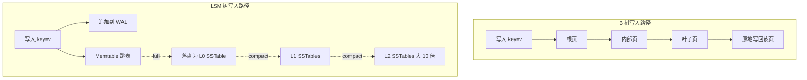
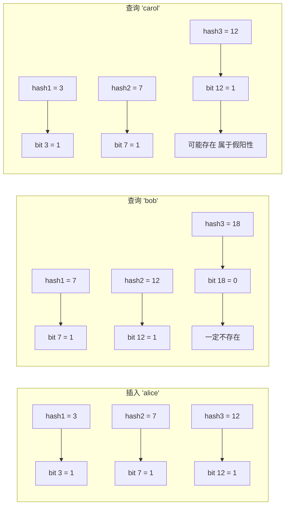
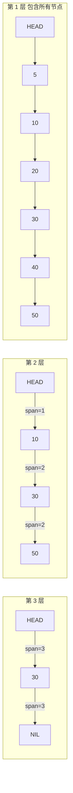
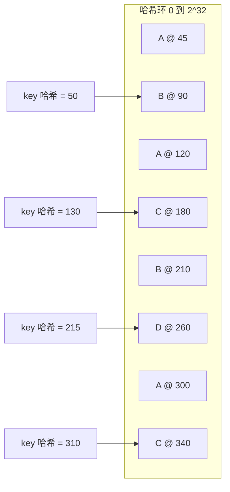

# 分布式系统常用的数据结构

> **TL;DR**: 想真正理解分布式系统，你只需要六种数据结构：哈希表负责 O(1) 查找，B 树负责读多写少数据库里的范围查询，LSM 树负责写多的存储，布隆过滤器是廉价的“这东西存在吗”预筛，跳表支撑高并发的有序集合，一致性哈希负责分片摆放。生产环境里每一个数据库、缓存和分片路由器，都是其中一种或几种的实例。

## 学习目标

学完这一节，你将能够：

- [ ] 解释为什么哈希表是分布式系统里点查的默认结构
- [ ] 针对给定负载，在 B 树和 LSM 树存储之间做出选择
- [ ] 在已知预期条目数和目标误判率的情况下，算出布隆过滤器该开多大
- [ ] 说明 Redis 有序集合如何用跳表实现 O(log n) 的范围查询
- [ ] 画出一致性哈希环，并解释虚拟节点为什么重要
- [ ] 认出这些结构在 RocksDB 这类真实系统里是如何拼装起来的

## 直觉理解

想象一个装着一亿件包裹的仓库。有三类问题你必须秒答：“X 号包裹在哪？”（点查），“把周一到周五发出的包裹全给我”（范围查询），“这件新包裹该进哪个仓库？”（路由）。

哈希表是货架上的标签：你用运单号算出格位，直接走过去。B 树是排好序的档案柜：你翻过一层层隔板，锁定一个区间。LSM 树是收货月台：包裹先快速堆在暂存区，夜间班组再慢慢把它们整理进固定货架。布隆过滤器是门口的快速一问：“这件包裹到底在不在本仓库？”——问完你再决定要不要进去走一圈。跳表是那部跳过若干楼层的直达电梯。一致性哈希则是路由单：它决定网络里哪个仓库接这件包裹，而且当你新开一个仓库时，不必重写所有路由单。

这六种结构是可以组合的。RocksDB 把它们全叠在一起：写入先落到跳表实现的 memtable，随后刷成有序的 SSTable，每个 SSTable 都带一个布隆过滤器，整个引擎前面通常还站着一个按一致性哈希分片的路由器。[^1] 你要做的，是搞清楚哪个结构解决哪个问题。

## 原理

### 哈希表

哈希表以平均 O(1) 的时间把 key 映射到 value。把 key 哈希成一个桶下标，用链地址法或开放寻址处理冲突，你就得到了能拿到的最快点查。多数实现会在负载因子越过 ~0.75 时重新哈希（把桶数组翻倍）。[^2]

哈希表是这些东西的骨架：

- **内存缓存**：Redis、Memcached，以及每种语言里的 `dict` 或 `HashMap`
- **分片路由**：`shard = hash(key) % N` 决定哪个服务器拥有某个 key
- **数据库索引**：PostgreSQL 的哈希索引、InnoDB 的自适应哈希索引[^3]
- **哈希连接**：SQL 查询规划器把一侧建成哈希表，再用另一侧去探测

**致命局限**：哈希表摧毁了顺序。你没法问哈希表“把 X 到 Y 之间的 key 全给我”。要做范围查询，就得上树。

**什么时候用**：点查、分片路由、去重，以及任何永远不需要范围扫描的键值访问。

### B 树与 LSM 树

这是磁盘存储引擎的两大主流。每个数据库都得选一边。

**B 树**：一棵平衡树，每个节点是一个磁盘页，装着几百个 key 和子指针。PostgreSQL 用 8 KB 的页[^4]，InnoDB 用 16 KB 的页。[^5] 读和写都从根走到叶子，花 O(log n) 次磁盘寻道。更新是原地改：把页写回它原来的位置。PostgreSQL、MySQL 和 Oracle 的主索引用的都是它。

**LSM 树**（Log-Structured Merge tree）：写入先追加到内存里的 memtable（通常是跳表），同时写一份预写日志（WAL）。memtable 满了就刷到磁盘，成为一个不可变的 Sorted String Table（SSTable）。后台压缩（compaction）把小 SSTable 合并成大 SSTable，并把它们组织成层级，每一层大约是上一层的 10 倍。[^1] 读的时候可能要查 memtable 加上每一层的一个文件，所以每个 SSTable 都带一个布隆过滤器，用来跳过不存在的 key。

*B 树从根走到叶子，然后原地把页写回；LSM 树只往 memtable 和 WAL 追加，剩下的排序交给压缩去处理。*

核心权衡是写放大。B 树为了一次单 key 更新，要重写一整页。一个 5 层、每层放大 10 倍的 LSM 树，总写放大大约 33 倍，而生产环境的实测值落在 10 倍到 30 倍之间。[^1] 这笔成本你付在后台压缩 I/O 上，换来的是前台写入的顺序化和高速。

**什么时候用 B 树**：读多的 OLTP、范围扫描，以及读延迟比写吞吐更重要的负载。

**什么时候用 LSM 树**：写多的负载、时序数据、追加密集的模式。RocksDB、Cassandra 和 ScyllaDB 用的都是 LSM 存储。（DynamoDB 虽然和 2007 年那篇启发了 LSM 思路的 Dynamo 论文同名，但按 2022 年的 USENIX ATC 论文所述，它内部用的是另一套存储架构[^6]；除名字之外，两个系统交集不多。）

### 布隆过滤器

布隆过滤器回答“这个 key 可能存在吗”，而占用的空间只是哈希集合的零头。它从不返回假阴性，但会以可调的比率返回假阳性。

机制是这样的：一个大小为 `m` 的位数组，加上 `k` 个哈希函数。插入时把 key 哈希 `k` 次，把这些位置 1。查询时检查这 `k` 位：只要有一位是 0，这个 key 一定不存在；如果全是 1，它可能存在。

给定目标误判率 `p` 和预期条目数 `n`：

- `m = -n * ln(p) / (ln 2)^2`
- `k = (m/n) * ln 2`

在 1% 的误判率下，算出来约是每项 9.6 比特、7 个哈希函数。[^7] RocksDB 默认每个 key 10 比特。[^8] 100 万条目、1% 误判率：位数组约 1.2 MB，而一个普通哈希集合要约 8 MB。

*插入时置起三位；“bob” 因为 bit 18 是 0 被排除，而 “carol” 的位和 alice 撞上了，于是返回一次假阳性。*

布隆过滤器在生产里出现在这些地方：

- **LSM 树的 SSTable**：过滤器说 key 不存在，就直接跳过这个文件的读取
- **CDN**：“这个 URL 我见过吗”，作为第一道筛查
- **Cassandra**：`bloom_filter_fp_chance` 默认 0.01（LeveledCompactionStrategy 下是 0.1）[^9]

> [!NOTE]
> 布隆过滤器不能删除条目。如果你的负载有删除操作，就用计数布隆过滤器（Counting Bloom Filter，占 4 倍空间），或者用布谷鸟过滤器（Cuckoo filter）——它支持删除，空间效率与标准布隆过滤器相当甚至更好（在误判率低于 3% 时尤其明显）。[^10]

**什么时候用**：在昂贵的磁盘或网络查询之前，拿它做一层廉价的存在性检查，也就是负缓存。

### 跳表

跳表是一条有序链表，外加若干条概率生成的“快车道”。每个新节点会被随机分配一个层级；层级越高，一次跨过的节点越多，期望查找代价 O(log n)。没有旋转，没有再平衡，并发实现比 AVL 树或红黑树简单得多。[^11]

Redis 用跳表实现有序集合（`ZADD`、`ZRANGE`、`ZRANK`）。Redis 源码注释里直接讲明了这个选择：对跳表做了三处改造——允许分数重复、分数相同时按附属元素比较、加一个第 1 层的回退指针以支持反向遍历。[^12] 每个节点还带一个按层记录的 span 计数，于是排名查询靠指数式跳跃做到 O(log n)，而不是线性走一遍。

Redis 设定 `ZSKIPLIST_P = 1/4`（每一层有 25% 的概率被采样）和 `ZSKIPLIST_MAXLEVEL = 64`，足以支撑数十亿条目的有序集合。[^12]

*层级越高，一次跨过的节点越多；Redis 按层存了 span 计数，于是 ZRANK 靠指数式跳跃在 O(log n) 内给出答案，而不是线性走一遍。*

LevelDB 和 RocksDB 的 memtable 用的也是跳表：写入落进一个并发跳表，排序顺序得以保持，等着最终刷成 SSTable。[^13]

**什么时候用**：需要有序操作，又想要比平衡树更简单的并发实现。Redis 排行榜、内存有序索引、LSM 的 memtable。

### 一致性哈希

问题出在这：你有 N 台缓存服务器。用 `hash(key) % N` 这种朴素分片，一旦 N 变了，几乎每个 key 都要重新映射，源站瞬间被海量缓存未命中踩塌。[^14]

解法是：把服务器摆到一个环上（0 到 2^32），key 也哈希到同一个环上。每个 key 归顺时针方向遇到的第一台服务器所有。增加或移除一台服务器，只搬动约 1/N 的 key，而不是全部。[^15]

**虚拟节点**解决的是“某台倒霉服务器分到一段巨大弧”的问题。每台物理服务器在环上被表示成 100 到 300 个点。[^15] 这让负载分布更均匀，也让再平衡变成增量式的。

*每个物理节点通过虚拟节点占据多段弧；一个 key 映射到顺时针方向的第一个 vnode，并复制到接下来 R 个不同的物理节点上。*

DynamoDB 用的就是带虚拟节点的一致性哈希，是 2007 年 Dynamo 设计的直系后裔。[^15] 2025 年 Prime Day，DynamoDB 峰值达到每秒 1.51 亿次请求，延迟维持在个位数毫秒。[^17]

**什么时候用**：需要让成员变化时重排量最小的分片。Dynamo 系数据库、分布式缓存、Kafka 的分区分配。

## 真实案例

### Discord 从 Cassandra 迁移到 ScyllaDB

Discord 用 LSM 存储存着数万亿条消息。他们的历程正好展示了这些数据结构在规模上如何相互作用。[^16]

2017 年，Discord 跑着 12 个 Cassandra 节点，存了几十亿条消息。到 2022 年初，已经长到 177 个节点、数万亿条消息。消息按频道和时间桶切分（一致性哈希），每个分片内部按 Snowflake ID 排序（LSM 树的顺序性），每个 SSTable 都带布隆过滤器，为不存在的 key 省掉磁盘读。

问题来了：Cassandra 的 JVM 垃圾回收在热分片上造成延迟尖刺。读 p99 延迟在 40 到 125 ms 之间波动，还周期性爆表。压缩跟不上，得靠人工轮转节点。

解法是迁到 ScyllaDB（同样的 LSM 架构，C++ 实现、每核一分片、没有 GC 停顿）。结果：

- **节点数**：177 个 Cassandra 降到 72 个 ScyllaDB（少了 60%）
- **读 p99**：从 40 到 125 ms 降到约 15 ms
- **写 p99**：从 5 到 70 ms 降到稳定约 5 ms
- **迁移速度**：用 Rust 写的迁移工具跑到每秒 320 万条消息；整个迁移花了 9 天

Discord 还加了一层 Rust 的 data-service，用基于一致性哈希的路由，让某个频道的所有请求都落到同一个服务实例上，从而实现请求合并：对同一频道的并发读变成一次数据库查询、N 个订阅者。[^16]

教训是：数据结构其实没变（LSM 树、布隆过滤器、一致性哈希），差的是实现质量——GC 停顿、压缩调度、每核分片的隔离性。

## 何时选用哪种结构

这一节里唯一真正对打的选项是 B 树与 LSM 树。另外四种结构（哈希表、布隆过滤器、跳表、一致性哈希）并不与它们竞争；它们是拼进更大的引擎里，或者解决另一类任务。

| 引擎 | 读 | 写 | 空间开销 | 最适用的场景 | 我们的选择 |
|--------|------|-------|----------------|-----------|----------|
| B 树 | O(log n)，每次查找走一条从根到叶的路径 | O(log n)，随机原地写页 | O(n)，每页有适度的空闲余量 | 读多的 OLTP，带范围扫描，且读延迟比写吞吐更重要 | PostgreSQL、MySQL/InnoDB 类负载 |
| LSM 树 | 最坏 O(log n)，要跨 memtable 和各层；布隆过滤器跳过不存在的 key | 摊还 O(1)，顺序追加；压缩付出 10 到 30 倍写放大 [^1] | O(n) 加上压缩翻搅，再加每个 SSTable 的布隆过滤器 | 写多的负载、时序数据、追加模式，且顺序写吞吐是主导因素 | Cassandra、RocksDB、ScyllaDB |

至于组合用的那几种结构，各自该在什么时候拿出来：

- **哈希表。** 用于永远不需要顺序的点查（内存缓存、分片键路由、哈希连接）。它在设计上就毁掉顺序；需要范围谓词时，绝不能用它替代 B 树。标准代价：读写平均 O(1)，负载因子 ~0.75 时重新哈希。[^2][^3]
- **布隆过滤器。** 配在任何昂贵的“这东西可能存在吗”检查之前，挡在磁盘或网络前面。标准配置是每项约 10 比特、7 个哈希函数，对应 1% 的误判率。[^7][^8] 经典搭配：LSM 的 SSTable、CDN 的 URL 缓存、Cassandra 的每 SSTable 过滤器[^9]。不能删除。需要删除就换布谷鸟过滤器[^10]。
- **跳表。** 需要有序原语、又想要简单并发（没有旋转和再平衡）时就上它。标准用法：Redis 有序集合（`ZADD`/`ZRANGE`，按层 span 计数让排名查询是 O(log n)）[^12]，以及 LevelDB/RocksDB 里刷 SSTable 之前的 memtable[^13]。
- **一致性哈希。** 用于成员可弹性伸缩的分片，加一台或减一台服务器只搬动约 1/N 的 key，而不是几乎全部[^14][^15]。永远配上每台物理服务器 100 到 300 个虚拟节点，让负载更均匀、再平衡可以增量进行。经典部署：DynamoDB[^6]、Cassandra、Memcached 客户端。

## 常见陷阱

> [!WARNING]
> **拿哈希索引做范围查询。** `WHERE created_at BETWEEN x AND y` 用不了哈希索引，因为哈希在设计上就毁掉顺序。查询规划器会退化成全表扫描。范围谓词请用 B 树索引。[^3]

> [!WARNING]
> **布隆过滤器开小了。** 如果按 10 万条目来定容，结果塞进 1000 万，误判率会从 1% 暴涨到实际上 50%。过滤器就不再过滤了。要盯着实际条目数和容量的比值。在 LSM 系统里，每次压缩都会给 SSTable 生成新的过滤器，所以能自愈；但应用层的布隆过滤器需要你手动扩容。[^7]

> [!CAUTION]
> **朴素的取模分片。** `hash(key) % N` 在 N 变化时几乎重映射所有 key。你第一次加分片，缓存命中率就崩，源站被踩穿。只要打算扩展，第一天就该用带虚拟节点的一致性哈希。[^14]

> [!WARNING]
> **忽视 LSM 的压缩停顿。** 当 L0 填满的速度快过压缩排空的速度，RocksDB 会限速，然后彻底停写（`level0_stop_writes_trigger`）。生产调优必须让 L1 的容量与 L0 相当，并提高压缩并行度。盯住 `STALL_MICROS` 计数器。[^1]

## 练习

> **设计挑战**：你在做一个短链服务。短码约 7 个字符，要存几十亿条 URL。每个进来的请求都要在 1 ms 内判断“这个短码以前生成过吗”。存储很便宜，但每台服务器只有 16 GB 内存。设计这个查找。

提示

你不需要把完整 URL 放进内存，只需要“这个短码存在吗”这个问题的快速否定答案。哪种数据结构能用每百万条目不到一兆字节的空间回答它？

答案

**第 1 步：前面挡一层布隆过滤器。** 100 亿条目、1% 误判率：`m = -10^10 * ln(0.01) / (ln 2)^2` = 约 960 亿比特 = 约 12 GB，7 个哈希函数。16 GB 内存塞得下。

每个请求把短码哈希 7 次、查位。只要有一位是 0，这个短码必然是新的，立刻返回，不碰磁盘。这一步为未知短码干掉了 99% 以上的磁盘读。

**第 2 步：真命中的走磁盘。** 对于过滤器说“可能存在”的短码，去分片的 RocksDB 实例（LSM 树）里查。每个分片自己带着每 SSTable 的布隆过滤器，所以顶层的一次假阳性也能很快收敛。

**第 3 步：一致性哈希路由。** 对短码做哈希来选分片。32 个分片、每个约 300 GB，是可以管的。每个分片做 3 副本以保证持久性。加一个分片只重新安置约 1/32 的 key。

**第 4 步：写入。** 新短码追加进 memtable（快速顺序写），随后刷成 SSTable。插入时更新顶层布隆过滤器。短链服务几乎不删除，所以布隆过滤器“不能删”的限制可以接受。

**延迟预算：**

- 布隆过滤器检查：约 100 ns（CPU 密集，7 次哈希计算）
- SSD 上的 RocksDB get：约 50 到 200 us
- 数据中心内的网络往返：约 500 us
- 合计：热读远低于 1 ms；404 在微秒级就能答完

这道练习把四种结构拼在了一起：布隆过滤器（存在性检查）、LSM 树（磁盘存储）、跳表（memtable）、一致性哈希（分片路由）。

## 要点回顾

- 哈希表是点查的默认选择。在顺序或范围查询逼你上树之前，一直用它。
- B 树赢在读多、带范围扫描的负载；LSM 树赢在写多、顺序追加的负载。两者都无处不在。
- 布隆过滤器用可调的误判率换巨大的空间节省（1% 误判率下每项约 10 比特，而哈希集合要 64 比特以上）。拿它做昂贵查找前的预筛。
- 跳表是平衡树更简单、对并发更友好的替代品。Redis 用它做有序集合，RocksDB 用它做 memtable。
- 一致性哈希让分片数可以弹性伸缩：加一个节点只搬动约 1/N 的数据。每台物理服务器永远配 100 到 300 个虚拟节点。
- 真实系统会把这些结构组合起来。RocksDB 里嵌着跳表、布隆过滤器、LSM 分层，外面还站着一个一致性哈希路由器。
- Discord 从 177 个 Cassandra 节点迁到 72 个 ScyllaDB 节点，把 p99 读延迟从 125 ms 压到 15 ms——同样的数据结构，更好的实现。[^16]

## 延伸阅读

- [Dynamo: Amazon's Highly Available Key-value Store](https://www.allthingsdistributed.com/files/amazon-dynamo-sosp2007.pdf) - DeCandia 等，SOSP 2007。一致性哈希 + 虚拟节点 + 宽松法定人数（sloppy quorum）的参考实现，开启了一代 NoSQL 数据库。
- [How Discord Stores Trillions of Messages](https://discord.com/blog/how-discord-stores-trillions-of-messages) - Bo Ingram，2023。完整的迁移数据，以及驯服热分片的请求合并模式。
- [RocksDB Tuning Guide](https://github.com/facebook/rocksdb/wiki/RocksDB-Tuning-Guide) - Facebook。生产环境 LSM 调优的权威参考；涵盖写放大、压缩策略和布隆过滤器定容。
- [Space/Time Trade-offs in Hash Coding with Allowable Errors](https://dl.acm.org/doi/10.1145/362686.362692) - Bloom，1970。布隆过滤器的原始论文；只有 10 页，出人意料地好读。
- [Skip Lists: A Probabilistic Alternative to Balanced Trees](https://homepage.cs.uiowa.edu/~ghosh/skip.pdf) - Pugh，1990。Redis 在源码注释里引用的那篇论文。
- [The Log-Structured Merge-Tree](https://www.cs.umb.edu/~poneil/lsmtree.pdf) - O'Neil 等，1996。LSM 树的原始论文；配合 DDIA 第 3 章一起读，能看到现代的语境。
- [Designing Data-Intensive Applications, Ch. 3](https://dataintensive.net/) - Kleppmann。讲 B 树与 LSM 树权衡最好的一章，带生产案例。

## 记忆卡片

**Q:** 什么情况下你会选 LSM 树而不是 B 树？
**A:** 写多的负载。LSM 把随机写转成顺序追加，对 SSD 友好得多。代价是更高的读放大和后台压缩成本（10 到 30 倍写放大）。

**Q:** 布隆过滤器会给出假阴性吗？
**A:** 不会，永远不会。如果布隆过滤器说“一定不存在”，那就是对的。它只可能给出假阳性（条目不存在时却说“可能存在”）。

**Q:** 往朴素的 `hash(key) % N` 分片里加一台服务器会发生什么？
**A:** N 变了，几乎所有 key 的取模结果都变了，于是几乎全部 key 同时搬迁。一致性哈希把搬迁量限制在约 1/N 的 key。

**Q:** 为什么 Redis 的有序集合用跳表而不是平衡树？
**A:** 跳表实现更简单（没有旋转），做并发也更容易，性能是相近的 O(log n)。Redis 还给它加了按层的 span 计数，让排名查询也是 O(log n)。[^12]

**Q:** 1% 误判率下，布隆过滤器每个条目需要多少比特？
**A:** 约 9.6 比特，配 7 个哈希函数。RocksDB 向上取整到每个 key 10 比特。

**Q:** LSM 树里的写放大是什么？
**A:** 写入磁盘的字节数与应用写入字节数的比值。数据逐层上迁时，压缩会重写它们。5 层的 RocksDB 配置大约 33 倍写放大；生产系统通常看到 10 到 30 倍。[^1]

**Q:** 一致性哈希里，每台物理服务器通常配多少个虚拟节点？
**A:** 100 到 300 个。虚拟节点能抹平负载不均，并让再平衡变成增量操作。

**Q:** 2025 年 Prime Day 上，什么系统的峰值达到每秒 1.51 亿次请求？
**A:** Amazon DynamoDB。它用的是带虚拟节点的一致性哈希，承自 2007 年的 Dynamo 论文。在那个峰值下，它维持了个位数毫秒的延迟。[^6]

## 参考文献

[^1]: Facebook, “RocksDB Tuning Guide”（写放大、布隆过滤器、分层压缩）。https://github.com/facebook/rocksdb/wiki/RocksDB-Tuning-Guide
[^2]: Kleppmann, DDIA Chapter 3, “Storage and Retrieval”，哈希索引一节。https://dataintensive.net/
[^3]: PostgreSQL 文档，“Index Types”（涵盖 B-tree、Hash、GiST、SP-GiST、GIN、BRIN）。https://www.postgresql.org/docs/current/indexes-types.html
[^4]: PostgreSQL 文档，“Database Page Layout”（默认 8 KB 页）。https://www.postgresql.org/docs/current/storage-page-layout.html
[^5]: Oracle MySQL 文档，“The Physical Structure of an InnoDB Index”（默认页大小 16 KB）。https://docs.oracle.com/cd/E17952_01/mysql-8.0-en/innodb-physical-structure.html
[^6]: Elhemali, Gallagher, Hunt, et al., “Amazon DynamoDB: A Scalable, Predictably Performant, and Fully Managed NoSQL Database Service”, USENIX ATC 2022. https://www.usenix.org/conference/atc22/presentation/elhemali
[^7]: Bloom, “Space/Time Trade-offs in Hash Coding with Allowable Errors”, CACM 1970. https://dl.acm.org/doi/10.1145/362686.362692
[^8]: Facebook, “RocksDB Bloom Filter” wiki. https://github.com/facebook/rocksdb/wiki/RocksDB-Bloom-Filter
[^9]: Apache Cassandra 文档，“Bloom Filters”（`bloom_filter_fp_chance` 默认值）。https://cassandra.apache.org/doc/stable/cassandra/managing/operating/bloom_filters.html
[^10]: Fan, Andersen, Kaminsky, Mitzenmacher, “Cuckoo Filter: Practically Better Than Bloom”, CoNEXT 2014. https://www.cs.cmu.edu/~binfan/papers/conext14_cuckoofilter.pdf
[^11]: Pugh, “Skip Lists: A Probabilistic Alternative to Balanced Trees”, CACM 1990. https://homepage.cs.uiowa.edu/~ghosh/skip.pdf
[^12]: Redis 源码，`src/t_zset.c`（有序集合实现）。https://github.com/redis/redis/blob/unstable/src/t_zset.c
[^13]: Dean and Ghemawat, “LevelDB documentation index”. https://github.com/google/leveldb/blob/main/doc/index.md
[^14]: “Consistent Hashing: The Algorithm Behind Every Scalable Distributed System”. https://backendbytes.com/articles/consistent-hashing-guide/
[^15]: DeCandia, Hastorun, Jampani, et al., “Dynamo: Amazon's Highly Available Key-value Store”, SOSP 2007. https://www.allthingsdistributed.com/files/amazon-dynamo-sosp2007.pdf
[^16]: Bo Ingram, “How Discord Stores Trillions of Messages”, Discord Engineering, 2023. https://discord.com/blog/how-discord-stores-trillions-of-messages
[^17]: Channy Yun, “AWS services scale to new heights for Prime Day 2025: Key metrics and milestones”, AWS Blog, 2025. https://aws.amazon.com/blogs/aws/aws-services-scale-to-new-heights-for-prime-day-2025-key-metrics-and-milestones/
