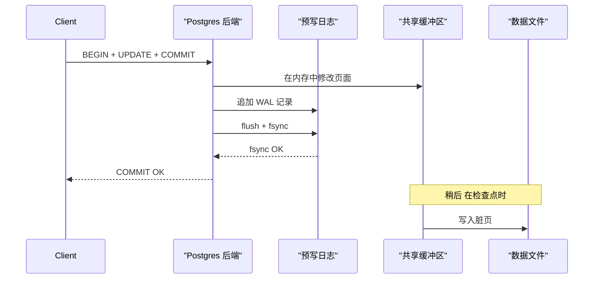
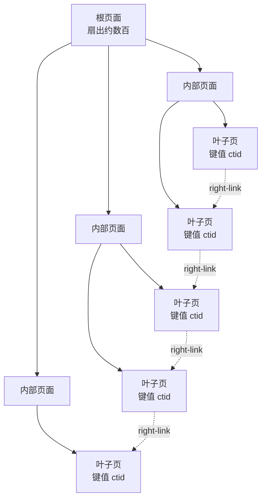
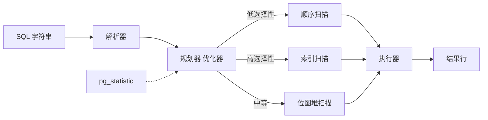
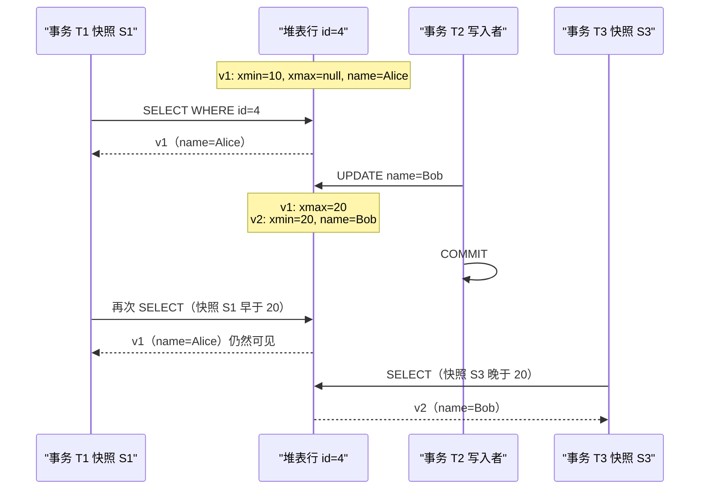

# 系统设计中的数据库基础

> **TL;DR**: 关系型数据库就是一个跑在存储引擎之上的 SQL 引擎：用 B 树索引找数据，用预写日志保证持久性，用 MVCC 保证隔离性。每加一个索引都会让某类查询变快，同时让所有写入变慢。隔离级别越强，能挡住的异常现象越多，但被中止的事务也越多。Postgres 默认是读已提交，页大小为 8 KB[^1]，不接连接池时连接数上限是 100[^2]。只要吃透这三对张力（读与写、隔离与吞吐、连接与内存），你就能从第一性原理出发预判生产环境里的大多数故障。

## 学习目标

学完本模块，你将能够：

- [ ] 用具体机制解释 ACID（WAL 负责持久性，MVCC 负责隔离性）
- [ ] 设计出能服务你的查询的复合索引，并能识别哪些索引在拖后腿
- [ ] 读懂 `EXPLAIN ANALYZE` 的执行计划，看出时间到底花在哪
- [ ] 按允许的异常现象区分隔离级别（脏读、幻读、写偏斜）
- [ ] 判断什么时候该范式化（OLTP），什么时候该反范式化（读多的信息流）
- [ ] 解释为什么生产环境的 Postgres 必须上连接池

## 直觉理解

把数据库想成一座图书馆，馆里有一位非常严格的管理员。她维护一套卡片目录（索引），让你几秒钟就能找到任何一本书，而不必把每个书架都翻一遍。她还有一本流水账（预写日志），每改动一处之前先记下来，所以万一楼里停电，她照着流水账重放一遍，什么都不会丢。她还有一条规矩：两个人可以同时读同一本书，但如果有人在改写某一页，其他读者在你改完之前看到的仍是旧版本（MVCC）。

每种超能力都有代价。卡片目录占地方，而且每本书一挪位置就得更新。流水账必须先落盘到持久存储，她才能说“好了”，这一下要几毫秒。而保留旧页面版本意味着总得有人定期清理（VACUUM）。作为系统设计者，你的工作就是理解这些代价，把它们花在对的地方。

## 原理

### ACID 与预写日志

ACID 是一个事务提供的保证契约[^3]：

- **原子性（Atomicity）**：全有或全无。任何一条语句失败，整个事务回滚。
- **一致性（Consistency）**：每次提交后，约束（外键、CHECK、唯一索引）都成立。
- **隔离性（Isolation）**：并发事务看不到彼此尚未完成的中间状态。
- **持久性（Durability）**：已提交的数据能扛住崩溃。

原子性和持久性共用同一套机制：**预写日志（WAL）**。每次修改都追加到 WAL 并 `fsync` 落盘，之后才告诉事务“提交成功”。[^4] 真正的数据页稍后在检查点里更新。数据库崩溃后，恢复过程从上一个检查点开始重放 WAL。不需要任何临时性的修补。



*持久性来自提交时对 WAL 的 fsync；数据文件在检查点被惰性更新，所以崩溃恢复只需要重放 WAL。*

> [!IMPORTANT]
> 每次提交都做 `fsync` 很贵（NVMe 上 1 到 10 ms）。组提交（group commit）把多个事务合并成一次 `fsync` 调用，摊薄这笔开销。`fsync` 为什么重要、组提交怎么工作，见 [操作系统基础](../part-0-prerequisites/01-os-essentials.md)。

### 隔离级别与异常现象

SQL 按允许哪些异常现象来定义四个隔离级别[^3]：

| 隔离级别 | 脏读 | 不可重复读 | 幻读 | 写偏斜 |
|-------|:---:|:---:|:---:|:---:|
| 读未提交 | 会 | 会 | 会 | 会 |
| 读已提交 | 不会 | 会 | 会 | 会 |
| 可重复读（快照） | 不会 | 不会 | Postgres 中不会 | 会 |
| 可串行化 | 不会 | 不会 | 不会 | 不会 |

**Postgres 默认使用读已提交。** 在这个级别下，每条语句看到一个新快照。你读了一行，另一个事务更新并提交了它，你下次再读就看到新值。对多数 Web 应用这没问题，但对不变量校验很危险。

**写偏斜（write skew）** 是最微妙的一种。两个事务各自读到一部分互不重叠的视图，各自基于读到的内容写入，两边都提交，合起来的结果破坏了某条不变量——而单独看谁都没破坏。例子：两位值班医生各自检查“还有别人在值班吗”，都看到有，于是都下线了。现在没人值班。[^5] 快照隔离（Postgres 的可重复读）允许这种情况发生。只有可串行化能挡住它。

**Postgres 的可串行化** 用的是可串行化快照隔离（SSI）：它在运行期检测读写依赖环，中止其中一个事务并返回 SQLSTATE 40001。[^3][^6] 应用必须在这个错误上重试。

> [!WARNING]
> **不要盲信“可串行化”。** 2020 年 Jepsen 发现 Postgres 12.3 的可串行化在涉及刚插入行的并发更新与插入场景下仍允许 G2-item 异常，这是 SSI 冲突检测里一个存在了九年的 bug。[^6] 保持 Postgres 小版本为最新，金融类负载要实打实测试隔离行为。

### 索引的内部结构与使用规则

索引是一种辅助数据结构，把全表扫描变成 O(log n) 的查找。[^7] Postgres 默认用 B 树（Lehman-Yao 变体，带 right-link 支持并发查找）。[^8]

B 树的内部结构见 [系统数据结构](./02-data-structures-for-systems.md)。做数据库设计要记住这几点：

- Postgres 的页是 8 KB。[^1] 每个内部页装几百个（键，子指针）对，所以即使几十亿行，树高也只有 3 到 5 层。[^9]
- 叶子页之间双向链接，支持两个方向的有序范围扫描。[^8]
- 一次索引查找每层摸一个页：约 3 到 5 次随机读，内存中约 10 us，冷盘上约 10 ms。



*扇出几百的 B 树能把几十亿行压在 3 到 5 层之内；双向链接的叶子页让范围扫描很高效。*

**复合索引的列顺序。** `(a, b)` 上的索引先按 `a` 排序，再按 `b`。只按 `a` 过滤、或按 `a AND b` 过滤的查询能用上它。只按 `b` 过滤的查询用不上。想想电话簿：先按姓排，再按名排。你能快速找到所有姓 Smith 的人，但找不到所有叫 John 的人。[^10]

**覆盖索引。** 如果查询需要的每一列都在索引里，Postgres 不用回表就能满足查询（Index Only Scan）。[^7] 用 `CREATE INDEX ... INCLUDE (col)` 可以附加载荷列而不改变排序顺序。

**部分索引。** `CREATE INDEX ... WHERE status = 'pending'` 只索引匹配的行。如果 1% 的订单处于 pending，这个索引比全量索引小 100 倍，照样能服务那个热查询。[^7]

**索引的代价。** 每次插入、以及每次触及被索引列的更新，都要更新每一个索引。Uber 记录过一个数字：在一张有 12 个索引的表上更新一个字段，需要 13 次物理更新（新元组加 12 次索引指针更新），每次都要写 WAL。[^11] 这种写放大直接促使他们在 2016 年从 Postgres 迁到 MySQL。

> [!TIP]
> 高写入表的主键用 UUIDv7（按时间有序），别用 UUIDv4（随机）。一份 Postgres 18 的基准测试显示，5000 万行的插入场景下 UUIDv4 比 UUIDv7 慢 11 倍，叶子页碎片率 50%，而 UUIDv7 是 0%。[^12]

### 查询执行与执行计划

一条 SQL 字符串要过三个阶段：**解析器**（构建 AST）、**规划器**（借 `pg_statistic` 里的表统计信息挑最便宜的计划）、**执行器**（执行计划）。[^13]



*低选择性的谓词规划器走顺序扫描，高选择性的走索引扫描；位图堆扫描处理中间地带，把零散的索引命中排成顺序的堆访问顺序。*

**怎么读 EXPLAIN ANALYZE 的输出：**

```sql
EXPLAIN (ANALYZE, BUFFERS)
SELECT * FROM orders WHERE user_id = 42 ORDER BY created_at DESC LIMIT 20;
```

每个节点会打印 `(cost=startup..total rows=N width=B)`，带 ANALYZE 时还会打印 `(actual time=start..total rows=N loops=M)`。估算的 `rows` 和实际的 `rows` 差得远，说明统计信息过期了。对该表跑一次 `ANALYZE`。[^13]

`BUFFERS` 选项会显示 `shared hit`（页缓存命中）和 `shared read`（读盘）。如果 `shared read` 占大头，说明你的工作集超出了内存。页缓存怎么工作，见 [操作系统基础](../part-0-prerequisites/01-os-essentials.md)。

> [!TIP]
> `EXPLAIN ANALYZE` 会真的执行查询，副作用也一起发生。把有破坏性的查询包在 `BEGIN; ... ROLLBACK;` 里，就能只看到计划而不提交改动。

### MVCC 读写互不阻塞

多版本并发控制（MVCC）为每一行保留多个版本，让读者拿到一致的快照，同时不必锁住写者。[^14]

**Postgres 的实现：** 每一行都有 `xmin`（插入它的事务 ID）和 `xmax`（删除或更新它的事务 ID）。执行 UPDATE 时，Postgres 写一个新元组，并把旧元组的 `xmax` 标记上。旧版本一直留着，直到 VACUUM 回收。[^14][^11] 每个事务拿到一个快照：如果一个元组的 `xmin` 在快照之前已提交，而 `xmax` 尚未提交或在快照之后才提交，这个元组就可见。



*Postgres 的 MVCC 每次 UPDATE 都写一个新元组；读者看到的是 xmin 在自己的快照之前已提交的那个版本，从不阻塞写者。*

**VACUUM 的代价。** 死元组会不断堆积，直到 VACUUM 回收它们。如果 VACUUM 跟不上（长事务拖住了最老的快照），表和索引就会无限膨胀。Notion 在 2021 年做分片，恰恰是被 VACUUM 卡住、事务 ID 逼近 20 亿上限、面临回绕风险逼出来的。[^15]

**InnoDB 的做法：** 旧版本存在 undo log（回滚段）里，而不在主表中。堆表里只保留最新版本，清理起来更便宜，但重建旧快照更慢。[^11]

### 范式化与反范式化

**范式化** 让每个事实只存一份，存在该事实的键所在的那张表里。3NF 模式把写入异常和存储开销降到最低。

**反范式化** 复制事实，让读取跳过 JOIN。社交信息流是经典例子：发帖时，帖子的 ID 扇出写进每个关注者预计算好的时间线（在 Redis 里），把读取时的一次 `JOIN posts ON followers` 换成 O(1) 的列表查找。

| 方案 | 写入 | 读取 | 适用场景 |
|----------|--------|-------|-----------|
| 范式化（3NF） | 数据量小、干净、只需改一处 | 需要 JOIN | OLTP、数据频繁变更、写多读少 |
| 反范式化 | 写放大（扇出） | O(1)、无 JOIN、可缓存 | 信息流、看板、读写比大于 100:1 |

**经验法则：** 事实源头用范式化，读取路径用反范式化。两者之间用一条复制管道（CDC、事件流）连起来。[存储引擎](../../../hld/part-4-data-systems/00-storage-engines.md) 接着讲这个话题，展示生产数据库如何实现这两种形态。

### 连接池

Postgres 是每连接一个进程的模型。每个后端进程占 5 到 10 MB 常驻内存。[^2] 默认 `max_connections` 是 100。[^2] 一个 20 实例、每个开 50 连接的 Web 应用需要 1000 个连接，是默认值的 10 倍，光后端进程就要吃掉 5 到 10 GB 内存。

**PgBouncer** 把成千上万个应用连接复用到一小池真实的 Postgres 后端上。[^16] 在 `transaction` 池化模式下，后端在一个事务期间分配给某个客户端，事务一结束立刻归还。这是高并发 Web 应用在生产环境的默认做法。

- `default_pool_size`：每个用户与数据库对的服务端连接数，默认 20[^16]
- `max_client_conn`：生产环境提到 10000 以上[^16]
- Figma 专门引入 PgBouncer，就是为了给应用打开的那几千个连接设上限。[^17]

> [!WARNING]
> **事务级池化会破坏会话状态。** 会话级的 `SET`、跨语句的咨询锁、`WITH HOLD` 游标、会话级预备语句，在事务池化下全都会失效。把应用设计成事务之间无状态。

## 真实案例

**Figma：从单实例 Postgres 到水平分片。**

2020 年，Figma 跑在一个 `r5.12xlarge` 的 Postgres RDS 实例上，峰值 CPU 达到 65%。[^17] 从 2020 到 2024 年，他们的数据库集群规模涨了约 100 倍。[^18]

**第一阶段：纵向拆分（2022 年）。** 把相关表的组（“Figma 文件”、“组织”）搬到各自独立的物理数据库上，每个库前面挂 PgBouncer。迁移用 Postgres 逻辑复制完成，初始拷贝前先删掉索引、拷完再重建，避免逐行更新索引慢得离谱。[^17] 到 2022 年 10 月，他们搬完了 50 张表，每次迁移造成约 30 秒的部分可用性影响。

**第二阶段：水平分片（2023 年）。** 一个叫 DBProxy 的 Go 服务夹在应用和 PgBouncer 之间，把 SQL 解析成 AST，抽出分片键（UserID、FileID、OrgID），路由到正确的物理分片。[^18] 他们选择哈希路由，避免自增 ID 造成热点。第一张水平分片的表在 2023 年 9 月上线，造成 10 秒的部分主库可用性影响，副本无影响。[^18]

**这对基础概念意味着什么：** Figma 迁移中的每一个决定，都能追溯到本章的概念。他们需要 PgBouncer，是因为连接数上限。他们需要理解索引重建的代价。他们需要判断哪些表会被一起查询（范式化边界）。他们放弃了 CockroachDB 和 Vitess，因为迁移风险太大，选择留在 Postgres 上、在应用层做分片。[^18]

## 设计决策

本章唯一一个“同一件事有两种可替换形态”的决策，是范式化与反范式化。完整讨论见 [范式化与反范式化](#范式化与反范式化)。

| 方案 | 写入 | 读取 | 适用场景 | 我们的选择 |
|----------|--------|-------|-----------|----------|
| 范式化（3NF） | 数据量小、干净、只需改一处 | 需要 JOIN | OLTP、数据频繁变更、写多读少 | **新项目的默认选择** |
| 反范式化 | 写放大（扇出） | O(1)、无 JOIN、可缓存 | 信息流、看板、读写比大于 100:1 | 只用于已被证实的读热点 |

本章另外四个决策不是二选一。它们是按表、按事务、按查询各自做出的独立判断，每一个都在其原生小节里讲透了：

- **要不要加索引。** 见 [索引的内部结构与使用规则](#索引的内部结构与使用规则)。加之前和加之后都要用 `EXPLAIN ANALYZE` 量一遍。
- **用哪个隔离级别。** 见 [隔离级别与异常现象](#隔离级别与异常现象)。涉及钱或库存这类关键不变量的场景用可串行化；其余场景读已提交就是 Postgres 的默认选择。
- **索引该不该做成覆盖索引（`INCLUDE`）。** 见 [索引的内部结构与使用规则](#索引的内部结构与使用规则)。这是“加索引”这件事的细化，不是一个独立选项：只有当 `EXPLAIN` 显示某个已知热查询在回表取堆时，才加上 `INCLUDE` 列。

## 常见陷阱

> [!WARNING]
> **N+1 查询问题。** 你的 ORM 先取了 100 个用户，然后为每个用户的帖子各跑一次查询。这就是 101 次往返。用 `JOIN`、`IN (...)` 或 DataLoader 风格的批量加载。检测方法：`pg_stat_statements` 里会看到大量几乎相同的查询成批出现。

> [!WARNING]
> **索引过多。** 每个索引都会拖慢写入、占用磁盘。一张有 12 个索引的表，写入量是没有索引的表的 13 倍。[^11] 永远不要“以防万一”加索引。加之前和加之后都跑 `EXPLAIN ANALYZE`。用 `pg_stat_user_indexes` 找出没用的索引删掉（看 `idx_scan = 0`）。

> [!WARNING]
> **快照隔离下的写偏斜。** 两个事务各自读一个条件，各自基于它写入，两边都提交，合起来的结果破坏了不变量。Postgres 的可重复读挡不住这个。涉及关键不变量的检查要用可串行化，或者显式加 `SELECT ... FOR UPDATE` 锁。[^5]

> [!WARNING]
> **不上连接池导致连接耗尽。** Postgres 默认 100 个连接，每个后端 5 到 10 MB，很快就撞上内存上限。生产环境一定要用 PgBouncer（或应用侧池化）。把 `idle_in_transaction_session_timeout` 设上，杀掉游荡的会话。[^2]

> [!WARNING]
> **长事务造成 MVCC 膨胀。** 一个开着几分钟的事务会拖住 VACUUM。死元组堆积、索引膨胀，还有事务 ID 回绕的风险（Postgres 在逼近 20 亿 XID 上限时会拒绝写入）。[^15] 事务保持在秒级以内。绝不在事务里做网络 I/O。

## 练习

> **设计挑战**：你对一张 1000 万行的 `events` 表跑 `EXPLAIN ANALYZE`，看到一次顺序扫描花了 4.2 秒。查询是 `SELECT * FROM events WHERE user_id = 123 AND created_at > '2026-01-01' ORDER BY created_at DESC LIMIT 50`。你会加什么索引，又怎么验证它生效？

<details>
<summary>提示</summary>

想想 WHERE 和 ORDER BY 里出现了哪些列。如果列顺序和查询模式对得上，一个复合索引可以同时服务过滤和排序。“最左前缀”规则在这里适用。

</details>

<details>
<summary>参考答案</summary>

**索引：**

```sql
CREATE INDEX idx_events_user_created ON events (user_id, created_at DESC);
```

这个复合索引同时满足了 `WHERE user_id = 123`（第一列上的等值条件）和 `ORDER BY created_at DESC`（第二列本来就已经按正确方向排好）。规划器可以做索引扫描，顺着叶子页走，取到 50 行就停，完全不用排序。

**验证：**

```sql
EXPLAIN (ANALYZE, BUFFERS)
SELECT * FROM events WHERE user_id = 123 AND created_at > '2026-01-01'
ORDER BY created_at DESC LIMIT 50;
```

你应该看到：

- 走的是 `idx_events_user_created` 上的 `Index Scan`（不是 Seq Scan）
- `actual time` 在微秒到低毫秒级（不是 4.2 秒）
- `rows=50`，没有单独的 Sort 节点（顺序由索引提供）

**如果需要覆盖索引**（彻底避免回表）：

```sql
CREATE INDEX idx_events_cover ON events (user_id, created_at DESC)
INCLUDE (event_type, payload);
```

只要查询选的正是这些列，现在就能用 Index Only Scan 满足。验证方法是看 EXPLAIN 输出里有没有 `Index Only Scan` 和 `Heap Fetches: 0`。

**接受的权衡：** 这个索引会让每次插入 `events` 稍微变慢，并占用与表大小成正比的磁盘。对一张 1000 万行、读多写少的表来说，这笔代价是值得的。

</details>

## 要点回顾

- ACID 是四条保证，各有具体机制：WAL 负责原子性和持久性，MVCC 或锁负责隔离性，约束负责一致性。
- 每个索引都会让某一类查询变快、让所有写入变慢。加索引之前先用 `EXPLAIN ANALYZE` 量。
- Postgres 默认读已提交。在选更弱或更强的隔离级别之前，先搞懂写偏斜。
- MVCC 带来非阻塞读取，但需要 VACUUM 回收死元组。长事务是敌人。
- 事实源头做范式化，读取路径做反范式化。两者用复制连起来。
- 连接池（事务模式的 PgBouncer）对生产环境的 Postgres 是必需的。默认 100 个连接撑不住现代 Web 应用。
- 高写入表的主键用 UUIDv7 而不是 UUIDv4，保住 B 树的局部性。

## 延伸阅读

- [PostgreSQL Concurrency Control (Chapter 13)](https://www.postgresql.org/docs/current/mvcc.html) - Postgres MVCC 与隔离级别的权威参考，含写偏斜和 SSI 行为的具体 SQL 示例。
- [PostgreSQL Using EXPLAIN (14.1)](https://www.postgresql.org/docs/current/using-explain.html) - 读懂计划节点、ANALYZE 和 BUFFERS 的权威指南；做任何索引调优之前必读。
- [Use the Index, Luke (Markus Winand)](https://use-the-index-luke.com/) - 讲 SQL 索引的免费书；“Concatenated Indexes” 一章用电话簿类比讲清了复合索引的列顺序。
- [Designing Data-Intensive Applications, Ch. 3 and 7](https://dataintensive.net/) - Kleppmann 论存储引擎与事务；本章的深度就以此为参照。
- [Why Uber Switched from Postgres to MySQL](https://www.uber.com/blog/postgres-to-mysql-migration/) - 关于二级索引指针造成写放大的最清晰的公开解释；它说明了为什么要谨慎设计索引。
- [Notion: Sharding Postgres at Notion](https://www.notion.com/blog/sharding-postgres-at-notion) - 32 个物理库上 480 个逻辑分片，起因是 VACUUM 卡住、事务 ID 面临回绕。
- [How Figma's Databases Team Lived to Tell the Scale](https://www.figma.com/blog/how-figmas-databases-team-lived-to-tell-the-scale/) - DBProxy、逻辑分片与物理分片，以及在 Postgres 上做哈希路由。
- [Jepsen: PostgreSQL 12.3](https://jepsen.io/analyses/postgresql-12.3) - Kyle Kingsbury 的隔离性测试，揪出一个九年前就存在的可串行化 bug；提醒你要去测试，而不是相信。

## 记忆卡片

**Q:** 预写日志（WAL）保证了什么？
**A:** 原子性和持久性。修改在 COMMIT 返回之前就追加到 WAL 并 fsync。崩溃后，恢复过程从上一个检查点开始重放 WAL。

**Q:** Postgres 的默认隔离级别是什么？
**A:** 读已提交。每条语句看到一个新快照。在一个事务内部，不可重复读和幻读都可能发生。

**Q:** 为什么 `(a, b)` 上的索引帮不了只按 `b` 过滤的查询？
**A:** 索引先按 `a` 排序。没有已知的 `a` 值，数据库无法缩小 `b` 值所在的范围，只能扫整个索引（或者退化成全表扫描）。

**Q:** 什么是写偏斜，哪个隔离级别能挡住它？
**A:** 两个事务各自读一个条件，各自基于它写入，两边都提交，合起来的结果破坏了不变量。只有可串行化能挡住。快照隔离（Postgres 的可重复读）挡不住。

**Q:** MVCC 给你换来了什么，代价是什么？
**A:** 读者从不阻塞写者，写者从不阻塞读者（非阻塞并发）。代价是死元组堆积、需要 VACUUM，以及 VACUUM 跟不上时的膨胀和事务 ID 回绕风险。

**Q:** 为什么生产环境的 Postgres 必须上连接池？
**A:** Postgres 每连接一个进程，每个后端 5 到 10 MB。默认 max_connections 是 100。事务模式的 PgBouncer 让几千个应用连接共享约 20 个真实后端。

**Q:** `EXPLAIN ANALYZE` 能显示哪些 `EXPLAIN` 单独看不到的东西？
**A:** 实际执行耗时、实际行数、循环次数。单用 EXPLAIN 只有规划器的估算值，统计信息过期时可能错得离谱。

**Q:** 什么时候该反范式化？
**A:** 当读远多于写（100:1 以上）、查询时 JOIN 太贵、且被复制的数据不常变。经典例子：社交信息流、看板、物化视图。

**Q:** 是什么触发了 Notion 在 2021 年对 Postgres 做分片？
**A:** 长事务造成的 VACUUM 卡顿，让事务 ID 逼近 20 亿上限、面临回绕。为了保护数据完整性，Postgres 会拒绝所有写入。

**Q:** 为什么 UUIDv4 不适合做 B 树主键？
**A:** 随机值让插入落到不同的叶子页，引发页分裂和缓存冷未命中。UUIDv7（按时间有序）保住插入的局部性：基准测试里插入快 11 倍，叶子碎片率 0%，而 v4 是 50%。

## 参考文献

[^1]: PostgreSQL Global Development Group. “66.6. Database Page Layout” (default 8 kB page size). PostgreSQL Documentation (current). https://www.postgresql.org/docs/current/storage-page-layout.html
[^2]: PostgreSQL Global Development Group. “19.3. Connections and Authentication.” PostgreSQL Documentation (current). https://www.postgresql.org/docs/current/runtime-config-connection.html
[^3]: PostgreSQL Global Development Group. “13.2. Transaction Isolation.” PostgreSQL Documentation (current). https://www.postgresql.org/docs/current/transaction-iso.html
[^4]: PostgreSQL Global Development Group. “28. Reliability and the Write-Ahead Log.” PostgreSQL Documentation (current). https://www.postgresql.org/docs/current/wal.html
[^5]: Berenson, H., Bernstein, P., Gray, J., Melton, J., O'Neil, E., O'Neil, P. “A Critique of ANSI SQL Isolation Levels.” SIGMOD 1995. https://www.microsoft.com/en-us/research/publication/a-critique-of-ansi-sql-isolation-levels/
[^6]: Kingsbury, K. “PostgreSQL 12.3.” Jepsen Analyses, 2020-06-12. https://jepsen.io/analyses/postgresql-12.3
[^7]: PostgreSQL Global Development Group. “11. Indexes.” PostgreSQL Documentation (current). https://www.postgresql.org/docs/current/indexes.html
[^8]: postgres/postgres: `src/backend/access/nbtree/README` (Lehman-Yao B-tree implementation). https://github.com/postgres/postgres/blob/master/src/backend/access/nbtree/README
[^9]: Winand, M. “Anatomy of an Index.” Use the Index, Luke. https://use-the-index-luke.com/sql/anatomy
[^10]: Winand, M. “Concatenated Indexes.” Use the Index, Luke. https://use-the-index-luke.com/sql/where-clause/the-equals-operator/concatenated-keys
[^11]: Klitzke, E. “Why Uber Engineering Switched from Postgres to MySQL.” Uber Engineering Blog, 2016-07-26. https://www.uber.com/blog/postgres-to-mysql-migration/
[^12]: Machytka, J. “A deeper look at old UUIDv4 vs new UUIDv7 in PostgreSQL 18.” credativ Blog, 2025-12-05. https://www.credativ.de/en/blog/postgresql-en/a-deeper-look-at-old-uuidv4-vs-new-uuidv7-in-postgresql-18/
[^13]: PostgreSQL Global Development Group. “14.1. Using EXPLAIN.” PostgreSQL Documentation (current). https://www.postgresql.org/docs/current/using-explain.html
[^14]: PostgreSQL Global Development Group. “13.1. Introduction (MVCC).” PostgreSQL Documentation (current). https://www.postgresql.org/docs/current/mvcc-intro.html
[^15]: Fidalgo, G. “Herding elephants: Lessons learned from sharding Postgres at Notion.” Notion Blog, 2021-10-06. https://www.notion.com/blog/sharding-postgres-at-notion
[^16]: PgBouncer. “Configuration Reference.” https://www.pgbouncer.org/config.html
[^17]: Liang, T. “The growing pains of database architecture.” Figma Blog, 2023-04-04. https://www.figma.com/blog/how-figma-scaled-to-multiple-databases/
[^18]: Steele, S. “How Figma's databases team lived to tell the scale.” Figma Blog, 2024-03-14. https://www.figma.com/blog/how-figmas-databases-team-lived-to-tell-the-scale/
